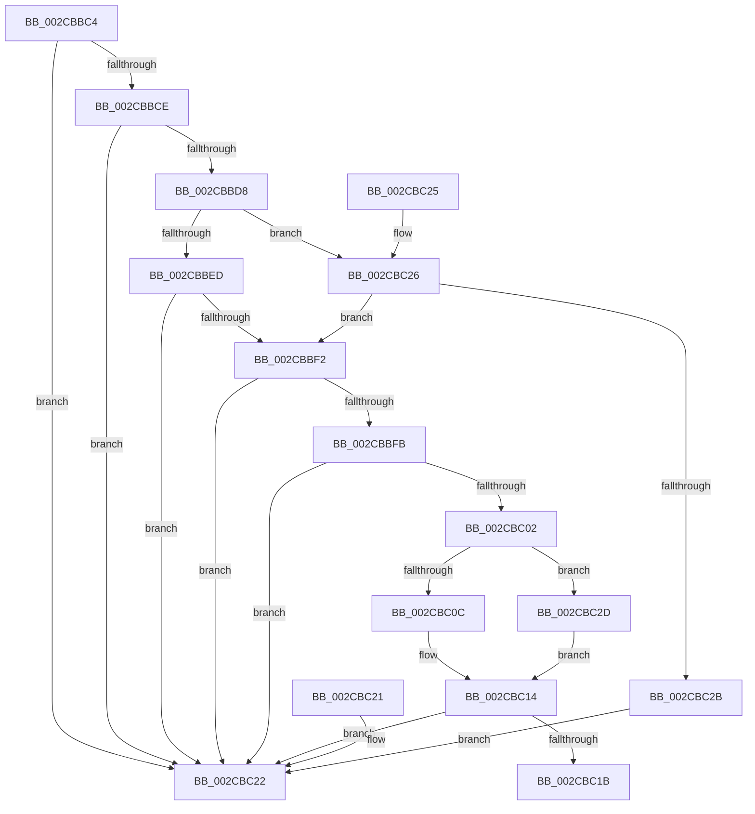

# MiZeroPageLogEntriesMergable

- RVA: `0x002CBBC4`–`0x002CBC36` (길이 `114` bytes)
- VA: `0x00000001402CBBC4`
- 실행 섹션: `.text`
- PDB 이름 있음: `예`; PDB Function 태그: `아니요`
- unwind 정보 RVA: `0x000DB714`
- 디코드: `43`개 명령, `114/114` bytes 표시
- 미해석 바이트: `0` (있으면 어셈블리에 `.byte`로 보존)

> 이 문서는 커널 이미지의 기계어와 PDB 기호를 분석해 생성했습니다. 4번과 5번은 함수 원형과 자료형을 바이너리 사용 방식에서 추정한 C 해석이며 원본 소스 복구 결과는 아닙니다.

## 1. Dependencies

- 직접 호출 지점: **0**; 고유 호출 대상: **0**
- 직접 호출자로 확인된 함수: **1**
- RIP 상대 이미지 참조: **0**

### Outgoing calls
- 직접 디코드된 call 명령이 없습니다.

### Direct callers
- [MiLogZeroPageDecision](MiLogZeroPageDecision_function_002CD090.md) at `0x002CD177`

### Static image references
- 디코드된 RIP-relative 메모리 참조가 없습니다.

## 2. Other-region calls and transfers

- 다른 실행 섹션으로 향하는 call: **0**
- 별도 외부 분기/꼬리 이동을 확인하지 못했습니다.

## 3. Assembly (complete function range)

```asm
002CBBC4  0F B7 42 08                     movzx eax, word ptr [rdx + 8]
002CBBC8  66 39 41 08                     cmp word ptr [rcx + 8], ax
002CBBCC  75 54                           jne 0x1402cbc22
002CBBCE  0F B7 42 0A                     movzx eax, word ptr [rdx + 0xa]
002CBBD2  66 39 41 0A                     cmp word ptr [rcx + 0xa], ax
002CBBD6  75 4A                           jne 0x1402cbc22
002CBBD8  44 8A 42 0C                     mov r8b, byte ptr [rdx + 0xc]
002CBBDC  41 B1 04                        mov r9b, 4
002CBBDF  8A 41 0C                        mov al, byte ptr [rcx + 0xc]
002CBBE2  41 80 E0 0F                     and r8b, 0xf
002CBBE6  24 0F                           and al, 0xf
002CBBE8  41 3A C1                        cmp al, r9b
002CBBEB  77 39                           ja 0x1402cbc26
002CBBED  45 3A C1                        cmp r8b, r9b
002CBBF0  77 30                           ja 0x1402cbc22
002CBBF2  44 8B 01                        mov r8d, dword ptr [rcx]
002CBBF5  41 F6 C0 01                     test r8b, 1
002CBBF9  75 27                           jne 0x1402cbc22
002CBBFB  8B 12                           mov edx, dword ptr [rdx]
002CBBFD  F6 C2 01                        test dl, 1
002CBC00  75 20                           jne 0x1402cbc22
002CBC02  B8 CD CC CC CC                  mov eax, 0xcccccccd
002CBC07  44 3B C2                        cmp r8d, edx
002CBC0A  72 21                           jb 0x1402cbc2d
002CBC0C  41 8B C8                        mov ecx, r8d
002CBC0F  2B CA                           sub ecx, edx
002CBC11  41 F7 E0                        mul r8d
002CBC14  C1 EA 03                        shr edx, 3
002CBC17  3B CA                           cmp ecx, edx
002CBC19  77 07                           ja 0x1402cbc22
002CBC1B  B8 01 00 00 00                  mov eax, 1
002CBC20  C3                              ret
002CBC21  CC                              int3
002CBC22  33 C0                           xor eax, eax
002CBC24  C3                              ret
002CBC25  CC                              int3
002CBC26  45 3A C1                        cmp r8b, r9b
002CBC29  77 C7                           ja 0x1402cbbf2
002CBC2B  EB F5                           jmp 0x1402cbc22
002CBC2D  8B CA                           mov ecx, edx
002CBC2F  41 2B C8                        sub ecx, r8d
002CBC32  F7 E2                           mul edx
002CBC34  EB DE                           jmp 0x1402cbc14
```

## 4. C-style interpretation (structured pseudocode)

```c
__int64 __fastcall MiZeroPageLogEntriesMergable(__int64 a1, __int64 a2)
{
    __int64 result;

    if ((*(unsigned __int16 *)(a1 + 8)) != ((unsigned __int16)(*(unsigned __int16 *)(a2 + 8)))) goto loc_002CBC22;
    if ((*(unsigned __int16 *)(a1 + 10)) != ((unsigned __int16)(*(unsigned __int16 *)(a2 + 10)))) goto loc_002CBC22;
    a3 = (unsigned __int8)((*(unsigned __int8 *)(a2 + 12)) & (15));
    result = (unsigned __int8)((*(unsigned __int8 *)(a1 + 12)) & (15));
    if (((unsigned __int8)(result)) > 4) goto loc_002CBC26;
    if (((unsigned __int8)(a3)) > 4) goto loc_002CBC22;
loc_002CBBF2:
    if ((((unsigned __int8)((unsigned int)(*(unsigned int *)(a1)))) & (1)) != 0) goto loc_002CBC22;
    if ((((unsigned __int8)((unsigned int)(*(unsigned int *)(a2)))) & (1)) != 0) goto loc_002CBC22;
    if (((unsigned int)((unsigned int)(*(unsigned int *)(a1)))) < ((unsigned int)((unsigned int)(*(unsigned int *)(a2))))) goto loc_002CBC2D;
    a1 = (unsigned int)(((unsigned int)((unsigned int)((unsigned int)(*(unsigned int *)(a1))))) - ((unsigned int)((unsigned int)(*(unsigned int *)(a2)))));
loc_002CBC14:
    a2 = (unsigned int)(((unsigned int)(*(unsigned int *)(a2))) >> (3));
    if (((unsigned int)(a1)) > ((unsigned int)(a2))) goto loc_002CBC22;
    return 1;
loc_002CBC22:
    result = 0;
    return result;
loc_002CBC26:
    if (((unsigned __int8)((unsigned int)(*(unsigned int *)(a1)))) > 4) goto loc_002CBBF2;
    goto loc_002CBC22;
loc_002CBC2D:
    a1 = (unsigned int)(((unsigned int)((unsigned int)(a2))) - ((unsigned int)((unsigned int)(*(unsigned int *)(a1)))));
    goto loc_002CBC14;
}
```

## 5. (Beta) C Style

```c
int64_t MiZeroPageLogEntriesMergable(void *Arg1, void *Arg2)
{
    uint8_t *arg1 = (uint8_t *)Arg1;
    uint8_t *arg2 = (uint8_t *)Arg2;

    int64_t result;

    if ((*(uint16_t *)(arg1 + 0x8)) != ((uint16_t)(*(uint16_t *)(arg2 + 0x8)))) goto loc_002CBC22;
    if ((*(uint16_t *)(arg1 + 0xA)) != ((uint16_t)(*(uint16_t *)(arg2 + 0xA)))) goto loc_002CBC22;
    a3 = (uint8_t)((*(uint8_t *)(arg2 + 0xC)) & (15));
    result = (uint8_t)((*(uint8_t *)(arg1 + 0xC)) & (15));
    if (((uint8_t)(result)) > 4) goto loc_002CBC26;
    if (((uint8_t)(a3)) > 4) goto loc_002CBC22;
loc_002CBBF2:
    if ((((uint8_t)((uint32_t)(*(uint32_t *)(arg1)))) & (1)) != 0) goto loc_002CBC22;
    if ((((uint8_t)((uint32_t)(*(uint32_t *)(arg2)))) & (1)) != 0) goto loc_002CBC22;
    if (((uint32_t)((uint32_t)(*(uint32_t *)(arg1)))) < ((uint32_t)((uint32_t)(*(uint32_t *)(arg2))))) goto loc_002CBC2D;
    Arg1 = (uint32_t)(((uint32_t)((uint32_t)((uint32_t)(*(uint32_t *)(arg1))))) - ((uint32_t)((uint32_t)(*(uint32_t *)(arg2)))));
loc_002CBC14:
    Arg2 = (uint32_t)(((uint32_t)(*(uint32_t *)(arg2))) >> (3));
    if (((uint32_t)(Arg1)) > ((uint32_t)(Arg2))) goto loc_002CBC22;
    return 1;
loc_002CBC22:
    result = 0;
    return result;
loc_002CBC26:
    if (((uint8_t)((uint32_t)(*(uint32_t *)(arg1)))) > 4) goto loc_002CBBF2;
    goto loc_002CBC22;
loc_002CBC2D:
    Arg1 = (uint32_t)(((uint32_t)((uint32_t)(Arg2))) - ((uint32_t)((uint32_t)(*(uint32_t *)(arg1)))));
    goto loc_002CBC14;
}
```

### 관측된 메모리 오프셋

구조체 형식이 확인되지 않은 접근은 인자 기준의 오프셋으로만 기록했습니다.

| 기준 인자 | 오프셋 표현 | 폭 (bit) | 접근 |
|---|---:|---:|---|
| `Arg1` | `+ 0x0` | `32` | `R` |
| `Arg1` | `+ 0x8` | `16` | `R` |
| `Arg1` | `+ 0xA` | `16` | `R` |
| `Arg1` | `+ 0xC` | `8` | `R` |
| `Arg2` | `+ 0x0` | `32` | `R` |
| `Arg2` | `+ 0x8` | `16` | `R` |
| `Arg2` | `+ 0xA` | `16` | `R` |
| `Arg2` | `+ 0xC` | `8` | `R` |

## 6. Execution-region graph

[열기: 2D/3D 그래프와 함수 탐색 컨트롤 패널](../../../control-panel.html?section=text&rva=0x002CBBC4&view=graph)

- 2D 그래프는 위에서 아래로 흐르고, 3D 그래프는 빈 공간을 드래그해 회전합니다. Shift+드래그는 이동, 휠은 확대·축소, 함수 노드 선택은 대상 보고서 이동입니다.

### Static fallback


