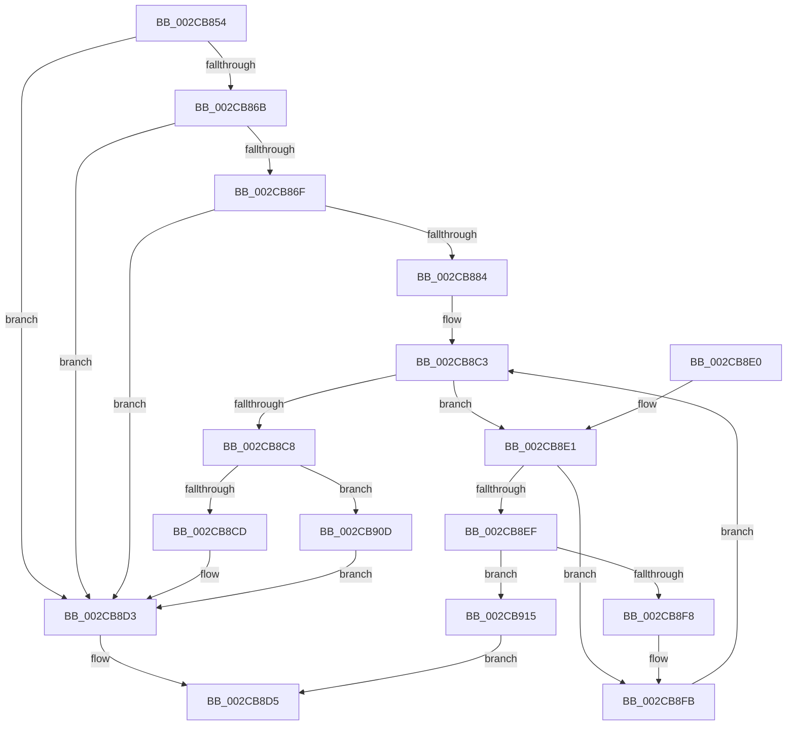

# MiZeroThreadContending

- RVA: `0x002CB854`–`0x002CB922` (길이 `206` bytes)
- VA: `0x00000001402CB854`
- 실행 섹션: `.text`
- PDB 이름 있음: `예`; PDB Function 태그: `아니요`
- unwind 정보 RVA: `0x0006F308`
- 디코드: `55`개 명령, `206/206` bytes 표시
- 미해석 바이트: `0` (있으면 어셈블리에 `.byte`로 보존)

> 이 문서는 커널 이미지의 기계어와 PDB 기호를 분석해 생성했습니다. 4번과 5번은 함수 원형과 자료형을 바이너리 사용 방식에서 추정한 C 해석이며 원본 소스 복구 결과는 아닙니다.

## 1. Dependencies

- 직접 호출 지점: **0**; 고유 호출 대상: **0**
- 직접 호출자로 확인된 함수: **2**
- RIP 상대 이미지 참조: **2**

### Outgoing calls
- 직접 디코드된 call 명령이 없습니다.

### Direct callers
- [MiFindReductionContendingThread](MiFindReductionContendingThread_function_002CABB8.md) at `0x002CAC9D`
- [MiMoveZeroThreadsToOtherCores](MiMoveZeroThreadsToOtherCores_function_002CB798.md) at `0x002CB7F1`

### Static image references
- `0x002CB88B` → RVA `0x00FC8C40` (`ALMOSTRO`; read)
- `0x002CB8A3` → RVA `0x00F231B8` (`.data`; read)

## 2. Other-region calls and transfers

- 다른 실행 섹션으로 향하는 call: **0**
- 별도 외부 분기/꼬리 이동을 확인하지 못했습니다.

## 3. Assembly (complete function range)

```asm
002CB854  48 89 5C 24 10                  mov qword ptr [rsp + 0x10], rbx
002CB859  56                              push rsi
002CB85A  48 83 EC 10                     sub rsp, 0x10
002CB85E  8B 81 80 01 00 00               mov eax, dword ptr [rcx + 0x180]
002CB864  4C 8B C1                        mov r8, rcx
002CB867  A8 01                           test al, 1
002CB869  74 68                           je 0x1402cb8d3
002CB86B  A8 02                           test al, 2
002CB86D  75 64                           jne 0x1402cb8d3
002CB86F  0F 10 81 70 01 00 00            movups xmm0, xmmword ptr [rcx + 0x170]
002CB876  66 48 0F 7E C3                  movq rbx, xmm0
002CB87B  0F 11 04 24                     movups xmmword ptr [rsp], xmm0
002CB87F  48 85 DB                        test rbx, rbx
002CB882  74 4F                           je 0x1402cb8d3
002CB884  48 8B 91 50 01 00 00            mov rdx, qword ptr [rcx + 0x150]
002CB88B  48 8D 35 AE D3 CF 00            lea rsi, [rip + 0xcfd3ae]
002CB892  0F B7 44 24 08                  movzx eax, word ptr [rsp + 8]
002CB897  45 33 D2                        xor r10d, r10d
002CB89A  48 0F BC CB                     bsf rcx, rbx
002CB89E  C1 E0 06                        shl eax, 6
002CB8A1  03 C8                           add ecx, eax
002CB8A3  48 8B 05 0E 79 C5 00            mov rax, qword ptr [rip + 0xc5790e]
002CB8AA  44 8B 1C 88                     mov r11d, dword ptr [rax + rcx*4]
002CB8AE  4A 8B 0C DE                     mov rcx, qword ptr [rsi + r11*8]
002CB8B2  4C 8B 89 60 8E 00 00            mov r9, qword ptr [rcx + 0x8e60]
002CB8B9  4C 23 CB                        and r9, rbx
002CB8BC  4C 0B 89 C8 00 00 00            or r9, qword ptr [rcx + 0xc8]
002CB8C3  4D 85 C9                        test r9, r9
002CB8C6  75 19                           jne 0x1402cb8e1
002CB8C8  45 85 D2                        test r10d, r10d
002CB8CB  74 40                           je 0x1402cb90d
002CB8CD  FF 82 E4 00 00 00               inc dword ptr [rdx + 0xe4]
002CB8D3  33 C0                           xor eax, eax
002CB8D5  48 8B 5C 24 28                  mov rbx, qword ptr [rsp + 0x28]
002CB8DA  48 83 C4 10                     add rsp, 0x10
002CB8DE  5E                              pop rsi
002CB8DF  C3                              ret
002CB8E0  CC                              int3
002CB8E1  4A 8B 04 DE                     mov rax, qword ptr [rsi + r11*8]
002CB8E5  48 8B 48 08                     mov rcx, qword ptr [rax + 8]
002CB8E9  48 3B 48 18                     cmp rcx, qword ptr [rax + 0x18]
002CB8ED  74 0C                           je 0x1402cb8fb
002CB8EF  49 3B 88 48 01 00 00            cmp rcx, qword ptr [r8 + 0x148]
002CB8F6  75 1D                           jne 0x1402cb915
002CB8F8  41 FF C2                        inc r10d
002CB8FB  48 8B 80 C8 00 00 00            mov rax, qword ptr [rax + 0xc8]
002CB902  48 F7 D0                        not rax
002CB905  4C 23 C8                        and r9, rax
002CB908  41 FF C3                        inc r11d
002CB90B  EB B6                           jmp 0x1402cb8c3
002CB90D  FF 82 DC 00 00 00               inc dword ptr [rdx + 0xdc]
002CB913  EB BE                           jmp 0x1402cb8d3
002CB915  FF 82 E0 00 00 00               inc dword ptr [rdx + 0xe0]
002CB91B  B8 01 00 00 00                  mov eax, 1
002CB920  EB B3                           jmp 0x1402cb8d5
```

## 4. C-style interpretation (structured pseudocode)

```c
__int64 __fastcall MiZeroThreadContending(__int64 a1)
{
    __int64 result;
    __int64 v_r10;
    __int64 v_r11;
    __int64 v_rsp;
    unsigned __int16 v_stack_m10;
    unsigned __int64 v_stack_m18;
    unsigned __int64 v_stack_p10;

    v_stack_p10 = v_rbx;
    v_rsp = (v_rsp) - (16);
    if ((((unsigned __int8)((unsigned int)(*(unsigned int *)(a1 + 384)))) & (1)) == 0) goto loc_002CB8D3;
    if ((((unsigned __int8)((unsigned int)(*(unsigned int *)(a1 + 384)))) & (2)) != 0) goto loc_002CB8D3;
    v_stack_m18 = v_xmm0;
    if (v_rbx == 0) goto loc_002CB8D3;
    v_r10 = 0;
    result = (unsigned int)((v_stack_m10) << (6));
    a1 = (unsigned int)((a1) + ((unsigned int)(result)));
    a4 = (*(unsigned __int64 *)(*(unsigned __int64 *)(v_rip + 13620142 + (unsigned int)(*(unsigned int *)(*(unsigned __int64 *)(v_rip + 12941582) + a1 * 4)) * 8) + 36448)) & (v_rbx);
    a4 = (a4) | (*(unsigned __int64 *)(*(unsigned __int64 *)(v_rip + 13620142 + (unsigned int)(*(unsigned int *)(*(unsigned __int64 *)(v_rip + 12941582) + a1 * 4)) * 8) + 200));
loc_002CB8C3:
    if (a4 != 0) goto loc_002CB8E1;
    if (0 == 0) goto loc_002CB90D;
loc_002CB8D3:
    result = 0;
loc_002CB8D5:
    v_rsp = (v_rsp) + (16);
    return result;
loc_002CB8E1:
    if ((*(unsigned __int64 *)(*(unsigned __int64 *)(v_rip + 13620142 + (unsigned int)(*(unsigned int *)(*(unsigned __int64 *)(v_rip + 12941582) + a1 * 4)) * 8) + 8)) == (*(unsigned __int64 *)(*(unsigned __int64 *)(v_rip + 13620142 + (unsigned int)(*(unsigned int *)(*(unsigned __int64 *)(v_rip + 12941582) + a1 * 4)) * 8) + 24))) goto loc_002CB8FB;
    if ((*(unsigned __int64 *)(*(unsigned __int64 *)(v_rip + 13620142 + (unsigned int)(*(unsigned int *)(*(unsigned __int64 *)(v_rip + 12941582) + a1 * 4)) * 8) + 8)) != (*(unsigned __int64 *)(a1 + 328))) goto loc_002CB915;
    v_r10 = (unsigned int)((v_r10) + 1);
loc_002CB8FB:
    result = ~(*(unsigned __int64 *)(*(unsigned __int64 *)(v_rip + 13620142 + (unsigned int)(*(unsigned int *)(*(unsigned __int64 *)(v_rip + 12941582) + a1 * 4)) * 8) + 200));
    a4 = (a4) & (result);
    v_r11 = (unsigned int)(((unsigned int)(*(unsigned int *)(*(unsigned __int64 *)(v_rip + 12941582) + a1 * 4))) + 1);
    goto loc_002CB8C3;
loc_002CB90D:
    goto loc_002CB8D3;
loc_002CB915:
    goto loc_002CB8D5;
}
```

## 5. (Beta) C Style

```c
int64_t MiZeroThreadContending(void *Arg1)
{
    uint8_t *arg1 = (uint8_t *)Arg1;

    int64_t result;
    int64_t local_r10;
    int64_t local_r11;
    int64_t local_rsp;
    uint16_t v_stack_m10;
    uint64_t v_stack_m18;
    uint64_t v_stack_p10;

    v_stack_p10 = local_rbx;
    local_rsp = (local_rsp) - (16);
    if ((((uint8_t)((uint32_t)(*(uint32_t *)(arg1 + 0x180)))) & (1)) == 0) goto loc_002CB8D3;
    if ((((uint8_t)((uint32_t)(*(uint32_t *)(arg1 + 0x180)))) & (2)) != 0) goto loc_002CB8D3;
    v_stack_m18 = v_xmm0;
    if (local_rbx == 0) goto loc_002CB8D3;
    local_r10 = 0;
    result = (uint32_t)((v_stack_m10) << (6));
    Arg1 = (uint32_t)((Arg1) + ((uint32_t)(result)));
    a4 = (*(uint64_t *)(*(uint64_t *)(v_rip + 0xCFD3AE + (uint32_t)(*(uint32_t *)(*(uint64_t *)(v_rip + 0xC5790E) + arg1 * 4)) * 8) + 0x8E60)) & (local_rbx);
    a4 = (a4) | (*(uint64_t *)(*(uint64_t *)(v_rip + 0xCFD3AE + (uint32_t)(*(uint32_t *)(*(uint64_t *)(v_rip + 0xC5790E) + arg1 * 4)) * 8) + 0xC8));
loc_002CB8C3:
    if (a4 != 0) goto loc_002CB8E1;
    if (0 == 0) goto loc_002CB90D;
loc_002CB8D3:
    result = 0;
loc_002CB8D5:
    local_rsp = (local_rsp) + (16);
    return result;
loc_002CB8E1:
    if ((*(uint64_t *)(*(uint64_t *)(v_rip + 0xCFD3AE + (uint32_t)(*(uint32_t *)(*(uint64_t *)(v_rip + 0xC5790E) + arg1 * 4)) * 8) + 0x8)) == (*(uint64_t *)(*(uint64_t *)(v_rip + 0xCFD3AE + (uint32_t)(*(uint32_t *)(*(uint64_t *)(v_rip + 0xC5790E) + arg1 * 4)) * 8) + 0x18))) goto loc_002CB8FB;
    if ((*(uint64_t *)(*(uint64_t *)(v_rip + 0xCFD3AE + (uint32_t)(*(uint32_t *)(*(uint64_t *)(v_rip + 0xC5790E) + arg1 * 4)) * 8) + 0x8)) != (*(uint64_t *)(arg1 + 0x148))) goto loc_002CB915;
    local_r10 = (uint32_t)((local_r10) + 1);
loc_002CB8FB:
    result = ~(*(uint64_t *)(*(uint64_t *)(v_rip + 0xCFD3AE + (uint32_t)(*(uint32_t *)(*(uint64_t *)(v_rip + 0xC5790E) + arg1 * 4)) * 8) + 0xC8));
    a4 = (a4) & (result);
    local_r11 = (uint32_t)(((uint32_t)(*(uint32_t *)(*(uint64_t *)(v_rip + 0xC5790E) + arg1 * 4))) + 1);
    goto loc_002CB8C3;
loc_002CB90D:
    goto loc_002CB8D3;
loc_002CB915:
    goto loc_002CB8D5;
}
```

### 관측된 메모리 오프셋

구조체 형식이 확인되지 않은 접근은 인자 기준의 오프셋으로만 기록했습니다.

| 기준 인자 | 오프셋 표현 | 폭 (bit) | 접근 |
|---|---:|---:|---|
| `Arg1` | `+ 0x148` | `64` | `R` |
| `Arg1` | `+ 0x150` | `64` | `R` |
| `Arg1` | `+ 0x170` | `128` | `R` |
| `Arg1` | `+ 0x180` | `32` | `R` |

## 6. Execution-region graph

[열기: 2D/3D 그래프와 함수 탐색 컨트롤 패널](../../../control-panel.html?section=text&rva=0x002CB854&view=graph)

- 2D 그래프는 위에서 아래로 흐르고, 3D 그래프는 빈 공간을 드래그해 회전합니다. Shift+드래그는 이동, 휠은 확대·축소, 함수 노드 선택은 대상 보고서 이동입니다.

### Static fallback


