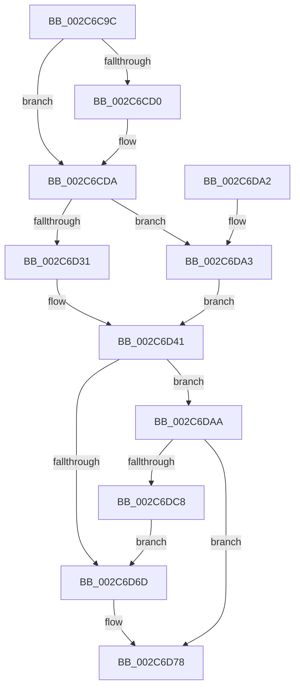

# MiZeroWithUltraSpace

- RVA: `0x002C6C9C`–`0x002C6DD0` (길이 `308` bytes)
- VA: `0x00000001402C6C9C`
- 실행 섹션: `.text`
- PDB 이름 있음: `예`; PDB Function 태그: `아니요`
- unwind 정보 RVA: `0x0006EC98`
- 디코드: `86`개 명령, `308/308` bytes 표시
- 미해석 바이트: `0` (있으면 어셈블리에 `.byte`로 보존)

> 이 문서는 커널 이미지의 기계어와 PDB 기호를 분석해 생성했습니다. 4번과 5번은 함수 원형과 자료형을 바이너리 사용 방식에서 추정한 C 해석이며 원본 소스 복구 결과는 아닙니다.

## 1. Dependencies

- 직접 호출 지점: **6**; 고유 호출 대상: **5**
- 직접 호출자로 확인된 함수: **2**
- RIP 상대 이미지 참조: **2**

### Outgoing calls
- `0x002C6CD3` → [MiGetPfnPageSizeIndex](../31/MiGetPfnPageSizeIndex_function_0031C710.md) (function, `0x0031C710`)
- `0x002C6CF7` → [MiGetUltraMapping](../32/MiGetUltraMapping_function_00323270.md) (function, `0x00323270`)
- `0x002C6D5F` → [MiWriteLargePte](MiWriteLargePte_function_002C6DE0.md) (function, `0x002C6DE0`)
- `0x002C6D73` → [KeZeroPages](../6B/KeZeroPages_function_006BA070.md) (function, `0x006BA070`)
- `0x002C6D84` → [MiWriteLargePte](MiWriteLargePte_function_002C6DE0.md) (function, `0x002C6DE0`)
- `0x002C6DBF` → [AccelFillMemory](AccelFillMemory_function_002C7C7C.md) (function, `0x002C7C7C`)

### Direct callers
- [MiZeroChainWorker](MiZeroChainWorker_function_002C67C8.md) at `0x002C684C`
- [MiZeroLargePage](MiZeroLargePage_function_002C6914.md) at `0x002C6A05`

### Static image references
- `0x002C6CDC` → RVA `0x00011C60` (`.rdata`; read)
- `0x002C6DC8` → RVA `0x00EF508C` (`.data`; read/write)

## 2. Other-region calls and transfers

- 다른 실행 섹션으로 향하는 call: **0**
- 별도 외부 분기/꼬리 이동을 확인하지 못했습니다.

## 3. Assembly (complete function range)

```asm
002C6C9C  48 89 5C 24 08                  mov qword ptr [rsp + 8], rbx
002C6CA1  48 89 6C 24 10                  mov qword ptr [rsp + 0x10], rbp
002C6CA6  48 89 74 24 18                  mov qword ptr [rsp + 0x18], rsi
002C6CAB  57                              push rdi
002C6CAC  41 56                           push r14
002C6CAE  41 57                           push r15
002C6CB0  48 83 EC 30                     sub rsp, 0x30
002C6CB4  49 8B 40 28                     mov rax, qword ptr [r8 + 0x28]
002C6CB8  41 8B F1                        mov esi, r9d
002C6CBB  48 0F BA E0 28                  bt rax, 0x28
002C6CC0  49 8B F8                        mov rdi, r8
002C6CC3  4C 8B FA                        mov r15, rdx
002C6CC6  4C 8B F1                        mov r14, rcx
002C6CC9  BB 03 00 00 00                  mov ebx, 3
002C6CCE  73 0A                           jae 0x1402c6cda
002C6CD0  49 8B C8                        mov rcx, r8
002C6CD3  E8 38 5A 05 00                  call 0x14031c710
002C6CD8  8B D8                           mov ebx, eax
002C6CDA  8B CB                           mov ecx, ebx
002C6CDC  48 8D 2D 7D AF D4 FF            lea rbp, [rip - 0x2b5083]
002C6CE3  44 8B CE                        mov r9d, esi
002C6CE6  8B D3                           mov edx, ebx
002C6CE8  48 8B 6C CD 00                  mov rbp, qword ptr [rbp + rcx*8]
002C6CED  48 C1 E1 05                     shl rcx, 5
002C6CF1  4C 8B C5                        mov r8, rbp
002C6CF4  49 03 CE                        add rcx, r14
002C6CF7  E8 74 C5 05 00                  call 0x140323270
002C6CFC  48 8B F0                        mov rsi, rax
002C6CFF  48 B8 00 00 00 00 00 DE FF FF   movabs rax, 0xffffde0000000000
002C6D09  8B 4F 20                        mov ecx, dword ptr [rdi + 0x20]
002C6D0C  4C 8B F7                        mov r14, rdi
002C6D0F  4C 2B F0                        sub r14, rax
002C6D12  C1 E9 10                        shr ecx, 0x10
002C6D15  49 C1 FE 04                     sar r14, 4
002C6D19  48 B8 AB AA AA AA AA AA AA AA   movabs rax, 0xaaaaaaaaaaaaaaab
002C6D23  4C 0F AF F0                     imul r14, rax
002C6D27  BA 04 00 00 00                  mov edx, 4
002C6D2C  80 F9 40                        cmp cl, 0x40
002C6D2F  72 72                           jb 0x1402c6da3
002C6D31  8B 47 20                        mov eax, dword ptr [rdi + 0x20]
002C6D34  8D 4A 18                        lea ecx, [rdx + 0x18]
002C6D37  C1 E8 10                        shr eax, 0x10
002C6D3A  24 C0                           and al, 0xc0
002C6D3C  3C 80                           cmp al, 0x80
002C6D3E  0F 44 D1                        cmove edx, ecx
002C6D41  B8 00 00 00 A0                  mov eax, 0xa0000000
002C6D46  41 B9 00 00 00 A4               mov r9d, 0xa4000000
002C6D4C  83 FB 01                        cmp ebx, 1
002C6D4F  44 8B C3                        mov r8d, ebx
002C6D52  48 8B CE                        mov rcx, rsi
002C6D55  44 0F 47 C8                     cmova r9d, eax
002C6D59  44 0B CA                        or r9d, edx
002C6D5C  49 8B D6                        mov rdx, r14
002C6D5F  E8 7C 00 00 00                  call 0x1402c6de0
002C6D64  48 C1 E5 0C                     shl rbp, 0xc
002C6D68  4D 85 FF                        test r15, r15
002C6D6B  75 3D                           jne 0x1402c6daa
002C6D6D  48 8B D5                        mov rdx, rbp
002C6D70  48 8B CE                        mov rcx, rsi
002C6D73  E8 F8 32 3F 00                  call 0x1406ba070
002C6D78  45 33 C9                        xor r9d, r9d
002C6D7B  44 8B C3                        mov r8d, ebx
002C6D7E  49 8B D6                        mov rdx, r14
002C6D81  48 8B CE                        mov rcx, rsi
002C6D84  E8 57 00 00 00                  call 0x1402c6de0
002C6D89  48 8B 5C 24 50                  mov rbx, qword ptr [rsp + 0x50]
002C6D8E  48 8B 6C 24 58                  mov rbp, qword ptr [rsp + 0x58]
002C6D93  48 8B 74 24 60                  mov rsi, qword ptr [rsp + 0x60]
002C6D98  48 83 C4 30                     add rsp, 0x30
002C6D9C  41 5F                           pop r15
002C6D9E  41 5E                           pop r14
002C6DA0  5F                              pop rdi
002C6DA1  C3                              ret
002C6DA2  CC                              int3
002C6DA3  BA 0C 00 00 00                  mov edx, 0xc
002C6DA8  EB 97                           jmp 0x1402c6d41
002C6DAA  45 33 C9                        xor r9d, r9d
002C6DAD  48 C7 44 24 20 03 00 00 00      mov qword ptr [rsp + 0x20], 3
002C6DB6  4C 8B C5                        mov r8, rbp
002C6DB9  48 8B D6                        mov rdx, rsi
002C6DBC  49 8B CF                        mov rcx, r15
002C6DBF  E8 B8 0E 00 00                  call 0x1402c7c7c
002C6DC4  85 C0                           test eax, eax
002C6DC6  79 B0                           jns 0x1402c6d78
002C6DC8  FF 05 BE E2 C2 00               inc dword ptr [rip + 0xc2e2be]
002C6DCE  EB 9D                           jmp 0x1402c6d6d
```

## 4. C-style interpretation (structured pseudocode)

```c
__int64 __fastcall MiZeroWithUltraSpace(__int64 a1, __int64 a2, __int64 a3, int a4)
{
    __int64 result;
    __int64 v_r14;
    __int64 v_rbp;
    __int64 v_rbx;
    __int64 v_rsp;
    unsigned __int64 v_stack_p10;
    unsigned __int64 v_stack_p18;
    unsigned __int64 v_stack_p20;
    unsigned __int64 v_stack_p8;

    v_stack_p8 = v_rbx;
    v_stack_p10 = v_rbp;
    v_stack_p18 = v_rsi;
    v_rsp = (v_rsp) - (48);
    result = *(unsigned __int64 *)(a3 + 40);
    v_rbx = 3;
    if (!(condition_is_above_or_equal)) {
        a1 = a3;
        result = MiGetPfnPageSizeIndex(a1, a2, a3, a4);
        v_rbx = (unsigned int)(result);
    }
    a1 = ((unsigned int)((unsigned int)(v_rbx))) << (5);
    a1 = (a1) + (a1);
    result = MiGetUltraMapping(a1, (unsigned int)((unsigned int)(v_rbx)), *(unsigned __int64 *)(v_rip - 2838659 + (unsigned int)((unsigned int)(v_rbx)) * 8), (unsigned int)((unsigned int)((unsigned int)(a4))));
    v_r14 = (a3) - (result);
    a1 = (unsigned int)(((unsigned int)(*(unsigned int *)(a3 + 32))) >> (16));
    v_r14 = (v_r14) >> (4);
    v_r14 = (v_r14) * (result);
    if (((unsigned __int8)(a1)) < 64) goto loc_002C6DA3;
    result = (unsigned int)(((unsigned int)(*(unsigned int *)(a3 + 32))) >> (16));
    result = (unsigned __int8)((result) & (192));
    a2 = 4;
    if (((unsigned __int8)(result)) == 128) { a2 = (unsigned int)(4 + 24); }
loc_002C6D41:
    a4 = (unsigned int)(0xA4000000ULL);
    if (((unsigned int)(v_rbx)) > 1) { a4 = (unsigned int)((unsigned int)(0xA0000000ULL)); }
    a4 = (unsigned int)((a4) | ((unsigned int)(a2)));
    result = MiWriteLargePte(result, v_r14, (unsigned int)((unsigned int)(v_rbx)), a4);
    v_rbp = (*(unsigned __int64 *)(v_rip - 2838659 + (unsigned int)((unsigned int)(v_rbx)) * 8)) << (12);
    if (a2 != 0) goto loc_002C6DAA;
loc_002C6D6D:
    result = KeZeroPages(result, v_rbp, (unsigned int)((unsigned int)(v_rbx)), a4);
loc_002C6D78:
    a4 = 0;
    result = MiWriteLargePte(result, v_r14, (unsigned int)((unsigned int)(v_rbx)), a4);
    v_rsp = (v_rsp) + (48);
    return result;
loc_002C6DA3:
    goto loc_002C6D41;
loc_002C6DAA:
    a4 = 0;
    v_stack_p20 = 3;
    result = AccelFillMemory(a2, v_stack_p18, v_stack_p10, a4);
    if (!sign_flag) goto loc_002C6D78;
    goto loc_002C6D6D;
}
```

## 5. (Beta) C Style

```c
int64_t MiZeroWithUltraSpace(int64_t Arg1, int64_t Arg2, void *Arg3, int32_t Arg4)
{
    uint8_t *arg3 = (uint8_t *)Arg3;

    int64_t result;
    int64_t local_r14;
    int64_t local_rbp;
    int64_t local_rbx;
    int64_t local_rsp;
    uint64_t v_stack_p10;
    uint64_t v_stack_p18;
    uint64_t v_stack_p20;
    uint64_t v_stack_p8;

    v_stack_p8 = local_rbx;
    v_stack_p10 = local_rbp;
    v_stack_p18 = local_rsi;
    local_rsp = (local_rsp) - (48);
    result = *(uint64_t *)(arg3 + 0x28);
    local_rbx = 3;
    if (!(condition_is_above_or_equal)) {
        Arg1 = Arg3;
        result = MiGetPfnPageSizeIndex(Arg1, Arg2, Arg3, Arg4);
        local_rbx = (uint32_t)(result);
    }
    Arg1 = ((uint32_t)((uint32_t)(local_rbx))) << (5);
    Arg1 = (Arg1) + (Arg1);
    result = MiGetUltraMapping(Arg1, (uint32_t)((uint32_t)(local_rbx)), *(uint64_t *)(v_rip - 0x2B5083 + (uint32_t)((uint32_t)(local_rbx)) * 8), (uint32_t)((uint32_t)((uint32_t)(Arg4))));
    local_r14 = (Arg3) - (result);
    Arg1 = (uint32_t)(((uint32_t)(*(uint32_t *)(arg3 + 0x20))) >> (16));
    local_r14 = (local_r14) >> (4);
    local_r14 = (local_r14) * (result);
    if (((uint8_t)(Arg1)) < 64) goto loc_002C6DA3;
    result = (uint32_t)(((uint32_t)(*(uint32_t *)(arg3 + 0x20))) >> (16));
    result = (uint8_t)((result) & (192));
    Arg2 = 4;
    if (((uint8_t)(result)) == 128) { Arg2 = (uint32_t)(4 + 24); }
loc_002C6D41:
    Arg4 = (uint32_t)(0xA4000000ULL);
    if (((uint32_t)(local_rbx)) > 1) { Arg4 = (uint32_t)((uint32_t)(0xA0000000ULL)); }
    Arg4 = (uint32_t)((Arg4) | ((uint32_t)(Arg2)));
    result = MiWriteLargePte(result, local_r14, (uint32_t)((uint32_t)(local_rbx)), Arg4);
    local_rbp = (*(uint64_t *)(v_rip - 0x2B5083 + (uint32_t)((uint32_t)(local_rbx)) * 8)) << (12);
    if (Arg2 != 0) goto loc_002C6DAA;
loc_002C6D6D:
    result = KeZeroPages(result, local_rbp, (uint32_t)((uint32_t)(local_rbx)), Arg4);
loc_002C6D78:
    Arg4 = 0;
    result = MiWriteLargePte(result, local_r14, (uint32_t)((uint32_t)(local_rbx)), Arg4);
    local_rsp = (local_rsp) + (48);
    return result;
loc_002C6DA3:
    goto loc_002C6D41;
loc_002C6DAA:
    Arg4 = 0;
    v_stack_p20 = 3;
    result = AccelFillMemory(Arg2, v_stack_p18, v_stack_p10, Arg4);
    if (!sign_flag) goto loc_002C6D78;
    goto loc_002C6D6D;
}
```

### 관측된 메모리 오프셋

구조체 형식이 확인되지 않은 접근은 인자 기준의 오프셋으로만 기록했습니다.

| 기준 인자 | 오프셋 표현 | 폭 (bit) | 접근 |
|---|---:|---:|---|
| `Arg3` | `+ 0x20` | `32` | `R` |
| `Arg3` | `+ 0x28` | `64` | `R` |

## 6. Execution-region graph

[열기: 2D/3D 그래프와 함수 탐색 컨트롤 패널](../../../control-panel.html?section=text&rva=0x002C6C9C&view=graph)

- 2D 그래프는 위에서 아래로 흐르고, 3D 그래프는 빈 공간을 드래그해 회전합니다. Shift+드래그는 이동, 휠은 확대·축소, 함수 노드 선택은 대상 보고서 이동입니다.

### Static fallback


