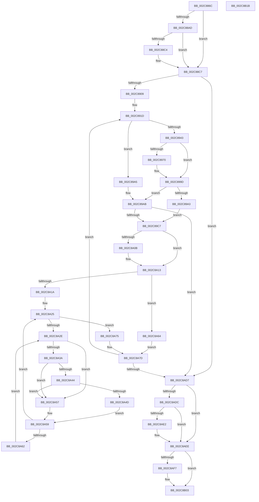

# MmAllocateNonChargedSecurePages

- RVA: `0x002C886C`–`0x002C8B1C` (길이 `688` bytes)
- VA: `0x00000001402C886C`
- 실행 섹션: `.text`
- PDB 이름 있음: `예`; PDB Function 태그: `아니요`
- unwind 정보 RVA: `0x0006EF68`
- 디코드: `183`개 명령, `688/688` bytes 표시
- 미해석 바이트: `0` (있으면 어셈블리에 `.byte`로 보존)

> 이 문서는 커널 이미지의 기계어와 PDB 기호를 분석해 생성했습니다. 4번과 5번은 함수 원형과 자료형을 바이너리 사용 방식에서 추정한 C 해석이며 원본 소스 복구 결과는 아닙니다.

## 1. Dependencies

- 직접 호출 지점: **14**; 고유 호출 대상: **14**
- 직접 호출자로 확인된 함수: **2**
- RIP 상대 이미지 참조: **4**

### Outgoing calls
- `0x002C88A0` → [MiPartitionObjectToPartition](../3E/MiPartitionObjectToPartition_function_003EAB0C.md) (function, `0x003EAB0C`)
- `0x002C88BB` → [MiAcquireNonPagedResources](../28/MiAcquireNonPagedResources_function_00286C60.md) (function, `0x00286C60`)
- `0x002C88FC` → [MiInitializePageColorBase](../32/MiInitializePageColorBase_function_00320410.md) (function, `0x00320410`)
- `0x002C895C` → [MiGetSlabPage](../37/MiGetSlabPage_function_00376FBC.md) (function, `0x00376FBC`)
- `0x002C898E` → [MiIsPfnFromChargedSlabAllocation](../2A/MiIsPfnFromChargedSlabAllocation_function_002A2968.md) (function, `0x002A2968`)
- `0x002C89B5` → [MiGetPage](../28/MiGetPage_function_002884C0.md) (function, `0x002884C0`)
- `0x002C8A44` → [KiCheckVpBackingLongSpinWaitHypercall](../30/KiCheckVpBackingLongSpinWaitHypercall_function_0030F490.md) (function, `0x0030F490`)
- `0x002C8A50` → [HvlNotifyLongSpinWait](../30/HvlNotifyLongSpinWait_function_0030F460.md) (function, `0x0030F460`)
- `0x002C8A67` → [MiLockPageInline](../31/MiLockPageInline_function_0031A340.md) (function, `0x0031A340`)
- `0x002C8A85` → [MiInitializeMdlPfn](MiInitializeMdlPfn_function_002C9670.md) (function, `0x002C9670`)
- `0x002C8A91` → [MiUpdatePageFileHighInPte](../36/MiUpdatePageFileHighInPte_function_0036D840.md) (function, `0x0036D840`)
- `0x002C8AA4` → [MiUnlockPage](../31/MiUnlockPage_function_0031A3E0.md) (function, `0x0031A3E0`)
- `0x002C8AE9` → [MiReleaseNonPagedResources](../32/MiReleaseNonPagedResources_function_0032299C.md) (function, `0x0032299C`)
- `0x002C8AFE` → [PsDereferencePartition](../34/PsDereferencePartition_function_00342E70.md) (function, `0x00342E70`)

### Direct callers
- [PspIumReplenishPartitionPages](PspIumReplenishPartitionPages_function_002C8710.md) at `0x002C878B`
- [PspIumAllocatePartitionState](../5E/PspIumAllocatePartitionState_function_005E43A8.md) at `0x005E44BF`

### Static image references
- `0x002C890E` → RVA `0x00E2DCC0` (`.data`; read)
- `0x002C89DF` → RVA `0x00010880` (`.rdata`; read)
- `0x002C8A31` → RVA `0x00FC52AC` (`ALMOSTRO`; reference)
- `0x002C8A3A` → RVA `0x00FC6AB8` (`ALMOSTRO`; read)

## 2. Other-region calls and transfers

- 다른 실행 섹션으로 향하는 call: **0**
- 별도 외부 분기/꼬리 이동을 확인하지 못했습니다.

## 3. Assembly (complete function range)

```asm
002C886C  48 8B C4                        mov rax, rsp
002C886F  48 89 58 08                     mov qword ptr [rax + 8], rbx
002C8873  4C 89 48 20                     mov qword ptr [rax + 0x20], r9
002C8877  89 50 10                        mov dword ptr [rax + 0x10], edx
002C887A  55                              push rbp
002C887B  56                              push rsi
002C887C  57                              push rdi
002C887D  41 54                           push r12
002C887F  41 55                           push r13
002C8881  41 56                           push r14
002C8883  41 57                           push r15
002C8885  48 83 EC 60                     sub rsp, 0x60
002C8889  49 8B F0                        mov rsi, r8
002C888C  C6 40 98 00                     mov byte ptr [rax - 0x68], 0
002C8890  44 8B FA                        mov r15d, edx
002C8893  4C 8D 40 98                     lea r8, [rax - 0x68]
002C8897  0F 57 C0                        xorps xmm0, xmm0
002C889A  B2 01                           mov dl, 1
002C889C  0F 11 40 B0                     movups xmmword ptr [rax - 0x50], xmm0
002C88A0  E8 67 22 12 00                  call 0x1403eab0c
002C88A5  48 8B F8                        mov rdi, rax
002C88A8  45 85 FF                        test r15d, r15d
002C88AB  74 1A                           je 0x1402c88c7
002C88AD  8B 16                           mov edx, dword ptr [rsi]
002C88AF  41 B9 02 00 00 00               mov r9d, 2
002C88B5  45 33 C0                        xor r8d, r8d
002C88B8  48 8B C8                        mov rcx, rax
002C88BB  E8 A0 E3 FB FF                  call 0x140286c60
002C88C0  85 C0                           test eax, eax
002C88C2  79 03                           jns 0x1402c88c7
002C88C4  83 26 00                        and dword ptr [rsi], 0
002C88C7  44 0F 20 C0                     mov rax, cr8
002C88CB  33 C9                           xor ecx, ecx
002C88CD  48 89 44 24 40                  mov qword ptr [rsp + 0x40], rax
002C88D2  3C 02                           cmp al, 2
002C88D4  4C 8D 4C 24 48                  lea r9, [rsp + 0x48]
002C88D9  0F 94 C1                        sete cl
002C88DC  89 4C 24 34                     mov dword ptr [rsp + 0x34], ecx
002C88E0  B9 06 00 00 00                  mov ecx, 6
002C88E5  44 8D 71 10                     lea r14d, [rcx + 0x10]
002C88E9  44 0F 45 F1                     cmovne r14d, ecx
002C88ED  8D 51 FD                        lea edx, [rcx - 3]
002C88F0  45 33 C0                        xor r8d, r8d
002C88F3  44 89 74 24 38                  mov dword ptr [rsp + 0x38], r14d
002C88F8  33 C9                           xor ecx, ecx
002C88FA  33 ED                           xor ebp, ebp
002C88FC  E8 0F 7B 05 00                  call 0x140320410
002C8901  39 2E                           cmp dword ptr [rsi], ebp
002C8903  0F 86 CE 01 00 00               jbe 0x1402c8ad7
002C8909  4C 8B 64 24 50                  mov r12, qword ptr [rsp + 0x50]
002C890E  4C 8D 05 AB 53 B6 00            lea r8, [rip + 0xb653ab]
002C8915  49 C1 EC 10                     shr r12, 0x10
002C8919  41 83 E4 03                     and r12d, 3
002C891D  48 8B 4C 24 48                  mov rcx, qword ptr [rsp + 0x48]
002C8922  B8 01 00 00 00                  mov eax, 1
002C8927  F0 0F C1 01                     lock xadd dword ptr [rcx], eax
002C892B  33 D2                           xor edx, edx
002C892D  43 F7 34 A0                     div dword ptr [r8 + r12*4]
002C8931  8B 47 04                        mov eax, dword ptr [rdi + 4]
002C8934  33 54 24 50                     xor edx, dword ptr [rsp + 0x50]
002C8938  0F B6 DA                        movzx ebx, dl
002C893B  33 5C 24 50                     xor ebx, dword ptr [rsp + 0x50]
002C893F  A8 08                           test al, 8
002C8941  74 62                           je 0x1402c89a5
002C8943  83 64 24 28 00                  and dword ptr [rsp + 0x28], 0
002C8948  45 8B CE                        mov r9d, r14d
002C894B  48 83 4C 24 20 FF               or qword ptr [rsp + 0x20], 0xffffffffffffffff
002C8951  44 8B C3                        mov r8d, ebx
002C8954  BA 02 00 00 00                  mov edx, 2
002C8959  48 8B CF                        mov rcx, rdi
002C895C  E8 5B E6 0A 00                  call 0x140376fbc
002C8961  4C 8B F0                        mov r14, rax
002C8964  41 BD 09 00 00 00               mov r13d, 9
002C896A  48 83 F8 FF                     cmp rax, -1
002C896E  74 2D                           je 0x1402c899d
002C8970  48 8D 0C 40                     lea rcx, [rax + rax*2]
002C8974  41 BD 0B 00 00 00               mov r13d, 0xb
002C897A  48 C1 E1 04                     shl rcx, 4
002C897E  48 B8 00 00 00 00 00 DE FF FF   movabs rax, 0xffffde0000000000
002C8988  48 8B C0                        mov rax, rax
002C898B  48 03 C8                        add rcx, rax
002C898E  E8 D5 9F FD FF                  call 0x1402a2968
002C8993  85 C0                           test eax, eax
002C8995  41 8D 4D 04                     lea ecx, [r13 + 4]
002C8999  44 0F 45 E9                     cmovne r13d, ecx
002C899D  49 83 FE FF                     cmp r14, -1
002C89A1  74 08                           je 0x1402c89ab
002C89A3  EB 22                           jmp 0x1402c89c7
002C89A5  41 BD 09 00 00 00               mov r13d, 9
002C89AB  44 8B 44 24 34                  mov r8d, dword ptr [rsp + 0x34]
002C89B0  8B D3                           mov edx, ebx
002C89B2  48 8B CF                        mov rcx, rdi
002C89B5  E8 06 FB FB FF                  call 0x1402884c0
002C89BA  4C 8B F0                        mov r14, rax
002C89BD  48 83 F8 FF                     cmp rax, -1
002C89C1  0F 84 10 01 00 00               je 0x1402c8ad7
002C89C7  4B 8D 1C 76                     lea rbx, [r14 + r14*2]
002C89CB  48 B8 00 00 00 00 00 DE FF FF   movabs rax, 0xffffde0000000000
002C89D5  48 C1 E3 04                     shl rbx, 4
002C89D9  48 8B C8                        mov rcx, rax
002C89DC  48 03 D9                        add rbx, rcx
002C89DF  48 8B 0D 9A 7E D4 FF            mov rcx, qword ptr [rip - 0x2b8166]
002C89E6  48 C7 03 00 00 00 00            mov qword ptr [rbx], 0
002C89ED  48 89 4B 10                     mov qword ptr [rbx + 0x10], rcx
002C89F1  48 B9 FF FF FF FF FF FF FF 7F   movabs rcx, 0x7fffffffffffffff
002C89FB  48 8B 43 28                     mov rax, qword ptr [rbx + 0x28]
002C89FF  48 23 C1                        and rax, rcx
002C8A02  48 89 43 28                     mov qword ptr [rbx + 0x28], rax
002C8A06  45 85 FF                        test r15d, r15d
002C8A09  75 08                           jne 0x1402c8a13
002C8A0B  F0 48 FF 87 B0 01 00 00         lock inc qword ptr [rdi + 0x1b0]
002C8A13  80 7C 24 40 02                  cmp byte ptr [rsp + 0x40], 2
002C8A18  75 4A                           jne 0x1402c8a64
002C8A1A  C6 84 24 B0 00 00 00 11         mov byte ptr [rsp + 0xb0], 0x11
002C8A22  45 33 FF                        xor r15d, r15d
002C8A25  F0 48 0F BA 6B 18 3F            lock bts qword ptr [rbx + 0x18], 0x3f
002C8A2C  73 47                           jae 0x1402c8a75
002C8A2E  41 FF C7                        inc r15d
002C8A31  44 85 3D 74 C8 CF 00            test dword ptr [rip + 0xcfc874], r15d
002C8A38  75 1D                           jne 0x1402c8a57
002C8A3A  8B 05 78 E0 CF 00               mov eax, dword ptr [rip + 0xcfe078]
002C8A40  A8 40                           test al, 0x40
002C8A42  74 13                           je 0x1402c8a57
002C8A44  E8 47 6A 04 00                  call 0x14030f490
002C8A49  84 C0                           test al, al
002C8A4B  74 0A                           je 0x1402c8a57
002C8A4D  41 8B CF                        mov ecx, r15d
002C8A50  E8 0B 6A 04 00                  call 0x14030f460
002C8A55  EB 02                           jmp 0x1402c8a59
002C8A57  F3 90                           pause
002C8A59  48 8B 43 18                     mov rax, qword ptr [rbx + 0x18]
002C8A5D  48 85 C0                        test rax, rax
002C8A60  79 C3                           jns 0x1402c8a25
002C8A62  EB CA                           jmp 0x1402c8a2e
002C8A64  48 8B CB                        mov rcx, rbx
002C8A67  E8 D4 18 05 00                  call 0x14031a340
002C8A6C  88 84 24 B0 00 00 00            mov byte ptr [rsp + 0xb0], al
002C8A73  EB 08                           jmp 0x1402c8a7d
002C8A75  44 8B BC 24 A8 00 00 00         mov r15d, dword ptr [rsp + 0xa8]
002C8A7D  BA 00 02 02 00                  mov edx, 0x20200
002C8A82  48 8B CB                        mov rcx, rbx
002C8A85  E8 E6 0B 00 00                  call 0x1402c9670
002C8A8A  48 8B 4B 10                     mov rcx, qword ptr [rbx + 0x10]
002C8A8E  49 8B D5                        mov rdx, r13
002C8A91  E8 AA 4D 0A 00                  call 0x14036d840
002C8A96  8A 94 24 B0 00 00 00            mov dl, byte ptr [rsp + 0xb0]
002C8A9D  48 8B CB                        mov rcx, rbx
002C8AA0  48 89 43 10                     mov qword ptr [rbx + 0x10], rax
002C8AA4  E8 37 19 05 00                  call 0x14031a3e0
002C8AA9  4C 8B AC 24 B8 00 00 00         mov r13, qword ptr [rsp + 0xb8]
002C8AB1  4C 8D 05 08 52 B6 00            lea r8, [rip + 0xb65208]
002C8AB8  FF C5                           inc ebp
002C8ABA  4D 89 75 00                     mov qword ptr [r13], r14
002C8ABE  49 83 C5 08                     add r13, 8
002C8AC2  44 8B 74 24 38                  mov r14d, dword ptr [rsp + 0x38]
002C8AC7  4C 89 AC 24 B8 00 00 00         mov qword ptr [rsp + 0xb8], r13
002C8ACF  3B 2E                           cmp ebp, dword ptr [rsi]
002C8AD1  0F 82 46 FE FF FF               jb 0x1402c891d
002C8AD7  45 85 FF                        test r15d, r15d
002C8ADA  74 12                           je 0x1402c8aee
002C8ADC  8B 06                           mov eax, dword ptr [rsi]
002C8ADE  3B E8                           cmp ebp, eax
002C8AE0  73 0C                           jae 0x1402c8aee
002C8AE2  2B C5                           sub eax, ebp
002C8AE4  48 8B CF                        mov rcx, rdi
002C8AE7  8B D0                           mov edx, eax
002C8AE9  E8 AE 9E 05 00                  call 0x14032299c
002C8AEE  80 7C 24 30 00                  cmp byte ptr [rsp + 0x30], 0
002C8AF3  89 2E                           mov dword ptr [rsi], ebp
002C8AF5  74 0C                           je 0x1402c8b03
002C8AF7  48 8B 8F B8 00 00 00            mov rcx, qword ptr [rdi + 0xb8]
002C8AFE  E8 6D A3 07 00                  call 0x140342e70
002C8B03  48 8B 9C 24 A0 00 00 00         mov rbx, qword ptr [rsp + 0xa0]
002C8B0B  48 83 C4 60                     add rsp, 0x60
002C8B0F  41 5F                           pop r15
002C8B11  41 5E                           pop r14
002C8B13  41 5D                           pop r13
002C8B15  41 5C                           pop r12
002C8B17  5F                              pop rdi
002C8B18  5E                              pop rsi
002C8B19  5D                              pop rbp
002C8B1A  C3                              ret
002C8B1B  CC                              int3
```

## 4. C-style interpretation (structured pseudocode)

```c
__int64 __fastcall MmAllocateNonChargedSecurePages(__int64 a1, int a2, __int64 a3, __int64 a4)
{
    __int64 result;
    __int64 v_r12;
    __int64 v_r13;
    __int64 v_r14;
    __int64 v_r15;
    __int64 v_rbp;
    __int64 v_rbx;
    __int64 v_rsp;
    unsigned __int64 v_stack_m48;
    unsigned __int64 v_stack_m50;
    unsigned __int64 v_stack_m58;
    unsigned int v_stack_m60;
    unsigned int v_stack_m64;
    unsigned __int8 v_stack_m68;
    unsigned int v_stack_m70;
    unsigned __int64 v_stack_m78;
    unsigned int v_stack_p10;
    unsigned __int8 v_stack_p18;
    unsigned __int64 v_stack_p20;
    unsigned __int64 v_stack_p8;

    *(unsigned __int64 *)(v_rsp + 8) = v_rbx;
    *(unsigned __int64 *)(v_rsp + 32) = a4;
    *(unsigned int *)(v_rsp + 16) = a2;
    v_rsp = (v_rsp) - (96);
    *(unsigned __int8 *)(v_rsp - 104) = 0;
    *(unsigned __int64 *)(v_rsp - 80) = v_xmm0;
    result = MiPartitionObjectToPartition(a1, 1, v_rsp - 104, a4);
    if ((unsigned int)((unsigned int)(a2)) == 0) goto loc_002C88C7;
    a3 = 0;
    result = MiAcquireNonPagedResources(result, (unsigned int)(*(unsigned int *)(a3)), a3, 2);
    if (sign_flag) {
    }
    a1 = 0;
    v_stack_m58 = v_cr8;
    a1 = (((unsigned __int8)(v_cr8)) == 2) ? 1 : 0;
    v_stack_m64 = (unsigned int)(a1);
    v_r14 = 6 + 16;
    if (((unsigned __int8)(v_cr8)) != 2) { v_r14 = 6; }
    a3 = 0;
    v_stack_m60 = (unsigned int)(v_r14);
    a1 = 0;
    v_rbp = 0;
    result = MiInitializePageColorBase(a1, 6 - 3, a3, v_stack_m50);
    if ((*(unsigned int *)(a3)) <= 0) goto loc_002C8AD7;
    v_r12 = (v_stack_m48) >> (16);
    v_r12 = (unsigned int)((v_r12) & (3));
loc_002C891D:
    a2 = 0;
    a2 = (unsigned int)((a2) ^ (v_stack_m48));
    v_rbx = (unsigned int)(((unsigned __int8)(a2)) ^ (v_stack_m48));
    if ((((unsigned __int8)((unsigned int)(*(unsigned int *)(result + 4)))) & (8)) == 0) goto loc_002C89A5;
    result = MiGetSlabPage(result, 2, (unsigned int)((unsigned int)(v_rbx)), (unsigned int)((unsigned int)(v_r14)));
    v_r13 = 9;
    if (result != -1) {
        a1 = result + result * 2;
        v_r13 = 11;
        a1 = (a1) << (4);
        result = result;
        a1 = (a1) + (result);
        result = MiIsPfnFromChargedSlabAllocation(a1, 2, (unsigned int)((unsigned int)(v_rbx)), (unsigned int)((unsigned int)(v_r14)));
        a1 = v_r13 + 4;
        if ((unsigned int)(result) != 0) { v_r13 = (unsigned int)(a1); }
    }
    if (result == -1) goto loc_002C89AB;
    goto loc_002C89C7;
loc_002C89A5:
loc_002C89AB:
    result = MiGetPage(result, (unsigned int)((unsigned int)(v_rbx)), (unsigned int)(v_stack_m64), (unsigned int)((unsigned int)(v_r14)));
    if (result == -1) goto loc_002C8AD7;
loc_002C89C7:
    v_rbx = (result + result * 2) << (4);
    v_rbx = (v_rbx) + (result);
    *(unsigned __int64 *)(v_rbx) = 0;
    *(unsigned __int64 *)(v_rbx + 16) = *(unsigned __int64 *)(v_rip - 2851174);
    result = (*(unsigned __int64 *)(v_rbx + 40)) & (*(unsigned __int64 *)(v_rip - 2851174));
    *(unsigned __int64 *)(v_rbx + 40) = result;
    if ((unsigned int)((unsigned int)(a2)) == 0) {
    }
    if (v_stack_m58 != 2) goto loc_002C8A64;
    v_stack_p18 = 17;
    v_r15 = 0;
loc_002C8A25:
    if (condition_is_above_or_equal) goto loc_002C8A75;
loc_002C8A2E:
    v_r15 = (unsigned int)((v_r15) + 1);
    if (((*(unsigned int *)(v_rip + 13617268)) & ((unsigned int)(v_r15))) != 0) goto loc_002C8A57;
    if ((((unsigned __int8)((unsigned int)(*(unsigned int *)(v_rip + 13623416)))) & (64)) == 0) goto loc_002C8A57;
    result = KiCheckVpBackingLongSpinWaitHypercall(*(unsigned __int64 *)(v_rip - 2851174), (unsigned int)((unsigned int)(v_rbx)), (unsigned int)(v_stack_m64), (unsigned int)((unsigned int)(v_r14)));
    if ((unsigned __int8)(result) == 0) goto loc_002C8A57;
    result = HvlNotifyLongSpinWait((unsigned int)((unsigned int)(v_r15)), (unsigned int)((unsigned int)(v_rbx)), (unsigned int)(v_stack_m64), (unsigned int)((unsigned int)(v_r14)));
    goto loc_002C8A59;
loc_002C8A57:
loc_002C8A59:
    if (!sign_flag) goto loc_002C8A25;
    goto loc_002C8A2E;
loc_002C8A64:
    result = MiLockPageInline(v_rbx, (unsigned int)((unsigned int)(v_rbx)), (unsigned int)(v_stack_m64), (unsigned int)((unsigned int)(v_r14)));
    v_stack_p18 = (unsigned __int8)(result);
    goto loc_002C8A7D;
loc_002C8A75:
loc_002C8A7D:
    result = MiInitializeMdlPfn(v_rbx, (unsigned int)(0x20200ULL), (unsigned int)(v_stack_m64), (unsigned int)((unsigned int)(v_r14)));
    result = MiUpdatePageFileHighInPte(*(unsigned __int64 *)(v_rbx + 16), 9, (unsigned int)(v_stack_m64), (unsigned int)((unsigned int)(v_r14)));
    *(unsigned __int64 *)(v_rbx + 16) = result;
    result = MiUnlockPage(v_rbx, v_stack_p18, (unsigned int)(v_stack_m64), (unsigned int)((unsigned int)(v_r14)));
    v_rbp = (unsigned int)((v_rbp) + 1);
    *(unsigned __int64 *)(v_stack_p20) = result;
    v_r13 = (v_stack_p20) + (8);
    v_stack_p20 = v_r13;
    if (((unsigned int)(v_rbp)) < (*(unsigned int *)(a3))) goto loc_002C891D;
loc_002C8AD7:
    if ((unsigned int)((unsigned int)(v_stack_p10)) == 0) goto loc_002C8AEE;
    result = (unsigned int)(*(unsigned int *)(a3));
    if (((unsigned int)(v_rbp)) < ((unsigned int)((unsigned int)(*(unsigned int *)(a3))))) {
        result = (unsigned int)(((unsigned int)(*(unsigned int *)(a3))) - ((unsigned int)(v_rbp)));
        a1 = result;
        a2 = (unsigned int)(result);
        result = MiReleaseNonPagedResources(a1, a2, v_rip + 11948552, (unsigned int)((unsigned int)(v_r14)));
    }
    *(unsigned int *)(a3) = (unsigned int)(v_rbp);
    if (v_stack_m68 != 0) {
        a1 = *(unsigned __int64 *)(result + 184);
        result = PsDereferencePartition(a1, a2, v_rip + 11948552, (unsigned int)((unsigned int)(v_r14)));
    }
    v_rsp = (v_rsp) + (96);
    return result;
}
```

## 5. (Beta) C Style

```c
int64_t MmAllocateNonChargedSecurePages(int64_t Arg1, int32_t Arg2, void *Arg3, int64_t Arg4)
{
    uint8_t *arg3 = (uint8_t *)Arg3;

    int64_t result;
    int64_t local_r12;
    int64_t local_r13;
    int64_t local_r14;
    int64_t local_r15;
    int64_t local_rbp;
    int64_t local_rbx;
    int64_t local_rsp;
    uint64_t v_stack_m48;
    uint64_t v_stack_m50;
    uint64_t v_stack_m58;
    uint32_t v_stack_m60;
    uint32_t v_stack_m64;
    uint8_t v_stack_m68;
    uint32_t v_stack_m70;
    uint64_t v_stack_m78;
    uint32_t v_stack_p10;
    uint8_t v_stack_p18;
    uint64_t v_stack_p20;
    uint64_t v_stack_p8;

    *(uint64_t *)(local_rsp + 0x8) = local_rbx;
    *(uint64_t *)(local_rsp + 0x20) = Arg4;
    *(uint32_t *)(local_rsp + 0x10) = Arg2;
    local_rsp = (local_rsp) - (96);
    *(uint8_t *)(local_rsp - 0x68) = 0;
    *(uint64_t *)(local_rsp - 0x50) = v_xmm0;
    result = MiPartitionObjectToPartition(Arg1, 1, local_rsp - 104, Arg4);
    if ((uint32_t)((uint32_t)(Arg2)) == 0) goto loc_002C88C7;
    Arg3 = 0;
    result = MiAcquireNonPagedResources(result, (uint32_t)(*(uint32_t *)(arg3)), Arg3, 2);
    if (sign_flag) {
    }
    Arg1 = 0;
    v_stack_m58 = v_cr8;
    Arg1 = (((uint8_t)(v_cr8)) == 2) ? 1 : 0;
    v_stack_m64 = (uint32_t)(Arg1);
    local_r14 = 6 + 16;
    if (((uint8_t)(v_cr8)) != 2) { local_r14 = 6; }
    Arg3 = 0;
    v_stack_m60 = (uint32_t)(local_r14);
    Arg1 = 0;
    local_rbp = 0;
    result = MiInitializePageColorBase(Arg1, 6 - 3, Arg3, v_stack_m50);
    if ((*(uint32_t *)(arg3)) <= 0) goto loc_002C8AD7;
    local_r12 = (v_stack_m48) >> (16);
    local_r12 = (uint32_t)((local_r12) & (3));
loc_002C891D:
    Arg2 = 0;
    Arg2 = (uint32_t)((Arg2) ^ (v_stack_m48));
    local_rbx = (uint32_t)(((uint8_t)(Arg2)) ^ (v_stack_m48));
    if ((((uint8_t)((uint32_t)(*(uint32_t *)(result + 0x4)))) & (8)) == 0) goto loc_002C89A5;
    result = MiGetSlabPage(result, 2, (uint32_t)((uint32_t)(local_rbx)), (uint32_t)((uint32_t)(local_r14)));
    local_r13 = 9;
    if (result != -1) {
        Arg1 = result + result * 2;
        local_r13 = 11;
        Arg1 = (Arg1) << (4);
        result = result;
        Arg1 = (Arg1) + (result);
        result = MiIsPfnFromChargedSlabAllocation(Arg1, 2, (uint32_t)((uint32_t)(local_rbx)), (uint32_t)((uint32_t)(local_r14)));
        Arg1 = local_r13 + 4;
        if ((uint32_t)(result) != 0) { local_r13 = (uint32_t)(Arg1); }
    }
    if (result == -1) goto loc_002C89AB;
    goto loc_002C89C7;
loc_002C89A5:
loc_002C89AB:
    result = MiGetPage(result, (uint32_t)((uint32_t)(local_rbx)), (uint32_t)(v_stack_m64), (uint32_t)((uint32_t)(local_r14)));
    if (result == -1) goto loc_002C8AD7;
loc_002C89C7:
    local_rbx = (result + result * 2) << (4);
    local_rbx = (local_rbx) + (result);
    *(uint64_t *)(local_rbx) = 0;
    *(uint64_t *)(local_rbx + 0x10) = *(uint64_t *)(v_rip - 0x2B8166);
    result = (*(uint64_t *)(local_rbx + 0x28)) & (*(uint64_t *)(v_rip - 0x2B8166));
    *(uint64_t *)(local_rbx + 0x28) = result;
    if ((uint32_t)((uint32_t)(Arg2)) == 0) {
    }
    if (v_stack_m58 != 2) goto loc_002C8A64;
    v_stack_p18 = 17;
    local_r15 = 0;
loc_002C8A25:
    if (condition_is_above_or_equal) goto loc_002C8A75;
loc_002C8A2E:
    local_r15 = (uint32_t)((local_r15) + 1);
    if (((*(uint32_t *)(v_rip + 0xCFC874)) & ((uint32_t)(local_r15))) != 0) goto loc_002C8A57;
    if ((((uint8_t)((uint32_t)(*(uint32_t *)(v_rip + 0xCFE078)))) & (64)) == 0) goto loc_002C8A57;
    result = KiCheckVpBackingLongSpinWaitHypercall(*(uint64_t *)(v_rip - 0x2B8166), (uint32_t)((uint32_t)(local_rbx)), (uint32_t)(v_stack_m64), (uint32_t)((uint32_t)(local_r14)));
    if ((uint8_t)(result) == 0) goto loc_002C8A57;
    result = HvlNotifyLongSpinWait((uint32_t)((uint32_t)(local_r15)), (uint32_t)((uint32_t)(local_rbx)), (uint32_t)(v_stack_m64), (uint32_t)((uint32_t)(local_r14)));
    goto loc_002C8A59;
loc_002C8A57:
loc_002C8A59:
    if (!sign_flag) goto loc_002C8A25;
    goto loc_002C8A2E;
loc_002C8A64:
    result = MiLockPageInline(local_rbx, (uint32_t)((uint32_t)(local_rbx)), (uint32_t)(v_stack_m64), (uint32_t)((uint32_t)(local_r14)));
    v_stack_p18 = (uint8_t)(result);
    goto loc_002C8A7D;
loc_002C8A75:
loc_002C8A7D:
    result = MiInitializeMdlPfn(local_rbx, (uint32_t)(0x20200ULL), (uint32_t)(v_stack_m64), (uint32_t)((uint32_t)(local_r14)));
    result = MiUpdatePageFileHighInPte(*(uint64_t *)(local_rbx + 0x10), 9, (uint32_t)(v_stack_m64), (uint32_t)((uint32_t)(local_r14)));
    *(uint64_t *)(local_rbx + 0x10) = result;
    result = MiUnlockPage(local_rbx, v_stack_p18, (uint32_t)(v_stack_m64), (uint32_t)((uint32_t)(local_r14)));
    local_rbp = (uint32_t)((local_rbp) + 1);
    *(uint64_t *)(v_stack_p20) = result;
    local_r13 = (v_stack_p20) + (8);
    v_stack_p20 = local_r13;
    if (((uint32_t)(local_rbp)) < (*(uint32_t *)(arg3))) goto loc_002C891D;
loc_002C8AD7:
    if ((uint32_t)((uint32_t)(v_stack_p10)) == 0) goto loc_002C8AEE;
    result = (uint32_t)(*(uint32_t *)(arg3));
    if (((uint32_t)(local_rbp)) < ((uint32_t)((uint32_t)(*(uint32_t *)(arg3))))) {
        result = (uint32_t)(((uint32_t)(*(uint32_t *)(arg3))) - ((uint32_t)(local_rbp)));
        Arg1 = result;
        Arg2 = (uint32_t)(result);
        result = MiReleaseNonPagedResources(Arg1, Arg2, v_rip + 11948552, (uint32_t)((uint32_t)(local_r14)));
    }
    *(uint32_t *)(arg3) = (uint32_t)(local_rbp);
    if (v_stack_m68 != 0) {
        Arg1 = *(uint64_t *)(result + 0xB8);
        result = PsDereferencePartition(Arg1, Arg2, v_rip + 11948552, (uint32_t)((uint32_t)(local_r14)));
    }
    local_rsp = (local_rsp) + (96);
    return result;
}
```

### 관측된 메모리 오프셋

구조체 형식이 확인되지 않은 접근은 인자 기준의 오프셋으로만 기록했습니다.

| 기준 인자 | 오프셋 표현 | 폭 (bit) | 접근 |
|---|---:|---:|---|
| `Arg3` | `+ 0x0` | `32` | `R` |
| `Arg3` | `+ 0x0` | `32` | `R/W` |
| `Arg3` | `+ 0x0` | `32` | `W` |

## 6. Execution-region graph

[열기: 2D/3D 그래프와 함수 탐색 컨트롤 패널](../../../control-panel.html?section=text&rva=0x002C886C&view=graph)

- 2D 그래프는 위에서 아래로 흐르고, 3D 그래프는 빈 공간을 드래그해 회전합니다. Shift+드래그는 이동, 휠은 확대·축소, 함수 노드 선택은 대상 보고서 이동입니다.

### Static fallback


