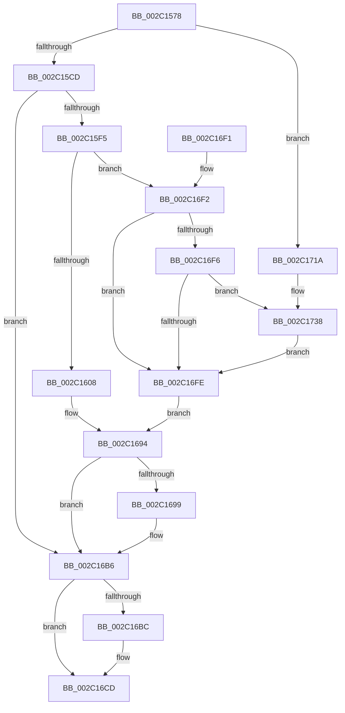

# MmFreePoolMemory

- RVA: `0x002C1578`–`0x002C173C` (길이 `452` bytes)
- VA: `0x00000001402C1578`
- 실행 섹션: `.text`
- PDB 이름 있음: `예`; PDB Function 태그: `아니요`
- unwind 정보 RVA: `0x0006E724`
- 디코드: `116`개 명령, `452/452` bytes 표시
- 미해석 바이트: `0` (있으면 어셈블리에 `.byte`로 보존)

> 이 문서는 커널 이미지의 기계어와 PDB 기호를 분석해 생성했습니다. 4번과 5번은 함수 원형과 자료형을 바이너리 사용 방식에서 추정한 C 해석이며 원본 소스 복구 결과는 아닙니다.

## 1. Dependencies

- 직접 호출 지점: **6**; 고유 호출 대상: **6**
- 직접 호출자로 확인된 함수: **9**
- RIP 상대 이미지 참조: **5**

### Outgoing calls
- `0x002C15BC` → [MiDeterminePoolType](MiDeterminePoolType_function_002C1750.md) (function, `0x002C1750`)
- `0x002C166E` → [MiDecommitPages](../24/MiDecommitPages_function_00241BD0.md) (function, `0x00241BD0`)
- `0x002C168F` → [MiUnmapReturnSystemCommit](../../page/A3/MiUnmapReturnSystemCommit_function_00A35600.md) (function, `0x00A35600`)
- `0x002C16C8` → [MiReturnSystemVa](../23/MiReturnSystemVa_function_002394C4.md) (function, `0x002394C4`)
- `0x002C170D` → [MiClearNonPagedPtes](MiClearNonPagedPtes_function_002C17A0.md) (function, `0x002C17A0`)
- `0x002C1732` → [KeBugCheckEx](../4F/KeBugCheckEx_function_004FD660.md) (function, `0x004FD660`)

### Direct callers
- [RtlpHpEnvFreeVA](RtlpHpEnvFreeVA_function_002C1534.md) at `0x002C1541`
- [RtlpHpVaMgrCtxFree](../2E/RtlpHpVaMgrCtxFree_function_002ED734.md) at `0x002ED882`
- [RtlpHpVaMgrRangeFree](../2E/RtlpHpVaMgrRangeFree_function_002ED9F4.md) at `0x002EDA62`
- [RtlpHpVaMgrAlloc](../2E/RtlpHpVaMgrAlloc_function_002EDB1C.md) at `0x002EDD24`
- [RtlpCSparseBitmapPageDecommit](../2E/RtlpCSparseBitmapPageDecommit_function_002EFAD4.md) at `0x002EFE97`
- [RtlpHpSegMgrCommit](../32/RtlpHpSegMgrCommit_function_00326BE4.md) at `0x00326E95`
- [sub_00328FA3](../32/Unknown_function_00328FA3.md) at `0x003292FF`
- [sub_00328FA3](../32/Unknown_function_00328FA3.md) at `0x00329355`
- [sub_00329430](../32/Unknown_function_00329430.md) at `0x00329442`
- [RtlpHpVaMgrRangeDecommit](../60/RtlpHpVaMgrRangeDecommit_function_00604040.md) at `0x00604104`

### Static image references
- `0x002C1673` → RVA `0x00E3816E` (`.data`; read)
- `0x002C167F` → RVA `0x00E30088` (`.data`; read)
- `0x002C169C` → RVA `0x00E37650` (`.data`; read)
- `0x002C16A7` → RVA `0x00E2CB48` (`.data`; read)
- `0x002C16F6` → RVA `0x00FC6C14` (`ALMOSTRO`; read)

## 2. Other-region calls and transfers

- 다른 실행 섹션으로 향하는 call: **1**
  - `0x002C168F` → [MiUnmapReturnSystemCommit](../../page/A3/MiUnmapReturnSystemCommit_function_00A35600.md) (`.text` → `PAGE`)
- 별도 외부 분기/꼬리 이동을 확인하지 못했습니다.

## 3. Assembly (complete function range)

```asm
002C1578  48 8B C4                        mov rax, rsp
002C157B  48 89 58 08                     mov qword ptr [rax + 8], rbx
002C157F  48 89 68 10                     mov qword ptr [rax + 0x10], rbp
002C1583  48 89 70 18                     mov qword ptr [rax + 0x18], rsi
002C1587  48 89 78 20                     mov qword ptr [rax + 0x20], rdi
002C158B  41 54                           push r12
002C158D  41 56                           push r14
002C158F  41 57                           push r15
002C1591  48 81 EC 80 00 00 00            sub rsp, 0x80
002C1598  4C 8B 32                        mov r14, qword ptr [rdx]
002C159B  41 BA 00 00 00 00               mov r10d, 0
002C15A1  48 8B 31                        mov rsi, qword ptr [rcx]
002C15A4  49 F7 C6 FF 0F 00 00            test r14, 0xfff
002C15AB  49 8B C6                        mov rax, r14
002C15AE  48 8B CE                        mov rcx, rsi
002C15B1  41 0F 95 C2                     setne r10b
002C15B5  48 C1 E8 0C                     shr rax, 0xc
002C15B9  4C 03 D0                        add r10, rax
002C15BC  E8 8F 01 00 00                  call 0x1402c1750
002C15C1  4C 8B F8                        mov r15, rax
002C15C4  48 85 C0                        test rax, rax
002C15C7  0F 84 4D 01 00 00               je 0x1402c171a
002C15CD  45 33 E4                        xor r12d, r12d
002C15D0  B9 00 40 00 00                  mov ecx, 0x4000
002C15D5  48 83 F8 40                     cmp rax, 0x40
002C15D9  41 8B F8                        mov edi, r8d
002C15DC  41 0F 95 C4                     setne r12b
002C15E0  0B F9                           or edi, ecx
002C15E2  41 0F BA E0 0F                  bt r8d, 0xf
002C15E7  41 0F 43 F8                     cmovae edi, r8d
002C15EB  8B DF                           mov ebx, edi
002C15ED  85 F9                           test ecx, edi
002C15EF  0F 84 C1 00 00 00               je 0x1402c16b6
002C15F5  8B C7                           mov eax, edi
002C15F7  B9 00 00 00 40                  mov ecx, 0x40000000
002C15FC  23 C1                           and eax, ecx
002C15FE  49 83 FF 40                     cmp r15, 0x40
002C1602  0F 84 EA 00 00 00               je 0x1402c16f2
002C1608  33 C9                           xor ecx, ecx
002C160A  0F 57 C0                        xorps xmm0, xmm0
002C160D  F7 D8                           neg eax
002C160F  48 89 4C 24 70                  mov qword ptr [rsp + 0x70], rcx
002C1614  48 8B CE                        mov rcx, rsi
002C1617  48 BA F8 FF FF FF 7F 00 00 00   movabs rdx, 0x7ffffffff8
002C1621  1B C0                           sbb eax, eax
002C1623  48 C1 E9 09                     shr rcx, 9
002C1627  F7 D0                           not eax
002C1629  48 23 CA                        and rcx, rdx
002C162C  83 E0 10                        and eax, 0x10
002C162F  0F 11 44 24 40                  movups xmmword ptr [rsp + 0x40], xmm0
002C1634  0F 11 44 24 50                  movups xmmword ptr [rsp + 0x50], xmm0
002C1639  0F 11 44 24 60                  movups xmmword ptr [rsp + 0x60], xmm0
002C163E  48 BA 00 00 00 00 80 F6 FF FF   movabs rdx, 0xfffff68000000000
002C1648  48 03 CA                        add rcx, rdx
002C164B  45 33 C9                        xor r9d, r9d
002C164E  48 8D 54 24 40                  lea rdx, [rsp + 0x40]
002C1653  45 33 C0                        xor r8d, r8d
002C1656  48 89 54 24 38                  mov qword ptr [rsp + 0x38], rdx
002C165B  49 8B D2                        mov rdx, r10
002C165E  48 83 64 24 30 00               and qword ptr [rsp + 0x30], 0
002C1664  89 44 24 28                     mov dword ptr [rsp + 0x28], eax
002C1668  48 83 64 24 20 00               and qword ptr [rsp + 0x20], 0
002C166E  E8 5D 05 F8 FF                  call 0x140241bd0
002C1673  0F B7 05 F4 6A B7 00            movzx eax, word ptr [rip + 0xb76af4]
002C167A  48 8D 54 24 40                  lea rdx, [rsp + 0x40]
002C167F  48 8B 0D 02 EA B6 00            mov rcx, qword ptr [rip + 0xb6ea02]
002C1686  48 8B 6C 24 58                  mov rbp, qword ptr [rsp + 0x58]
002C168B  48 8B 0C C1                     mov rcx, qword ptr [rcx + rax*8]
002C168F  E8 6C 3F 77 00                  call 0x140a35600
002C1694  48 85 ED                        test rbp, rbp
002C1697  74 1D                           je 0x1402c16b6
002C1699  48 F7 DD                        neg rbp
002C169C  48 8D 0D AD 5F B7 00            lea rcx, [rip + 0xb75fad]
002C16A3  49 83 FF 40                     cmp r15, 0x40
002C16A7  48 8D 05 9A B4 B6 00            lea rax, [rip + 0xb6b49a]
002C16AE  48 0F 45 C1                     cmovne rax, rcx
002C16B2  F0 48 01 28                     lock add qword ptr [rax], rbp
002C16B6  0F BA E3 0F                     bt ebx, 0xf
002C16BA  73 11                           jae 0x1402c16cd
002C16BC  49 8D 14 36                     lea rdx, [r14 + rsi]
002C16C0  48 8B CE                        mov rcx, rsi
002C16C3  45 8D 44 24 04                  lea r8d, [r12 + 4]
002C16C8  E8 F7 7D F7 FF                  call 0x1402394c4
002C16CD  4C 8D 9C 24 80 00 00 00         lea r11, [rsp + 0x80]
002C16D5  33 C0                           xor eax, eax
002C16D7  49 8B 5B 20                     mov rbx, qword ptr [r11 + 0x20]
002C16DB  49 8B 6B 28                     mov rbp, qword ptr [r11 + 0x28]
002C16DF  49 8B 73 30                     mov rsi, qword ptr [r11 + 0x30]
002C16E3  49 8B 7B 38                     mov rdi, qword ptr [r11 + 0x38]
002C16E7  49 8B E3                        mov rsp, r11
002C16EA  41 5F                           pop r15
002C16EC  41 5E                           pop r14
002C16EE  41 5C                           pop r12
002C16F0  C3                              ret
002C16F1  CC                              int3
002C16F2  85 C0                           test eax, eax
002C16F4  75 08                           jne 0x1402c16fe
002C16F6  39 05 18 55 D0 00               cmp dword ptr [rip + 0xd05518], eax
002C16FC  75 3A                           jne 0x1402c1738
002C16FE  41 B9 01 00 00 00               mov r9d, 1
002C1704  44 8B C3                        mov r8d, ebx
002C1707  49 8B D2                        mov rdx, r10
002C170A  48 8B CE                        mov rcx, rsi
002C170D  E8 8E 00 00 00                  call 0x1402c17a0
002C1712  48 8B E8                        mov rbp, rax
002C1715  E9 7A FF FF FF                  jmp 0x1402c1694
002C171A  41 8B C0                        mov eax, r8d
002C171D  4D 8B CE                        mov r9, r14
002C1720  4C 8B C6                        mov r8, rsi
002C1723  48 89 44 24 20                  mov qword ptr [rsp + 0x20], rax
002C1728  BA 05 53 00 00                  mov edx, 0x5305
002C172D  B9 1A 00 00 00                  mov ecx, 0x1a
002C1732  E8 29 BF 23 00                  call 0x1404fd660
002C1737  CC                              int3
002C1738  0B D9                           or ebx, ecx
002C173A  EB C2                           jmp 0x1402c16fe
```

## 4. C-style interpretation (structured pseudocode)

```c
__int64 __fastcall MmFreePoolMemory(__int64 a1, __int64 a2, int a3, int a4)
{
    __int64 result;
    __int64 v_r10;
    __int64 v_r12;
    __int64 v_rbp;
    __int64 v_rbx;
    __int64 v_rdi;
    __int64 v_rsp;
    unsigned __int64 v_stack_m18;
    unsigned __int64 v_stack_m28;
    unsigned __int64 v_stack_m38;
    unsigned __int64 v_stack_m40;
    unsigned __int64 v_stack_m48;
    unsigned __int64 v_stack_m58;
    unsigned __int64 v_stack_m60;
    unsigned __int64 v_stack_m68;
    unsigned int v_stack_m70;
    unsigned __int64 v_stack_m78;

    *(unsigned __int64 *)(v_rsp + 8) = v_rbx;
    *(unsigned __int64 *)(v_rsp + 16) = v_rbp;
    *(unsigned __int64 *)(v_rsp + 24) = v_rsi;
    *(unsigned __int64 *)(v_rsp + 32) = v_rdi;
    v_rsp = (v_rsp) - (128);
    v_r10 = (((*(unsigned __int64 *)(a2)) & (0xFFFULL)) != 0) ? 1 : 0;
    result = (*(unsigned __int64 *)(a2)) >> (12);
    v_r10 = (v_r10) + (result);
    result = MiDeterminePoolType(*(unsigned __int64 *)(a1), a2, a3, a4);
    if (result == 0) goto loc_002C171A;
    v_r12 = 0;
    v_r12 = (result != 64) ? 1 : 0;
    v_rdi = (unsigned int)(((unsigned int)(a3)) | ((unsigned int)((unsigned int)(0x4000ULL))));
    if (condition_is_above_or_equal) { v_rdi = a3; }
    if ((((unsigned int)((unsigned int)(0x4000ULL))) & ((unsigned int)(v_rdi))) == 0) goto loc_002C16B6;
    result = (unsigned int)(((unsigned int)((unsigned int)(v_rdi))) & ((unsigned int)((unsigned int)(0x40000000ULL))));
    if (result == 64) goto loc_002C16F2;
    a1 = 0;
    result = (unsigned int)(-(result));
    v_stack_m28 = 0;
    a1 = (*(unsigned __int64 *)(a1)) >> (9);
    result = (unsigned int)(~(result));
    a1 = (a1) & (a2);
    result = (unsigned int)((result) & (16));
    v_stack_m58 = v_xmm0;
    v_stack_m48 = v_xmm0;
    v_stack_m38 = v_xmm0;
    a1 = (a1) + (a2);
    a4 = 0;
    a3 = 0;
    v_stack_m60 = v_stack_m58;
    v_stack_m70 = (unsigned int)(result);
    result = MiDecommitPages(a1, v_r10, a3, a4);
    result = MiUnmapReturnSystemCommit(*(unsigned __int64 *)(*(unsigned __int64 *)(v_rip + 11987458) + *(unsigned __int16 *)(v_rip + 12020468) * 8), v_stack_m58, a3, a4);
loc_002C1694:
    v_rbp = v_stack_m40;
    if (v_stack_m40 != 0) {
        v_rbp = -(v_stack_m40);
        a1 = v_rip + 12017581;
        result = v_rip + 11973786;
        if (result != 64) { result = a1; }
    }
    if (result < 64) {
        a2 = *(unsigned __int64 *)(a2) + *(unsigned __int64 *)(a1) * 1;
        a1 = *(unsigned __int64 *)(a1);
        a3 = v_r12 + 4;
        result = MiReturnSystemVa(a1, a2, a3, a4);
    }
    result = 0;
    return result;
loc_002C16F2:
    if (0 != 0) goto loc_002C16FE;
    if ((*(unsigned int *)(v_rip + 13653272)) != 0) goto loc_002C1738;
loc_002C16FE:
    result = MiClearNonPagedPtes(*(unsigned __int64 *)(v_stack_m18 + 48), v_r10, (unsigned int)((unsigned int)(*(unsigned __int64 *)(v_stack_m18 + 32))), 1);
    goto loc_002C1694;
loc_002C171A:
    v_stack_m60 = (unsigned int)((unsigned int)((unsigned int)((unsigned int)(*(unsigned __int64 *)(v_stack_m18 + 32)))));
    result = KeBugCheckEx(26, (unsigned int)(0x5305ULL), *(unsigned __int64 *)(v_stack_m18 + 48), *(unsigned __int64 *)(a2));
loc_002C1738:
    v_rbx = (unsigned int)((*(unsigned __int64 *)(v_stack_m18 + 32)) | (26));
    goto loc_002C16FE;
}
```

## 5. (Beta) C Style

```c
int64_t MmFreePoolMemory(void *Arg1, void *Arg2, int32_t Arg3, int32_t Arg4)
{
    uint8_t *arg1 = (uint8_t *)Arg1;
    uint8_t *arg2 = (uint8_t *)Arg2;

    int64_t result;
    int64_t local_r10;
    int64_t local_r12;
    int64_t local_rbp;
    int64_t local_rbx;
    int64_t local_rdi;
    int64_t local_rsp;
    uint64_t v_stack_m18;
    uint64_t v_stack_m28;
    uint64_t v_stack_m38;
    uint64_t v_stack_m40;
    uint64_t v_stack_m48;
    uint64_t v_stack_m58;
    uint64_t v_stack_m60;
    uint64_t v_stack_m68;
    uint32_t v_stack_m70;
    uint64_t v_stack_m78;

    *(uint64_t *)(local_rsp + 0x8) = local_rbx;
    *(uint64_t *)(local_rsp + 0x10) = local_rbp;
    *(uint64_t *)(local_rsp + 0x18) = local_rsi;
    *(uint64_t *)(local_rsp + 0x20) = local_rdi;
    local_rsp = (local_rsp) - (128);
    local_r10 = (((*(uint64_t *)(arg2)) & (0xFFFULL)) != 0) ? 1 : 0;
    result = (*(uint64_t *)(arg2)) >> (12);
    local_r10 = (local_r10) + (result);
    result = MiDeterminePoolType(*(uint64_t *)(arg1), Arg2, Arg3, Arg4);
    if (result == 0) goto loc_002C171A;
    local_r12 = 0;
    local_r12 = (result != 64) ? 1 : 0;
    local_rdi = (uint32_t)(((uint32_t)(Arg3)) | ((uint32_t)((uint32_t)(0x4000ULL))));
    if (condition_is_above_or_equal) { local_rdi = Arg3; }
    if ((((uint32_t)((uint32_t)(0x4000ULL))) & ((uint32_t)(local_rdi))) == 0) goto loc_002C16B6;
    result = (uint32_t)(((uint32_t)((uint32_t)(local_rdi))) & ((uint32_t)((uint32_t)(0x40000000ULL))));
    if (result == 64) goto loc_002C16F2;
    Arg1 = 0;
    result = (uint32_t)(-(result));
    v_stack_m28 = 0;
    Arg1 = (*(uint64_t *)(arg1)) >> (9);
    result = (uint32_t)(~(result));
    Arg1 = (Arg1) & (Arg2);
    result = (uint32_t)((result) & (16));
    v_stack_m58 = v_xmm0;
    v_stack_m48 = v_xmm0;
    v_stack_m38 = v_xmm0;
    Arg1 = (Arg1) + (Arg2);
    Arg4 = 0;
    Arg3 = 0;
    v_stack_m60 = v_stack_m58;
    v_stack_m70 = (uint32_t)(result);
    result = MiDecommitPages(Arg1, local_r10, Arg3, Arg4);
    result = MiUnmapReturnSystemCommit(*(uint64_t *)(*(uint64_t *)(v_rip + 0xB6EA02) + *(uint16_t *)(v_rip + 0xB76AF4) * 8), v_stack_m58, Arg3, Arg4);
loc_002C1694:
    local_rbp = v_stack_m40;
    if (v_stack_m40 != 0) {
        local_rbp = -(v_stack_m40);
        Arg1 = v_rip + 12017581;
        result = v_rip + 11973786;
        if (result != 64) { result = Arg1; }
    }
    if (result < 64) {
        Arg2 = *(uint64_t *)(arg2) + *(uint64_t *)(arg1) * 1;
        Arg1 = *(uint64_t *)(arg1);
        Arg3 = local_r12 + 4;
        result = MiReturnSystemVa(Arg1, Arg2, Arg3, Arg4);
    }
    result = 0;
    return result;
loc_002C16F2:
    if (0 != 0) goto loc_002C16FE;
    if ((*(uint32_t *)(v_rip + 0xD05518)) != 0) goto loc_002C1738;
loc_002C16FE:
    result = MiClearNonPagedPtes(*(uint64_t *)(v_stack_m18 + 0x30), local_r10, (uint32_t)((uint32_t)(*(uint64_t *)(v_stack_m18 + 0x20))), 1);
    goto loc_002C1694;
loc_002C171A:
    v_stack_m60 = (uint32_t)((uint32_t)((uint32_t)((uint32_t)(*(uint64_t *)(v_stack_m18 + 0x20)))));
    result = KeBugCheckEx(26, (uint32_t)(0x5305ULL), *(uint64_t *)(v_stack_m18 + 0x30), *(uint64_t *)(arg2));
loc_002C1738:
    local_rbx = (uint32_t)((*(uint64_t *)(v_stack_m18 + 0x20)) | (26));
    goto loc_002C16FE;
}
```

### 관측된 메모리 오프셋

구조체 형식이 확인되지 않은 접근은 인자 기준의 오프셋으로만 기록했습니다.

| 기준 인자 | 오프셋 표현 | 폭 (bit) | 접근 |
|---|---:|---:|---|
| `Arg1` | `+ 0x0` | `64` | `R` |
| `Arg2` | `+ 0x0` | `64` | `R` |

## 6. Execution-region graph

[열기: 2D/3D 그래프와 함수 탐색 컨트롤 패널](../../../control-panel.html?section=text&rva=0x002C1578&view=graph)

- 2D 그래프는 위에서 아래로 흐르고, 3D 그래프는 빈 공간을 드래그해 회전합니다. Shift+드래그는 이동, 휠은 확대·축소, 함수 노드 선택은 대상 보고서 이동입니다.

### Static fallback


