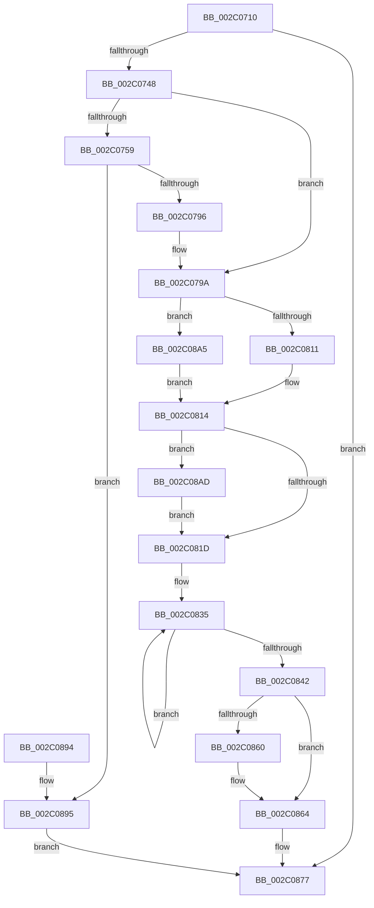

# MmQuerySystemWorkingSetInformation

- RVA: `0x002C0710`–`0x002C08BB` (길이 `427` bytes)
- VA: `0x00000001402C0710`
- 실행 섹션: `.text`
- PDB 이름 있음: `예`; PDB Function 태그: `아니요`
- unwind 정보 RVA: `0x0006E608`
- 디코드: `108`개 명령, `427/427` bytes 표시
- 미해석 바이트: `0` (있으면 어셈블리에 `.byte`로 보존)

> 이 문서는 커널 이미지의 기계어와 PDB 기호를 분석해 생성했습니다. 4번과 5번은 함수 원형과 자료형을 바이너리 사용 방식에서 추정한 C 해석이며 원본 소스 복구 결과는 아닙니다.

## 1. Dependencies

- 직접 호출 지점: **6**; 고유 호출 대상: **6**
- 직접 호출자로 확인된 함수: **1**
- RIP 상대 이미지 참조: **1**

### Outgoing calls
- `0x002C0748` → [MiMapWorkingSetTypeToVm](MiMapWorkingSetTypeToVm_function_002C08C4.md) (function, `0x002C08C4`)
- `0x002C07AF` → [MiLockWorkingSetShared](../27/MiLockWorkingSetShared_function_0027CBF0.md) (function, `0x0027CBF0`)
- `0x002C07BB` → [MiLockWorkingSetCoreExclusive](MiLockWorkingSetCoreExclusive_function_002C0CFC.md) (function, `0x002C0CFC`)
- `0x002C0804` → [MiUnlockWorkingSetCoreExclusive](MiUnlockWorkingSetCoreExclusive_function_002C0DC4.md) (function, `0x002C0DC4`)
- `0x002C0824` → [MiUnlockWorkingSetShared](../27/MiUnlockWorkingSetShared_function_0027D690.md) (function, `0x0027D690`)
- `0x002C089E` → [memset](../6C/memset_function_006C6C40.md) (function, `0x006C6C40`)

### Direct callers
- [ExpQuerySystemInformation](../../page/A5/ExpQuerySystemInformation_function_00A57858.md) at `0x00A5988E`

### Static image references
- `0x002C0769` → RVA `0x00E30088` (`.data`; read)

## 2. Other-region calls and transfers

- 다른 실행 섹션으로 향하는 call: **0**
- 별도 외부 분기/꼬리 이동을 확인하지 못했습니다.

## 3. Assembly (complete function range)

```asm
002C0710  48 89 5C 24 10                  mov qword ptr [rsp + 0x10], rbx
002C0715  48 89 6C 24 18                  mov qword ptr [rsp + 0x18], rbp
002C071A  48 89 74 24 20                  mov qword ptr [rsp + 0x20], rsi
002C071F  57                              push rdi
002C0720  41 54                           push r12
002C0722  41 55                           push r13
002C0724  41 56                           push r14
002C0726  41 57                           push r15
002C0728  48 83 EC 20                     sub rsp, 0x20
002C072C  45 33 F6                        xor r14d, r14d
002C072F  8D 41 FF                        lea eax, [rcx - 1]
002C0732  48 8D 72 3C                     lea rsi, [rdx + 0x3c]
002C0736  48 8B FA                        mov rdi, rdx
002C0739  44 89 36                        mov dword ptr [rsi], r14d
002C073C  44 8B F9                        mov r15d, ecx
002C073F  83 F8 03                        cmp eax, 3
002C0742  0F 87 2F 01 00 00               ja 0x1402c0877
002C0748  E8 77 01 00 00                  call 0x1402c08c4
002C074D  48 8B E8                        mov rbp, rax
002C0750  4C 8B E6                        mov r12, rsi
002C0753  41 83 FF 01                     cmp r15d, 1
002C0757  75 41                           jne 0x1402c079a
002C0759  65 48 8B 04 25 88 01 00 00      mov rax, qword ptr gs:[0x188]
002C0762  48 8B 88 B8 00 00 00            mov rcx, qword ptr [rax + 0xb8]
002C0769  48 8B 05 18 F9 B6 00            mov rax, qword ptr [rip + 0xb6f918]
002C0770  0F B7 91 AE 04 00 00            movzx edx, word ptr [rcx + 0x4ae]
002C0777  48 8B 0C D0                     mov rcx, qword ptr [rax + rdx*8]
002C077B  8A 81 5C 48 00 00               mov al, byte ptr [rcx + 0x485c]
002C0781  48 81 C1 80 49 00 00            add rcx, 0x4980
002C0788  F6 D8                           neg al
002C078A  48 1B ED                        sbb rbp, rbp
002C078D  48 23 E9                        and rbp, rcx
002C0790  0F 84 FF 00 00 00               je 0x1402c0895
002C0796  4C 8D 67 3C                     lea r12, [rdi + 0x3c]
002C079A  0F B7 8D AE 00 00 00            movzx ecx, word ptr [rbp + 0xae]
002C07A1  48 8B 05 E0 F8 B6 00            mov rax, qword ptr [rip + 0xb6f8e0]
002C07A8  4C 8B 2C C8                     mov r13, qword ptr [rax + rcx*8]
002C07AC  48 8B CD                        mov rcx, rbp
002C07AF  E8 3C C4 FB FF                  call 0x14027cbf0
002C07B4  48 8B CD                        mov rcx, rbp
002C07B7  88 44 24 50                     mov byte ptr [rsp + 0x50], al
002C07BB  E8 3C 05 00 00                  call 0x1402c0cfc
002C07C0  48 8B 8D 80 00 00 00            mov rcx, qword ptr [rbp + 0x80]
002C07C7  41 8D 47 FF                     lea eax, [r15 - 1]
002C07CB  48 89 0F                        mov qword ptr [rdi], rcx
002C07CE  48 8B 8D A0 00 00 00            mov rcx, qword ptr [rbp + 0xa0]
002C07D5  48 89 4F 08                     mov qword ptr [rdi + 8], rcx
002C07D9  8B 4D 04                        mov ecx, dword ptr [rbp + 4]
002C07DC  89 4F 10                        mov dword ptr [rdi + 0x10], ecx
002C07DF  48 8B 4D 70                     mov rcx, qword ptr [rbp + 0x70]
002C07E3  48 89 4F 18                     mov qword ptr [rdi + 0x18], rcx
002C07E7  48 8B 4D 78                     mov rcx, qword ptr [rbp + 0x78]
002C07EB  48 89 4F 20                     mov qword ptr [rdi + 0x20], rcx
002C07EF  48 8B CD                        mov rcx, rbp
002C07F2  8B 9D B8 00 00 00               mov ebx, dword ptr [rbp + 0xb8]
002C07F8  49 8B 84 C5 48 1C 00 00         mov rax, qword ptr [r13 + rax*8 + 0x1c48]
002C0800  48 89 47 30                     mov qword ptr [rdi + 0x30], rax
002C0804  E8 BB 05 00 00                  call 0x1402c0dc4
002C0809  84 DB                           test bl, bl
002C080B  0F 88 94 00 00 00               js 0x1402c08a5
002C0811  4C 8B E6                        mov r12, rsi
002C0814  F6 C3 40                        test bl, 0x40
002C0817  0F 85 90 00 00 00               jne 0x1402c08ad
002C081D  8A 54 24 50                     mov dl, byte ptr [rsp + 0x50]
002C0821  48 8B CD                        mov rcx, rbp
002C0824  E8 67 CE FB FF                  call 0x14027d690
002C0829  49 8D 85 24 1C 00 00            lea rax, [r13 + 0x1c24]
002C0830  B9 07 00 00 00                  mov ecx, 7
002C0835  44 03 30                        add r14d, dword ptr [rax]
002C0838  48 8D 40 04                     lea rax, [rax + 4]
002C083C  48 83 E9 01                     sub rcx, 1
002C0840  75 F3                           jne 0x1402c0835
002C0842  48 8B 17                        mov rdx, qword ptr [rdi]
002C0845  48 8B 47 30                     mov rax, qword ptr [rdi + 0x30]
002C0849  44 89 77 38                     mov dword ptr [rdi + 0x38], r14d
002C084D  49 8B 8D 40 1C 00 00            mov rcx, qword ptr [r13 + 0x1c40]
002C0854  48 03 CA                        add rcx, rdx
002C0857  48 89 4F 28                     mov qword ptr [rdi + 0x28], rcx
002C085B  48 3B C8                        cmp rcx, rax
002C085E  76 04                           jbe 0x1402c0864
002C0860  48 89 47 28                     mov qword ptr [rdi + 0x28], rax
002C0864  48 8B 47 08                     mov rax, qword ptr [rdi + 8]
002C0868  48 C1 E2 0C                     shl rdx, 0xc
002C086C  48 C1 E0 0C                     shl rax, 0xc
002C0870  48 89 47 08                     mov qword ptr [rdi + 8], rax
002C0874  48 89 17                        mov qword ptr [rdi], rdx
002C0877  48 8B 5C 24 58                  mov rbx, qword ptr [rsp + 0x58]
002C087C  48 8B 6C 24 60                  mov rbp, qword ptr [rsp + 0x60]
002C0881  48 8B 74 24 68                  mov rsi, qword ptr [rsp + 0x68]
002C0886  48 83 C4 20                     add rsp, 0x20
002C088A  41 5F                           pop r15
002C088C  41 5E                           pop r14
002C088E  41 5D                           pop r13
002C0890  41 5C                           pop r12
002C0892  5F                              pop rdi
002C0893  C3                              ret
002C0894  CC                              int3
002C0895  33 D2                           xor edx, edx
002C0897  48 8B CF                        mov rcx, rdi
002C089A  44 8D 42 40                     lea r8d, [rdx + 0x40]
002C089E  E8 9D 63 40 00                  call 0x1406c6c40
002C08A3  EB D2                           jmp 0x1402c0877
002C08A5  83 0E 04                        or dword ptr [rsi], 4
002C08A8  E9 67 FF FF FF                  jmp 0x1402c0814
002C08AD  8B 06                           mov eax, dword ptr [rsi]
002C08AF  83 C8 01                        or eax, 1
002C08B2  41 89 04 24                     mov dword ptr [r12], eax
002C08B6  E9 62 FF FF FF                  jmp 0x1402c081d
```

## 4. C-style interpretation (structured pseudocode)

```c
__int64 __fastcall MmQuerySystemWorkingSetInformation(__int64 a1, __int64 a2)
{
    __int64 result;
    __int64 v_r14;
    __int64 v_rbp;
    __int64 v_rsp;
    unsigned __int64 v_stack_p10;
    unsigned __int64 v_stack_p18;
    unsigned __int64 v_stack_p20;
    unsigned __int8 v_stack_p8;

    v_stack_p10 = v_rbx;
    v_stack_p18 = v_rbp;
    v_stack_p20 = v_rsi;
    v_rsp = (v_rsp) - (32);
    v_r14 = 0;
    *(unsigned int *)(a2 + 60) = 0;
    if (((unsigned int)(a1 - 1)) > 3) goto loc_002C0877;
    result = MiMapWorkingSetTypeToVm(a1, a2, a3, a4);
    if (((unsigned int)((unsigned int)((unsigned int)(a1)))) != 1) goto loc_002C079A;
    a1 = (*(unsigned __int64 *)(*(unsigned __int64 *)(v_rip + 11991320) + *(unsigned __int16 *)(*(unsigned __int64 *)(*(unsigned __int64 *)(gs_base + (0 + 392)) + 184) + 1198) * 8)) + (0x4980ULL);
    result = (unsigned __int8)(-(*(unsigned __int8 *)(*(unsigned __int64 *)(*(unsigned __int64 *)(v_rip + 11991320) + *(unsigned __int16 *)(*(unsigned __int64 *)(*(unsigned __int64 *)(gs_base + (0 + 392)) + 184) + 1198) * 8) + 18524)));
    v_rbp = (result) & (a1);
    if (condition_is_equal) goto loc_002C0895;
loc_002C079A:
    result = MiLockWorkingSetShared(v_rbp, *(unsigned __int16 *)(*(unsigned __int64 *)(*(unsigned __int64 *)(gs_base + (0 + 392)) + 184) + 1198), a3, a4);
    v_stack_p8 = (unsigned __int8)(result);
    result = MiLockWorkingSetCoreExclusive(v_rbp, *(unsigned __int16 *)(*(unsigned __int64 *)(*(unsigned __int64 *)(gs_base + (0 + 392)) + 184) + 1198), a3, a4);
    *(unsigned __int64 *)(a2) = *(unsigned __int64 *)(v_rbp + 128);
    *(unsigned __int64 *)(a2 + 8) = *(unsigned __int64 *)(v_rbp + 160);
    *(unsigned int *)(a2 + 16) = (unsigned int)((unsigned int)(*(unsigned int *)(v_rbp + 4)));
    *(unsigned __int64 *)(a2 + 24) = *(unsigned __int64 *)(v_rbp + 112);
    *(unsigned __int64 *)(a2 + 32) = *(unsigned __int64 *)(v_rbp + 120);
    *(unsigned __int64 *)(a2 + 48) = *(unsigned __int64 *)(*(unsigned __int64 *)(*(unsigned __int64 *)(v_rip + 11991264) + *(unsigned __int16 *)(v_rbp + 174) * 8) + (unsigned int)((unsigned int)(a1)) - 1 * 8 + 7240);
    result = MiUnlockWorkingSetCoreExclusive(v_rbp, *(unsigned __int16 *)(*(unsigned __int64 *)(*(unsigned __int64 *)(gs_base + (0 + 392)) + 184) + 1198), a3, a4);
    if (sign_flag) goto loc_002C08A5;
loc_002C0814:
    if ((((unsigned __int8)((unsigned int)(*(unsigned int *)(v_rbp + 184)))) & (64)) != 0) goto loc_002C08AD;
loc_002C081D:
    result = MiUnlockWorkingSetShared(v_rbp, v_stack_p8, a3, a4);
loc_002C0835:
    v_r14 = (unsigned int)((v_r14) + (*(unsigned int *)(*(unsigned __int64 *)(*(unsigned __int64 *)(v_rip + 11991264) + *(unsigned __int16 *)(v_rbp + 174) * 8) + 7204)));
    a1 = (7) - (1);
    if (condition_is_not_equal) goto loc_002C0835;
    *(unsigned int *)(a2 + 56) = (unsigned int)(v_r14);
    a1 = (*(unsigned __int64 *)(*(unsigned __int64 *)(*(unsigned __int64 *)(v_rip + 11991264) + *(unsigned __int16 *)(v_rbp + 174) * 8) + 7232)) + (*(unsigned __int64 *)(a2));
    *(unsigned __int64 *)(a2 + 40) = a1;
    if (a1 >= = (*(unsigned __int64 *)(a2 + 48))) {
        *(unsigned __int64 *)(a2 + 40) = *(unsigned __int64 *)(a2 + 48);
    }
    a2 = (*(unsigned __int64 *)(a2)) << (12);
    result = (*(unsigned __int64 *)(a2 + 8)) << (12);
    *(unsigned __int64 *)(a2 + 8) = result;
    *(unsigned __int64 *)(a2) = a2;
loc_002C0877:
    v_rsp = (v_rsp) + (32);
    return result;
loc_002C0895:
    a2 = 0;
    result = memset(0, a2, a2 + 64, a4);
    goto loc_002C0877;
loc_002C08A5:
    goto loc_002C0814;
loc_002C08AD:
    result = (unsigned int)(((unsigned int)(*(unsigned int *)(v_stack_p20))) | (1));
    *(unsigned int *)(a2 + 60) = (unsigned int)(result);
    goto loc_002C081D;
}
```

## 5. (Beta) C Style

```c
int64_t MmQuerySystemWorkingSetInformation(void *Arg1, void *Arg2)
{
    uint8_t *arg1 = (uint8_t *)Arg1;
    uint8_t *arg2 = (uint8_t *)Arg2;

    int64_t result;
    int64_t local_r14;
    int64_t local_rbp;
    int64_t local_rsp;
    uint64_t v_stack_p10;
    uint64_t v_stack_p18;
    uint64_t v_stack_p20;
    uint8_t v_stack_p8;

    v_stack_p10 = local_rbx;
    v_stack_p18 = local_rbp;
    v_stack_p20 = local_rsi;
    local_rsp = (local_rsp) - (32);
    local_r14 = 0;
    *(uint32_t *)(arg2 + 0x3C) = 0;
    if (((uint32_t)(Arg1 - 1)) > 3) goto loc_002C0877;
    result = MiMapWorkingSetTypeToVm(Arg1, Arg2, a3, a4);
    if (((uint32_t)((uint32_t)((uint32_t)(Arg1)))) != 1) goto loc_002C079A;
    Arg1 = (*(uint64_t *)(*(uint64_t *)(v_rip + 0xB6F918) + *(uint16_t *)(*(uint64_t *)(*(uint64_t *)(gs_base + (0 + 0x188)) + 0xB8) + 0x4AE) * 8)) + (0x4980ULL);
    result = (uint8_t)(-(*(uint8_t *)(*(uint64_t *)(*(uint64_t *)(v_rip + 0xB6F918) + *(uint16_t *)(*(uint64_t *)(*(uint64_t *)(gs_base + (0 + 0x188)) + 0xB8) + 0x4AE) * 8) + 0x485C)));
    local_rbp = (result) & (Arg1);
    if (condition_is_equal) goto loc_002C0895;
loc_002C079A:
    result = MiLockWorkingSetShared(local_rbp, *(uint16_t *)(*(uint64_t *)(*(uint64_t *)(gs_base + (0 + 0x188)) + 0xB8) + 0x4AE), a3, a4);
    v_stack_p8 = (uint8_t)(result);
    result = MiLockWorkingSetCoreExclusive(local_rbp, *(uint16_t *)(*(uint64_t *)(*(uint64_t *)(gs_base + (0 + 0x188)) + 0xB8) + 0x4AE), a3, a4);
    *(uint64_t *)(arg2) = *(uint64_t *)(local_rbp + 0x80);
    *(uint64_t *)(arg2 + 0x8) = *(uint64_t *)(local_rbp + 0xA0);
    *(uint32_t *)(arg2 + 0x10) = (uint32_t)((uint32_t)(*(uint32_t *)(local_rbp + 0x4)));
    *(uint64_t *)(arg2 + 0x18) = *(uint64_t *)(local_rbp + 0x70);
    *(uint64_t *)(arg2 + 0x20) = *(uint64_t *)(local_rbp + 0x78);
    *(uint64_t *)(arg2 + 0x30) = *(uint64_t *)(*(uint64_t *)(*(uint64_t *)(v_rip + 0xB6F8E0) + *(uint16_t *)(local_rbp + 0xAE) * 8) + (uint32_t)((uint32_t)(arg1)) - 0x1 * 8 + 0x1C48);
    result = MiUnlockWorkingSetCoreExclusive(local_rbp, *(uint16_t *)(*(uint64_t *)(*(uint64_t *)(gs_base + (0 + 0x188)) + 0xB8) + 0x4AE), a3, a4);
    if (sign_flag) goto loc_002C08A5;
loc_002C0814:
    if ((((uint8_t)((uint32_t)(*(uint32_t *)(local_rbp + 0xB8)))) & (64)) != 0) goto loc_002C08AD;
loc_002C081D:
    result = MiUnlockWorkingSetShared(local_rbp, v_stack_p8, a3, a4);
loc_002C0835:
    local_r14 = (uint32_t)((local_r14) + (*(uint32_t *)(*(uint64_t *)(*(uint64_t *)(v_rip + 0xB6F8E0) + *(uint16_t *)(local_rbp + 0xAE) * 8) + 0x1C24)));
    Arg1 = (7) - (1);
    if (condition_is_not_equal) goto loc_002C0835;
    *(uint32_t *)(arg2 + 0x38) = (uint32_t)(local_r14);
    Arg1 = (*(uint64_t *)(*(uint64_t *)(*(uint64_t *)(v_rip + 0xB6F8E0) + *(uint16_t *)(local_rbp + 0xAE) * 8) + 0x1C40)) + (*(uint64_t *)(arg2));
    *(void **)(arg2 + 0x28) = Arg1;
    if (Arg1 >= = (*(uint64_t *)(arg2 + 0x30))) {
        *(uint64_t *)(arg2 + 0x28) = *(uint64_t *)(arg2 + 0x30);
    }
    Arg2 = (*(uint64_t *)(arg2)) << (12);
    result = (*(uint64_t *)(arg2 + 0x8)) << (12);
    *(uint64_t *)(arg2 + 0x8) = result;
    *(void **)(arg2) = Arg2;
loc_002C0877:
    local_rsp = (local_rsp) + (32);
    return result;
loc_002C0895:
    Arg2 = 0;
    result = memset(0, Arg2, Arg2 + 64, a4);
    goto loc_002C0877;
loc_002C08A5:
    goto loc_002C0814;
loc_002C08AD:
    result = (uint32_t)(((uint32_t)(*(uint32_t *)(v_stack_p20))) | (1));
    *(uint32_t *)(arg2 + 0x3C) = (uint32_t)(result);
    goto loc_002C081D;
}
```

### 관측된 메모리 오프셋

구조체 형식이 확인되지 않은 접근은 인자 기준의 오프셋으로만 기록했습니다.

| 기준 인자 | 오프셋 표현 | 폭 (bit) | 접근 |
|---|---:|---:|---|
| `Arg1` | `- 0x1` | `32` | `R` |
| `Arg2` | `+ 0x0` | `32` | `R` |
| `Arg2` | `+ 0x0` | `32` | `R/W` |
| `Arg2` | `+ 0x0` | `32` | `W` |
| `Arg2` | `+ 0x0` | `64` | `R` |
| `Arg2` | `+ 0x0` | `64` | `W` |
| `Arg2` | `+ 0x8` | `64` | `R` |
| `Arg2` | `+ 0x8` | `64` | `W` |
| `Arg2` | `+ 0x10` | `32` | `W` |
| `Arg2` | `+ 0x18` | `64` | `W` |
| `Arg2` | `+ 0x20` | `64` | `W` |
| `Arg2` | `+ 0x28` | `64` | `W` |
| `Arg2` | `+ 0x30` | `64` | `R` |
| `Arg2` | `+ 0x30` | `64` | `W` |
| `Arg2` | `+ 0x38` | `32` | `W` |
| `Arg2` | `+ 0x3C` | `64` | `R` |

## 6. Execution-region graph

[열기: 2D/3D 그래프와 함수 탐색 컨트롤 패널](../../../control-panel.html?section=text&rva=0x002C0710&view=graph)

- 2D 그래프는 위에서 아래로 흐르고, 3D 그래프는 빈 공간을 드래그해 회전합니다. Shift+드래그는 이동, 휠은 확대·축소, 함수 노드 선택은 대상 보고서 이동입니다.

### Static fallback


