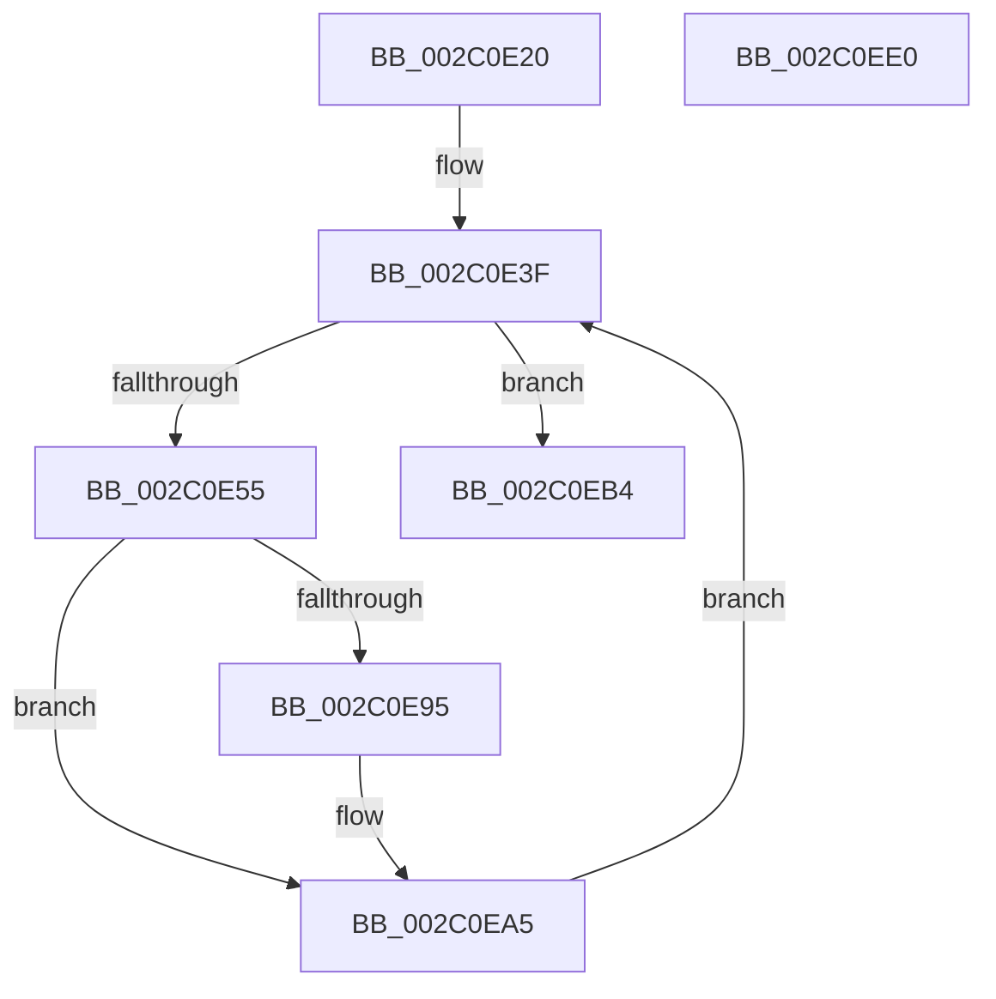

# PfSnNameQueryWorker

- RVA: `0x002C0E20`–`0x002C0EE1` (길이 `193` bytes)
- VA: `0x00000001402C0E20`
- 실행 섹션: `.text`
- PDB 이름 있음: `예`; PDB Function 태그: `아니요`
- unwind 정보 RVA: `0x0005FD94`
- 디코드: `46`개 명령, `193/193` bytes 표시
- 미해석 바이트: `0` (있으면 어셈블리에 `.byte`로 보존)

> 이 문서는 커널 이미지의 기계어와 PDB 기호를 분석해 생성했습니다. 4번과 5번은 함수 원형과 자료형을 바이너리 사용 방식에서 추정한 C 해석이며 원본 소스 복구 결과는 아닙니다.

## 1. Dependencies

- 직접 호출 지점: **7**; 고유 호출 대상: **6**
- 직접 호출자로 확인된 함수: **0**
- RIP 상대 이미지 참조: **1**

### Outgoing calls
- `0x002C0E42` → [ExAcquireSpinLockExclusive](../24/ExAcquireSpinLockExclusive_function_00248690.md) (function, `0x00248690`)
- `0x002C0E69` → [ExReleaseSpinLockExclusive](ExReleaseSpinLockExclusive_function_002C0EF0.md) (function, `0x002C0EF0`)
- `0x002C0E8C` → [guard_dispatch_icall](../6B/guard_dispatch_icall_function_006BAAD0.md) (function, `0x006BAAD0`)
- `0x002C0EA0` → [PfSnVolumeKeyQuery](../../page/A1/PfSnVolumeKeyQuery_function_00A18928.md) (function, `0x00A18928`)
- `0x002C0EAD` → [ObfDereferenceObjectWithTag](../2F/ObfDereferenceObjectWithTag_function_002F78E0.md) (function, `0x002F78E0`)
- `0x002C0EBF` → [ExReleaseSpinLockExclusive](ExReleaseSpinLockExclusive_function_002C0EF0.md) (function, `0x002C0EF0`)
- `0x002C0ECB` → [ExReleaseRundownProtection](../34/ExReleaseRundownProtection_function_00349E80.md) (function, `0x00349E80`)

### Direct callers
- 이 함수 시작 RVA로 연결되는 직접 call은 확인되지 않았습니다. 간접 호출은 완전히 역산할 수 없습니다.

### Static image references
- `0x002C0E6E` → RVA `0x00E671E8` (`.data`; read)

## 2. Other-region calls and transfers

- 다른 실행 섹션으로 향하는 call: **1**
  - `0x002C0EA0` → [PfSnVolumeKeyQuery](../../page/A1/PfSnVolumeKeyQuery_function_00A18928.md) (`.text` → `PAGE`)
- 별도 외부 분기/꼬리 이동을 확인하지 못했습니다.

## 3. Assembly (complete function range)

```asm
002C0E20  48 89 5C 24 10                  mov qword ptr [rsp + 0x10], rbx
002C0E25  48 89 74 24 18                  mov qword ptr [rsp + 0x18], rsi
002C0E2A  57                              push rdi
002C0E2B  48 83 EC 20                     sub rsp, 0x20
002C0E2F  48 83 64 24 30 00               and qword ptr [rsp + 0x30], 0
002C0E35  48 8D B9 40 02 00 00            lea rdi, [rcx + 0x240]
002C0E3C  48 8B D9                        mov rbx, rcx
002C0E3F  48 8B CF                        mov rcx, rdi
002C0E42  E8 49 78 F8 FF                  call 0x140248690
002C0E47  48 8B B3 18 02 00 00            mov rsi, qword ptr [rbx + 0x218]
002C0E4E  8A D0                           mov dl, al
002C0E50  48 85 F6                        test rsi, rsi
002C0E53  74 5F                           je 0x1402c0eb4
002C0E55  48 8B 0E                        mov rcx, qword ptr [rsi]
002C0E58  48 89 8B 18 02 00 00            mov qword ptr [rbx + 0x218], rcx
002C0E5F  48 8B CF                        mov rcx, rdi
002C0E62  48 C7 06 0A 00 00 00            mov qword ptr [rsi], 0xa
002C0E69  E8 82 00 00 00                  call 0x1402c0ef0
002C0E6E  48 8B 05 73 63 BA 00            mov rax, qword ptr [rip + 0xba6373]
002C0E75  4C 8D 44 24 30                  lea r8, [rsp + 0x30]
002C0E7A  48 8B 76 08                     mov rsi, qword ptr [rsi + 8]
002C0E7E  48 8B 8B 60 01 00 00            mov rcx, qword ptr [rbx + 0x160]
002C0E85  48 8B D6                        mov rdx, rsi
002C0E88  48 8B 40 10                     mov rax, qword ptr [rax + 0x10]
002C0E8C  E8 3F 9C 3F 00                  call 0x1406baad0
002C0E91  85 C0                           test eax, eax
002C0E93  78 10                           js 0x1402c0ea5
002C0E95  48 8B 54 24 30                  mov rdx, qword ptr [rsp + 0x30]
002C0E9A  4C 8B C6                        mov r8, rsi
002C0E9D  48 8B CB                        mov rcx, rbx
002C0EA0  E8 83 7A 75 00                  call 0x140a18928
002C0EA5  BA 44 66 6C 74                  mov edx, 0x746c6644
002C0EAA  48 8B CE                        mov rcx, rsi
002C0EAD  E8 2E 6A 03 00                  call 0x1402f78e0
002C0EB2  EB 8B                           jmp 0x1402c0e3f
002C0EB4  48 83 A3 38 02 00 00 00         and qword ptr [rbx + 0x238], 0
002C0EBC  48 8B CF                        mov rcx, rdi
002C0EBF  E8 2C 00 00 00                  call 0x1402c0ef0
002C0EC4  48 8D 8B 68 01 00 00            lea rcx, [rbx + 0x168]
002C0ECB  E8 B0 8F 08 00                  call 0x140349e80
002C0ED0  48 8B 5C 24 38                  mov rbx, qword ptr [rsp + 0x38]
002C0ED5  48 8B 74 24 40                  mov rsi, qword ptr [rsp + 0x40]
002C0EDA  48 83 C4 20                     add rsp, 0x20
002C0EDE  5F                              pop rdi
002C0EDF  C3                              ret
002C0EE0  CC                              int3
```

## 4. C-style interpretation (structured pseudocode)

```c
__int64 __fastcall PfSnNameQueryWorker(__int64 a1)
{
    __int64 result;
    __int64 v_rsp;
    unsigned __int64 v_stack_p10;
    unsigned __int64 v_stack_p18;
    unsigned __int64 v_stack_p8;

    v_stack_p10 = v_rbx;
    v_stack_p18 = v_rsi;
    v_rsp = (v_rsp) - (32);
loc_002C0E3F:
    result = ExAcquireSpinLockExclusive(a1 + 576, a2, a3, a4);
    if (*(unsigned __int64 *)(a1 + 536) == 0) goto loc_002C0EB4;
    *(unsigned __int64 *)(a1 + 536) = *(unsigned __int64 *)(*(unsigned __int64 *)(a1 + 536));
    *(unsigned __int64 *)(*(unsigned __int64 *)(a1 + 536)) = 10;
    result = ExReleaseSpinLockExclusive(a1 + 576, (unsigned __int8)(result), a3, a4);
    result = guard_dispatch_icall(*(unsigned __int64 *)(a1 + 352), *(unsigned __int64 *)(*(unsigned __int64 *)(a1 + 536) + 8), v_stack_p8, a4);
    if (!(sign_flag)) {
        a2 = v_stack_p8;
        a3 = *(unsigned __int64 *)(*(unsigned __int64 *)(a1 + 536) + 8);
        a1 = a1;
        result = PfSnVolumeKeyQuery(a1, a2, a3, a4);
    }
    result = ObfDereferenceObjectWithTag(*(unsigned __int64 *)(*(unsigned __int64 *)(a1 + 536) + 8), (unsigned int)(0x746C6644ULL), a3, a4);
    goto loc_002C0E3F;
loc_002C0EB4:
    result = ExReleaseSpinLockExclusive(a1 + 576, (unsigned int)(0x746C6644ULL), a3, a4);
    result = ExReleaseRundownProtection(a1 + 360, (unsigned int)(0x746C6644ULL), a3, a4);
    v_rsp = (v_rsp) + (32);
    return result;
}
```

## 5. (Beta) C Style

```c
int64_t PfSnNameQueryWorker(void *Arg1)
{
    uint8_t *arg1 = (uint8_t *)Arg1;

    int64_t result;
    int64_t local_rsp;
    uint64_t v_stack_p10;
    uint64_t v_stack_p18;
    uint64_t v_stack_p8;

    v_stack_p10 = local_rbx;
    v_stack_p18 = local_rsi;
    local_rsp = (local_rsp) - (32);
loc_002C0E3F:
    result = ExAcquireSpinLockExclusive(Arg1 + 576, a2, a3, a4);
    if (*(uint64_t *)(arg1 + 0x218) == 0) goto loc_002C0EB4;
    *(uint64_t *)(arg1 + 0x218) = *(uint64_t *)(*(uint64_t *)(arg1 + 0x218));
    *(uint64_t *)(*(uint64_t *)(arg1 + 0x218)) = 10;
    result = ExReleaseSpinLockExclusive(Arg1 + 576, (uint8_t)(result), a3, a4);
    result = guard_dispatch_icall(*(uint64_t *)(arg1 + 0x160), *(uint64_t *)(*(uint64_t *)(arg1 + 0x218) + 0x8), v_stack_p8, a4);
    if (!(sign_flag)) {
        a2 = v_stack_p8;
        a3 = *(uint64_t *)(*(uint64_t *)(arg1 + 0x218) + 0x8);
        Arg1 = Arg1;
        result = PfSnVolumeKeyQuery(Arg1, a2, a3, a4);
    }
    result = ObfDereferenceObjectWithTag(*(uint64_t *)(*(uint64_t *)(arg1 + 0x218) + 0x8), (uint32_t)(0x746C6644ULL), a3, a4);
    goto loc_002C0E3F;
loc_002C0EB4:
    result = ExReleaseSpinLockExclusive(Arg1 + 576, (uint32_t)(0x746C6644ULL), a3, a4);
    result = ExReleaseRundownProtection(Arg1 + 360, (uint32_t)(0x746C6644ULL), a3, a4);
    local_rsp = (local_rsp) + (32);
    return result;
}
```

### 관측된 메모리 오프셋

구조체 형식이 확인되지 않은 접근은 인자 기준의 오프셋으로만 기록했습니다.

| 기준 인자 | 오프셋 표현 | 폭 (bit) | 접근 |
|---|---:|---:|---|
| `Arg1` | `+ 0x160` | `64` | `R` |
| `Arg1` | `+ 0x168` | `64` | `R` |
| `Arg1` | `+ 0x218` | `64` | `R` |
| `Arg1` | `+ 0x218` | `64` | `W` |
| `Arg1` | `+ 0x238` | `64` | `R/W` |
| `Arg1` | `+ 0x240` | `64` | `R` |

## 6. Execution-region graph

[열기: 2D/3D 그래프와 함수 탐색 컨트롤 패널](../../../control-panel.html?section=text&rva=0x002C0E20&view=graph)

- 2D 그래프는 위에서 아래로 흐르고, 3D 그래프는 빈 공간을 드래그해 회전합니다. Shift+드래그는 이동, 휠은 확대·축소, 함수 노드 선택은 대상 보고서 이동입니다.

### Static fallback


