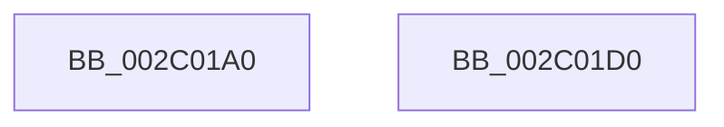

# PoFxIdleComponent

- RVA: `0x002C01A0`–`0x002C01D1` (길이 `49` bytes)
- VA: `0x00000001402C01A0`
- 실행 섹션: `.text`
- PDB 이름 있음: `예`; PDB Function 태그: `아니요`
- unwind 정보 RVA: `0x0006E590`
- 디코드: `13`개 명령, `49/49` bytes 표시
- 미해석 바이트: `0` (있으면 어셈블리에 `.byte`로 보존)

> 이 문서는 커널 이미지의 기계어와 PDB 기호를 분석해 생성했습니다. 4번과 5번은 함수 원형과 자료형을 바이너리 사용 방식에서 추정한 C 해석이며 원본 소스 복구 결과는 아닙니다.

## 1. Dependencies

- 직접 호출 지점: **1**; 고유 호출 대상: **1**
- 직접 호출자로 확인된 함수: **4**
- RIP 상대 이미지 참조: **0**

### Outgoing calls
- `0x002C01C6` → [PopFxIdleComponent](PopFxIdleComponent_function_002C01D8.md) (function, `0x002C01D8`)

### Direct callers
- [PopFxHandleReportDevicePoweredOn](../26/PopFxHandleReportDevicePoweredOn_function_0026D980.md) at `0x0026DAEA`
- [PoFxIdleDevice](../48/PoFxIdleDevice_function_00483EE8.md) at `0x00483FA5`
- [PoFxStartDevicePowerManagement](../4B/PoFxStartDevicePowerManagement_function_004B5740.md) at `0x004B5824`
- [DifPoFxIdleComponentWrapper](../63/DifPoFxIdleComponentWrapper_function_006393D0.md) at `0x006394B7`

### Static image references
- 디코드된 RIP-relative 메모리 참조가 없습니다.

## 2. Other-region calls and transfers

- 다른 실행 섹션으로 향하는 call: **0**
- 별도 외부 분기/꼬리 이동을 확인하지 못했습니다.

## 3. Assembly (complete function range)

```asm
002C01A0  48 83 EC 68                     sub rsp, 0x68
002C01A4  0F 57 C0                        xorps xmm0, xmm0
002C01A7  4C 8D 4C 24 20                  lea r9, [rsp + 0x20]
002C01AC  33 C0                           xor eax, eax
002C01AE  0F 11 44 24 20                  movups xmmword ptr [rsp + 0x20], xmm0
002C01B3  48 89 44 24 50                  mov qword ptr [rsp + 0x50], rax
002C01B8  0F 11 44 24 30                  movups xmmword ptr [rsp + 0x30], xmm0
002C01BD  89 44 24 58                     mov dword ptr [rsp + 0x58], eax
002C01C1  0F 11 44 24 40                  movups xmmword ptr [rsp + 0x40], xmm0
002C01C6  E8 0D 00 00 00                  call 0x1402c01d8
002C01CB  48 83 C4 68                     add rsp, 0x68
002C01CF  C3                              ret
002C01D0  CC                              int3
```

## 4. C-style interpretation (structured pseudocode)

```c
__int64 __fastcall PoFxIdleComponent(void)
{
    __int64 result;
    __int64 v_rsp;
    unsigned int v_stack_m10;
    unsigned __int64 v_stack_m18;
    unsigned __int64 v_stack_m28;
    unsigned __int64 v_stack_m38;
    unsigned __int64 v_stack_m48;

    v_rsp = (v_rsp) - (104);
    result = 0;
    v_stack_m48 = v_xmm0;
    v_stack_m18 = 0;
    v_stack_m38 = v_xmm0;
    v_stack_m10 = 0;
    v_stack_m28 = v_xmm0;
    result = PopFxIdleComponent(a1, a2, a3, v_stack_m48);
    v_rsp = (v_rsp) + (104);
    return result;
}
```

## 5. (Beta) C Style

```c
void PoFxIdleComponent(void)
{
    int64_t result;
    int64_t local_rsp;
    uint32_t v_stack_m10;
    uint64_t v_stack_m18;
    uint64_t v_stack_m28;
    uint64_t v_stack_m38;
    uint64_t v_stack_m48;

    local_rsp = (local_rsp) - (104);
    result = 0;
    v_stack_m48 = v_xmm0;
    v_stack_m18 = 0;
    v_stack_m38 = v_xmm0;
    v_stack_m10 = 0;
    v_stack_m28 = v_xmm0;
    result = PopFxIdleComponent(a1, a2, a3, v_stack_m48);
    local_rsp = (local_rsp) + (104);
    return result;
}
```

## 6. Execution-region graph

[열기: 2D/3D 그래프와 함수 탐색 컨트롤 패널](../../../control-panel.html?section=text&rva=0x002C01A0&view=graph)

- 2D 그래프는 위에서 아래로 흐르고, 3D 그래프는 빈 공간을 드래그해 회전합니다. Shift+드래그는 이동, 휠은 확대·축소, 함수 노드 선택은 대상 보고서 이동입니다.

### Static fallback


