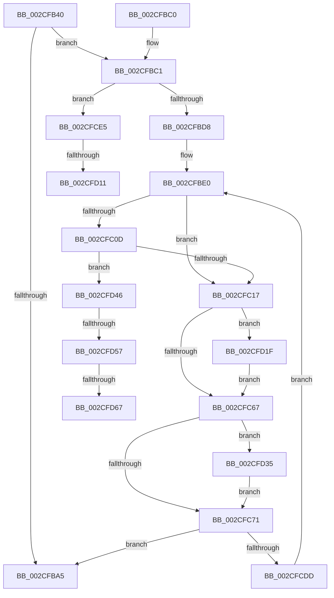

# PoIdle

- RVA: `0x002CFB40`–`0x002CFD76` (길이 `566` bytes)
- VA: `0x00000001402CFB40`
- 실행 섹션: `.text`
- PDB 이름 있음: `예`; PDB Function 태그: `예`
- unwind 정보 RVA: `0x0006F6C0`
- 디코드: `139`개 명령, `566/566` bytes 표시
- 미해석 바이트: `0` (있으면 어셈블리에 `.byte`로 보존)

> 이 문서는 커널 이미지의 기계어와 PDB 기호를 분석해 생성했습니다. 4번과 5번은 함수 원형과 자료형을 바이너리 사용 방식에서 추정한 C 해석이며 원본 소스 복구 결과는 아닙니다.

## 1. Dependencies

- 직접 호출 지점: **8**; 고유 호출 대상: **8**
- 직접 호출자로 확인된 함수: **1**
- RIP 상대 이미지 참조: **3**

### Outgoing calls
- `0x002CFBEA` → [PpmUpdateProcessorIdleAccounting](PpmUpdateProcessorIdleAccounting_function_002CFF18.md) (function, `0x002CFF18`)
- `0x002CFBFA` → [PpmPerfSetProcessorIdle](PpmPerfSetProcessorIdle_function_002CFD7C.md) (function, `0x002CFD7C`)
- `0x002CFC56` → [PpmIdleSelectStates](PpmIdleSelectStates_function_002CFFE8.md) (function, `0x002CFFE8`)
- `0x002CFC85` → [PpmWakeClockOwnerIfNeeded](../2D/PpmWakeClockOwnerIfNeeded_function_002D0924.md) (function, `0x002D0924`)
- `0x002CFCCB` → [PpmIdleExecuteTransition](../2D/PpmIdleExecuteTransition_function_002D0A1C.md) (function, `0x002D0A1C`)
- `0x002CFCF7` → [KeIdleSpecCtrl](../4B/KeIdleSpecCtrl_function_004B0D40.md) (function, `0x004B0D40`)
- `0x002CFD2B` → [PpmEventIdleStateChange](../4A/PpmEventIdleStateChange_function_004A23C8.md) (function, `0x004A23C8`)
- `0x002CFD3C` → [PpmResetProcessorIdleAccounting](../44/PpmResetProcessorIdleAccounting_function_00447594.md) (function, `0x00447594`)

### Direct callers
- [KiIdleLoop](../6B/KiIdleLoop_function_006B2910.md) at `0x006B295F`

### Static image references
- `0x002CFB5C` → RVA `0x00E08380` (`.data`; read)
- `0x002CFB66` → RVA `0x00F0CE0C` (`.data`; read)
- `0x002CFBFF` → RVA `0x00E0B3B0` (`.data`; read)

## 2. Other-region calls and transfers

- 다른 실행 섹션으로 향하는 call: **0**
- call이 아닌 외부 분기/꼬리 이동: **5**
  - `0x002CFD0B` → [sub_006DCDC2](../6D/Unknown_function_006DCDC2.md) (`tail-transfer`)
  - `0x002CFD1A` → [sub_006DCDC2](../6D/Unknown_function_006DCDC2.md) (`tail-transfer`)
  - `0x002CFD51` → [sub_006DCDC2 + 0x35](../6D/Unknown_function_006DCDC2.md) (`tail-transfer`)
  - `0x002CFD61` → [sub_006DCDC2 + 0x35](../6D/Unknown_function_006DCDC2.md) (`tail-transfer`)
  - `0x002CFD71` → [sub_006DCDC2 + 0x35](../6D/Unknown_function_006DCDC2.md) (`tail-transfer`)

## 3. Assembly (complete function range)

```asm
002CFB40  48 89 5C 24 08                  mov qword ptr [rsp + 8], rbx
002CFB45  55                              push rbp
002CFB46  56                              push rsi
002CFB47  57                              push rdi
002CFB48  41 54                           push r12
002CFB4A  41 55                           push r13
002CFB4C  41 56                           push r14
002CFB4E  41 57                           push r15
002CFB50  48 8D 6C 24 D9                  lea rbp, [rsp - 0x27]
002CFB55  48 81 EC 90 00 00 00            sub rsp, 0x90
002CFB5C  48 8B 15 1D 88 B3 00            mov rdx, qword ptr [rip + 0xb3881d]
002CFB63  45 33 ED                        xor r13d, r13d
002CFB66  48 63 05 9F D2 C3 00            movsxd rax, dword ptr [rip + 0xc3d29f]
002CFB6D  48 8B D9                        mov rbx, rcx
002CFB70  48 69 C8 E8 01 00 00            imul rcx, rax, 0x1e8
002CFB77  44 89 6D FF                     mov dword ptr [rbp - 1], r13d
002CFB7B  4C 89 6D 07                     mov qword ptr [rbp + 7], r13
002CFB7F  4C 89 6D 0F                     mov qword ptr [rbp + 0xf], r13
002CFB83  4C 89 6D 17                     mov qword ptr [rbp + 0x17], r13
002CFB87  44 88 6D 7F                     mov byte ptr [rbp + 0x7f], r13b
002CFB8B  44 88 6D 77                     mov byte ptr [rbp + 0x77], r13b
002CFB8F  44 89 6D 03                     mov dword ptr [rbp + 3], r13d
002CFB93  44 89 6D F7                     mov dword ptr [rbp - 9], r13d
002CFB97  44 88 6D 6F                     mov byte ptr [rbp + 0x6f], r13b
002CFB9B  44 38 AC 11 CD 00 00 00         cmp byte ptr [rcx + rdx + 0xcd], r13b
002CFBA3  74 1C                           je 0x1402cfbc1
002CFBA5  48 8B 9C 24 D0 00 00 00         mov rbx, qword ptr [rsp + 0xd0]
002CFBAD  48 81 C4 90 00 00 00            add rsp, 0x90
002CFBB4  41 5F                           pop r15
002CFBB6  41 5E                           pop r14
002CFBB8  41 5D                           pop r13
002CFBBA  41 5C                           pop r12
002CFBBC  5F                              pop rdi
002CFBBD  5E                              pop rsi
002CFBBE  5D                              pop rbp
002CFBBF  C3                              ret
002CFBC0  CC                              int3
002CFBC1  4C 8D B3 40 88 00 00            lea r14, [rbx + 0x8840]
002CFBC8  49 8B 36                        mov rsi, qword ptr [r14]
002CFBCB  4D 8B 7E 08                     mov r15, qword ptr [r14 + 8]
002CFBCF  48 85 F6                        test rsi, rsi
002CFBD2  0F 84 0D 01 00 00               je 0x1402cfce5
002CFBD8  45 8A E5                        mov r12b, r13b
002CFBDB  BF 01 00 00 00                  mov edi, 1
002CFBE0  49 8B CE                        mov rcx, r14
002CFBE3  44 89 AE 0C 04 00 00            mov dword ptr [rsi + 0x40c], r13d
002CFBEA  E8 29 03 00 00                  call 0x1402cff18
002CFBEF  48 8D 55 6F                     lea rdx, [rbp + 0x6f]
002CFBF3  40 88 7E 05                     mov byte ptr [rsi + 5], dil
002CFBF7  48 8B CB                        mov rcx, rbx
002CFBFA  E8 7D 01 00 00                  call 0x1402cfd7c
002CFBFF  44 38 2D AA B7 B3 00            cmp byte ptr [rip + 0xb3b7aa], r13b
002CFC06  66 44 89 6E 38                  mov word ptr [rsi + 0x38], r13w
002CFC0B  74 0A                           je 0x1402cfc17
002CFC0D  44 38 6E 10                     cmp byte ptr [rsi + 0x10], r13b
002CFC11  0F 85 2F 01 00 00               jne 0x1402cfd46
002CFC17  44 8A 6D 6F                     mov r13b, byte ptr [rbp + 0x6f]
002CFC1B  48 8D 45 77                     lea rax, [rbp + 0x77]
002CFC1F  48 89 44 24 40                  mov qword ptr [rsp + 0x40], rax
002CFC24  4C 8D 4D 0F                     lea r9, [rbp + 0xf]
002CFC28  48 8D 45 17                     lea rax, [rbp + 0x17]
002CFC2C  41 8A D5                        mov dl, r13b
002CFC2F  48 89 44 24 38                  mov qword ptr [rsp + 0x38], rax
002CFC34  4C 8D 45 07                     lea r8, [rbp + 7]
002CFC38  48 8D 45 03                     lea rax, [rbp + 3]
002CFC3C  48 8B CB                        mov rcx, rbx
002CFC3F  48 89 44 24 30                  mov qword ptr [rsp + 0x30], rax
002CFC44  48 8D 45 F7                     lea rax, [rbp - 9]
002CFC48  48 89 44 24 28                  mov qword ptr [rsp + 0x28], rax
002CFC4D  48 8D 45 FF                     lea rax, [rbp - 1]
002CFC51  48 89 44 24 20                  mov qword ptr [rsp + 0x20], rax
002CFC56  E8 8D 03 00 00                  call 0x1402cffe8
002CFC5B  8B 56 18                        mov edx, dword ptr [rsi + 0x18]
002CFC5E  39 55 F7                        cmp dword ptr [rbp - 9], edx
002CFC61  0F 85 B8 00 00 00               jne 0x1402cfd1f
002CFC67  41 01 7F 04                     add dword ptr [r15 + 4], edi
002CFC6B  0F 84 C4 00 00 00               je 0x1402cfd35
002CFC71  8B 45 F7                        mov eax, dword ptr [rbp - 9]
002CFC74  48 8B CB                        mov rcx, rbx
002CFC77  48 69 D0 58 01 00 00            imul rdx, rax, 0x158
002CFC7E  8A 94 32 71 05 00 00            mov dl, byte ptr [rdx + rsi + 0x571]
002CFC85  E8 9A 0C 00 00                  call 0x1402d0924
002CFC8A  4C 8B 4D 17                     mov r9, qword ptr [rbp + 0x17]
002CFC8E  48 8D 45 7F                     lea rax, [rbp + 0x7f]
002CFC92  44 8B 45 03                     mov r8d, dword ptr [rbp + 3]
002CFC96  48 8B CB                        mov rcx, rbx
002CFC99  8B 55 F7                        mov edx, dword ptr [rbp - 9]
002CFC9C  48 89 44 24 50                  mov qword ptr [rsp + 0x50], rax
002CFCA1  8A 45 77                        mov al, byte ptr [rbp + 0x77]
002CFCA4  44 88 64 24 48                  mov byte ptr [rsp + 0x48], r12b
002CFCA9  44 88 6C 24 40                  mov byte ptr [rsp + 0x40], r13b
002CFCAE  88 44 24 38                     mov byte ptr [rsp + 0x38], al
002CFCB2  48 8B 45 0F                     mov rax, qword ptr [rbp + 0xf]
002CFCB6  48 89 44 24 30                  mov qword ptr [rsp + 0x30], rax
002CFCBB  48 8B 45 07                     mov rax, qword ptr [rbp + 7]
002CFCBF  48 89 44 24 28                  mov qword ptr [rsp + 0x28], rax
002CFCC4  8B 45 FF                        mov eax, dword ptr [rbp - 1]
002CFCC7  89 44 24 20                     mov dword ptr [rsp + 0x20], eax
002CFCCB  E8 4C 0D 00 00                  call 0x1402d0a1c
002CFCD0  45 33 ED                        xor r13d, r13d
002CFCD3  44 38 6D 7F                     cmp byte ptr [rbp + 0x7f], r13b
002CFCD7  0F 84 C8 FE FF FF               je 0x1402cfba5
002CFCDD  44 8A E7                        mov r12b, dil
002CFCE0  E9 FB FE FF FF                  jmp 0x1402cfbe0
002CFCE5  45 33 C9                        xor r9d, r9d
002CFCE8  44 89 6D FB                     mov dword ptr [rbp - 5], r13d
002CFCEC  4C 8D 45 FB                     lea r8, [rbp - 5]
002CFCF0  48 8B CB                        mov rcx, rbx
002CFCF3  41 8D 51 01                     lea edx, [r9 + 1]
002CFCF7  E8 44 10 1E 00                  call 0x1404b0d40
002CFCFC  8B 7D FB                        mov edi, dword ptr [rbp - 5]
002CFCFF  0F B7 F0                        movzx esi, ax
002CFD02  41 BE 48 00 00 00               mov r14d, 0x48
002CFD08  66 85 FF                        test di, di
002CFD0B  0F 84 B1 D0 40 00               je 0x1406dcdc2
002CFD11  33 C0                           xor eax, eax
002CFD13  41 8B CE                        mov ecx, r14d
002CFD16  33 D2                           xor edx, edx
002CFD18  0F 30                           wrmsr
002CFD1A  E9 A3 D0 40 00                  jmp 0x1406dcdc2
002CFD1F  89 56 20                        mov dword ptr [rsi + 0x20], edx
002CFD22  8B 45 F7                        mov eax, dword ptr [rbp - 9]
002CFD25  89 46 18                        mov dword ptr [rsi + 0x18], eax
002CFD28  8B 4D F7                        mov ecx, dword ptr [rbp - 9]
002CFD2B  E8 98 26 1D 00                  call 0x1404a23c8
002CFD30  E9 32 FF FF FF                  jmp 0x1402cfc67
002CFD35  48 8B 55 07                     mov rdx, qword ptr [rbp + 7]
002CFD39  49 8B CF                        mov rcx, r15
002CFD3C  E8 53 78 17 00                  call 0x140447594
002CFD41  E9 2B FF FF FF                  jmp 0x1402cfc71
002CFD46  41 0F B7 F5                     movzx esi, r13w
002CFD4A  40 84 BB DC 06 00 00            test byte ptr [rbx + 0x6dc], dil
002CFD51  0F 84 A0 D0 40 00               je 0x1406dcdf7
002CFD57  0F B7 83 E6 06 00 00            movzx eax, word ptr [rbx + 0x6e6]
002CFD5E  66 85 C0                        test ax, ax
002CFD61  0F 84 90 D0 40 00               je 0x1406dcdf7
002CFD67  66 09 BB D8 06 00 00            or word ptr [rbx + 0x6d8], di
002CFD6E  0F B7 F0                        movzx esi, ax
002CFD71  E9 81 D0 40 00                  jmp 0x1406dcdf7
```

## 4. C-style interpretation (structured pseudocode)

```c
__int64 __fastcall PoIdle(__int64 a1)
{
    __int64 result;
    __int64 v_r13;
    __int64 v_rsp;
    unsigned __int64 v_stack_m48;
    unsigned __int64 v_stack_m50;
    unsigned __int64 v_stack_m58;
    unsigned int v_stack_m5C;
    unsigned __int64 v_stack_m5F;
    unsigned int v_stack_m60;
    unsigned int v_stack_m64;
    unsigned int v_stack_m68;
    unsigned __int8 v_stack_p10;
    unsigned __int8 v_stack_p18;
    unsigned __int8 v_stack_p20;
    unsigned __int64 v_stack_p28;
    unsigned __int64 v_stack_p30;
    unsigned __int64 v_stack_p38;
    unsigned __int64 v_stack_p40;
    unsigned __int8 v_stack_p48;
    unsigned __int64 v_stack_p50;
    unsigned __int64 v_stack_p8;

    v_stack_p8 = v_rbx;
    v_rsp = (v_rsp) - (144);
    v_r13 = 0;
    a1 = (a1) * ((int)(*(unsigned int *)(v_rip + 12833439)));
    v_stack_m60 = 0;
    v_stack_m58 = 0;
    v_stack_m50 = 0;
    v_stack_m48 = 0;
    v_stack_p20 = 0;
    v_stack_p18 = 0;
    v_stack_m5C = 0;
    v_stack_m68 = 0;
    v_stack_p10 = 0;
    if ((*(unsigned __int8 *)(a1 + *(unsigned __int64 *)(v_rip + 11765789) * 1 + 205)) == 0) goto loc_002CFBC1;
loc_002CFBA5:
    v_rsp = (v_rsp) + (144);
    return (int)(*(unsigned int *)(v_rip + 12833439));
loc_002CFBC1:
    if (*(unsigned __int64 *)(v_stack_p8 + 34880) == 0) goto loc_002CFCE5;
loc_002CFBE0:
    *(unsigned int *)(*(unsigned __int64 *)(v_stack_p8 + 34880) + 1036) = 0;
    result = PpmUpdateProcessorIdleAccounting(v_stack_p8 + 34880, *(unsigned __int64 *)(v_rip + 11765789), a3, a4);
    *(unsigned __int8 *)(*(unsigned __int64 *)(v_stack_p8 + 34880) + 5) = 1;
    result = PpmPerfSetProcessorIdle(v_stack_p8, v_stack_p10, a3, a4);
    *(unsigned __int16 *)(*(unsigned __int64 *)(v_stack_p8 + 34880) + 56) = 0;
    if ((*(unsigned __int8 *)(v_rip + 11777962)) == 0) goto loc_002CFC17;
    if ((*(unsigned __int8 *)(*(unsigned __int64 *)(v_stack_p8 + 34880) + 16)) != 0) goto loc_002CFD46;
loc_002CFC17:
    v_stack_p40 = v_stack_p18;
    v_stack_p38 = v_stack_m48;
    v_stack_p30 = v_stack_m5C;
    v_stack_p28 = v_stack_m68;
    v_stack_p20 = v_stack_m60;
    result = PpmIdleSelectStates(v_stack_p8, (unsigned __int8)(v_stack_p10), v_stack_m58, v_stack_m50);
    if (v_stack_m68 != ((unsigned int)((unsigned int)(*(unsigned int *)(*(unsigned __int64 *)(v_stack_p8 + 34880) + 24))))) goto loc_002CFD1F;
loc_002CFC67:
    if (v_stack_m68 == ((unsigned int)((unsigned int)(*(unsigned int *)(*(unsigned __int64 *)(v_stack_p8 + 34880) + 24))))) goto loc_002CFD35;
loc_002CFC71:
    a2 = ((unsigned int)(*(unsigned int *)(*(unsigned __int64 *)(v_stack_p8 + 34880) + 24))) * ((unsigned int)(v_stack_m68));
    result = PpmWakeClockOwnerIfNeeded(v_stack_p8, *(unsigned __int8 *)(a2 + *(unsigned __int64 *)(v_stack_p8 + 34880) * 1 + 1393), v_stack_m58, v_stack_m50);
    v_stack_p50 = v_stack_p20;
    v_stack_p48 = 0;
    v_stack_p40 = (unsigned __int8)(v_stack_p10);
    v_stack_p38 = (unsigned __int8)(v_stack_p18);
    v_stack_p30 = v_stack_m50;
    v_stack_p28 = v_stack_m58;
    v_stack_p20 = (unsigned int)((unsigned int)(v_stack_m60));
    result = PpmIdleExecuteTransition(v_stack_p8, (unsigned int)(v_stack_m68), (unsigned int)(v_stack_m5C), v_stack_m48);
    v_r13 = 0;
    if (v_stack_p20 == 0) goto loc_002CFBA5;
    goto loc_002CFBE0;
loc_002CFCE5:
    a4 = 0;
    v_stack_m64 = 0;
    result = KeIdleSpecCtrl(v_stack_p8, a4 + 1, v_stack_m64, a4);
    result = 0;
    a2 = 0;
loc_002CFD1F:
    *(unsigned int *)((unsigned __int16)(result) + 32) = 0;
    *(unsigned int *)((unsigned __int16)(result) + 24) = (unsigned int)((unsigned int)(v_stack_m68));
    result = PpmEventIdleStateChange((unsigned int)(v_stack_m68), a2, v_stack_m64, a4);
    goto loc_002CFC67;
loc_002CFD35:
    result = PpmResetProcessorIdleAccounting(*(unsigned __int64 *)(v_stack_p8 + 34880 + 8), v_stack_m58, v_stack_m64, a4);
    goto loc_002CFC71;
loc_002CFD46:
}
```

## 5. (Beta) C Style

```c
int64_t PoIdle(void *Arg1)
{
    uint8_t *arg1 = (uint8_t *)Arg1;

    int64_t result;
    int64_t local_r13;
    int64_t local_rsp;
    uint64_t v_stack_m48;
    uint64_t v_stack_m50;
    uint64_t v_stack_m58;
    uint32_t v_stack_m5C;
    uint64_t v_stack_m5F;
    uint32_t v_stack_m60;
    uint32_t v_stack_m64;
    uint32_t v_stack_m68;
    uint8_t v_stack_p10;
    uint8_t v_stack_p18;
    uint8_t v_stack_p20;
    uint64_t v_stack_p28;
    uint64_t v_stack_p30;
    uint64_t v_stack_p38;
    uint64_t v_stack_p40;
    uint8_t v_stack_p48;
    uint64_t v_stack_p50;
    uint64_t v_stack_p8;

    v_stack_p8 = local_rbx;
    local_rsp = (local_rsp) - (144);
    local_r13 = 0;
    Arg1 = (Arg1) * ((int32_t)(*(uint32_t *)(v_rip + 0xC3D29F)));
    v_stack_m60 = 0;
    v_stack_m58 = 0;
    v_stack_m50 = 0;
    v_stack_m48 = 0;
    v_stack_p20 = 0;
    v_stack_p18 = 0;
    v_stack_m5C = 0;
    v_stack_m68 = 0;
    v_stack_p10 = 0;
    if ((*(uint8_t *)(arg1 + *(uint64_t *)(v_rip + 0xB3881D) * 1 + 0xCD)) == 0) goto loc_002CFBC1;
loc_002CFBA5:
    local_rsp = (local_rsp) + (144);
    return (int32_t)(*(uint32_t *)(v_rip + 0xC3D29F));
loc_002CFBC1:
    if (*(uint64_t *)(v_stack_p8 + 0x8840) == 0) goto loc_002CFCE5;
loc_002CFBE0:
    *(uint32_t *)(*(uint64_t *)(v_stack_p8 + 0x8840) + 0x40C) = 0;
    result = PpmUpdateProcessorIdleAccounting(v_stack_p8 + 34880, *(uint64_t *)(v_rip + 0xB3881D), a3, a4);
    *(uint8_t *)(*(uint64_t *)(v_stack_p8 + 0x8840) + 0x5) = 1;
    result = PpmPerfSetProcessorIdle(v_stack_p8, v_stack_p10, a3, a4);
    *(uint16_t *)(*(uint64_t *)(v_stack_p8 + 0x8840) + 0x38) = 0;
    if ((*(uint8_t *)(v_rip + 0xB3B7AA)) == 0) goto loc_002CFC17;
    if ((*(uint8_t *)(*(uint64_t *)(v_stack_p8 + 0x8840) + 0x10)) != 0) goto loc_002CFD46;
loc_002CFC17:
    v_stack_p40 = v_stack_p18;
    v_stack_p38 = v_stack_m48;
    v_stack_p30 = v_stack_m5C;
    v_stack_p28 = v_stack_m68;
    v_stack_p20 = v_stack_m60;
    result = PpmIdleSelectStates(v_stack_p8, (uint8_t)(v_stack_p10), v_stack_m58, v_stack_m50);
    if (v_stack_m68 != ((uint32_t)((uint32_t)(*(uint32_t *)(*(uint64_t *)(v_stack_p8 + 0x8840) + 0x18))))) goto loc_002CFD1F;
loc_002CFC67:
    if (v_stack_m68 == ((uint32_t)((uint32_t)(*(uint32_t *)(*(uint64_t *)(v_stack_p8 + 0x8840) + 0x18))))) goto loc_002CFD35;
loc_002CFC71:
    a2 = ((uint32_t)(*(uint32_t *)(*(uint64_t *)(v_stack_p8 + 0x8840) + 0x18))) * ((uint32_t)(v_stack_m68));
    result = PpmWakeClockOwnerIfNeeded(v_stack_p8, *(uint8_t *)(a2 + *(uint64_t *)(v_stack_p8 + 0x8840) * 1 + 0x571), v_stack_m58, v_stack_m50);
    v_stack_p50 = v_stack_p20;
    v_stack_p48 = 0;
    v_stack_p40 = (uint8_t)(v_stack_p10);
    v_stack_p38 = (uint8_t)(v_stack_p18);
    v_stack_p30 = v_stack_m50;
    v_stack_p28 = v_stack_m58;
    v_stack_p20 = (uint32_t)((uint32_t)(v_stack_m60));
    result = PpmIdleExecuteTransition(v_stack_p8, (uint32_t)(v_stack_m68), (uint32_t)(v_stack_m5C), v_stack_m48);
    local_r13 = 0;
    if (v_stack_p20 == 0) goto loc_002CFBA5;
    goto loc_002CFBE0;
loc_002CFCE5:
    a4 = 0;
    v_stack_m64 = 0;
    result = KeIdleSpecCtrl(v_stack_p8, a4 + 1, v_stack_m64, a4);
    result = 0;
    a2 = 0;
loc_002CFD1F:
    *(uint32_t *)((uint16_t)(result) + 0x20) = 0;
    *(uint32_t *)((uint16_t)(result) + 0x18) = (uint32_t)((uint32_t)(v_stack_m68));
    result = PpmEventIdleStateChange((uint32_t)(v_stack_m68), a2, v_stack_m64, a4);
    goto loc_002CFC67;
loc_002CFD35:
    result = PpmResetProcessorIdleAccounting(*(uint64_t *)(v_stack_p8 + 0x8840 + 0x8), v_stack_m58, v_stack_m64, a4);
    goto loc_002CFC71;
loc_002CFD46:
}
```

### 관측된 메모리 오프셋

구조체 형식이 확인되지 않은 접근은 인자 기준의 오프셋으로만 기록했습니다.

| 기준 인자 | 오프셋 표현 | 폭 (bit) | 접근 |
|---|---:|---:|---|
| `Arg1` | `+ 0x0` | `64` | `R` |
| `Arg1` | `+ 0x8` | `64` | `R` |
| `Arg1` | `+ 0xCD + rdx*1` | `8` | `R` |
| `Arg1` | `+ 0x6D8` | `16` | `R/W` |
| `Arg1` | `+ 0x6DC` | `8` | `R` |
| `Arg1` | `+ 0x6E6` | `16` | `R` |
| `Arg1` | `+ 0x8840` | `64` | `R` |

## 6. Execution-region graph

[열기: 2D/3D 그래프와 함수 탐색 컨트롤 패널](../../../control-panel.html?section=text&rva=0x002CFB40&view=graph)

- 2D 그래프는 위에서 아래로 흐르고, 3D 그래프는 빈 공간을 드래그해 회전합니다. Shift+드래그는 이동, 휠은 확대·축소, 함수 노드 선택은 대상 보고서 이동입니다.

### Static fallback


