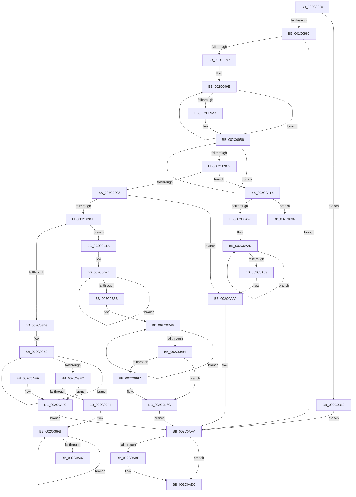

# PopFxAllocatePowerIrp

- RVA: `0x002C0920`–`0x002C0B93` (길이 `627` bytes)
- VA: `0x00000001402C0920`
- 실행 섹션: `.text`
- PDB 이름 있음: `예`; PDB Function 태그: `예`
- unwind 정보 RVA: `0x0006E628`
- 디코드: `176`개 명령, `627/627` bytes 표시
- 미해석 바이트: `0` (있으면 어셈블리에 `.byte`로 보존)

> 이 문서는 커널 이미지의 기계어와 PDB 기호를 분석해 생성했습니다. 4번과 5번은 함수 원형과 자료형을 바이너리 사용 방식에서 추정한 C 해석이며 원본 소스 복구 결과는 아닙니다.

## 1. Dependencies

- 직접 호출 지점: **6**; 고유 호출 대상: **6**
- 직접 호출자로 확인된 함수: **1**
- RIP 상대 이미지 참조: **0**

### Outgoing calls
- `0x002C0967` → [ExAcquireSpinLockExclusive](../24/ExAcquireSpinLockExclusive_function_00248690.md) (function, `0x00248690`)
- `0x002C0985` → [PopFxTryReferenceDevice](PopFxTryReferenceDevice_function_002C0628.md) (function, `0x002C0628`)
- `0x002C0AA5` → [PopFxDereferenceDevice](../27/PopFxDereferenceDevice_function_0027038C.md) (function, `0x0027038C`)
- `0x002C0AB4` → [ExReleaseSpinLockExclusive](ExReleaseSpinLockExclusive_function_002C0EF0.md) (function, `0x002C0EF0`)
- `0x002C0ACB` → [PopFxAddLogEntry](../39/PopFxAddLogEntry_function_00390B94.md) (function, `0x00390B94`)
- `0x002C0AFC` → [KeResetEvent](../24/KeResetEvent_function_00248350.md) (function, `0x00248350`)

### Direct callers
- [PopAllocateIrp](../27/PopAllocateIrp_function_0027116C.md) at `0x0027125F`

### Static image references
- 디코드된 RIP-relative 메모리 참조가 없습니다.

## 2. Other-region calls and transfers

- 다른 실행 섹션으로 향하는 call: **0**
- call이 아닌 외부 분기/꼬리 이동: **2**
  - `0x002C0A19` → [sub_006DC186 + 0x4B](../6D/Unknown_function_006DC186.md) (`tail-transfer`)
  - `0x002C0B8E` → [sub_006DC186](../6D/Unknown_function_006DC186.md) (`tail-transfer`)

## 3. Assembly (complete function range)

```asm
002C0920  48 89 5C 24 08                  mov qword ptr [rsp + 8], rbx
002C0925  48 89 6C 24 10                  mov qword ptr [rsp + 0x10], rbp
002C092A  48 89 74 24 18                  mov qword ptr [rsp + 0x18], rsi
002C092F  57                              push rdi
002C0930  41 54                           push r12
002C0932  41 55                           push r13
002C0934  41 56                           push r14
002C0936  41 57                           push r15
002C0938  48 83 EC 20                     sub rsp, 0x20
002C093C  4C 8B B4 24 80 00 00 00         mov r14, qword ptr [rsp + 0x80]
002C0944  48 8D 69 58                     lea rbp, [rcx + 0x58]
002C0948  4C 8B BC 24 88 00 00 00         mov r15, qword ptr [rsp + 0x88]
002C0950  48 8B F9                        mov rdi, rcx
002C0953  48 8B CD                        mov rcx, rbp
002C0956  4D 8B E1                        mov r12, r9
002C0959  41 8B D8                        mov ebx, r8d
002C095C  4C 8B EA                        mov r13, rdx
002C095F  49 83 26 00                     and qword ptr [r14], 0
002C0963  49 83 27 00                     and qword ptr [r15], 0
002C0967  E8 24 7D F8 FF                  call 0x140248690
002C096C  48 8B 7F 50                     mov rdi, qword ptr [rdi + 0x50]
002C0970  88 84 24 80 00 00 00            mov byte ptr [rsp + 0x80], al
002C0977  48 85 FF                        test rdi, rdi
002C097A  0F 84 93 01 00 00               je 0x1402c0b13
002C0980  33 D2                           xor edx, edx
002C0982  48 8B CF                        mov rcx, rdi
002C0985  E8 9E FC FF FF                  call 0x1402c0628
002C098A  45 33 C9                        xor r9d, r9d
002C098D  8B F0                           mov esi, eax
002C098F  85 C0                           test eax, eax
002C0991  0F 88 13 01 00 00               js 0x1402c0aaa
002C0997  0F 0D 4F 20                     prefetchw byte ptr [rdi + 0x20]
002C099B  8B 47 20                        mov eax, dword ptr [rdi + 0x20]
002C099E  8B C8                           mov ecx, eax
002C09A0  41 0B C9                        or ecx, r9d
002C09A3  F0 0F B1 4F 20                  lock cmpxchg dword ptr [rdi + 0x20], ecx
002C09A8  75 F4                           jne 0x1402c099e
002C09AA  8B D0                           mov edx, eax
002C09AC  83 E2 10                        and edx, 0x10
002C09AF  0F 0D 4F 20                     prefetchw byte ptr [rdi + 0x20]
002C09B3  8B 47 20                        mov eax, dword ptr [rdi + 0x20]
002C09B6  8B C8                           mov ecx, eax
002C09B8  41 0B C9                        or ecx, r9d
002C09BB  F0 0F B1 4F 20                  lock cmpxchg dword ptr [rdi + 0x20], ecx
002C09C0  75 F4                           jne 0x1402c09b6
002C09C2  85 D2                           test edx, edx
002C09C4  75 58                           jne 0x1402c0a1e
002C09C6  A8 10                           test al, 0x10
002C09C8  0F 85 D2 00 00 00               jne 0x1402c0aa0
002C09CE  44 38 4C 24 78                  cmp byte ptr [rsp + 0x78], r9b
002C09D3  0F 85 41 01 00 00               jne 0x1402c0b1a
002C09D9  0F 0D 4F 20                     prefetchw byte ptr [rdi + 0x20]
002C09DD  8B 47 20                        mov eax, dword ptr [rdi + 0x20]
002C09E0  8B C8                           mov ecx, eax
002C09E2  41 0B C9                        or ecx, r9d
002C09E5  F0 0F B1 4F 20                  lock cmpxchg dword ptr [rdi + 0x20], ecx
002C09EA  75 F4                           jne 0x1402c09e0
002C09EC  A8 20                           test al, 0x20
002C09EE  0F 84 FC 00 00 00               je 0x1402c0af0
002C09F4  0F 0D 4F 20                     prefetchw byte ptr [rdi + 0x20]
002C09F8  8B 47 20                        mov eax, dword ptr [rdi + 0x20]
002C09FB  8B C8                           mov ecx, eax
002C09FD  41 0B C9                        or ecx, r9d
002C0A00  F0 0F B1 4F 20                  lock cmpxchg dword ptr [rdi + 0x20], ecx
002C0A05  75 F4                           jne 0x1402c09fb
002C0A07  44 8B C0                        mov r8d, eax
002C0A0A  BA 00 01 00 00                  mov edx, 0x100
002C0A0F  44 23 C2                        and r8d, edx
002C0A12  0F 0D 4F 20                     prefetchw byte ptr [rdi + 0x20]
002C0A16  8B 47 20                        mov eax, dword ptr [rdi + 0x20]
002C0A19  E9 B3 B7 41 00                  jmp 0x1406dc1d1
002C0A1E  A8 20                           test al, 0x20
002C0A20  0F 85 61 01 00 00               jne 0x1402c0b87
002C0A26  0F 0D 4F 20                     prefetchw byte ptr [rdi + 0x20]
002C0A2A  8B 47 20                        mov eax, dword ptr [rdi + 0x20]
002C0A2D  8B C8                           mov ecx, eax
002C0A2F  41 0B C9                        or ecx, r9d
002C0A32  F0 0F B1 4F 20                  lock cmpxchg dword ptr [rdi + 0x20], ecx
002C0A37  75 F4                           jne 0x1402c0a2d
002C0A39  44 8B C0                        mov r8d, eax
002C0A3C  B8 00 02 00 00                  mov eax, 0x200
002C0A41  44 23 C0                        and r8d, eax
002C0A44  F0 83 4F 20 20                  lock or dword ptr [rdi + 0x20], 0x20
002C0A49  F0 31 47 20                     lock xor dword ptr [rdi + 0x20], eax
002C0A4D  41 8B C8                        mov ecx, r8d
002C0A50  41 8B C0                        mov eax, r8d
002C0A53  F7 D9                           neg ecx
002C0A55  BE 03 01 00 00                  mov esi, 0x103
002C0A5A  48 1B D2                        sbb rdx, rdx
002C0A5D  83 E2 08                        and edx, 8
002C0A60  F7 D8                           neg eax
002C0A62  41 8B C0                        mov eax, r8d
002C0A65  48 1B C9                        sbb rcx, rcx
002C0A68  83 E1 04                        and ecx, 4
002C0A6B  4C 89 AC 3A 28 02 00 00         mov qword ptr [rdx + rdi + 0x228], r13
002C0A73  F7 D8                           neg eax
002C0A75  48 8B 44 24 70                  mov rax, qword ptr [rsp + 0x70]
002C0A7A  89 9C 39 38 02 00 00            mov dword ptr [rcx + rdi + 0x238], ebx
002C0A81  48 1B C9                        sbb rcx, rcx
002C0A84  83 E1 08                        and ecx, 8
002C0A87  41 F7 D8                        neg r8d
002C0A8A  4C 89 A4 39 40 02 00 00         mov qword ptr [rcx + rdi + 0x240], r12
002C0A92  48 1B C9                        sbb rcx, rcx
002C0A95  83 E1 08                        and ecx, 8
002C0A98  48 89 84 39 50 02 00 00         mov qword ptr [rcx + rdi + 0x250], rax
002C0AA0  33 D2                           xor edx, edx
002C0AA2  48 8B CF                        mov rcx, rdi
002C0AA5  E8 E2 F8 FA FF                  call 0x14027038c
002C0AAA  8A 94 24 80 00 00 00            mov dl, byte ptr [rsp + 0x80]
002C0AB1  48 8B CD                        mov rcx, rbp
002C0AB4  E8 37 04 00 00                  call 0x1402c0ef0
002C0AB9  48 85 FF                        test rdi, rdi
002C0ABC  74 12                           je 0x1402c0ad0
002C0ABE  48 8B 4F 30                     mov rcx, qword ptr [rdi + 0x30]
002C0AC2  33 D2                           xor edx, edx
002C0AC4  4C 63 CE                        movsxd r9, esi
002C0AC7  44 8D 42 15                     lea r8d, [rdx + 0x15]
002C0ACB  E8 C4 00 0D 00                  call 0x140390b94
002C0AD0  48 8B 5C 24 50                  mov rbx, qword ptr [rsp + 0x50]
002C0AD5  8B C6                           mov eax, esi
002C0AD7  48 8B 74 24 60                  mov rsi, qword ptr [rsp + 0x60]
002C0ADC  48 8B 6C 24 58                  mov rbp, qword ptr [rsp + 0x58]
002C0AE1  48 83 C4 20                     add rsp, 0x20
002C0AE5  41 5F                           pop r15
002C0AE7  41 5E                           pop r14
002C0AE9  41 5D                           pop r13
002C0AEB  41 5C                           pop r12
002C0AED  5F                              pop rdi
002C0AEE  C3                              ret
002C0AEF  CC                              int3
002C0AF0  F0 83 4F 20 10                  lock or dword ptr [rdi + 0x20], 0x10
002C0AF5  48 8D 8F 60 02 00 00            lea rcx, [rdi + 0x260]
002C0AFC  E8 4F 78 F8 FF                  call 0x140248350
002C0B01  48 8B 47 10                     mov rax, qword ptr [rdi + 0x10]
002C0B05  33 F6                           xor esi, esi
002C0B07  49 89 06                        mov qword ptr [r14], rax
002C0B0A  48 8B 47 18                     mov rax, qword ptr [rdi + 0x18]
002C0B0E  49 89 07                        mov qword ptr [r15], rax
002C0B11  EB 97                           jmp 0x1402c0aaa
002C0B13  BE B6 02 00 C0                  mov esi, 0xc00002b6
002C0B18  EB 90                           jmp 0x1402c0aaa
002C0B1A  F0 44 09 4F 20                  lock or dword ptr [rdi + 0x20], r9d
002C0B1F  BA 00 01 00 00                  mov edx, 0x100
002C0B24  F0 31 57 20                     lock xor dword ptr [rdi + 0x20], edx
002C0B28  0F 0D 4F 20                     prefetchw byte ptr [rdi + 0x20]
002C0B2C  8B 47 20                        mov eax, dword ptr [rdi + 0x20]
002C0B2F  8B C8                           mov ecx, eax
002C0B31  41 0B C9                        or ecx, r9d
002C0B34  F0 0F B1 4F 20                  lock cmpxchg dword ptr [rdi + 0x20], ecx
002C0B39  75 F4                           jne 0x1402c0b2f
002C0B3B  44 8B C0                        mov r8d, eax
002C0B3E  44 23 C2                        and r8d, edx
002C0B41  0F 0D 4F 20                     prefetchw byte ptr [rdi + 0x20]
002C0B45  8B 47 20                        mov eax, dword ptr [rdi + 0x20]
002C0B48  8B C8                           mov ecx, eax
002C0B4A  41 0B C9                        or ecx, r9d
002C0B4D  F0 0F B1 4F 20                  lock cmpxchg dword ptr [rdi + 0x20], ecx
002C0B52  75 F4                           jne 0x1402c0b48
002C0B54  C1 E8 09                        shr eax, 9
002C0B57  41 8B C9                        mov ecx, r9d
002C0B5A  83 E0 01                        and eax, 1
002C0B5D  45 85 C0                        test r8d, r8d
002C0B60  0F 95 C1                        setne cl
002C0B63  3B C8                           cmp ecx, eax
002C0B65  75 05                           jne 0x1402c0b6c
002C0B67  F0 83 67 20 DF                  lock and dword ptr [rdi + 0x20], 0xffffffdf
002C0B6C  F0 83 4F 20 10                  lock or dword ptr [rdi + 0x20], 0x10
002C0B71  48 8B 47 10                     mov rax, qword ptr [rdi + 0x10]
002C0B75  41 8B F1                        mov esi, r9d
002C0B78  49 89 06                        mov qword ptr [r14], rax
002C0B7B  48 8B 47 18                     mov rax, qword ptr [rdi + 0x18]
002C0B7F  49 89 07                        mov qword ptr [r15], rax
002C0B82  E9 23 FF FF FF                  jmp 0x1402c0aaa
002C0B87  0F 0D 4F 20                     prefetchw byte ptr [rdi + 0x20]
002C0B8B  8B 47 20                        mov eax, dword ptr [rdi + 0x20]
002C0B8E  E9 F3 B5 41 00                  jmp 0x1406dc186
```

## 4. C-style interpretation (structured pseudocode)

```c
__int64 __fastcall PopFxAllocatePowerIrp(__int64 a1, __int64 a2, int a3, __int64 a4, __int64 a5, unsigned __int8 a6, unsigned __int8 a7, __int64 a8)
{
    __int64 result;
    __int64 v_rsi;
    __int64 v_rsp;
    unsigned __int64 v_stack_p10;
    unsigned __int64 v_stack_p18;
    unsigned __int8 v_stack_p38;
    unsigned __int64 v_stack_p8;

    v_stack_p8 = v_rbx;
    v_stack_p10 = v_rbp;
    v_stack_p18 = v_rsi;
    v_rsp = (v_rsp) - (32);
    result = ExAcquireSpinLockExclusive(a1 + 88, a2, a3, a4);
    v_stack_p38 = (unsigned __int8)(result);
    if (*(unsigned __int64 *)(a1 + 80) == 0) goto loc_002C0B13;
    a2 = 0;
    result = PopFxTryReferenceDevice(*(unsigned __int64 *)(a1 + 80), a2, a3, a4);
    a4 = 0;
    if (sign_flag) goto loc_002C0AAA;
loc_002C099E:
    a1 = (unsigned int)(((unsigned int)((unsigned int)((unsigned int)(*(unsigned int *)(*(unsigned __int64 *)(a1 + 80) + 32))))) | (0));
    if (condition_is_not_equal) goto loc_002C099E;
    a2 = (unsigned int)(((unsigned int)((unsigned int)((unsigned int)(*(unsigned int *)(*(unsigned __int64 *)(a1 + 80) + 32))))) & (16));
loc_002C09B6:
    a1 = (unsigned int)(((unsigned int)((unsigned int)((unsigned int)(*(unsigned int *)(*(unsigned __int64 *)(a1 + 80) + 32))))) | (0));
    if (condition_is_not_equal) goto loc_002C09B6;
    if ((unsigned int)(a2) != 0) goto loc_002C0A1E;
    if ((((unsigned __int8)((unsigned int)(*(unsigned int *)(*(unsigned __int64 *)(a1 + 80) + 32)))) & (16)) != 0) goto loc_002C0AA0;
    if (a6 != 0) goto loc_002C0B1A;
loc_002C09E0:
    a1 = (unsigned int)(((unsigned int)((unsigned int)((unsigned int)(*(unsigned int *)(*(unsigned __int64 *)(a1 + 80) + 32))))) | (0));
    if (condition_is_not_equal) goto loc_002C09E0;
    if ((((unsigned __int8)((unsigned int)(*(unsigned int *)(*(unsigned __int64 *)(a1 + 80) + 32)))) & (32)) == 0) goto loc_002C0AF0;
loc_002C09FB:
    a1 = (unsigned int)(((unsigned int)((unsigned int)((unsigned int)(*(unsigned int *)(*(unsigned __int64 *)(a1 + 80) + 32))))) | (0));
    if (condition_is_not_equal) goto loc_002C09FB;
    a3 = (unsigned int)(((unsigned int)((unsigned int)((unsigned int)(*(unsigned int *)(*(unsigned __int64 *)(a1 + 80) + 32))))) & (256));
loc_002C0A1E:
    if ((((unsigned __int8)((unsigned int)(*(unsigned int *)(*(unsigned __int64 *)(a1 + 80) + 32)))) & (32)) != 0) goto loc_002C0B87;
loc_002C0A2D:
    a1 = (unsigned int)(((unsigned int)((unsigned int)((unsigned int)(*(unsigned int *)(*(unsigned __int64 *)(a1 + 80) + 32))))) | (0));
    if (condition_is_not_equal) goto loc_002C0A2D;
    a3 = (unsigned int)(((unsigned int)((unsigned int)((unsigned int)(*(unsigned int *)(*(unsigned __int64 *)(a1 + 80) + 32))))) & (512));
    a1 = (unsigned int)(-((unsigned int)(a3)));
    a2 = (unsigned int)((256) & (8));
    result = (unsigned int)(-((unsigned int)(a3)));
    a1 = (unsigned int)((a1) & (4));
    *(unsigned __int64 *)(a2 + *(unsigned __int64 *)(a1 + 80) * 1 + 552) = a2;
    result = (unsigned int)(-((unsigned int)(a3)));
    *(unsigned int *)(a1 + *(unsigned __int64 *)(a1 + 80) * 1 + 568) = (unsigned int)((unsigned int)(a3));
    a1 = (unsigned int)((a1) & (8));
    a3 = (unsigned int)(-(a3));
    *(unsigned __int64 *)(a1 + *(unsigned __int64 *)(a1 + 80) * 1 + 576) = 0;
    a1 = (unsigned int)((a1) & (8));
    *(unsigned __int64 *)(a1 + *(unsigned __int64 *)(a1 + 80) * 1 + 592) = a5;
loc_002C0AA0:
    a2 = 0;
    result = PopFxDereferenceDevice(*(unsigned __int64 *)(a1 + 80), a2, a3, a4);
loc_002C0AAA:
    result = ExReleaseSpinLockExclusive(a1 + 88, a7, a3, a4);
    if (*(unsigned __int64 *)(a1 + 80) != 0) {
        a1 = *(unsigned __int64 *)(*(unsigned __int64 *)(a1 + 80) + 48);
        a2 = 0;
        a4 = (int)(259);
        a3 = a2 + 21;
        result = PopFxAddLogEntry(a1, a2, a3, a4);
    }
    v_rsp = (v_rsp) + (32);
    return 259;
loc_002C0AF0:
    result = KeResetEvent(*(unsigned __int64 *)(a1 + 80) + 608, a2, a3, a4);
    v_rsi = 0;
    *(unsigned __int64 *)(a7) = *(unsigned __int64 *)(*(unsigned __int64 *)(a1 + 80) + 16);
    *(unsigned __int64 *)(a8) = *(unsigned __int64 *)(*(unsigned __int64 *)(a1 + 80) + 24);
    goto loc_002C0AAA;
loc_002C0B13:
    goto loc_002C0AAA;
loc_002C0B1A:
loc_002C0B2F:
    a1 = (unsigned int)(((unsigned int)((unsigned int)((unsigned int)(*(unsigned int *)(*(unsigned __int64 *)(a1 + 80) + 32))))) | ((unsigned int)(a4)));
    if (condition_is_not_equal) goto loc_002C0B2F;
    a3 = (unsigned int)(((unsigned int)((unsigned int)((unsigned int)(*(unsigned int *)(*(unsigned __int64 *)(a1 + 80) + 32))))) & (256));
loc_002C0B48:
    a1 = (unsigned int)(((unsigned int)((unsigned int)((unsigned int)(*(unsigned int *)(*(unsigned __int64 *)(a1 + 80) + 32))))) | ((unsigned int)(a4)));
    if (condition_is_not_equal) goto loc_002C0B48;
    result = (unsigned int)(((unsigned int)(*(unsigned int *)(*(unsigned __int64 *)(a1 + 80) + 32))) >> (9));
    result = (unsigned int)((result) & (1));
    a1 = (a3 != 0) ? 1 : 0;
    if (((unsigned int)(a1)) == ((unsigned int)(result))) {
    }
    *(unsigned __int64 *)(a7) = *(unsigned __int64 *)(*(unsigned __int64 *)(a1 + 80) + 16);
    *(unsigned __int64 *)(a8) = *(unsigned __int64 *)(*(unsigned __int64 *)(a1 + 80) + 24);
    goto loc_002C0AAA;
loc_002C0B87:
}
```

## 5. (Beta) C Style

```c
int64_t PopFxAllocatePowerIrp(void *Arg1, int64_t Arg2, int32_t Arg3, int64_t Arg4, int64_t Arg5, uint8_t Arg6, void *Arg7, void *Arg8)
{
    uint8_t *arg1 = (uint8_t *)Arg1;
    uint8_t *arg7 = (uint8_t *)Arg7;
    uint8_t *arg8 = (uint8_t *)Arg8;

    int64_t result;
    int64_t local_rsi;
    int64_t local_rsp;
    uint64_t v_stack_p10;
    uint64_t v_stack_p18;
    uint8_t v_stack_p38;
    uint64_t v_stack_p8;

    v_stack_p8 = local_rbx;
    v_stack_p10 = local_rbp;
    v_stack_p18 = local_rsi;
    local_rsp = (local_rsp) - (32);
    result = ExAcquireSpinLockExclusive(Arg1 + 88, Arg2, Arg3, Arg4);
    v_stack_p38 = (uint8_t)(result);
    if (*(uint64_t *)(arg1 + 0x50) == 0) goto loc_002C0B13;
    Arg2 = 0;
    result = PopFxTryReferenceDevice(*(uint64_t *)(arg1 + 0x50), Arg2, Arg3, Arg4);
    Arg4 = 0;
    if (sign_flag) goto loc_002C0AAA;
loc_002C099E:
    Arg1 = (uint32_t)(((uint32_t)((uint32_t)((uint32_t)(*(uint32_t *)(*(uint64_t *)(arg1 + 0x50) + 0x20))))) | (0));
    if (condition_is_not_equal) goto loc_002C099E;
    Arg2 = (uint32_t)(((uint32_t)((uint32_t)((uint32_t)(*(uint32_t *)(*(uint64_t *)(arg1 + 0x50) + 0x20))))) & (16));
loc_002C09B6:
    Arg1 = (uint32_t)(((uint32_t)((uint32_t)((uint32_t)(*(uint32_t *)(*(uint64_t *)(arg1 + 0x50) + 0x20))))) | (0));
    if (condition_is_not_equal) goto loc_002C09B6;
    if ((uint32_t)(Arg2) != 0) goto loc_002C0A1E;
    if ((((uint8_t)((uint32_t)(*(uint32_t *)(*(uint64_t *)(arg1 + 0x50) + 0x20)))) & (16)) != 0) goto loc_002C0AA0;
    if (Arg6 != 0) goto loc_002C0B1A;
loc_002C09E0:
    Arg1 = (uint32_t)(((uint32_t)((uint32_t)((uint32_t)(*(uint32_t *)(*(uint64_t *)(arg1 + 0x50) + 0x20))))) | (0));
    if (condition_is_not_equal) goto loc_002C09E0;
    if ((((uint8_t)((uint32_t)(*(uint32_t *)(*(uint64_t *)(arg1 + 0x50) + 0x20)))) & (32)) == 0) goto loc_002C0AF0;
loc_002C09FB:
    Arg1 = (uint32_t)(((uint32_t)((uint32_t)((uint32_t)(*(uint32_t *)(*(uint64_t *)(arg1 + 0x50) + 0x20))))) | (0));
    if (condition_is_not_equal) goto loc_002C09FB;
    Arg3 = (uint32_t)(((uint32_t)((uint32_t)((uint32_t)(*(uint32_t *)(*(uint64_t *)(arg1 + 0x50) + 0x20))))) & (256));
loc_002C0A1E:
    if ((((uint8_t)((uint32_t)(*(uint32_t *)(*(uint64_t *)(arg1 + 0x50) + 0x20)))) & (32)) != 0) goto loc_002C0B87;
loc_002C0A2D:
    Arg1 = (uint32_t)(((uint32_t)((uint32_t)((uint32_t)(*(uint32_t *)(*(uint64_t *)(arg1 + 0x50) + 0x20))))) | (0));
    if (condition_is_not_equal) goto loc_002C0A2D;
    Arg3 = (uint32_t)(((uint32_t)((uint32_t)((uint32_t)(*(uint32_t *)(*(uint64_t *)(arg1 + 0x50) + 0x20))))) & (512));
    Arg1 = (uint32_t)(-((uint32_t)(Arg3)));
    Arg2 = (uint32_t)((256) & (8));
    result = (uint32_t)(-((uint32_t)(Arg3)));
    Arg1 = (uint32_t)((Arg1) & (4));
    *(uint64_t *)(Arg2 + *(uint64_t *)(arg1 + 0x50) * 1 + 0x228) = Arg2;
    result = (uint32_t)(-((uint32_t)(Arg3)));
    *(uint32_t *)(arg1 + *(uint64_t *)(arg1 + 0x50) * 1 + 0x238) = (uint32_t)((uint32_t)(Arg3));
    Arg1 = (uint32_t)((Arg1) & (8));
    Arg3 = (uint32_t)(-(Arg3));
    *(uint64_t *)(arg1 + *(uint64_t *)(arg1 + 0x50) * 1 + 0x240) = 0;
    Arg1 = (uint32_t)((Arg1) & (8));
    *(uint64_t *)(arg1 + *(uint64_t *)(arg1 + 0x50) * 1 + 0x250) = Arg5;
loc_002C0AA0:
    Arg2 = 0;
    result = PopFxDereferenceDevice(*(uint64_t *)(arg1 + 0x50), Arg2, Arg3, Arg4);
loc_002C0AAA:
    result = ExReleaseSpinLockExclusive(Arg1 + 88, Arg7, Arg3, Arg4);
    if (*(uint64_t *)(arg1 + 0x50) != 0) {
        Arg1 = *(uint64_t *)(*(uint64_t *)(arg1 + 0x50) + 0x30);
        Arg2 = 0;
        Arg4 = (int32_t)(259);
        Arg3 = Arg2 + 21;
        result = PopFxAddLogEntry(Arg1, Arg2, Arg3, Arg4);
    }
    local_rsp = (local_rsp) + (32);
    return 259;
loc_002C0AF0:
    result = KeResetEvent(*(uint64_t *)(arg1 + 0x50) + 608, Arg2, Arg3, Arg4);
    local_rsi = 0;
    *(uint64_t *)(arg7) = *(uint64_t *)(*(uint64_t *)(arg1 + 0x50) + 0x10);
    *(uint64_t *)(arg8) = *(uint64_t *)(*(uint64_t *)(arg1 + 0x50) + 0x18);
    goto loc_002C0AAA;
loc_002C0B13:
    goto loc_002C0AAA;
loc_002C0B1A:
loc_002C0B2F:
    Arg1 = (uint32_t)(((uint32_t)((uint32_t)((uint32_t)(*(uint32_t *)(*(uint64_t *)(arg1 + 0x50) + 0x20))))) | ((uint32_t)(Arg4)));
    if (condition_is_not_equal) goto loc_002C0B2F;
    Arg3 = (uint32_t)(((uint32_t)((uint32_t)((uint32_t)(*(uint32_t *)(*(uint64_t *)(arg1 + 0x50) + 0x20))))) & (256));
loc_002C0B48:
    Arg1 = (uint32_t)(((uint32_t)((uint32_t)((uint32_t)(*(uint32_t *)(*(uint64_t *)(arg1 + 0x50) + 0x20))))) | ((uint32_t)(Arg4)));
    if (condition_is_not_equal) goto loc_002C0B48;
    result = (uint32_t)(((uint32_t)(*(uint32_t *)(*(uint64_t *)(arg1 + 0x50) + 0x20))) >> (9));
    result = (uint32_t)((result) & (1));
    Arg1 = (Arg3 != 0) ? 1 : 0;
    if (((uint32_t)(Arg1)) == ((uint32_t)(result))) {
    }
    *(uint64_t *)(arg7) = *(uint64_t *)(*(uint64_t *)(arg1 + 0x50) + 0x10);
    *(uint64_t *)(arg8) = *(uint64_t *)(*(uint64_t *)(arg1 + 0x50) + 0x18);
    goto loc_002C0AAA;
loc_002C0B87:
}
```

### 관측된 메모리 오프셋

구조체 형식이 확인되지 않은 접근은 인자 기준의 오프셋으로만 기록했습니다.

| 기준 인자 | 오프셋 표현 | 폭 (bit) | 접근 |
|---|---:|---:|---|
| `Arg1` | `+ 0x50` | `64` | `R` |
| `Arg1` | `+ 0x58` | `64` | `R` |
| `Arg7` | `+ 0x0` | `64` | `R/W` |
| `Arg7` | `+ 0x0` | `64` | `W` |
| `Arg8` | `+ 0x0` | `64` | `R/W` |
| `Arg8` | `+ 0x0` | `64` | `W` |

## 6. Execution-region graph

[열기: 2D/3D 그래프와 함수 탐색 컨트롤 패널](../../../control-panel.html?section=text&rva=0x002C0920&view=graph)

- 2D 그래프는 위에서 아래로 흐르고, 3D 그래프는 빈 공간을 드래그해 회전합니다. Shift+드래그는 이동, 휠은 확대·축소, 함수 노드 선택은 대상 보고서 이동입니다.

### Static fallback


