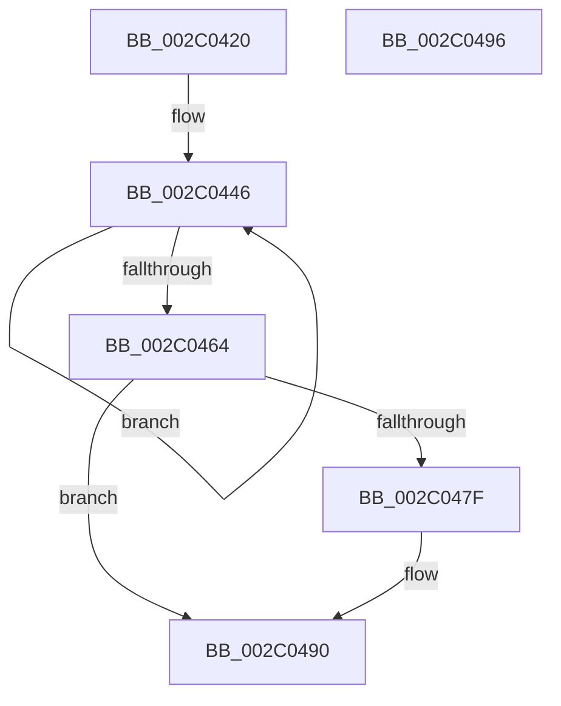

# PopFxComponentWork

- RVA: `0x002C0420`–`0x002C0497` (길이 `119` bytes)
- VA: `0x00000001402C0420`
- 실행 섹션: `.text`
- PDB 이름 있음: `예`; PDB Function 태그: `아니요`
- unwind 정보 RVA: `0x0006E5B4`
- 디코드: `32`개 명령, `119/119` bytes 표시
- 미해석 바이트: `0` (있으면 어셈블리에 `.byte`로 보존)

> 이 문서는 커널 이미지의 기계어와 PDB 기호를 분석해 생성했습니다. 4번과 5번은 함수 원형과 자료형을 바이너리 사용 방식에서 추정한 C 해석이며 원본 소스 복구 결과는 아닙니다.

## 1. Dependencies

- 직접 호출 지점: **2**; 고유 호출 대상: **2**
- 직접 호출자로 확인된 함수: **0**
- RIP 상대 이미지 참조: **0**

### Outgoing calls
- `0x002C0452` → [PopFxIdleWorker](PopFxIdleWorker_function_002C04A0.md) (function, `0x002C04A0`)
- `0x002C048B` → [KeSetEvent](../33/KeSetEvent_function_0033F310.md) (function, `0x0033F310`)

### Direct callers
- 이 함수 시작 RVA로 연결되는 직접 call은 확인되지 않았습니다. 간접 호출은 완전히 역산할 수 없습니다.

### Static image references
- 디코드된 RIP-relative 메모리 참조가 없습니다.

## 2. Other-region calls and transfers

- 다른 실행 섹션으로 향하는 call: **0**
- 별도 외부 분기/꼬리 이동을 확인하지 못했습니다.

## 3. Assembly (complete function range)

```asm
002C0420  40 53                           push rbx
002C0422  48 83 EC 60                     sub rsp, 0x60
002C0426  0F 57 C0                        xorps xmm0, xmm0
002C0429  33 C0                           xor eax, eax
002C042B  0F 11 44 24 20                  movups xmmword ptr [rsp + 0x20], xmm0
002C0430  48 89 44 24 50                  mov qword ptr [rsp + 0x50], rax
002C0435  48 8B D9                        mov rbx, rcx
002C0438  0F 11 44 24 30                  movups xmmword ptr [rsp + 0x30], xmm0
002C043D  89 44 24 58                     mov dword ptr [rsp + 0x58], eax
002C0441  0F 11 44 24 40                  movups xmmword ptr [rsp + 0x40], xmm0
002C0446  8B 53 10                        mov edx, dword ptr [rbx + 0x10]
002C0449  4C 8D 44 24 20                  lea r8, [rsp + 0x20]
002C044E  48 8B 4B 50                     mov rcx, qword ptr [rbx + 0x50]
002C0452  E8 49 00 00 00                  call 0x1402c04a0
002C0457  83 C8 FF                        or eax, 0xffffffff
002C045A  F0 0F C1 43 38                  lock xadd dword ptr [rbx + 0x38], eax
002C045F  83 F8 01                        cmp eax, 1
002C0462  75 E2                           jne 0x1402c0446
002C0464  48 8B 4B 50                     mov rcx, qword ptr [rbx + 0x50]
002C0468  F0 FF 89 20 01 00 00            lock dec dword ptr [rcx + 0x120]
002C046F  83 C8 FF                        or eax, 0xffffffff
002C0472  F0 0F C1 81 F4 00 00 00         lock xadd dword ptr [rcx + 0xf4], eax
002C047A  83 F8 01                        cmp eax, 1
002C047D  75 11                           jne 0x1402c0490
002C047F  48 81 C1 F8 00 00 00            add rcx, 0xf8
002C0486  45 33 C0                        xor r8d, r8d
002C0489  33 D2                           xor edx, edx
002C048B  E8 80 EE 07 00                  call 0x14033f310
002C0490  48 83 C4 60                     add rsp, 0x60
002C0494  5B                              pop rbx
002C0495  C3                              ret
002C0496  CC                              int3
```

## 4. C-style interpretation (structured pseudocode)

```c
__int64 __fastcall PopFxComponentWork(__int64 a1)
{
    __int64 result;
    __int64 v_rsp;
    unsigned int v_stack_m10;
    unsigned __int64 v_stack_m18;
    unsigned __int64 v_stack_m28;
    unsigned __int64 v_stack_m38;
    unsigned __int64 v_stack_m48;

    v_rsp = (v_rsp) - (96);
    result = 0;
    v_stack_m48 = v_xmm0;
    v_stack_m18 = 0;
    v_stack_m38 = v_xmm0;
    v_stack_m10 = 0;
    v_stack_m28 = v_xmm0;
loc_002C0446:
    result = PopFxIdleWorker(*(unsigned __int64 *)(a1 + 80), (unsigned int)(*(unsigned int *)(a1 + 16)), v_stack_m48, a4);
    result = (unsigned int)((result) | (0xFFFFFFFFULL));
    if (((unsigned int)(result)) != 1) goto loc_002C0446;
    result = (unsigned int)((result) | (0xFFFFFFFFULL));
    if (((unsigned int)(result)) == 1) {
        a1 = (*(unsigned __int64 *)(a1 + 80)) + (248);
        a3 = 0;
        a2 = 0;
        result = KeSetEvent(a1, a2, a3, a4);
    }
    v_rsp = (v_rsp) + (96);
    return result;
}
```

## 5. (Beta) C Style

```c
int64_t PopFxComponentWork(void *Arg1)
{
    uint8_t *arg1 = (uint8_t *)Arg1;

    int64_t result;
    int64_t local_rsp;
    uint32_t v_stack_m10;
    uint64_t v_stack_m18;
    uint64_t v_stack_m28;
    uint64_t v_stack_m38;
    uint64_t v_stack_m48;

    local_rsp = (local_rsp) - (96);
    result = 0;
    v_stack_m48 = v_xmm0;
    v_stack_m18 = 0;
    v_stack_m38 = v_xmm0;
    v_stack_m10 = 0;
    v_stack_m28 = v_xmm0;
loc_002C0446:
    result = PopFxIdleWorker(*(uint64_t *)(arg1 + 0x50), (uint32_t)(*(uint32_t *)(arg1 + 0x10)), v_stack_m48, a4);
    result = (uint32_t)((result) | (0xFFFFFFFFULL));
    if (((uint32_t)(result)) != 1) goto loc_002C0446;
    result = (uint32_t)((result) | (0xFFFFFFFFULL));
    if (((uint32_t)(result)) == 1) {
        Arg1 = (*(uint64_t *)(arg1 + 0x50)) + (248);
        a3 = 0;
        a2 = 0;
        result = KeSetEvent(Arg1, a2, a3, a4);
    }
    local_rsp = (local_rsp) + (96);
    return result;
}
```

### 관측된 메모리 오프셋

구조체 형식이 확인되지 않은 접근은 인자 기준의 오프셋으로만 기록했습니다.

| 기준 인자 | 오프셋 표현 | 폭 (bit) | 접근 |
|---|---:|---:|---|
| `Arg1` | `+ 0x10` | `32` | `R` |
| `Arg1` | `+ 0x38` | `32` | `R/W` |
| `Arg1` | `+ 0x50` | `64` | `R` |

## 6. Execution-region graph

[열기: 2D/3D 그래프와 함수 탐색 컨트롤 패널](../../../control-panel.html?section=text&rva=0x002C0420&view=graph)

- 2D 그래프는 위에서 아래로 흐르고, 3D 그래프는 빈 공간을 드래그해 회전합니다. Shift+드래그는 이동, 휠은 확대·축소, 함수 노드 선택은 대상 보고서 이동입니다.

### Static fallback


