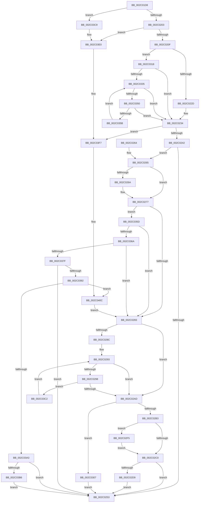

# PopFxIdleComponent

- RVA: `0x002C01D8`–`0x002C0419` (길이 `577` bytes)
- VA: `0x00000001402C01D8`
- 실행 섹션: `.text`
- PDB 이름 있음: `예`; PDB Function 태그: `아니요`
- unwind 정보 RVA: `0x0006E59C`
- 디코드: `147`개 명령, `577/577` bytes 표시
- 미해석 바이트: `0` (있으면 어셈블리에 `.byte`로 보존)

> 이 문서는 커널 이미지의 기계어와 PDB 기호를 분석해 생성했습니다. 4번과 5번은 함수 원형과 자료형을 바이너리 사용 방식에서 추정한 C 해석이며 원본 소스 복구 결과는 아닙니다.

## 1. Dependencies

- 직접 호출 지점: **10**; 고유 호출 대상: **7**
- 직접 호출자로 확인된 함수: **11**
- RIP 상대 이미지 참조: **4**

### Outgoing calls
- `0x002C026F` → [RtlGetInterruptTimePrecise](../20/RtlGetInterruptTimePrecise_function_0020A4C0.md) (function, `0x0020A4C0`)
- `0x002C02C8` → [PopFxIdleWorker](PopFxIdleWorker_function_002C04A0.md) (function, `0x002C04A0`)
- `0x002C02EB` → [KiClearSystemPriority](KiClearSystemPriority_function_002C05A8.md) (function, `0x002C05A8`)
- `0x002C0300` → [KiSetSystemPriorityThread](../2D/KiSetSystemPriorityThread_function_002D9FF8.md) (function, `0x002D9FF8`)
- `0x002C030E` → [PopFxQueueWorkOrder](../2B/PopFxQueueWorkOrder_function_002BFD34.md) (function, `0x002BFD34`)
- `0x002C031D` → [RtlGetInterruptTimePrecise](../20/RtlGetInterruptTimePrecise_function_0020A4C0.md) (function, `0x0020A4C0`)
- `0x002C03B8` → [PopFxArmResidentTimer](PopFxArmResidentTimer_function_002C0680.md) (function, `0x002C0680`)
- `0x002C03DA` → [PopFxBugCheck](../2B/PopFxBugCheck_function_002BFC6C.md) (function, `0x002BFC6C`)
- `0x002C03F1` → [PopFxBugCheck](../2B/PopFxBugCheck_function_002BFC6C.md) (function, `0x002BFC6C`)
- `0x002C0406` → [PopFxBugCheck](../2B/PopFxBugCheck_function_002BFC6C.md) (function, `0x002BFC6C`)

### Direct callers
- [PopFxNotifyPostDIrpCompletion](../26/PopFxNotifyPostDIrpCompletion_function_0026EA18.md) at `0x0026EAAE`
- [PopFxCompleteComponentActivation](../2B/PopFxCompleteComponentActivation_function_002BDDE4.md) at `0x002BDE28`
- [PoFxIdleComponent](PoFxIdleComponent_function_002C01A0.md) at `0x002C01C6`
- [PopFxDeactivateComponentDependencies](../43/PopFxDeactivateComponentDependencies_function_0043CF70.md) at `0x0043D023`
- [PopFxDeactivateComponentDependencies](../43/PopFxDeactivateComponentDependencies_function_0043CF70.md) at `0x0043D0A2`
- [PopFxResidentTimeoutRoutine](../46/PopFxResidentTimeoutRoutine_function_00462650.md) at `0x0046274D`
- [PoFxAddComponentRelation](../5D/PoFxAddComponentRelation_function_005D15E0.md) at `0x005D17FE`
- [PoFxRemoveComponentRelation](../5D/PoFxRemoveComponentRelation_function_005D1C90.md) at `0x005D1E8E`
- [PoFxRemoveComponentRelation](../5D/PoFxRemoveComponentRelation_function_005D1C90.md) at `0x005D1EA4`
- [PoFxRemoveDeviceRelation](../5D/PoFxRemoveDeviceRelation_function_005D1EF0.md) at `0x005D20B8`
- [PopFxComponentRelationsCleanup](../5D/PopFxComponentRelationsCleanup_function_005D221C.md) at `0x005D2340`
- [PopFxDeviceRelationsCleanup](../5D/PopFxDeviceRelationsCleanup_function_005D2660.md) at `0x005D26C6`
- [PopFxRegisterDevice](../../page/75/PopFxRegisterDevice_function_00759B80.md) at `0x00759DBF`

### Static image references
- `0x002C021C` → RVA `0x00E0B3E4` (`.data`; read)
- `0x002C035D` → RVA `0x00E676C1` (`.data`; read)
- `0x002C036A` → RVA `0x00E0B3D4` (`.data`; read)
- `0x002C03A3` → RVA `0x00F0E430` (`.data`; read/write)

## 2. Other-region calls and transfers

- 다른 실행 섹션으로 향하는 call: **0**
- 별도 외부 분기/꼬리 이동을 확인하지 못했습니다.

## 3. Assembly (complete function range)

```asm
002C01D8  48 89 5C 24 10                  mov qword ptr [rsp + 0x10], rbx
002C01DD  55                              push rbp
002C01DE  56                              push rsi
002C01DF  57                              push rdi
002C01E0  41 56                           push r14
002C01E2  41 57                           push r15
002C01E4  48 83 EC 30                     sub rsp, 0x30
002C01E8  41 8B C0                        mov eax, r8d
002C01EB  8B EA                           mov ebp, edx
002C01ED  83 E0 03                        and eax, 3
002C01F0  8B DA                           mov ebx, edx
002C01F2  4D 8B F9                        mov r15, r9
002C01F5  45 8B F0                        mov r14d, r8d
002C01F8  48 8B F9                        mov rdi, rcx
002C01FB  3C 03                           cmp al, 3
002C01FD  0F 84 C6 01 00 00               je 0x1402c03c9
002C0203  3B A9 64 03 00 00               cmp ebp, dword ptr [rcx + 0x364]
002C0209  0F 83 D1 01 00 00               jae 0x1402c03e0
002C020F  0F AE E8                        lfence
002C0212  48 8B 81 68 03 00 00            mov rax, qword ptr [rcx + 0x368]
002C0219  45 33 C0                        xor r8d, r8d
002C021C  83 3D C1 B1 B4 00 02            cmp dword ptr [rip + 0xb4b1c1], 2
002C0223  48 8B 1C E8                     mov rbx, qword ptr [rax + rbp*8]
002C0227  0F 84 EB 00 00 00               je 0x1402c0318
002C022D  48 8B B3 90 00 00 00            mov rsi, qword ptr [rbx + 0x90]
002C0234  8B 43 58                        mov eax, dword ptr [rbx + 0x58]
002C0237  A9 FF FF FF 3F                  test eax, 0x3fffffff
002C023C  0F 84 B5 01 00 00               je 0x1402c03f7
002C0242  83 C8 FF                        or eax, 0xffffffff
002C0245  F0 0F C1 43 58                  lock xadd dword ptr [rbx + 0x58], eax
002C024A  FF C8                           dec eax
002C024C  3D 00 00 00 80                  cmp eax, 0x80000000
002C0251  74 12                           je 0x1402c0265
002C0253  48 8B 5C 24 68                  mov rbx, qword ptr [rsp + 0x68]
002C0258  48 83 C4 30                     add rsp, 0x30
002C025C  41 5F                           pop r15
002C025E  41 5E                           pop r14
002C0260  5F                              pop rdi
002C0261  5E                              pop rsi
002C0262  5D                              pop rbp
002C0263  C3                              ret
002C0264  CC                              int3
002C0265  4D 85 C0                        test r8, r8
002C0268  75 0D                           jne 0x1402c0277
002C026A  48 8D 4C 24 20                  lea rcx, [rsp + 0x20]
002C026F  E8 4C A2 F4 FF                  call 0x14020a4c0
002C0274  4C 8B C0                        mov r8, rax
002C0277  8B 4B 5C                        mov ecx, dword ptr [rbx + 0x5c]
002C027A  F6 C1 02                        test cl, 2
002C027D  0F 84 DA 00 00 00               je 0x1402c035d
002C0283  83 3D 5A B1 B4 00 01            cmp dword ptr [rip + 0xb4b15a], 1
002C028A  75 21                           jne 0x1402c02ad
002C028C  48 8B 83 90 00 00 00            mov rax, qword ptr [rbx + 0x90]
002C0293  49 3B C0                        cmp rax, r8
002C0296  73 15                           jae 0x1402c02ad
002C0298  48 8B C8                        mov rcx, rax
002C029B  F0 4C 0F B1 83 90 00 00 00      lock cmpxchg qword ptr [rbx + 0x90], r8
002C02A4  48 3B C8                        cmp rcx, rax
002C02A7  0F 85 15 01 00 00               jne 0x1402c03c2
002C02AD  41 F6 C6 02                     test r14b, 2
002C02B1  75 54                           jne 0x1402c0307
002C02B3  44 0F 20 C0                     mov rax, cr8
002C02B7  BB 10 00 00 00                  mov ebx, 0x10
002C02BC  3C 02                           cmp al, 2
002C02BE  72 35                           jb 0x1402c02f5
002C02C0  4D 8B C7                        mov r8, r15
002C02C3  8B D5                           mov edx, ebp
002C02C5  48 8B CF                        mov rcx, rdi
002C02C8  E8 D3 01 00 00                  call 0x1402c04a0
002C02CD  44 0F 20 C0                     mov rax, cr8
002C02D1  3C 02                           cmp al, 2
002C02D3  0F 83 7A FF FF FF               jae 0x1402c0253
002C02D9  65 48 8B 0C 25 88 01 00 00      mov rcx, qword ptr gs:[0x188]
002C02E2  48 8D 54 24 70                  lea rdx, [rsp + 0x70]
002C02E7  89 5C 24 70                     mov dword ptr [rsp + 0x70], ebx
002C02EB  E8 B8 02 00 00                  call 0x1402c05a8
002C02F0  E9 5E FF FF FF                  jmp 0x1402c0253
002C02F5  65 48 8B 0C 25 88 01 00 00      mov rcx, qword ptr gs:[0x188]
002C02FE  8B D3                           mov edx, ebx
002C0300  E8 F3 9C 01 00                  call 0x1402d9ff8
002C0305  EB B9                           jmp 0x1402c02c0
002C0307  48 8D 4B 18                     lea rcx, [rbx + 0x18]
002C030B  48 8B D7                        mov rdx, rdi
002C030E  E8 21 FA FF FF                  call 0x1402bfd34
002C0313  E9 3B FF FF FF                  jmp 0x1402c0253
002C0318  48 8D 4C 24 20                  lea rcx, [rsp + 0x20]
002C031D  E8 9E A1 F4 FF                  call 0x14020a4c0
002C0322  48 8B B3 90 00 00 00            mov rsi, qword ptr [rbx + 0x90]
002C0329  4C 8B C0                        mov r8, rax
002C032C  48 3B F0                        cmp rsi, rax
002C032F  0F 83 FF FE FF FF               jae 0x1402c0234
002C0335  48 8B CE                        mov rcx, rsi
002C0338  48 8B C6                        mov rax, rsi
002C033B  F0 4C 0F B1 83 90 00 00 00      lock cmpxchg qword ptr [rbx + 0x90], r8
002C0344  48 8B F0                        mov rsi, rax
002C0347  48 3B C8                        cmp rcx, rax
002C034A  0F 84 E4 FE FF FF               je 0x1402c0234
002C0350  F3 90                           pause
002C0352  49 3B C0                        cmp rax, r8
002C0355  0F 83 D9 FE FF FF               jae 0x1402c0234
002C035B  EB D8                           jmp 0x1402c0335
002C035D  80 3D 5D 73 BA 00 00            cmp byte ptr [rip + 0xba735d], 0
002C0364  0F 85 19 FF FF FF               jne 0x1402c0283
002C036A  8B 0D 64 B0 B4 00               mov ecx, dword ptr [rip + 0xb4b064]
002C0370  49 8B D0                        mov rdx, r8
002C0373  48 2B D6                        sub rdx, rsi
002C0376  48 3B D1                        cmp rdx, rcx
002C0379  0F 83 04 FF FF FF               jae 0x1402c0283
002C037F  B9 01 00 00 80                  mov ecx, 0x80000001
002C0384  8D 41 FF                        lea eax, [rcx - 1]
002C0387  F0 0F B1 4B 58                  lock cmpxchg dword ptr [rbx + 0x58], ecx
002C038C  0F 85 C1 FE FF FF               jne 0x1402c0253
002C0392  B8 01 00 00 00                  mov eax, 1
002C0397  F0 0F C1 43 60                  lock xadd dword ptr [rbx + 0x60], eax
002C039C  FF C0                           inc eax
002C039E  83 F8 01                        cmp eax, 1
002C03A1  75 69                           jne 0x1402c040c
002C03A3  F0 0F C1 05 85 E0 C4 00         lock xadd dword ptr [rip + 0xc4e085], eax
002C03AB  FF C0                           inc eax
002C03AD  83 F8 01                        cmp eax, 1
002C03B0  0F 85 9D FE FF FF               jne 0x1402c0253
002C03B6  33 C9                           xor ecx, ecx
002C03B8  E8 C3 02 00 00                  call 0x1402c0680
002C03BD  E9 91 FE FF FF                  jmp 0x1402c0253
002C03C2  F3 90                           pause
002C03C4  E9 CA FE FF FF                  jmp 0x1402c0293
002C03C9  41 B9 01 00 00 00               mov r9d, 1
002C03CF  4C 8B C3                        mov r8, rbx
002C03D2  48 8B D7                        mov rdx, rdi
002C03D5  B9 14 06 00 00                  mov ecx, 0x614
002C03DA  E8 8D F8 FF FF                  call 0x1402bfc6c
002C03DF  CC                              int3
002C03E0  41 B9 02 00 00 00               mov r9d, 2
002C03E6  4C 8B C3                        mov r8, rbx
002C03E9  48 8B D7                        mov rdx, rdi
002C03EC  B9 14 06 00 00                  mov ecx, 0x614
002C03F1  E8 76 F8 FF FF                  call 0x1402bfc6c
002C03F6  CC                              int3
002C03F7  4C 63 43 58                     movsxd r8, dword ptr [rbx + 0x58]
002C03FB  45 33 C9                        xor r9d, r9d
002C03FE  48 8B D3                        mov rdx, rbx
002C0401  B9 08 06 00 00                  mov ecx, 0x608
002C0406  E8 61 F8 FF FF                  call 0x1402bfc6c
002C040B  CC                              int3
002C040C  F0 FF 4B 60                     lock dec dword ptr [rbx + 0x60]
002C0410  F0 FF 4B 58                     lock dec dword ptr [rbx + 0x58]
002C0414  E9 6A FE FF FF                  jmp 0x1402c0283
```

## 4. C-style interpretation (structured pseudocode)

```c
__int64 __fastcall PopFxIdleComponent(__int64 a1, int a2, int a3, __int64 a4)
{
    __int64 result;
    __int64 v_rsp;
    unsigned __int64 v_stack_p10;
    unsigned __int64 v_stack_p20;
    unsigned __int64 v_stack_p70;

    v_stack_p10 = v_rbx;
    v_rsp = (v_rsp) - (48);
    result = (unsigned int)(((unsigned int)(a3)) & (3));
    if (((unsigned __int8)(result)) == 3) goto loc_002C03C9;
    if (((unsigned int)((unsigned int)(a2))) >= (*(unsigned int *)(a1 + 868))) goto loc_002C03E0;
    a3 = 0;
    if ((*(unsigned int *)(v_rip + 11841985)) == 2) goto loc_002C0318;
loc_002C0234:
    if ((((unsigned int)((unsigned int)(*(unsigned int *)(*(unsigned __int64 *)(*(unsigned __int64 *)(a1 + 872) + (unsigned int)(a2) * 8) + 88)))) & (0x3FFFFFFFULL)) == 0) goto loc_002C03F7;
    result = (unsigned int)(((unsigned int)(*(unsigned int *)(*(unsigned __int64 *)(*(unsigned __int64 *)(a1 + 872) + (unsigned int)(a2) * 8) + 88))) | (0xFFFFFFFFULL));
    result = (unsigned int)((result) - 1);
    if (((unsigned int)(result)) == 0x80000000ULL) goto loc_002C0265;
loc_002C0253:
    v_rsp = (v_rsp) + (48);
    return result;
loc_002C0265:
    if (0 == 0) {
        a1 = v_stack_p20;
        result = RtlGetInterruptTimePrecise(a1, a2, a3, a4);
        a3 = result;
    }
    if ((((unsigned __int8)((unsigned int)(*(unsigned int *)(v_stack_p10 + 92)))) & (2)) == 0) goto loc_002C035D;
loc_002C0283:
    if ((*(unsigned int *)(v_rip + 11841882)) != 1) goto loc_002C02AD;
loc_002C0293:
    if ((*(unsigned __int64 *)(v_stack_p10 + 144)) >= a3) goto loc_002C02AD;
    if ((*(unsigned __int64 *)(v_stack_p10 + 144)) != (*(unsigned __int64 *)(v_stack_p10 + 144))) goto loc_002C03C2;
loc_002C02AD:
    if ((((unsigned __int8)((unsigned int)(a3))) & (2)) != 0) goto loc_002C0307;
    if (((unsigned __int8)(v_cr8)) < 2) goto loc_002C02F5;
loc_002C02C0:
    result = PopFxIdleWorker(a1, (unsigned int)((unsigned int)((unsigned int)(a2))), a4, a4);
    if (((unsigned __int8)(v_cr8)) >= 2) goto loc_002C0253;
    v_stack_p70 = 16;
    result = KiClearSystemPriority(*(unsigned __int64 *)(gs_base + (0 + 392)), v_stack_p70, a4, a4);
    goto loc_002C0253;
loc_002C02F5:
    result = KiSetSystemPriorityThread(*(unsigned __int64 *)(gs_base + (0 + 392)), 16, a4, a4);
    goto loc_002C02C0;
loc_002C0307:
    result = PopFxQueueWorkOrder(16 + 24, a1, a4, a4);
    goto loc_002C0253;
loc_002C0318:
    result = RtlGetInterruptTimePrecise(v_stack_p20, a1, a4, a4);
    if ((*(unsigned __int64 *)(16 + 144)) >= result) goto loc_002C0234;
loc_002C0335:
    if ((*(unsigned __int64 *)(16 + 144)) == (*(unsigned __int64 *)(16 + 144))) goto loc_002C0234;
    if ((*(unsigned __int64 *)(16 + 144)) >= result) goto loc_002C0234;
    goto loc_002C0335;
loc_002C035D:
    if ((*(unsigned __int8 *)(v_rip + 12219229)) != 0) goto loc_002C0283;
    a2 = (result) - (*(unsigned __int64 *)(16 + 144));
    if (a2 >= ((unsigned int)(*(unsigned int *)(v_rip + 11841636)))) goto loc_002C0283;
    if (a2 != ((unsigned int)(*(unsigned int *)(v_rip + 11841636)))) goto loc_002C0253;
    result = (unsigned int)((1) + 1);
    if (((unsigned int)(result)) != 1) goto loc_002C040C;
    result = (unsigned int)((result) + 1);
    if (((unsigned int)(result)) != 1) goto loc_002C0253;
    a1 = 0;
    result = PopFxArmResidentTimer(a1, a2, result, a4);
    goto loc_002C0253;
loc_002C03C2:
    goto loc_002C0293;
loc_002C03C9:
    result = PopFxBugCheck((unsigned int)(0x614ULL), 0, 16, 1);
loc_002C03E0:
    result = PopFxBugCheck((unsigned int)(0x614ULL), 0, 16, 2);
loc_002C03F7:
    a4 = 0;
    result = PopFxBugCheck((unsigned int)(0x608ULL), 16, (int)(*(unsigned int *)(16 + 88)), a4);
loc_002C040C:
    goto loc_002C0283;
}
```

## 5. (Beta) C Style

```c
int64_t PopFxIdleComponent(void *Arg1, int32_t Arg2, int32_t Arg3, int64_t Arg4)
{
    uint8_t *arg1 = (uint8_t *)Arg1;

    int64_t result;
    int64_t local_rsp;
    uint64_t v_stack_p10;
    uint64_t v_stack_p20;
    uint64_t v_stack_p70;

    v_stack_p10 = local_rbx;
    local_rsp = (local_rsp) - (48);
    result = (uint32_t)(((uint32_t)(Arg3)) & (3));
    if (((uint8_t)(result)) == 3) goto loc_002C03C9;
    if (((uint32_t)((uint32_t)(Arg2))) >= (*(uint32_t *)(arg1 + 0x364))) goto loc_002C03E0;
    Arg3 = 0;
    if ((*(uint32_t *)(v_rip + 0xB4B1C1)) == 2) goto loc_002C0318;
loc_002C0234:
    if ((((uint32_t)((uint32_t)(*(uint32_t *)(*(uint64_t *)(*(uint64_t *)(arg1 + 0x368) + (uint32_t)(Arg2) * 8) + 0x58)))) & (0x3FFFFFFFULL)) == 0) goto loc_002C03F7;
    result = (uint32_t)(((uint32_t)(*(uint32_t *)(*(uint64_t *)(*(uint64_t *)(arg1 + 0x368) + (uint32_t)(Arg2) * 8) + 0x58))) | (0xFFFFFFFFULL));
    result = (uint32_t)((result) - 1);
    if (((uint32_t)(result)) == 0x80000000ULL) goto loc_002C0265;
loc_002C0253:
    local_rsp = (local_rsp) + (48);
    return result;
loc_002C0265:
    if (0 == 0) {
        Arg1 = v_stack_p20;
        result = RtlGetInterruptTimePrecise(Arg1, Arg2, Arg3, Arg4);
        Arg3 = result;
    }
    if ((((uint8_t)((uint32_t)(*(uint32_t *)(v_stack_p10 + 0x5C)))) & (2)) == 0) goto loc_002C035D;
loc_002C0283:
    if ((*(uint32_t *)(v_rip + 0xB4B15A)) != 1) goto loc_002C02AD;
loc_002C0293:
    if ((*(uint64_t *)(v_stack_p10 + 0x90)) >= Arg3) goto loc_002C02AD;
    if ((*(uint64_t *)(v_stack_p10 + 0x90)) != (*(uint64_t *)(v_stack_p10 + 0x90))) goto loc_002C03C2;
loc_002C02AD:
    if ((((uint8_t)((uint32_t)(Arg3))) & (2)) != 0) goto loc_002C0307;
    if (((uint8_t)(v_cr8)) < 2) goto loc_002C02F5;
loc_002C02C0:
    result = PopFxIdleWorker(Arg1, (uint32_t)((uint32_t)((uint32_t)(Arg2))), Arg4, Arg4);
    if (((uint8_t)(v_cr8)) >= 2) goto loc_002C0253;
    v_stack_p70 = 16;
    result = KiClearSystemPriority(*(uint64_t *)(gs_base + (0 + 0x188)), v_stack_p70, Arg4, Arg4);
    goto loc_002C0253;
loc_002C02F5:
    result = KiSetSystemPriorityThread(*(uint64_t *)(gs_base + (0 + 0x188)), 16, Arg4, Arg4);
    goto loc_002C02C0;
loc_002C0307:
    result = PopFxQueueWorkOrder(16 + 24, Arg1, Arg4, Arg4);
    goto loc_002C0253;
loc_002C0318:
    result = RtlGetInterruptTimePrecise(v_stack_p20, Arg1, Arg4, Arg4);
    if ((*(uint64_t *)(16 + 0x90)) >= result) goto loc_002C0234;
loc_002C0335:
    if ((*(uint64_t *)(16 + 0x90)) == (*(uint64_t *)(16 + 0x90))) goto loc_002C0234;
    if ((*(uint64_t *)(16 + 0x90)) >= result) goto loc_002C0234;
    goto loc_002C0335;
loc_002C035D:
    if ((*(uint8_t *)(v_rip + 0xBA735D)) != 0) goto loc_002C0283;
    Arg2 = (result) - (*(uint64_t *)(16 + 0x90));
    if (Arg2 >= ((uint32_t)(*(uint32_t *)(v_rip + 0xB4B064)))) goto loc_002C0283;
    if (Arg2 != ((uint32_t)(*(uint32_t *)(v_rip + 0xB4B064)))) goto loc_002C0253;
    result = (uint32_t)((1) + 1);
    if (((uint32_t)(result)) != 1) goto loc_002C040C;
    result = (uint32_t)((result) + 1);
    if (((uint32_t)(result)) != 1) goto loc_002C0253;
    Arg1 = 0;
    result = PopFxArmResidentTimer(Arg1, Arg2, result, Arg4);
    goto loc_002C0253;
loc_002C03C2:
    goto loc_002C0293;
loc_002C03C9:
    result = PopFxBugCheck((uint32_t)(0x614ULL), 0, 16, 1);
loc_002C03E0:
    result = PopFxBugCheck((uint32_t)(0x614ULL), 0, 16, 2);
loc_002C03F7:
    Arg4 = 0;
    result = PopFxBugCheck((uint32_t)(0x608ULL), 16, (int32_t)(*(uint32_t *)(16 + 0x58)), Arg4);
loc_002C040C:
    goto loc_002C0283;
}
```

### 관측된 메모리 오프셋

구조체 형식이 확인되지 않은 접근은 인자 기준의 오프셋으로만 기록했습니다.

| 기준 인자 | 오프셋 표현 | 폭 (bit) | 접근 |
|---|---:|---:|---|
| `Arg1` | `+ 0x364` | `32` | `R` |
| `Arg1` | `+ 0x368` | `64` | `R` |

## 6. Execution-region graph

[열기: 2D/3D 그래프와 함수 탐색 컨트롤 패널](../../../control-panel.html?section=text&rva=0x002C01D8&view=graph)

- 2D 그래프는 위에서 아래로 흐르고, 3D 그래프는 빈 공간을 드래그해 회전합니다. Shift+드래그는 이동, 휠은 확대·축소, 함수 노드 선택은 대상 보고서 이동입니다.

### Static fallback


