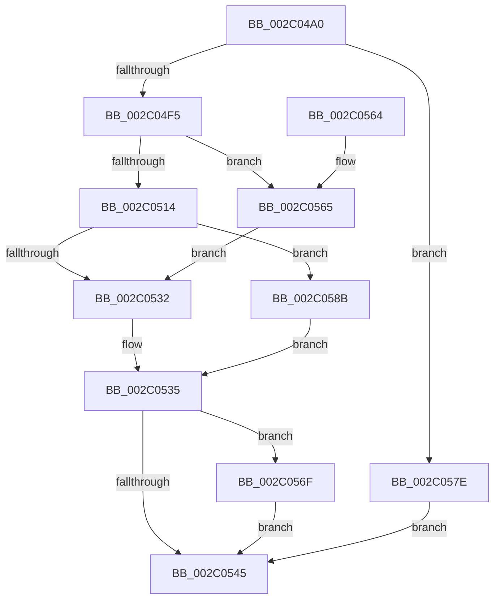

# PopFxIdleWorker

- RVA: `0x002C04A0`–`0x002C059F` (길이 `255` bytes)
- VA: `0x00000001402C04A0`
- 실행 섹션: `.text`
- PDB 이름 있음: `예`; PDB Function 태그: `아니요`
- unwind 정보 RVA: `0x0006E5C0`
- 디코드: `71`개 명령, `255/255` bytes 표시
- 미해석 바이트: `0` (있으면 어셈블리에 `.byte`로 보존)

> 이 문서는 커널 이미지의 기계어와 PDB 기호를 분석해 생성했습니다. 4번과 5번은 함수 원형과 자료형을 바이너리 사용 방식에서 추정한 C 해석이며 원본 소스 복구 결과는 아닙니다.

## 1. Dependencies

- 직접 호출 지점: **9**; 고유 호출 대상: **8**
- 직접 호출자로 확인된 함수: **2**
- RIP 상대 이미지 참조: **0**

### Outgoing calls
- `0x002C04C9` → [PopFxDeviceCriticalRegionEnter](../4F/PopFxDeviceCriticalRegionEnter_function_004F09A0.md) (function, `0x004F09A0`)
- `0x002C04D8` → [KeAcquireSpinLockRaiseToDpc](../20/KeAcquireSpinLockRaiseToDpc_function_00208470.md) (function, `0x00208470`)
- `0x002C04F9` → [KeResetEvent](../24/KeResetEvent_function_00248350.md) (function, `0x00248350`)
- `0x002C051D` → [guard_dispatch_icall](../6B/guard_dispatch_icall_function_006BAAD0.md) (function, `0x006BAAD0`)
- `0x002C053B` → [KeReleaseSpinLock](../39/KeReleaseSpinLock_function_00392BA0.md) (function, `0x00392BA0`)
- `0x002C0548` → [PopFxDeviceCriticalRegionLeave](../4F/PopFxDeviceCriticalRegionLeave_function_004F1330.md) (function, `0x004F1330`)
- `0x002C0577` → [PopFxIdleWorkerTail](../43/PopFxIdleWorkerTail_function_0043CDA0.md) (function, `0x0043CDA0`)
- `0x002C0584` → [KeReleaseSpinLock](../39/KeReleaseSpinLock_function_00392BA0.md) (function, `0x00392BA0`)
- `0x002C0598` → [PopFxAddLogEntry](../39/PopFxAddLogEntry_function_00390B94.md) (function, `0x00390B94`)

### Direct callers
- [PopFxIdleComponent](PopFxIdleComponent_function_002C01D8.md) at `0x002C02C8`
- [PopFxComponentWork](PopFxComponentWork_function_002C0420.md) at `0x002C0452`

### Static image references
- 디코드된 RIP-relative 메모리 참조가 없습니다.

## 2. Other-region calls and transfers

- 다른 실행 섹션으로 향하는 call: **0**
- 별도 외부 분기/꼬리 이동을 확인하지 못했습니다.

## 3. Assembly (complete function range)

```asm
002C04A0  48 89 5C 24 08                  mov qword ptr [rsp + 8], rbx
002C04A5  48 89 6C 24 18                  mov qword ptr [rsp + 0x18], rbp
002C04AA  56                              push rsi
002C04AB  57                              push rdi
002C04AC  41 54                           push r12
002C04AE  41 56                           push r14
002C04B0  41 57                           push r15
002C04B2  48 83 EC 20                     sub rsp, 0x20
002C04B6  48 8B 81 68 03 00 00            mov rax, qword ptr [rcx + 0x368]
002C04BD  4D 8B E0                        mov r12, r8
002C04C0  8B EA                           mov ebp, edx
002C04C2  48 8B F9                        mov rdi, rcx
002C04C5  48 8B 1C E8                     mov rbx, qword ptr [rax + rbp*8]
002C04C9  E8 D2 04 23 00                  call 0x1404f09a0
002C04CE  4C 8D B3 80 00 00 00            lea r14, [rbx + 0x80]
002C04D5  49 8B CE                        mov rcx, r14
002C04D8  E8 93 7F F4 FF                  call 0x140208470
002C04DD  44 8A F8                        mov r15b, al
002C04E0  B9 00 00 00 40                  mov ecx, 0x40000000
002C04E5  B8 00 00 00 80                  mov eax, 0x80000000
002C04EA  F0 0F B1 4B 58                  lock cmpxchg dword ptr [rbx + 0x58], ecx
002C04EF  0F 85 89 00 00 00               jne 0x1402c057e
002C04F5  48 8D 4B 68                     lea rcx, [rbx + 0x68]
002C04F9  E8 52 7E F8 FF                  call 0x140248350
002C04FE  C7 83 88 00 00 00 02 00 00 00   mov dword ptr [rbx + 0x88], 2
002C0508  40 32 F6                        xor sil, sil
002C050B  48 8B 47 78                     mov rax, qword ptr [rdi + 0x78]
002C050F  48 85 C0                        test rax, rax
002C0512  74 51                           je 0x1402c0565
002C0514  48 8B 8F C0 00 00 00            mov rcx, qword ptr [rdi + 0xc0]
002C051B  8B D5                           mov edx, ebp
002C051D  E8 AE A5 3F 00                  call 0x1406baad0
002C0522  83 C8 FF                        or eax, 0xffffffff
002C0525  F0 0F C1 83 88 00 00 00         lock xadd dword ptr [rbx + 0x88], eax
002C052D  83 F8 01                        cmp eax, 1
002C0530  75 59                           jne 0x1402c058b
002C0532  40 B6 01                        mov sil, 1
002C0535  41 8A D7                        mov dl, r15b
002C0538  49 8B CE                        mov rcx, r14
002C053B  E8 60 26 0D 00                  call 0x140392ba0
002C0540  40 84 F6                        test sil, sil
002C0543  75 2A                           jne 0x1402c056f
002C0545  48 8B CF                        mov rcx, rdi
002C0548  E8 E3 0D 23 00                  call 0x1404f1330
002C054D  48 8B 5C 24 50                  mov rbx, qword ptr [rsp + 0x50]
002C0552  48 8B 6C 24 60                  mov rbp, qword ptr [rsp + 0x60]
002C0557  48 83 C4 20                     add rsp, 0x20
002C055B  41 5F                           pop r15
002C055D  41 5E                           pop r14
002C055F  41 5C                           pop r12
002C0561  5F                              pop rdi
002C0562  5E                              pop rsi
002C0563  C3                              ret
002C0564  CC                              int3
002C0565  F0 83 83 88 00 00 00 FE         lock add dword ptr [rbx + 0x88], -2
002C056D  EB C3                           jmp 0x1402c0532
002C056F  4D 8B C4                        mov r8, r12
002C0572  8B D5                           mov edx, ebp
002C0574  48 8B CF                        mov rcx, rdi
002C0577  E8 24 C8 17 00                  call 0x14043cda0
002C057C  EB C7                           jmp 0x1402c0545
002C057E  41 8A D7                        mov dl, r15b
002C0581  49 8B CE                        mov rcx, r14
002C0584  E8 17 26 0D 00                  call 0x140392ba0
002C0589  EB BA                           jmp 0x1402c0545
002C058B  48 8B 4F 30                     mov rcx, qword ptr [rdi + 0x30]
002C058F  45 33 C9                        xor r9d, r9d
002C0592  8B D5                           mov edx, ebp
002C0594  45 8D 41 0D                     lea r8d, [r9 + 0xd]
002C0598  E8 F7 05 0D 00                  call 0x140390b94
002C059D  EB 96                           jmp 0x1402c0535
```

## 4. C-style interpretation (structured pseudocode)

```c
__int64 __fastcall PopFxIdleWorker(__int64 a1, int a2, __int64 a3, int a4)
{
    __int64 result;
    __int64 v_rsi;
    __int64 v_rsp;
    unsigned __int64 v_stack_p18;
    unsigned __int64 v_stack_p8;

    v_stack_p8 = v_rbx;
    v_stack_p18 = v_rbp;
    v_rsp = (v_rsp) - (32);
    result = PopFxDeviceCriticalRegionEnter(a1, a2, a3, a4);
    result = KeAcquireSpinLockRaiseToDpc(*(unsigned __int64 *)(*(unsigned __int64 *)(a1 + 872) + (unsigned int)(a2) * 8) + 128, a2, a3, a4);
    if (condition_is_not_equal) goto loc_002C057E;
    result = KeResetEvent(*(unsigned __int64 *)(*(unsigned __int64 *)(a1 + 872) + (unsigned int)(a2) * 8) + 104, a2, a3, a4);
    *(unsigned int *)(*(unsigned __int64 *)(*(unsigned __int64 *)(a1 + 872) + (unsigned int)(a2) * 8) + 136) = 2;
    v_rsi = 0;
    if (*(unsigned __int64 *)(a1 + 120) == 0) goto loc_002C0565;
    result = guard_dispatch_icall(*(unsigned __int64 *)(a1 + 192), (unsigned int)((unsigned int)((unsigned int)(a2))), a3, a4);
    result = (unsigned int)((result) | (0xFFFFFFFFULL));
    if (((unsigned int)(result)) != 1) goto loc_002C058B;
loc_002C0532:
loc_002C0535:
    result = KeReleaseSpinLock(*(unsigned __int64 *)(*(unsigned __int64 *)(a1 + 872) + (unsigned int)(a2) * 8) + 128, (unsigned __int8)((unsigned __int8)(result)), a3, a4);
    if (1 != 0) goto loc_002C056F;
loc_002C0545:
    result = PopFxDeviceCriticalRegionLeave(a1, (unsigned __int8)((unsigned __int8)(result)), a3, a4);
    v_rsp = (v_rsp) + (32);
    return result;
loc_002C0565:
    goto loc_002C0532;
loc_002C056F:
    result = PopFxIdleWorkerTail(a1, (unsigned int)((unsigned int)(v_stack_p18)), a3, a4);
    goto loc_002C0545;
loc_002C057E:
    result = KeReleaseSpinLock(*(unsigned __int64 *)(*(unsigned __int64 *)(a1 + 872) + (unsigned int)(a2) * 8) + 128, (unsigned __int8)((unsigned __int8)(result)), a3, a4);
    goto loc_002C0545;
loc_002C058B:
    a4 = 0;
    result = PopFxAddLogEntry(*(unsigned __int64 *)(a1 + 48), (unsigned int)((unsigned int)(v_stack_p18)), a4 + 13, a4);
    goto loc_002C0535;
}
```

## 5. (Beta) C Style

```c
int64_t PopFxIdleWorker(void *Arg1, int32_t Arg2, int64_t Arg3, int32_t Arg4)
{
    uint8_t *arg1 = (uint8_t *)Arg1;

    int64_t result;
    int64_t local_rsi;
    int64_t local_rsp;
    uint64_t v_stack_p18;
    uint64_t v_stack_p8;

    v_stack_p8 = local_rbx;
    v_stack_p18 = local_rbp;
    local_rsp = (local_rsp) - (32);
    result = PopFxDeviceCriticalRegionEnter(Arg1, Arg2, Arg3, Arg4);
    result = KeAcquireSpinLockRaiseToDpc(*(uint64_t *)(*(uint64_t *)(arg1 + 0x368) + (uint32_t)(Arg2) * 8) + 128, Arg2, Arg3, Arg4);
    if (condition_is_not_equal) goto loc_002C057E;
    result = KeResetEvent(*(uint64_t *)(*(uint64_t *)(arg1 + 0x368) + (uint32_t)(Arg2) * 8) + 104, Arg2, Arg3, Arg4);
    *(uint32_t *)(*(uint64_t *)(*(uint64_t *)(arg1 + 0x368) + (uint32_t)(Arg2) * 8) + 0x88) = 2;
    local_rsi = 0;
    if (*(uint64_t *)(arg1 + 0x78) == 0) goto loc_002C0565;
    result = guard_dispatch_icall(*(uint64_t *)(arg1 + 0xC0), (uint32_t)((uint32_t)((uint32_t)(Arg2))), Arg3, Arg4);
    result = (uint32_t)((result) | (0xFFFFFFFFULL));
    if (((uint32_t)(result)) != 1) goto loc_002C058B;
loc_002C0532:
loc_002C0535:
    result = KeReleaseSpinLock(*(uint64_t *)(*(uint64_t *)(arg1 + 0x368) + (uint32_t)(Arg2) * 8) + 128, (uint8_t)((uint8_t)(result)), Arg3, Arg4);
    if (1 != 0) goto loc_002C056F;
loc_002C0545:
    result = PopFxDeviceCriticalRegionLeave(Arg1, (uint8_t)((uint8_t)(result)), Arg3, Arg4);
    local_rsp = (local_rsp) + (32);
    return result;
loc_002C0565:
    goto loc_002C0532;
loc_002C056F:
    result = PopFxIdleWorkerTail(Arg1, (uint32_t)((uint32_t)(v_stack_p18)), Arg3, Arg4);
    goto loc_002C0545;
loc_002C057E:
    result = KeReleaseSpinLock(*(uint64_t *)(*(uint64_t *)(arg1 + 0x368) + (uint32_t)(Arg2) * 8) + 128, (uint8_t)((uint8_t)(result)), Arg3, Arg4);
    goto loc_002C0545;
loc_002C058B:
    Arg4 = 0;
    result = PopFxAddLogEntry(*(uint64_t *)(arg1 + 0x30), (uint32_t)((uint32_t)(v_stack_p18)), Arg4 + 13, Arg4);
    goto loc_002C0535;
}
```

### 관측된 메모리 오프셋

구조체 형식이 확인되지 않은 접근은 인자 기준의 오프셋으로만 기록했습니다.

| 기준 인자 | 오프셋 표현 | 폭 (bit) | 접근 |
|---|---:|---:|---|
| `Arg1` | `+ 0x30` | `64` | `R` |
| `Arg1` | `+ 0x78` | `64` | `R` |
| `Arg1` | `+ 0xC0` | `64` | `R` |
| `Arg1` | `+ 0x368` | `64` | `R` |

## 6. Execution-region graph

[열기: 2D/3D 그래프와 함수 탐색 컨트롤 패널](../../../control-panel.html?section=text&rva=0x002C04A0&view=graph)

- 2D 그래프는 위에서 아래로 흐르고, 3D 그래프는 빈 공간을 드래그해 회전합니다. Shift+드래그는 이동, 휠은 확대·축소, 함수 노드 선택은 대상 보고서 이동입니다.

### Static fallback


