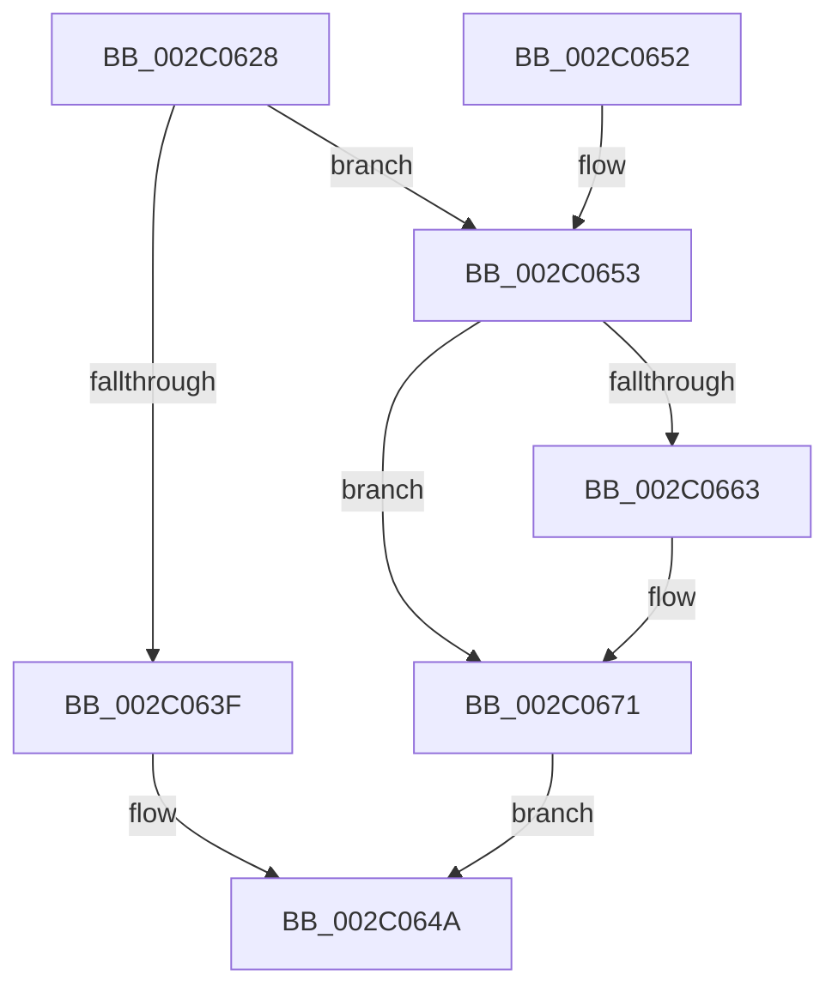

# PopFxTryReferenceDevice

- RVA: `0x002C0628`–`0x002C0679` (길이 `81` bytes)
- VA: `0x00000001402C0628`
- 실행 섹션: `.text`
- PDB 이름 있음: `예`; PDB Function 태그: `아니요`
- unwind 정보 RVA: `0x0006E5EC`
- 디코드: `20`개 명령, `81/81` bytes 표시
- 미해석 바이트: `0` (있으면 어셈블리에 `.byte`로 보존)

> 이 문서는 커널 이미지의 기계어와 PDB 기호를 분석해 생성했습니다. 4번과 5번은 함수 원형과 자료형을 바이너리 사용 방식에서 추정한 C 해석이며 원본 소스 복구 결과는 아닙니다.

## 1. Dependencies

- 직접 호출 지점: **1**; 고유 호출 대상: **1**
- 직접 호출자로 확인된 함수: **10**
- RIP 상대 이미지 참조: **0**

### Outgoing calls
- `0x002C066C` → [KeSetEvent](../33/KeSetEvent_function_0033F310.md) (function, `0x0033F310`)

### Direct callers
- [PopFxLockDevice](../26/PopFxLockDevice_function_0026F950.md) at `0x0026F9A1`
- [sub_002BD6E6](../2B/Unknown_function_002BD6E6.md) at `0x002BD84B`
- [PopFxAllocatePowerIrp](PopFxAllocatePowerIrp_function_002C0920.md) at `0x002C0985`
- [PopFxPlatformIdleVeto](../4A/PopFxPlatformIdleVeto_function_004AABC0.md) at `0x004AAC01`
- [PoFxPowerControl](../4B/PoFxPowerControl_function_004B2E70.md) at `0x004B2E9A`
- [PopFxProcessorIdleVeto](../5D/PopFxProcessorIdleVeto_function_005D2FF0.md) at `0x005D3031`
- [PopFxUpdatePlatformIdleState](../5D/PopFxUpdatePlatformIdleState_function_005D3880.md) at `0x005D38C7`
- [PopFxUpdateProcessorIdleState](../5D/PopFxUpdateProcessorIdleState_function_005D3960.md) at `0x005D39A7`
- [PopPepPlatformStateRegistered](../5D/PopPepPlatformStateRegistered_function_005DCDB8.md) at `0x005DCECB`
- [PoFxSetTargetDripsDevicePowerState](../../page/A8/PoFxSetTargetDripsDevicePowerState_function_00A88EB0.md) at `0x00A88F34`

### Static image references
- 디코드된 RIP-relative 메모리 참조가 없습니다.

## 2. Other-region calls and transfers

- 다른 실행 섹션으로 향하는 call: **0**
- 별도 외부 분기/꼬리 이동을 확인하지 못했습니다.

## 3. Assembly (complete function range)

```asm
002C0628  48 83 EC 28                     sub rsp, 0x28
002C062C  F0 FF 81 F4 00 00 00            lock inc dword ptr [rcx + 0xf4]
002C0633  45 33 C0                        xor r8d, r8d
002C0636  44 38 81 F0 00 00 00            cmp byte ptr [rcx + 0xf0], r8b
002C063D  75 14                           jne 0x1402c0653
002C063F  48 63 C2                        movsxd rax, edx
002C0642  F0 FF 84 81 10 01 00 00         lock inc dword ptr [rcx + rax*4 + 0x110]
002C064A  41 8B C0                        mov eax, r8d
002C064D  48 83 C4 28                     add rsp, 0x28
002C0651  C3                              ret
002C0652  CC                              int3
002C0653  83 C8 FF                        or eax, 0xffffffff
002C0656  F0 0F C1 81 F4 00 00 00         lock xadd dword ptr [rcx + 0xf4], eax
002C065E  83 F8 01                        cmp eax, 1
002C0661  75 0E                           jne 0x1402c0671
002C0663  48 81 C1 F8 00 00 00            add rcx, 0xf8
002C066A  33 D2                           xor edx, edx
002C066C  E8 9F EC 07 00                  call 0x14033f310
002C0671  41 B8 56 00 00 C0               mov r8d, 0xc0000056
002C0677  EB D1                           jmp 0x1402c064a
```

## 4. C-style interpretation (structured pseudocode)

```c
__int64 __fastcall PopFxTryReferenceDevice(__int64 a1, int a2, int a3)
{
    __int64 result;
    __int64 v_rsp;

    v_rsp = (v_rsp) - (40);
    a3 = 0;
    if ((*(unsigned __int8 *)(a1 + 240)) != 0) goto loc_002C0653;
loc_002C064A:
    v_rsp = (v_rsp) + (40);
    return 0;
loc_002C0653:
    result = (unsigned int)((0) | (0xFFFFFFFFULL));
    if (((unsigned int)(result)) == 1) {
        a1 = (a1) + (248);
        a2 = 0;
        result = KeSetEvent(a1, a2, a3, a4);
    }
    goto loc_002C064A;
}
```

## 5. (Beta) C Style

```c
int64_t PopFxTryReferenceDevice(void *Arg1, int32_t Arg2, int32_t Arg3)
{
    uint8_t *arg1 = (uint8_t *)Arg1;

    int64_t result;
    int64_t local_rsp;

    local_rsp = (local_rsp) - (40);
    Arg3 = 0;
    if ((*(uint8_t *)(arg1 + 0xF0)) != 0) goto loc_002C0653;
loc_002C064A:
    local_rsp = (local_rsp) + (40);
    return 0;
loc_002C0653:
    result = (uint32_t)((0) | (0xFFFFFFFFULL));
    if (((uint32_t)(result)) == 1) {
        Arg1 = (Arg1) + (248);
        Arg2 = 0;
        result = KeSetEvent(Arg1, Arg2, Arg3, a4);
    }
    goto loc_002C064A;
}
```

### 관측된 메모리 오프셋

구조체 형식이 확인되지 않은 접근은 인자 기준의 오프셋으로만 기록했습니다.

| 기준 인자 | 오프셋 표현 | 폭 (bit) | 접근 |
|---|---:|---:|---|
| `Arg1` | `+ 0xF0` | `8` | `R` |
| `Arg1` | `+ 0xF4` | `32` | `R/W` |
| `Arg1` | `+ 0x110 + rax*4` | `32` | `R/W` |

## 6. Execution-region graph

[열기: 2D/3D 그래프와 함수 탐색 컨트롤 패널](../../../control-panel.html?section=text&rva=0x002C0628&view=graph)

- 2D 그래프는 위에서 아래로 흐르고, 3D 그래프는 빈 공간을 드래그해 회전합니다. Shift+드래그는 이동, 휠은 확대·축소, 함수 노드 선택은 대상 보고서 이동입니다.

### Static fallback


