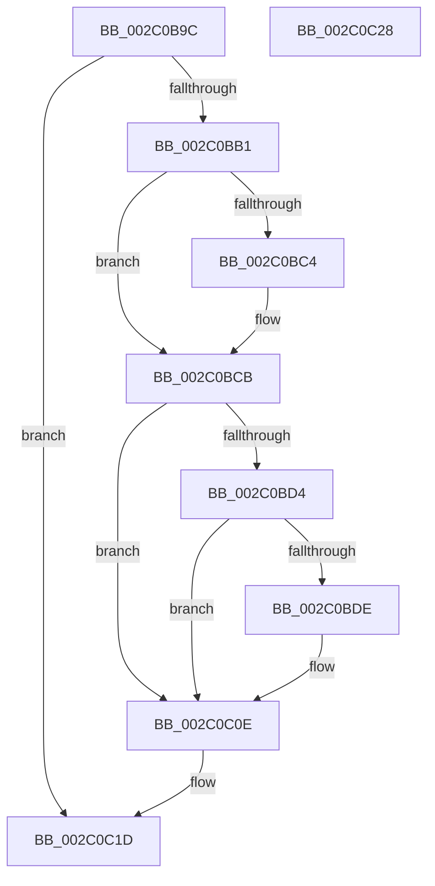

# PopPepArmIdleTimer

- RVA: `0x002C0B9C`–`0x002C0C29` (길이 `141` bytes)
- VA: `0x00000001402C0B9C`
- 실행 섹션: `.text`
- PDB 이름 있음: `예`; PDB Function 태그: `아니요`
- unwind 정보 RVA: `0x0006E5F8`
- 디코드: `33`개 명령, `141/141` bytes 표시
- 미해석 바이트: `0` (있으면 어셈블리에 `.byte`로 보존)

> 이 문서는 커널 이미지의 기계어와 PDB 기호를 분석해 생성했습니다. 4번과 5번은 함수 원형과 자료형을 바이너리 사용 방식에서 추정한 C 해석이며 원본 소스 복구 결과는 아닙니다.

## 1. Dependencies

- 직접 호출 지점: **3**; 고유 호출 대상: **3**
- 직접 호출자로 확인된 함수: **3**
- RIP 상대 이미지 참조: **7**

### Outgoing calls
- `0x002C0BB8` → [ExAcquireSpinLockExclusive](../24/ExAcquireSpinLockExclusive_function_00248690.md) (function, `0x00248690`)
- `0x002C0C09` → [KeSetCoalescableTimer](../22/KeSetCoalescableTimer_function_0022FFD0.md) (function, `0x0022FFD0`)
- `0x002C0C18` → [ExReleaseSpinLockExclusive](ExReleaseSpinLockExclusive_function_002C0EF0.md) (function, `0x002C0EF0`)

### Direct callers
- [sub_002BF8ED](../2B/Unknown_function_002BF8ED.md) at `0x002BF908`
- [PopPepIdleTimeoutRoutine](../45/PopPepIdleTimeoutRoutine_function_00458E10.md) at `0x00458FA1`
- [PopPepIdleTimeoutDpcRoutine](../4A/PopPepIdleTimeoutDpcRoutine_function_004A5B60.md) at `0x004A5B85`

### Static image references
- `0x002C0BA6` → RVA `0x00E0C464` (`.data`; read)
- `0x002C0BB1` → RVA `0x00F07748` (`.data`; read)
- `0x002C0BC4` → RVA `0x00F07744` (`.data`; write)
- `0x002C0BCB` → RVA `0x00F07744` (`.data`; read)
- `0x002C0BD4` → RVA `0x00F07740` (`.data`; read)
- `0x002C0BE5` → RVA `0x00F076C0` (`.data`; read)
- `0x002C0BFD` → RVA `0x00F07700` (`.data`; read)

## 2. Other-region calls and transfers

- 다른 실행 섹션으로 향하는 call: **0**
- 별도 외부 분기/꼬리 이동을 확인하지 못했습니다.

## 3. Assembly (complete function range)

```asm
002C0B9C  48 89 5C 24 08                  mov qword ptr [rsp + 8], rbx
002C0BA1  57                              push rdi
002C0BA2  48 83 EC 30                     sub rsp, 0x30
002C0BA6  83 3D B7 B8 B4 00 00            cmp dword ptr [rip + 0xb4b8b7], 0
002C0BAD  8A D9                           mov bl, cl
002C0BAF  74 6C                           je 0x1402c0c1d
002C0BB1  48 8D 0D 90 6B C4 00            lea rcx, [rip + 0xc46b90]
002C0BB8  E8 D3 7A F8 FF                  call 0x140248690
002C0BBD  40 8A F8                        mov dil, al
002C0BC0  84 DB                           test bl, bl
002C0BC2  74 07                           je 0x1402c0bcb
002C0BC4  C6 05 79 6B C4 00 00            mov byte ptr [rip + 0xc46b79], 0
002C0BCB  80 3D 72 6B C4 00 00            cmp byte ptr [rip + 0xc46b72], 0
002C0BD2  75 3A                           jne 0x1402c0c0e
002C0BD4  8B 0D 66 6B C4 00               mov ecx, dword ptr [rip + 0xc46b66]
002C0BDA  85 C9                           test ecx, ecx
002C0BDC  7E 30                           jle 0x1402c0c0e
002C0BDE  44 8B 0D 7F B8 B4 00            mov r9d, dword ptr [rip + 0xb4b87f]
002C0BE5  48 8D 05 D4 6A C4 00            lea rax, [rip + 0xc46ad4]
002C0BEC  49 69 D1 F0 D8 FF FF            imul rdx, r9, -0x2710
002C0BF3  45 33 C0                        xor r8d, r8d
002C0BF6  C6 05 47 6B C4 00 01            mov byte ptr [rip + 0xc46b47], 1
002C0BFD  48 8D 0D FC 6A C4 00            lea rcx, [rip + 0xc46afc]
002C0C04  48 89 44 24 20                  mov qword ptr [rsp + 0x20], rax
002C0C09  E8 C2 F3 F6 FF                  call 0x14022ffd0
002C0C0E  40 8A D7                        mov dl, dil
002C0C11  48 8D 0D 30 6B C4 00            lea rcx, [rip + 0xc46b30]
002C0C18  E8 D3 02 00 00                  call 0x1402c0ef0
002C0C1D  48 8B 5C 24 40                  mov rbx, qword ptr [rsp + 0x40]
002C0C22  48 83 C4 30                     add rsp, 0x30
002C0C26  5F                              pop rdi
002C0C27  C3                              ret
002C0C28  CC                              int3
```

## 4. C-style interpretation (structured pseudocode)

```c
__int64 __fastcall PopPepArmIdleTimer(unsigned __int8 a1, __int64 a2, int a3)
{
    __int64 result;
    __int64 v_rsp;
    unsigned __int64 v_stack_m18;
    unsigned __int64 v_stack_p8;

    v_stack_p8 = v_rbx;
    v_rsp = (v_rsp) - (48);
    if ((*(unsigned int *)(v_rip + 11843767)) == 0) goto loc_002C0C1D;
    result = ExAcquireSpinLockExclusive(v_rip + 12872592, a2, a3, a4);
    if (a1 != 0) {
        *(unsigned __int8 *)(v_rip + 12872569) = 0;
    }
    if ((*(unsigned __int8 *)(v_rip + 12872562)) != 0) goto loc_002C0C0E;
    if (!(condition_is_less_or_equal)) {
        a4 = *(unsigned int *)(v_rip + 11843711);
        result = v_rip + 12872404;
        a2 = (a2) * (a4);
        a3 = 0;
        *(unsigned __int8 *)(v_rip + 12872519) = 1;
        a1 = v_rip + 12872444;
        v_stack_m18 = result;
        result = KeSetCoalescableTimer(a1, a2, a3, a4);
    }
    result = ExReleaseSpinLockExclusive(v_rip + 12872496, (unsigned __int8)((unsigned __int8)(result)), a3, a4);
loc_002C0C1D:
    v_rsp = (v_rsp) + (48);
    return result;
}
```

## 5. (Beta) C Style

```c
int64_t PopPepArmIdleTimer(uint8_t Arg1, int64_t Arg2, int32_t Arg3)
{
    int64_t result;
    int64_t local_rsp;
    uint64_t v_stack_m18;
    uint64_t v_stack_p8;

    v_stack_p8 = local_rbx;
    local_rsp = (local_rsp) - (48);
    if ((*(uint32_t *)(v_rip + 0xB4B8B7)) == 0) goto loc_002C0C1D;
    result = ExAcquireSpinLockExclusive(v_rip + 12872592, Arg2, Arg3, a4);
    if (Arg1 != 0) {
        *(uint8_t *)(v_rip + 0xC46B79) = 0;
    }
    if ((*(uint8_t *)(v_rip + 0xC46B72)) != 0) goto loc_002C0C0E;
    if (!(condition_is_less_or_equal)) {
        a4 = *(uint32_t *)(v_rip + 0xB4B87F);
        result = v_rip + 12872404;
        Arg2 = (Arg2) * (a4);
        Arg3 = 0;
        *(uint8_t *)(v_rip + 0xC46B47) = 1;
        Arg1 = v_rip + 12872444;
        v_stack_m18 = result;
        result = KeSetCoalescableTimer(Arg1, Arg2, Arg3, a4);
    }
    result = ExReleaseSpinLockExclusive(v_rip + 12872496, (uint8_t)((uint8_t)(result)), Arg3, a4);
loc_002C0C1D:
    local_rsp = (local_rsp) + (48);
    return result;
}
```

## 6. Execution-region graph

[열기: 2D/3D 그래프와 함수 탐색 컨트롤 패널](../../../control-panel.html?section=text&rva=0x002C0B9C&view=graph)

- 2D 그래프는 위에서 아래로 흐르고, 3D 그래프는 빈 공간을 드래그해 회전합니다. Shift+드래그는 이동, 휠은 확대·축소, 함수 노드 선택은 대상 보고서 이동입니다.

### Static fallback


