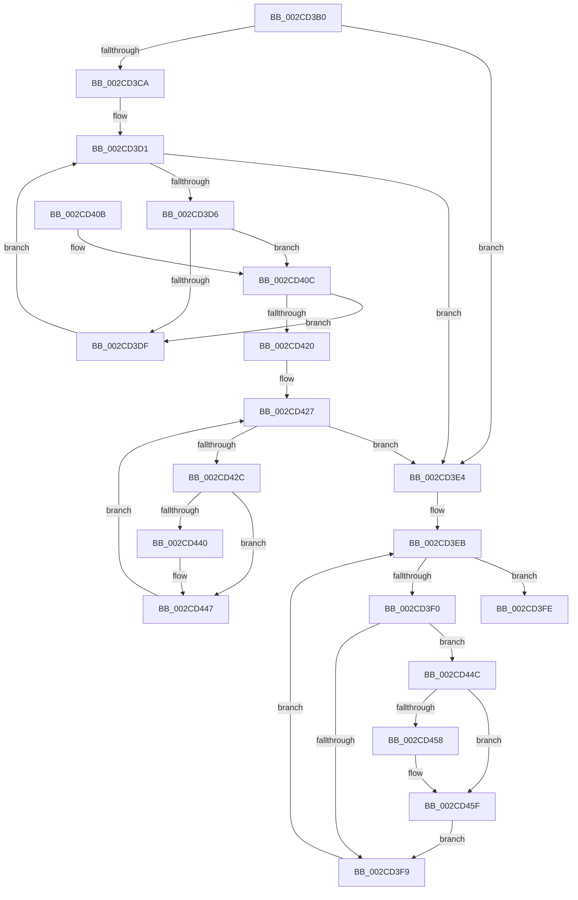

# PpmPerfApplyDomainStates

- RVA: `0x002CD3B0`–`0x002CD468` (길이 `184` bytes)
- VA: `0x00000001402CD3B0`
- 실행 섹션: `.text`
- PDB 이름 있음: `예`; PDB Function 태그: `아니요`
- unwind 정보 RVA: `0x0006F51C`
- 디코드: `49`개 명령, `184/184` bytes 표시
- 미해석 바이트: `0` (있으면 어셈블리에 `.byte`로 보존)

> 이 문서는 커널 이미지의 기계어와 PDB 기호를 분석해 생성했습니다. 4번과 5번은 함수 원형과 자료형을 바이너리 사용 방식에서 추정한 C 해석이며 원본 소스 복구 결과는 아닙니다.

## 1. Dependencies

- 직접 호출 지점: **3**; 고유 호출 대상: **2**
- 직접 호출자로 확인된 함수: **0**
- RIP 상대 이미지 참조: **3**

### Outgoing calls
- `0x002CD417` → [KeIsSubsetAffinityEx](KeIsSubsetAffinityEx_function_002CDC80.md) (function, `0x002CDC80`)
- `0x002CD437` → [KeIsSubsetAffinityEx](KeIsSubsetAffinityEx_function_002CDC80.md) (function, `0x002CDC80`)
- `0x002CD44F` → [PpmPerfApplyDomainState](PpmPerfApplyDomainState_function_002CD470.md) (function, `0x002CD470`)

### Direct callers
- 이 함수 시작 RVA로 연결되는 직접 call은 확인되지 않았습니다. 간접 호출은 완전히 역산할 수 없습니다.

### Static image references
- `0x002CD3BA` → RVA `0x00FC6CD4` (`ALMOSTRO`; read)
- `0x002CD3C1` → RVA `0x00FC6BA8` (`ALMOSTRO`; read)
- `0x002CD410` → RVA `0x00E0BED0` (`.data`; read)

## 2. Other-region calls and transfers

- 다른 실행 섹션으로 향하는 call: **0**
- 별도 외부 분기/꼬리 이동을 확인하지 못했습니다.

## 3. Assembly (complete function range)

```asm
002CD3B0  48 89 5C 24 08                  mov qword ptr [rsp + 8], rbx
002CD3B5  56                              push rsi
002CD3B6  48 83 EC 20                     sub rsp, 0x20
002CD3BA  83 3D 13 99 CF 00 00            cmp dword ptr [rip + 0xcf9913], 0
002CD3C1  48 8D 35 E0 97 CF 00            lea rsi, [rip + 0xcf97e0]
002CD3C8  74 1A                           je 0x1402cd3e4
002CD3CA  48 8B 1D D7 97 CF 00            mov rbx, qword ptr [rip + 0xcf97d7]
002CD3D1  48 3B DE                        cmp rbx, rsi
002CD3D4  74 0E                           je 0x1402cd3e4
002CD3D6  80 BB BD 04 00 00 00            cmp byte ptr [rbx + 0x4bd], 0
002CD3DD  75 2D                           jne 0x1402cd40c
002CD3DF  48 8B 1B                        mov rbx, qword ptr [rbx]
002CD3E2  EB ED                           jmp 0x1402cd3d1
002CD3E4  48 8B 1D BD 97 CF 00            mov rbx, qword ptr [rip + 0xcf97bd]
002CD3EB  48 3B DE                        cmp rbx, rsi
002CD3EE  74 0E                           je 0x1402cd3fe
002CD3F0  80 BB BD 04 00 00 00            cmp byte ptr [rbx + 0x4bd], 0
002CD3F7  75 53                           jne 0x1402cd44c
002CD3F9  48 8B 1B                        mov rbx, qword ptr [rbx]
002CD3FC  EB ED                           jmp 0x1402cd3eb
002CD3FE  48 8B 5C 24 30                  mov rbx, qword ptr [rsp + 0x30]
002CD403  B0 01                           mov al, 1
002CD405  48 83 C4 20                     add rsp, 0x20
002CD409  5E                              pop rsi
002CD40A  C3                              ret
002CD40B  CC                              int3
002CD40C  48 8D 4B 18                     lea rcx, [rbx + 0x18]
002CD410  48 8D 15 B9 EA B3 00            lea rdx, [rip + 0xb3eab9]
002CD417  E8 64 08 00 00                  call 0x1402cdc80
002CD41C  85 C0                           test eax, eax
002CD41E  75 BF                           jne 0x1402cd3df
002CD420  48 8B 1D 81 97 CF 00            mov rbx, qword ptr [rip + 0xcf9781]
002CD427  48 3B DE                        cmp rbx, rsi
002CD42A  74 B8                           je 0x1402cd3e4
002CD42C  48 8D 4B 18                     lea rcx, [rbx + 0x18]
002CD430  48 8D 15 99 EA B3 00            lea rdx, [rip + 0xb3ea99]
002CD437  E8 44 08 00 00                  call 0x1402cdc80
002CD43C  85 C0                           test eax, eax
002CD43E  75 07                           jne 0x1402cd447
002CD440  C6 83 BD 04 00 00 01            mov byte ptr [rbx + 0x4bd], 1
002CD447  48 8B 1B                        mov rbx, qword ptr [rbx]
002CD44A  EB DB                           jmp 0x1402cd427
002CD44C  48 8B CB                        mov rcx, rbx
002CD44F  E8 1C 00 00 00                  call 0x1402cd470
002CD454  84 C0                           test al, al
002CD456  74 07                           je 0x1402cd45f
002CD458  C6 83 BE 04 00 00 01            mov byte ptr [rbx + 0x4be], 1
002CD45F  C6 83 BD 04 00 00 00            mov byte ptr [rbx + 0x4bd], 0
002CD466  EB 91                           jmp 0x1402cd3f9
```

## 4. C-style interpretation (structured pseudocode)

```c
__int64 __fastcall PpmPerfApplyDomainStates(void)
{
    __int64 result;
    __int64 v_rsp;
    unsigned __int64 v_stack_p8;

    v_stack_p8 = v_rbx;
    v_rsp = (v_rsp) - (32);
    if ((*(unsigned int *)(v_rip + 13605139)) == 0) goto loc_002CD3E4;
loc_002CD3D1:
    if ((*(unsigned __int64 *)(v_rip + 13604823)) == (v_rip + 13604832)) goto loc_002CD3E4;
    if ((*(unsigned __int8 *)(*(unsigned __int64 *)(v_rip + 13604823) + 1213)) != 0) goto loc_002CD40C;
loc_002CD3DF:
    goto loc_002CD3D1;
loc_002CD3E4:
loc_002CD3EB:
    if ((*(unsigned __int64 *)(v_rip + 13604797)) == (v_rip + 13604832)) goto loc_002CD3FE;
    if ((*(unsigned __int8 *)(*(unsigned __int64 *)(v_rip + 13604797) + 1213)) != 0) goto loc_002CD44C;
loc_002CD3F9:
    goto loc_002CD3EB;
loc_002CD3FE:
    v_rsp = (v_rsp) + (32);
    return 1;
loc_002CD40C:
    result = KeIsSubsetAffinityEx(v_stack_p8 + 24, v_rip + 11791033, a3, a4);
    if ((unsigned int)(result) != 0) goto loc_002CD3DF;
loc_002CD427:
    if ((*(unsigned __int64 *)(v_rip + 13604737)) == (v_rip + 13604832)) goto loc_002CD3E4;
    result = KeIsSubsetAffinityEx(*(unsigned __int64 *)(v_rip + 13604737) + 24, v_rip + 11791001, a3, a4);
    if ((unsigned int)(result) == 0) {
        *(unsigned __int8 *)(*(unsigned __int64 *)(v_rip + 13604737) + 1213) = 1;
    }
    goto loc_002CD427;
loc_002CD44C:
    result = PpmPerfApplyDomainState(*(unsigned __int64 *)(*(unsigned __int64 *)(v_rip + 13604737)), v_rip + 11791001, a3, a4);
    if ((unsigned __int8)(result) != 0) {
        *(unsigned __int8 *)(*(unsigned __int64 *)(*(unsigned __int64 *)(v_rip + 13604737)) + 1214) = 1;
    }
    *(unsigned __int8 *)(*(unsigned __int64 *)(*(unsigned __int64 *)(v_rip + 13604737)) + 1213) = 0;
    goto loc_002CD3F9;
}
```

## 5. (Beta) C Style

```c
void PpmPerfApplyDomainStates(void)
{
    int64_t result;
    int64_t local_rsp;
    uint64_t v_stack_p8;

    v_stack_p8 = local_rbx;
    local_rsp = (local_rsp) - (32);
    if ((*(uint32_t *)(v_rip + 0xCF9913)) == 0) goto loc_002CD3E4;
loc_002CD3D1:
    if ((*(uint64_t *)(v_rip + 0xCF97D7)) == (v_rip + 13604832)) goto loc_002CD3E4;
    if ((*(uint8_t *)(*(uint64_t *)(v_rip + 0xCF97D7) + 0x4BD)) != 0) goto loc_002CD40C;
loc_002CD3DF:
    goto loc_002CD3D1;
loc_002CD3E4:
loc_002CD3EB:
    if ((*(uint64_t *)(v_rip + 0xCF97BD)) == (v_rip + 13604832)) goto loc_002CD3FE;
    if ((*(uint8_t *)(*(uint64_t *)(v_rip + 0xCF97BD) + 0x4BD)) != 0) goto loc_002CD44C;
loc_002CD3F9:
    goto loc_002CD3EB;
loc_002CD3FE:
    local_rsp = (local_rsp) + (32);
    return 1;
loc_002CD40C:
    result = KeIsSubsetAffinityEx(v_stack_p8 + 24, v_rip + 11791033, a3, a4);
    if ((uint32_t)(result) != 0) goto loc_002CD3DF;
loc_002CD427:
    if ((*(uint64_t *)(v_rip + 0xCF9781)) == (v_rip + 13604832)) goto loc_002CD3E4;
    result = KeIsSubsetAffinityEx(*(uint64_t *)(v_rip + 0xCF9781) + 24, v_rip + 11791001, a3, a4);
    if ((uint32_t)(result) == 0) {
        *(uint8_t *)(*(uint64_t *)(v_rip + 0xCF9781) + 0x4BD) = 1;
    }
    goto loc_002CD427;
loc_002CD44C:
    result = PpmPerfApplyDomainState(*(uint64_t *)(*(uint64_t *)(v_rip + 0xCF9781)), v_rip + 11791001, a3, a4);
    if ((uint8_t)(result) != 0) {
        *(uint8_t *)(*(uint64_t *)(*(uint64_t *)(v_rip + 0xCF9781)) + 0x4BE) = 1;
    }
    *(uint8_t *)(*(uint64_t *)(*(uint64_t *)(v_rip + 0xCF9781)) + 0x4BD) = 0;
    goto loc_002CD3F9;
}
```

## 6. Execution-region graph

[열기: 2D/3D 그래프와 함수 탐색 컨트롤 패널](../../../control-panel.html?section=text&rva=0x002CD3B0&view=graph)

- 2D 그래프는 위에서 아래로 흐르고, 3D 그래프는 빈 공간을 드래그해 회전합니다. Shift+드래그는 이동, 휠은 확대·축소, 함수 노드 선택은 대상 보고서 이동입니다.

### Static fallback


