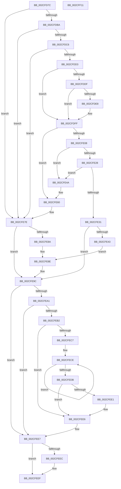

# PpmPerfSetProcessorIdle

- RVA: `0x002CFD7C`–`0x002CFF12` (길이 `406` bytes)
- VA: `0x00000001402CFD7C`
- 실행 섹션: `.text`
- PDB 이름 있음: `예`; PDB Function 태그: `아니요`
- unwind 정보 RVA: `0x0005FEF8`
- 디코드: `104`개 명령, `406/406` bytes 표시
- 미해석 바이트: `0` (있으면 어셈블리에 `.byte`로 보존)

> 이 문서는 커널 이미지의 기계어와 PDB 기호를 분석해 생성했습니다. 4번과 5번은 함수 원형과 자료형을 바이너리 사용 방식에서 추정한 C 해석이며 원본 소스 복구 결과는 아닙니다.

## 1. Dependencies

- 직접 호출 지점: **7**; 고유 호출 대상: **7**
- 직접 호출자로 확인된 함수: **1**
- RIP 상대 이미지 참조: **2**

### Outgoing calls
- `0x002CFDEB` → [KeDisableInterrupts](../21/KeDisableInterrupts_function_00217BE0.md) (function, `0x00217BE0`)
- `0x002CFDFA` → [KeAcquireSpinLockAtDpcLevel](../20/KeAcquireSpinLockAtDpcLevel_function_00208430.md) (function, `0x00208430`)
- `0x002CFE0A` → [KeQueryPerformanceCounter](../37/KeQueryPerformanceCounter_function_0037E7E0.md) (function, `0x0037E7E0`)
- `0x002CFE72` → [PpmPerfArbitratorApplyProcessorState](../39/PpmPerfArbitratorApplyProcessorState_function_00391E00.md) (function, `0x00391E00`)
- `0x002CFE97` → [KeUpdatePendingQosRequest](../39/KeUpdatePendingQosRequest_function_003924F4.md) (function, `0x003924F4`)
- `0x002CFEA8` → [KxReleaseSpinLock](../20/KxReleaseSpinLock_function_00206670.md) (function, `0x00206670`)
- `0x002CFEE1` → [KiRemoveSystemWorkPriorityKick](../26/KiRemoveSystemWorkPriorityKick_function_002631D0.md) (function, `0x002631D0`)

### Direct callers
- [PoIdle](PoIdle_function_002CFB40.md) at `0x002CFBFA`

### Static image references
- `0x002CFDAA` → RVA `0x00FC6AA6` (`ALMOSTRO`; read)
- `0x002CFDBA` → RVA `0x00FC50B0` (`ALMOSTRO`; read)

## 2. Other-region calls and transfers

- 다른 실행 섹션으로 향하는 call: **0**
- 별도 외부 분기/꼬리 이동을 확인하지 못했습니다.

## 3. Assembly (complete function range)

```asm
002CFD7C  48 8B C4                        mov rax, rsp
002CFD7F  48 89 58 08                     mov qword ptr [rax + 8], rbx
002CFD83  48 89 68 10                     mov qword ptr [rax + 0x10], rbp
002CFD87  48 89 70 18                     mov qword ptr [rax + 0x18], rsi
002CFD8B  48 89 78 20                     mov qword ptr [rax + 0x20], rdi
002CFD8F  41 54                           push r12
002CFD91  41 56                           push r14
002CFD93  41 57                           push r15
002CFD95  48 83 EC 20                     sub rsp, 0x20
002CFD99  45 32 E4                        xor r12b, r12b
002CFD9C  45 32 FF                        xor r15b, r15b
002CFD9F  40 32 ED                        xor bpl, bpl
002CFDA2  45 32 F6                        xor r14b, r14b
002CFDA5  33 FF                           xor edi, edi
002CFDA7  48 8B F2                        mov rsi, rdx
002CFDAA  40 38 3D F5 6C CF 00            cmp byte ptr [rip + 0xcf6cf5], dil
002CFDB1  48 8B D9                        mov rbx, rcx
002CFDB4  0F 84 C4 00 00 00               je 0x1402cfe7e
002CFDBA  39 3D F0 52 CF 00               cmp dword ptr [rip + 0xcf52f0], edi
002CFDC0  0F 84 B8 00 00 00               je 0x1402cfe7e
002CFDC6  83 B9 40 8A 00 00 05            cmp dword ptr [rcx + 0x8a40], 5
002CFDCD  0F 84 AB 00 00 00               je 0x1402cfe7e
002CFDD3  48 8B B9 B8 89 00 00            mov rdi, qword ptr [rcx + 0x89b8]
002CFDDA  48 85 FF                        test rdi, rdi
002CFDDD  74 20                           je 0x1402cfdff
002CFDDF  40 38 AF 8D 00 00 00            cmp byte ptr [rdi + 0x8d], bpl
002CFDE6  74 17                           je 0x1402cfdff
002CFDE8  40 B5 01                        mov bpl, 1
002CFDEB  E8 F0 7D F4 FF                  call 0x140217be0
002CFDF0  48 8D 8F 90 00 00 00            lea rcx, [rdi + 0x90]
002CFDF7  44 8A F0                        mov r14b, al
002CFDFA  E8 31 86 F3 FF                  call 0x140208430
002CFDFF  F6 83 48 8A 00 00 20            test byte ptr [rbx + 0x8a48], 0x20
002CFE06  75 58                           jne 0x1402cfe60
002CFE08  33 C9                           xor ecx, ecx
002CFE0A  E8 D1 E9 0A 00                  call 0x14037e7e0
002CFE0F  48 8B C8                        mov rcx, rax
002CFE12  48 8B D0                        mov rdx, rax
002CFE15  48 2B 8B 30 8A 00 00            sub rcx, qword ptr [rbx + 0x8a30]
002CFE1C  48 8B 83 38 8A 00 00            mov rax, qword ptr [rbx + 0x8a38]
002CFE23  48 3B C8                        cmp rcx, rax
002CFE26  73 22                           jae 0x1402cfe4a
002CFE28  44 38 A3 0E 8A 00 00            cmp byte ptr [rbx + 0x8a0e], r12b
002CFE2F  75 19                           jne 0x1402cfe4a
002CFE31  8B 83 EC 00 00 00               mov eax, dword ptr [rbx + 0xec]
002CFE37  B9 00 01 00 00                  mov ecx, 0x100
002CFE3C  41 B4 01                        mov r12b, 1
002CFE3F  85 C1                           test ecx, eax
002CFE41  75 59                           jne 0x1402cfe9c
002CFE43  45 8A FC                        mov r15b, r12b
002CFE46  0B C1                           or eax, ecx
002CFE48  EB 44                           jmp 0x1402cfe8e
002CFE4A  48 03 C0                        add rax, rax
002CFE4D  48 89 93 30 8A 00 00            mov qword ptr [rbx + 0x8a30], rdx
002CFE54  48 3B C8                        cmp rcx, rax
002CFE57  0F 93 C0                        setae al
002CFE5A  88 83 0E 8A 00 00               mov byte ptr [rbx + 0x8a0e], al
002CFE60  45 33 C0                        xor r8d, r8d
002CFE63  C7 83 40 8A 00 00 05 00 00 00   mov dword ptr [rbx + 0x8a40], 5
002CFE6D  B2 01                           mov dl, 1
002CFE6F  48 8B CB                        mov rcx, rbx
002CFE72  E8 89 1F 0C 00                  call 0x140391e00
002CFE77  C6 83 EC 00 00 00 05            mov byte ptr [rbx + 0xec], 5
002CFE7E  8B 83 EC 00 00 00               mov eax, dword ptr [rbx + 0xec]
002CFE84  0F BA E0 08                     bt eax, 8
002CFE88  73 12                           jae 0x1402cfe9c
002CFE8A  0F BA F0 08                     btr eax, 8
002CFE8E  48 8B CB                        mov rcx, rbx
002CFE91  89 83 EC 00 00 00               mov dword ptr [rbx + 0xec], eax
002CFE97  E8 58 26 0C 00                  call 0x1403924f4
002CFE9C  40 84 ED                        test bpl, bpl
002CFE9F  74 46                           je 0x1402cfee7
002CFEA1  48 8D 8F 90 00 00 00            lea rcx, [rdi + 0x90]
002CFEA8  E8 C3 67 F3 FF                  call 0x140206670
002CFEAD  45 84 F6                        test r14b, r14b
002CFEB0  74 35                           je 0x1402cfee7
002CFEB2  65 48 8B 0C 25 20 00 00 00      mov rcx, qword ptr gs:[0x20]
002CFEBB  4C 8B 81 B8 8E 00 00            mov r8, qword ptr [rcx + 0x8eb8]
002CFEC2  4D 85 C0                        test r8, r8
002CFEC5  74 1F                           je 0x1402cfee6
002CFEC7  41 0F 0D 08                     prefetchw byte ptr [r8]
002CFECB  41 8B 00                        mov eax, dword ptr [r8]
002CFECE  8B D0                           mov edx, eax
002CFED0  0F BA F2 15                     btr edx, 0x15
002CFED4  F0 41 0F B1 10                  lock cmpxchg dword ptr [r8], edx
002CFED9  75 F3                           jne 0x1402cfece
002CFEDB  0F BA E0 15                     bt eax, 0x15
002CFEDF  73 05                           jae 0x1402cfee6
002CFEE1  E8 EA 32 F9 FF                  call 0x1402631d0
002CFEE6  FB                              sti
002CFEE7  48 85 F6                        test rsi, rsi
002CFEEA  74 03                           je 0x1402cfeef
002CFEEC  44 88 26                        mov byte ptr [rsi], r12b
002CFEEF  48 8B 5C 24 40                  mov rbx, qword ptr [rsp + 0x40]
002CFEF4  41 8A C7                        mov al, r15b
002CFEF7  48 8B 6C 24 48                  mov rbp, qword ptr [rsp + 0x48]
002CFEFC  48 8B 74 24 50                  mov rsi, qword ptr [rsp + 0x50]
002CFF01  48 8B 7C 24 58                  mov rdi, qword ptr [rsp + 0x58]
002CFF06  48 83 C4 20                     add rsp, 0x20
002CFF0A  41 5F                           pop r15
002CFF0C  41 5E                           pop r14
002CFF0E  41 5C                           pop r12
002CFF10  C3                              ret
002CFF11  CC                              int3
```

## 4. C-style interpretation (structured pseudocode)

```c
__int64 __fastcall PpmPerfSetProcessorIdle(__int64 a1, __int64 a2, int a3)
{
    __int64 result;
    __int64 v_r12;
    __int64 v_r14;
    __int64 v_r15;
    __int64 v_rbp;
    __int64 v_rdi;
    __int64 v_rsp;
    unsigned __int64 v_stack_p10;
    unsigned __int64 v_stack_p18;
    unsigned __int64 v_stack_p20;
    unsigned __int64 v_stack_p8;

    *(unsigned __int64 *)(v_rsp + 8) = v_rbx;
    *(unsigned __int64 *)(v_rsp + 16) = v_rbp;
    *(unsigned __int64 *)(v_rsp + 24) = v_rsi;
    *(unsigned __int64 *)(v_rsp + 32) = v_rdi;
    v_rsp = (v_rsp) - (32);
    v_r12 = 0;
    v_r15 = 0;
    v_rbp = 0;
    v_r14 = 0;
    v_rdi = 0;
    if ((*(unsigned __int8 *)(v_rip + 13593845)) == 0) goto loc_002CFE7E;
    if ((*(unsigned int *)(v_rip + 13587184)) == 0) goto loc_002CFE7E;
    if ((*(unsigned int *)(a1 + 35392)) == 5) goto loc_002CFE7E;
    if (*(unsigned __int64 *)(a1 + 35256) == 0) goto loc_002CFDFF;
    result = v_rsp;
    if ((*(unsigned __int8 *)(*(unsigned __int64 *)(a1 + 35256) + 141)) != 0) {
        v_rbp = 1;
        result = KeDisableInterrupts(a1, a2, a3, a4);
        a1 = *(unsigned __int64 *)(a1 + 35256) + 144;
        v_r14 = (unsigned __int8)(result);
        result = KeAcquireSpinLockAtDpcLevel(a1, a2, a3, a4);
    }
    if (((*(unsigned __int8 *)(a1 + 35400)) & (32)) != 0) goto loc_002CFE60;
    a1 = 0;
    result = KeQueryPerformanceCounter(a1, a2, a3, a4);
    a1 = (result) - (*(unsigned __int64 *)(a1 + 35376));
    if (a1 >= (*(unsigned __int64 *)(a1 + 35384))) goto loc_002CFE4A;
    if ((*(unsigned __int8 *)(a1 + 35342)) != 0) goto loc_002CFE4A;
    if (((256) & ((unsigned int)((unsigned int)(*(unsigned int *)(a1 + 236))))) != 0) goto loc_002CFE9C;
    result = (unsigned int)(((unsigned int)(*(unsigned int *)(a1 + 236))) | (256));
    goto loc_002CFE8E;
loc_002CFE4A:
    result = (result) + (result);
    *(unsigned __int64 *)(a1 + 35376) = result;
    result = (256 >= result) ? 1 : 0;
    *(unsigned __int8 *)(a1 + 35342) = (unsigned __int8)(result);
loc_002CFE60:
    a3 = 0;
    *(unsigned int *)(a1 + 35392) = 5;
    result = PpmPerfArbitratorApplyProcessorState(a1, 1, a3, a4);
    *(unsigned __int8 *)(a1 + 236) = 5;
loc_002CFE7E:
    if (condition_is_above_or_equal) goto loc_002CFE9C;
loc_002CFE8E:
    *(unsigned int *)(a1 + 236) = (unsigned int)((unsigned int)(*(unsigned int *)(a1 + 236)));
    result = KeUpdatePendingQosRequest(a1, 1, a3, a4);
loc_002CFE9C:
    if ((unsigned __int8)(v_rbp) == 0) goto loc_002CFEE7;
    result = KxReleaseSpinLock(*(unsigned __int64 *)(a1 + 35256) + 144, 1, a3, a4);
    if ((unsigned __int8)(v_r14) == 0) goto loc_002CFEE7;
    if (*(unsigned __int64 *)(*(unsigned __int64 *)(gs_base + (0 + 32)) + 36536) == 0) goto loc_002CFEE6;
loc_002CFECE:
    if (*(unsigned __int64 *)(*(unsigned __int64 *)(gs_base + (0 + 32)) + 36536) != 0) goto loc_002CFECE;
    result = (unsigned int)(*(unsigned int *)(*(unsigned __int64 *)(*(unsigned __int64 *)(gs_base + (0 + 32)) + 36536)));
    if (!(condition_is_above_or_equal)) {
        result = KiRemoveSystemWorkPriorityKick(*(unsigned __int64 *)(gs_base + (0 + 32)), (unsigned int)((unsigned int)((unsigned int)(*(unsigned int *)(*(unsigned __int64 *)(*(unsigned __int64 *)(gs_base + (0 + 32)) + 36536))))), *(unsigned __int64 *)(*(unsigned __int64 *)(gs_base + (0 + 32)) + 36536), a4);
    }
loc_002CFEE7:
    if (a2 != 0) {
        *(unsigned __int8 *)(a2) = 1;
    }
    v_rsp = (v_rsp) + (32);
    return 1;
}
```

## 5. (Beta) C Style

```c
int64_t PpmPerfSetProcessorIdle(void *Arg1, int64_t Arg2, int32_t Arg3)
{
    uint8_t *arg1 = (uint8_t *)Arg1;

    int64_t result;
    int64_t local_r12;
    int64_t local_r14;
    int64_t local_r15;
    int64_t local_rbp;
    int64_t local_rdi;
    int64_t local_rsp;
    uint64_t v_stack_p10;
    uint64_t v_stack_p18;
    uint64_t v_stack_p20;
    uint64_t v_stack_p8;

    *(uint64_t *)(local_rsp + 0x8) = local_rbx;
    *(uint64_t *)(local_rsp + 0x10) = local_rbp;
    *(uint64_t *)(local_rsp + 0x18) = local_rsi;
    *(uint64_t *)(local_rsp + 0x20) = local_rdi;
    local_rsp = (local_rsp) - (32);
    local_r12 = 0;
    local_r15 = 0;
    local_rbp = 0;
    local_r14 = 0;
    local_rdi = 0;
    if ((*(uint8_t *)(v_rip + 0xCF6CF5)) == 0) goto loc_002CFE7E;
    if ((*(uint32_t *)(v_rip + 0xCF52F0)) == 0) goto loc_002CFE7E;
    if ((*(uint32_t *)(arg1 + 0x8A40)) == 5) goto loc_002CFE7E;
    if (*(uint64_t *)(arg1 + 0x89B8) == 0) goto loc_002CFDFF;
    result = local_rsp;
    if ((*(uint8_t *)(*(uint64_t *)(arg1 + 0x89B8) + 0x8D)) != 0) {
        local_rbp = 1;
        result = KeDisableInterrupts(Arg1, Arg2, Arg3, a4);
        Arg1 = *(uint64_t *)(arg1 + 0x89B8) + 144;
        local_r14 = (uint8_t)(result);
        result = KeAcquireSpinLockAtDpcLevel(Arg1, Arg2, Arg3, a4);
    }
    if (((*(uint8_t *)(arg1 + 0x8A48)) & (32)) != 0) goto loc_002CFE60;
    Arg1 = 0;
    result = KeQueryPerformanceCounter(Arg1, Arg2, Arg3, a4);
    Arg1 = (result) - (*(uint64_t *)(arg1 + 0x8A30));
    if (Arg1 >= (*(uint64_t *)(arg1 + 0x8A38))) goto loc_002CFE4A;
    if ((*(uint8_t *)(arg1 + 0x8A0E)) != 0) goto loc_002CFE4A;
    if (((256) & ((uint32_t)((uint32_t)(*(uint32_t *)(arg1 + 0xEC))))) != 0) goto loc_002CFE9C;
    result = (uint32_t)(((uint32_t)(*(uint32_t *)(arg1 + 0xEC))) | (256));
    goto loc_002CFE8E;
loc_002CFE4A:
    result = (result) + (result);
    *(uint64_t *)(arg1 + 0x8A30) = result;
    result = (256 >= result) ? 1 : 0;
    *(uint8_t *)(arg1 + 0x8A0E) = (uint8_t)(result);
loc_002CFE60:
    Arg3 = 0;
    *(uint32_t *)(arg1 + 0x8A40) = 5;
    result = PpmPerfArbitratorApplyProcessorState(Arg1, 1, Arg3, a4);
    *(uint8_t *)(arg1 + 0xEC) = 5;
loc_002CFE7E:
    if (condition_is_above_or_equal) goto loc_002CFE9C;
loc_002CFE8E:
    *(uint32_t *)(arg1 + 0xEC) = (uint32_t)((uint32_t)(*(uint32_t *)(arg1 + 0xEC)));
    result = KeUpdatePendingQosRequest(Arg1, 1, Arg3, a4);
loc_002CFE9C:
    if ((uint8_t)(local_rbp) == 0) goto loc_002CFEE7;
    result = KxReleaseSpinLock(*(uint64_t *)(arg1 + 0x89B8) + 144, 1, Arg3, a4);
    if ((uint8_t)(local_r14) == 0) goto loc_002CFEE7;
    if (*(uint64_t *)(*(uint64_t *)(gs_base + (0 + 0x20)) + 0x8EB8) == 0) goto loc_002CFEE6;
loc_002CFECE:
    if (*(uint64_t *)(*(uint64_t *)(gs_base + (0 + 0x20)) + 0x8EB8) != 0) goto loc_002CFECE;
    result = (uint32_t)(*(uint32_t *)(*(uint64_t *)(*(uint64_t *)(gs_base + (0 + 0x20)) + 0x8EB8)));
    if (!(condition_is_above_or_equal)) {
        result = KiRemoveSystemWorkPriorityKick(*(uint64_t *)(gs_base + (0 + 0x20)), (uint32_t)((uint32_t)((uint32_t)(*(uint32_t *)(*(uint64_t *)(*(uint64_t *)(gs_base + (0 + 0x20)) + 0x8EB8))))), *(uint64_t *)(*(uint64_t *)(gs_base + (0 + 0x20)) + 0x8EB8), a4);
    }
loc_002CFEE7:
    if (Arg2 != 0) {
        *(uint8_t *)(Arg2) = 1;
    }
    local_rsp = (local_rsp) + (32);
    return 1;
}
```

### 관측된 메모리 오프셋

구조체 형식이 확인되지 않은 접근은 인자 기준의 오프셋으로만 기록했습니다.

| 기준 인자 | 오프셋 표현 | 폭 (bit) | 접근 |
|---|---:|---:|---|
| `Arg1` | `+ 0xEC` | `8` | `W` |
| `Arg1` | `+ 0xEC` | `32` | `R` |
| `Arg1` | `+ 0xEC` | `32` | `W` |
| `Arg1` | `+ 0x89B8` | `64` | `R` |
| `Arg1` | `+ 0x8A0E` | `8` | `R` |
| `Arg1` | `+ 0x8A0E` | `8` | `W` |
| `Arg1` | `+ 0x8A30` | `64` | `R` |
| `Arg1` | `+ 0x8A30` | `64` | `W` |
| `Arg1` | `+ 0x8A38` | `64` | `R` |
| `Arg1` | `+ 0x8A40` | `32` | `R` |
| `Arg1` | `+ 0x8A40` | `32` | `W` |
| `Arg1` | `+ 0x8A48` | `8` | `R` |

## 6. Execution-region graph

[열기: 2D/3D 그래프와 함수 탐색 컨트롤 패널](../../../control-panel.html?section=text&rva=0x002CFD7C&view=graph)

- 2D 그래프는 위에서 아래로 흐르고, 3D 그래프는 빈 공간을 드래그해 회전합니다. Shift+드래그는 이동, 휠은 확대·축소, 함수 노드 선택은 대상 보고서 이동입니다.

### Static fallback


