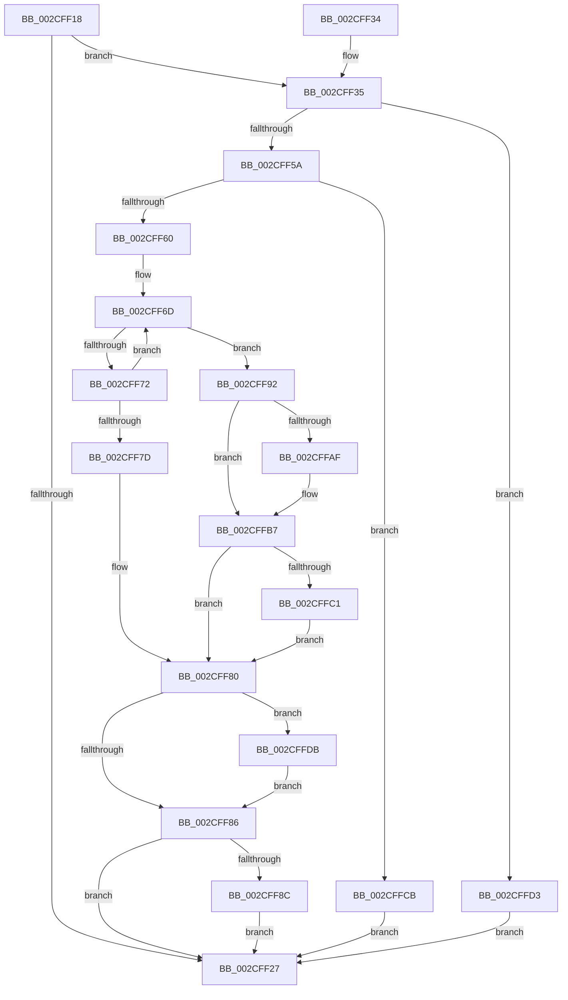

# PpmUpdateProcessorIdleAccounting

- RVA: `0x002CFF18`–`0x002CFFE1` (길이 `201` bytes)
- VA: `0x00000001402CFF18`
- 실행 섹션: `.text`
- PDB 이름 있음: `예`; PDB Function 태그: `아니요`
- unwind 정보 RVA: `0x000DB714`
- 디코드: `53`개 명령, `201/201` bytes 표시
- 미해석 바이트: `0` (있으면 어셈블리에 `.byte`로 보존)

> 이 문서는 커널 이미지의 기계어와 PDB 기호를 분석해 생성했습니다. 4번과 5번은 함수 원형과 자료형을 바이너리 사용 방식에서 추정한 C 해석이며 원본 소스 복구 결과는 아닙니다.

## 1. Dependencies

- 직접 호출 지점: **0**; 고유 호출 대상: **0**
- 직접 호출자로 확인된 함수: **3**
- RIP 상대 이미지 참조: **1**

### Outgoing calls
- 직접 디코드된 call 명령이 없습니다.

### Direct callers
- [PoIdle](PoIdle_function_002CFB40.md) at `0x002CFBEA`
- [PpmTranslateIdleAccounting](../43/PpmTranslateIdleAccounting_function_0043A924.md) at `0x0043A949`
- [PpmInstallNewIdleStates](../44/PpmInstallNewIdleStates_function_00446E80.md) at `0x00446EFC`

### Static image references
- `0x002CFF63` → RVA `0x00FC5730` (`ALMOSTRO`; read)

## 2. Other-region calls and transfers

- 다른 실행 섹션으로 향하는 call: **0**
- 별도 외부 분기/꼬리 이동을 확인하지 못했습니다.

## 3. Assembly (complete function range)

```asm
002CFF18  4C 8B 09                        mov r9, qword ptr [rcx]
002CFF1B  45 33 DB                        xor r11d, r11d
002CFF1E  4C 8B D1                        mov r10, rcx
002CFF21  45 38 59 05                     cmp byte ptr [r9 + 5], r11b
002CFF25  75 0E                           jne 0x1402cff35
002CFF27  45 89 59 3C                     mov dword ptr [r9 + 0x3c], r11d
002CFF2B  45 88 59 40                     mov byte ptr [r9 + 0x40], r11b
002CFF2F  45 88 59 05                     mov byte ptr [r9 + 5], r11b
002CFF33  C3                              ret
002CFF34  CC                              int3
002CFF35  4C 8B 41 10                     mov r8, qword ptr [rcx + 0x10]
002CFF39  4C 89 59 10                     mov qword ptr [rcx + 0x10], r11
002CFF3D  41 8B 41 1C                     mov eax, dword ptr [r9 + 0x1c]
002CFF41  4D 01 42 18                     add qword ptr [r10 + 0x18], r8
002CFF45  48 69 C8 F8 03 00 00            imul rcx, rax, 0x3f8
002CFF4C  49 03 4A 08                     add rcx, qword ptr [r10 + 8]
002CFF50  4C 01 41 28                     add qword ptr [rcx + 0x28], r8
002CFF54  45 38 59 40                     cmp byte ptr [r9 + 0x40], r11b
002CFF58  75 79                           jne 0x1402cffd3
002CFF5A  45 39 59 3C                     cmp dword ptr [r9 + 0x3c], r11d
002CFF5E  7C 6B                           jl 0x1402cffcb
002CFF60  FF 41 38                        inc dword ptr [rcx + 0x38]
002CFF63  48 8D 15 C6 57 CF 00            lea rdx, [rip + 0xcf57c6]
002CFF6A  41 8B C3                        mov eax, r11d
002CFF6D  4C 3B 02                        cmp r8, qword ptr [rdx]
002CFF70  72 20                           jb 0x1402cff92
002CFF72  FF C0                           inc eax
002CFF74  48 83 C2 18                     add rdx, 0x18
002CFF78  83 F8 1A                        cmp eax, 0x1a
002CFF7B  72 F0                           jb 0x1402cff6d
002CFF7D  FF 41 3C                        inc dword ptr [rcx + 0x3c]
002CFF80  4C 3B 41 40                     cmp r8, qword ptr [rcx + 0x40]
002CFF84  72 55                           jb 0x1402cffdb
002CFF86  4C 3B 41 48                     cmp r8, qword ptr [rcx + 0x48]
002CFF8A  76 9B                           jbe 0x1402cff27
002CFF8C  4C 89 41 48                     mov qword ptr [rcx + 0x48], r8
002CFF90  EB 95                           jmp 0x1402cff27
002CFF92  48 C1 E0 05                     shl rax, 5
002CFF96  4C 01 84 08 E0 00 00 00         add qword ptr [rax + rcx + 0xe0], r8
002CFF9E  FF 84 08 F8 00 00 00            inc dword ptr [rax + rcx + 0xf8]
002CFFA5  4C 3B 84 08 E8 00 00 00         cmp r8, qword ptr [rax + rcx + 0xe8]
002CFFAD  73 08                           jae 0x1402cffb7
002CFFAF  4C 89 84 08 E8 00 00 00         mov qword ptr [rax + rcx + 0xe8], r8
002CFFB7  4C 3B 84 08 F0 00 00 00         cmp r8, qword ptr [rax + rcx + 0xf0]
002CFFBF  76 BF                           jbe 0x1402cff80
002CFFC1  4C 89 84 08 F0 00 00 00         mov qword ptr [rax + rcx + 0xf0], r8
002CFFC9  EB B5                           jmp 0x1402cff80
002CFFCB  FF 41 34                        inc dword ptr [rcx + 0x34]
002CFFCE  E9 54 FF FF FF                  jmp 0x1402cff27
002CFFD3  FF 41 30                        inc dword ptr [rcx + 0x30]
002CFFD6  E9 4C FF FF FF                  jmp 0x1402cff27
002CFFDB  4C 89 41 40                     mov qword ptr [rcx + 0x40], r8
002CFFDF  EB A5                           jmp 0x1402cff86
```

## 4. C-style interpretation (structured pseudocode)

```c
__int64 __fastcall PpmUpdateProcessorIdleAccounting(__int64 a1)
{
    __int64 result;
    __int64 v_r11;

    v_r11 = 0;
    if ((*(unsigned __int8 *)(*(unsigned __int64 *)(a1) + 5)) != 0) goto loc_002CFF35;
loc_002CFF27:
    *(unsigned int *)(*(unsigned __int64 *)(a1) + 60) = 0;
    *(unsigned __int8 *)(*(unsigned __int64 *)(a1) + 64) = 0;
    *(unsigned __int8 *)(*(unsigned __int64 *)(a1) + 5) = 0;
    return result;
loc_002CFF35:
    *(unsigned __int64 *)(a1 + 16) = 0;
    a1 = (a1) * ((unsigned int)(*(unsigned int *)(*(unsigned __int64 *)(a1) + 28)));
    a1 = (a1) + (*(unsigned __int64 *)(a1 + 8));
    if ((*(unsigned __int8 *)(*(unsigned __int64 *)(a1) + 64)) != 0) goto loc_002CFFD3;
    if ((*(unsigned int *)(*(unsigned __int64 *)(a1) + 60)) < 0) goto loc_002CFFCB;
loc_002CFF6D:
    if ((*(unsigned __int64 *)(a1 + 16)) < (*(unsigned __int64 *)(v_rip + 13588422))) goto loc_002CFF92;
    result = (unsigned int)((0) + 1);
    a2 = (v_rip + 13588422) + (24);
    if (((unsigned int)(result)) < 26) goto loc_002CFF6D;
loc_002CFF80:
    if ((*(unsigned __int64 *)(a1 + 16)) < (*(unsigned __int64 *)(a1 + 64))) goto loc_002CFFDB;
loc_002CFF86:
    if ((*(unsigned __int64 *)(a1 + 16)) <= (*(unsigned __int64 *)(a1 + 72))) goto loc_002CFF27;
    *(unsigned __int64 *)(a1 + 72) = *(unsigned __int64 *)(a1 + 16);
    goto loc_002CFF27;
loc_002CFF92:
    result = (result) << (5);
    if ((*(unsigned __int64 *)(a1 + 16)) < (*(unsigned __int64 *)(result + a1 * 1 + 232))) {
        *(unsigned __int64 *)(result + a1 * 1 + 232) = *(unsigned __int64 *)(a1 + 16);
    }
    if ((*(unsigned __int64 *)(a1 + 16)) <= (*(unsigned __int64 *)(result + a1 * 1 + 240))) goto loc_002CFF80;
    *(unsigned __int64 *)(result + a1 * 1 + 240) = *(unsigned __int64 *)(a1 + 16);
    goto loc_002CFF80;
loc_002CFFCB:
    goto loc_002CFF27;
loc_002CFFD3:
    goto loc_002CFF27;
loc_002CFFDB:
    *(unsigned __int64 *)(a1 + 64) = *(unsigned __int64 *)(a1 + 16);
    goto loc_002CFF86;
}
```

## 5. (Beta) C Style

```c
int64_t PpmUpdateProcessorIdleAccounting(void *Arg1)
{
    uint8_t *arg1 = (uint8_t *)Arg1;

    int64_t result;
    int64_t local_r11;

    local_r11 = 0;
    if ((*(uint8_t *)(*(uint64_t *)(arg1) + 0x5)) != 0) goto loc_002CFF35;
loc_002CFF27:
    *(uint32_t *)(*(uint64_t *)(arg1) + 0x3C) = 0;
    *(uint8_t *)(*(uint64_t *)(arg1) + 0x40) = 0;
    *(uint8_t *)(*(uint64_t *)(arg1) + 0x5) = 0;
    return result;
loc_002CFF35:
    *(uint64_t *)(arg1 + 0x10) = 0;
    Arg1 = (Arg1) * ((uint32_t)(*(uint32_t *)(*(uint64_t *)(arg1) + 0x1C)));
    Arg1 = (Arg1) + (*(uint64_t *)(arg1 + 0x8));
    if ((*(uint8_t *)(*(uint64_t *)(arg1) + 0x40)) != 0) goto loc_002CFFD3;
    if ((*(uint32_t *)(*(uint64_t *)(arg1) + 0x3C)) < 0) goto loc_002CFFCB;
loc_002CFF6D:
    if ((*(uint64_t *)(arg1 + 0x10)) < (*(uint64_t *)(v_rip + 0xCF57C6))) goto loc_002CFF92;
    result = (uint32_t)((0) + 1);
    a2 = (v_rip + 13588422) + (24);
    if (((uint32_t)(result)) < 26) goto loc_002CFF6D;
loc_002CFF80:
    if ((*(uint64_t *)(arg1 + 0x10)) < (*(uint64_t *)(arg1 + 0x40))) goto loc_002CFFDB;
loc_002CFF86:
    if ((*(uint64_t *)(arg1 + 0x10)) <= (*(uint64_t *)(arg1 + 0x48))) goto loc_002CFF27;
    *(uint64_t *)(arg1 + 0x48) = *(uint64_t *)(arg1 + 0x10);
    goto loc_002CFF27;
loc_002CFF92:
    result = (result) << (5);
    if ((*(uint64_t *)(arg1 + 0x10)) < (*(uint64_t *)(result + arg1 * 1 + 0xE8))) {
        *(uint64_t *)(result + arg1 * 1 + 0xE8) = *(uint64_t *)(arg1 + 0x10);
    }
    if ((*(uint64_t *)(arg1 + 0x10)) <= (*(uint64_t *)(result + arg1 * 1 + 0xF0))) goto loc_002CFF80;
    *(uint64_t *)(result + arg1 * 1 + 0xF0) = *(uint64_t *)(arg1 + 0x10);
    goto loc_002CFF80;
loc_002CFFCB:
    goto loc_002CFF27;
loc_002CFFD3:
    goto loc_002CFF27;
loc_002CFFDB:
    *(uint64_t *)(arg1 + 0x40) = *(uint64_t *)(arg1 + 0x10);
    goto loc_002CFF86;
}
```

### 관측된 메모리 오프셋

구조체 형식이 확인되지 않은 접근은 인자 기준의 오프셋으로만 기록했습니다.

| 기준 인자 | 오프셋 표현 | 폭 (bit) | 접근 |
|---|---:|---:|---|
| `Arg1` | `+ 0x0` | `64` | `R` |
| `Arg1` | `+ 0x8` | `64` | `R` |
| `Arg1` | `+ 0x10` | `64` | `R` |
| `Arg1` | `+ 0x10` | `64` | `W` |
| `Arg1` | `+ 0x18` | `64` | `R/W` |
| `Arg1` | `+ 0x28` | `64` | `R/W` |
| `Arg1` | `+ 0x30` | `32` | `R/W` |
| `Arg1` | `+ 0x34` | `32` | `R/W` |
| `Arg1` | `+ 0x38` | `32` | `R/W` |
| `Arg1` | `+ 0x3C` | `32` | `R/W` |
| `Arg1` | `+ 0x40` | `64` | `R` |
| `Arg1` | `+ 0x40` | `64` | `W` |
| `Arg1` | `+ 0x48` | `64` | `R` |
| `Arg1` | `+ 0x48` | `64` | `W` |

## 6. Execution-region graph

[열기: 2D/3D 그래프와 함수 탐색 컨트롤 패널](../../../control-panel.html?section=text&rva=0x002CFF18&view=graph)

- 2D 그래프는 위에서 아래로 흐르고, 3D 그래프는 빈 공간을 드래그해 회전합니다. Shift+드래그는 이동, 휠은 확대·축소, 함수 노드 선택은 대상 보고서 이동입니다.

### Static fallback


