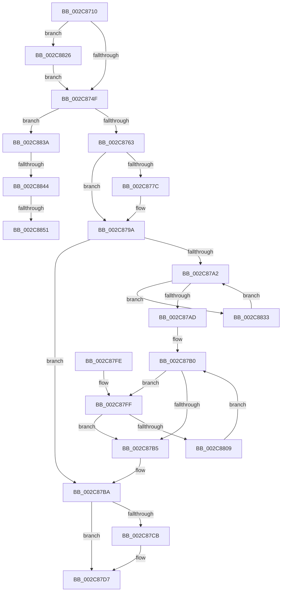

# PspIumReplenishPartitionPages

- RVA: `0x002C8710`–`0x002C8863` (길이 `339` bytes)
- VA: `0x00000001402C8710`
- 실행 섹션: `.text`
- PDB 이름 있음: `예`; PDB Function 태그: `예`
- unwind 정보 RVA: `0x0006EF3C`
- 디코드: `89`개 명령, `339/339` bytes 표시
- 미해석 바이트: `0` (있으면 어셈블리에 `.byte`로 보존)

> 이 문서는 커널 이미지의 기계어와 PDB 기호를 분석해 생성했습니다. 4번과 5번은 함수 원형과 자료형을 바이너리 사용 방식에서 추정한 C 해석이며 원본 소스 복구 결과는 아닙니다.

## 1. Dependencies

- 직접 호출 지점: **6**; 고유 호출 대상: **5**
- 직접 호출자로 확인된 함수: **2**
- RIP 상대 이미지 참조: **1**

### Outgoing calls
- `0x002C8756` → [ExTryAcquireSpinLockExclusiveAtDpcLevel](../2B/ExTryAcquireSpinLockExclusiveAtDpcLevel_function_002BB800.md) (function, `0x002BB800`)
- `0x002C878B` → [MmAllocateNonChargedSecurePages](MmAllocateNonChargedSecurePages_function_002C886C.md) (function, `0x002C886C`)
- `0x002C87BD` → [ExReleaseSpinLockExclusiveFromDpcLevel](../24/ExReleaseSpinLockExclusiveFromDpcLevel_function_002497E0.md) (function, `0x002497E0`)
- `0x002C87D2` → [KiLowerIrqlProcessIrqlFlags](../4F/KiLowerIrqlProcessIrqlFlags_function_004F5698.md) (function, `0x004F5698`)
- `0x002C8829` → [KiRaiseIrqlProcessIrqlFlags](../4F/KiRaiseIrqlProcessIrqlFlags_function_004F56FC.md) (function, `0x004F56FC`)
- `0x002C8858` → [KiLowerIrqlProcessIrqlFlags](../4F/KiLowerIrqlProcessIrqlFlags_function_004F5698.md) (function, `0x004F5698`)

### Direct callers
- [sub_006F88AE](../6F/Unknown_function_006F88AE.md) at `0x006F8DB1`
- [PspIumResolveVirtualFault](../../page/9F/PspIumResolveVirtualFault_function_009FF5E4.md) at `0x009FF6EB`

### Static image references
- `0x002C8742` → RVA `0x00FC6D20` (`ALMOSTRO`; read)

## 2. Other-region calls and transfers

- 다른 실행 섹션으로 향하는 call: **0**
- call이 아닌 외부 분기/꼬리 이동: **3**
  - `0x002C883E` → [sub_006DC9A8 + 0xF](../6D/Unknown_function_006DC9A8.md) (`tail-transfer`)
  - `0x002C884B` → [sub_006DC9A8](../6D/Unknown_function_006DC9A8.md) (`tail-transfer`)
  - `0x002C885E` → [sub_006DC9A8](../6D/Unknown_function_006DC9A8.md) (`tail-transfer`)

## 3. Assembly (complete function range)

```asm
002C8710  48 89 5C 24 10                  mov qword ptr [rsp + 0x10], rbx
002C8715  48 89 6C 24 18                  mov qword ptr [rsp + 0x18], rbp
002C871A  48 89 74 24 20                  mov qword ptr [rsp + 0x20], rsi
002C871F  57                              push rdi
002C8720  41 56                           push r14
002C8722  41 57                           push r15
002C8724  48 83 EC 20                     sub rsp, 0x20
002C8728  4C 8B B9 A0 00 00 00            mov r15, qword ptr [rcx + 0xa0]
002C872F  44 8B F2                        mov r14d, edx
002C8732  48 8B D9                        mov rbx, rcx
002C8735  44 0F 20 C6                     mov rsi, cr8
002C8739  BA 02 00 00 00                  mov edx, 2
002C873E  44 0F 22 C2                     mov cr8, rdx
002C8742  83 3D D7 E5 CF 00 00            cmp dword ptr [rip + 0xcfe5d7], 0
002C8749  0F 85 D7 00 00 00               jne 0x1402c8826
002C874F  48 8D 6B 58                     lea rbp, [rbx + 0x58]
002C8753  48 8B CD                        mov rcx, rbp
002C8756  E8 A5 30 FF FF                  call 0x1402bb800
002C875B  85 C0                           test eax, eax
002C875D  0F 84 D7 00 00 00               je 0x1402c883a
002C8763  8B 4B 04                        mov ecx, dword ptr [rbx + 4]
002C8766  8B 93 9C 00 00 00               mov edx, dword ptr [rbx + 0x9c]
002C876C  8B 83 98 00 00 00               mov eax, dword ptr [rbx + 0x98]
002C8772  2B C2                           sub eax, edx
002C8774  2B C1                           sub eax, ecx
002C8776  89 44 24 40                     mov dword ptr [rsp + 0x40], eax
002C877A  74 1E                           je 0x1402c879a
002C877C  48 8B 4B 08                     mov rcx, qword ptr [rbx + 8]
002C8780  4D 8D 0C D7                     lea r9, [r15 + rdx*8]
002C8784  33 D2                           xor edx, edx
002C8786  4C 8D 44 24 40                  lea r8, [rsp + 0x40]
002C878B  E8 DC 00 00 00                  call 0x1402c886c
002C8790  8B 44 24 40                     mov eax, dword ptr [rsp + 0x40]
002C8794  01 83 9C 00 00 00               add dword ptr [rbx + 0x9c], eax
002C879A  8B 7B 04                        mov edi, dword ptr [rbx + 4]
002C879D  83 FF 08                        cmp edi, 8
002C87A0  73 18                           jae 0x1402c87ba
002C87A2  F0 0F BA 2B 00                  lock bts dword ptr [rbx], 0
002C87A7  0F 82 86 00 00 00               jb 0x1402c8833
002C87AD  8B 7B 04                        mov edi, dword ptr [rbx + 4]
002C87B0  83 FF 08                        cmp edi, 8
002C87B3  72 4A                           jb 0x1402c87ff
002C87B5  F0 0F BA 33 00                  lock btr dword ptr [rbx], 0
002C87BA  48 8B CD                        mov rcx, rbp
002C87BD  E8 1E 10 F8 FF                  call 0x1402497e0
002C87C2  83 3D 57 E5 CF 00 00            cmp dword ptr [rip + 0xcfe557], 0
002C87C9  74 0C                           je 0x1402c87d7
002C87CB  44 0F 20 C1                     mov rcx, cr8
002C87CF  40 8A D6                        mov dl, sil
002C87D2  E8 C1 CE 22 00                  call 0x1404f5698
002C87D7  40 0F B6 C6                     movzx eax, sil
002C87DB  44 0F 22 C0                     mov cr8, rax
002C87DF  41 3B FE                        cmp edi, r14d
002C87E2  0F 93 C0                        setae al
002C87E5  48 8B 5C 24 48                  mov rbx, qword ptr [rsp + 0x48]
002C87EA  48 8B 6C 24 50                  mov rbp, qword ptr [rsp + 0x50]
002C87EF  48 8B 74 24 58                  mov rsi, qword ptr [rsp + 0x58]
002C87F4  48 83 C4 20                     add rsp, 0x20
002C87F8  41 5F                           pop r15
002C87FA  41 5E                           pop r14
002C87FC  5F                              pop rdi
002C87FD  C3                              ret
002C87FE  CC                              int3
002C87FF  8B 83 9C 00 00 00               mov eax, dword ptr [rbx + 0x9c]
002C8805  85 C0                           test eax, eax
002C8807  74 AC                           je 0x1402c87b5
002C8809  FF C8                           dec eax
002C880B  8B CF                           mov ecx, edi
002C880D  89 83 9C 00 00 00               mov dword ptr [rbx + 0x9c], eax
002C8813  49 8B 04 C7                     mov rax, qword ptr [r15 + rax*8]
002C8817  48 89 44 CB 18                  mov qword ptr [rbx + rcx*8 + 0x18], rax
002C881C  8B 7B 04                        mov edi, dword ptr [rbx + 4]
002C881F  FF C7                           inc edi
002C8821  89 7B 04                        mov dword ptr [rbx + 4], edi
002C8824  EB 8A                           jmp 0x1402c87b0
002C8826  40 8A CE                        mov cl, sil
002C8829  E8 CE CE 22 00                  call 0x1404f56fc
002C882E  E9 1C FF FF FF                  jmp 0x1402c874f
002C8833  F3 90                           pause
002C8835  E9 68 FF FF FF                  jmp 0x1402c87a2
002C883A  44 39 73 04                     cmp dword ptr [rbx + 4], r14d
002C883E  0F 82 73 41 41 00               jb 0x1406dc9b7
002C8844  83 3D D5 E4 CF 00 00            cmp dword ptr [rip + 0xcfe4d5], 0
002C884B  0F 84 57 41 41 00               je 0x1406dc9a8
002C8851  44 0F 20 C1                     mov rcx, cr8
002C8855  40 8A D6                        mov dl, sil
002C8858  E8 3B CE 22 00                  call 0x1404f5698
002C885D  90                              nop
002C885E  E9 45 41 41 00                  jmp 0x1406dc9a8
```

## 4. C-style interpretation (structured pseudocode)

```c
__int64 __fastcall PspIumReplenishPartitionPages(__int64 a1, int a2)
{
    __int64 result;
    __int64 v_rdi;
    __int64 v_rsp;
    unsigned __int64 v_stack_p10;
    unsigned __int64 v_stack_p18;
    unsigned __int64 v_stack_p20;
    unsigned int v_stack_p8;

    v_stack_p10 = v_rbx;
    v_stack_p18 = v_rbp;
    v_stack_p20 = v_rsi;
    v_rsp = (v_rsp) - (32);
    if ((*(unsigned int *)(v_rip + 13624791)) != 0) goto loc_002C8826;
loc_002C874F:
    result = ExTryAcquireSpinLockExclusiveAtDpcLevel(a1 + 88, 2, a3, a4);
    if ((unsigned int)(result) == 0) goto loc_002C883A;
    result = (unsigned int)(((unsigned int)(*(unsigned int *)(a1 + 152))) - ((unsigned int)((unsigned int)(*(unsigned int *)(a1 + 156)))));
    result = (unsigned int)((result) - ((unsigned int)((unsigned int)(*(unsigned int *)(a1 + 4)))));
    v_stack_p8 = (unsigned int)(result);
    if (!(condition_is_equal)) {
        a1 = *(unsigned __int64 *)(a1 + 8);
        a4 = *(unsigned __int64 *)(a1 + 160) + (unsigned int)(*(unsigned int *)(a1 + 156)) * 8;
        a2 = 0;
        a3 = v_stack_p8;
        result = MmAllocateNonChargedSecurePages(a1, a2, a3, a4);
        result = v_stack_p8;
    }
    if (((unsigned int)((unsigned int)(*(unsigned int *)(a1 + 4)))) >= 8) goto loc_002C87BA;
loc_002C87A2:
    if (((unsigned int)((unsigned int)(*(unsigned int *)(a1 + 4)))) < 8) goto loc_002C8833;
loc_002C87B0:
    if (((unsigned int)((unsigned int)(*(unsigned int *)(a1 + 4)))) < 8) goto loc_002C87FF;
loc_002C87B5:
loc_002C87BA:
    result = ExReleaseSpinLockExclusiveFromDpcLevel(a1 + 88, a2, a3, a4);
    if ((*(unsigned int *)(v_rip + 13624663)) != 0) {
        a1 = 2;
        a2 = (unsigned __int8)(v_cr8);
        result = KiLowerIrqlProcessIrqlFlags(a1, a2, a3, a4);
    }
    result = (((unsigned int)((unsigned int)(*(unsigned int *)(a1 + 4)))) >= ((unsigned int)((unsigned int)(a2)))) ? 1 : 0;
    v_rsp = (v_rsp) + (32);
    return result;
loc_002C87FF:
    if ((unsigned int)((unsigned int)(*(unsigned int *)(v_stack_p10 + 156))) == 0) goto loc_002C87B5;
    result = (unsigned int)(((unsigned int)(*(unsigned int *)(v_stack_p10 + 156))) - 1);
    *(unsigned int *)(v_stack_p10 + 156) = (unsigned int)(result);
    *(unsigned __int64 *)(v_stack_p10 + (unsigned int)((unsigned int)((unsigned int)(*(unsigned int *)(a1 + 4)))) * 8 + 24) = *(unsigned __int64 *)(*(unsigned __int64 *)(a1 + 160) + result * 8);
    v_rdi = (unsigned int)(((unsigned int)(*(unsigned int *)(v_stack_p10 + 4))) + 1);
    *(unsigned int *)(v_stack_p10 + 4) = (unsigned int)(v_rdi);
    goto loc_002C87B0;
loc_002C8826:
    result = KiRaiseIrqlProcessIrqlFlags((unsigned __int8)(v_stack_p20), a2, a3, a4);
    goto loc_002C874F;
loc_002C8833:
    goto loc_002C87A2;
loc_002C883A:
    result = KiLowerIrqlProcessIrqlFlags((unsigned __int8)(v_cr8), (unsigned __int8)(v_stack_p20), a3, a4);
}
```

## 5. (Beta) C Style

```c
int64_t PspIumReplenishPartitionPages(void *Arg1, int32_t Arg2)
{
    uint8_t *arg1 = (uint8_t *)Arg1;

    int64_t result;
    int64_t local_rdi;
    int64_t local_rsp;
    uint64_t v_stack_p10;
    uint64_t v_stack_p18;
    uint64_t v_stack_p20;
    uint32_t v_stack_p8;

    v_stack_p10 = local_rbx;
    v_stack_p18 = local_rbp;
    v_stack_p20 = local_rsi;
    local_rsp = (local_rsp) - (32);
    if ((*(uint32_t *)(v_rip + 0xCFE5D7)) != 0) goto loc_002C8826;
loc_002C874F:
    result = ExTryAcquireSpinLockExclusiveAtDpcLevel(Arg1 + 88, 2, a3, a4);
    if ((uint32_t)(result) == 0) goto loc_002C883A;
    result = (uint32_t)(((uint32_t)(*(uint32_t *)(arg1 + 0x98))) - ((uint32_t)((uint32_t)(*(uint32_t *)(arg1 + 0x9C)))));
    result = (uint32_t)((result) - ((uint32_t)((uint32_t)(*(uint32_t *)(arg1 + 0x4)))));
    v_stack_p8 = (uint32_t)(result);
    if (!(condition_is_equal)) {
        Arg1 = *(uint64_t *)(arg1 + 0x8);
        a4 = *(uint64_t *)(arg1 + 0xA0) + (uint32_t)(*(uint32_t *)(arg1 + 0x9C)) * 8;
        Arg2 = 0;
        a3 = v_stack_p8;
        result = MmAllocateNonChargedSecurePages(Arg1, Arg2, a3, a4);
        result = v_stack_p8;
    }
    if (((uint32_t)((uint32_t)(*(uint32_t *)(arg1 + 0x4)))) >= 8) goto loc_002C87BA;
loc_002C87A2:
    if (((uint32_t)((uint32_t)(*(uint32_t *)(arg1 + 0x4)))) < 8) goto loc_002C8833;
loc_002C87B0:
    if (((uint32_t)((uint32_t)(*(uint32_t *)(arg1 + 0x4)))) < 8) goto loc_002C87FF;
loc_002C87B5:
loc_002C87BA:
    result = ExReleaseSpinLockExclusiveFromDpcLevel(Arg1 + 88, Arg2, a3, a4);
    if ((*(uint32_t *)(v_rip + 0xCFE557)) != 0) {
        Arg1 = 2;
        Arg2 = (uint8_t)(v_cr8);
        result = KiLowerIrqlProcessIrqlFlags(Arg1, Arg2, a3, a4);
    }
    result = (((uint32_t)((uint32_t)(*(uint32_t *)(arg1 + 0x4)))) >= ((uint32_t)((uint32_t)(Arg2)))) ? 1 : 0;
    local_rsp = (local_rsp) + (32);
    return result;
loc_002C87FF:
    if ((uint32_t)((uint32_t)(*(uint32_t *)(v_stack_p10 + 0x9C))) == 0) goto loc_002C87B5;
    result = (uint32_t)(((uint32_t)(*(uint32_t *)(v_stack_p10 + 0x9C))) - 1);
    *(uint32_t *)(v_stack_p10 + 0x9C) = (uint32_t)(result);
    *(uint64_t *)(v_stack_p10 + (uint32_t)((uint32_t)((uint32_t)(*(uint32_t *)(arg1 + 0x4)))) * 8 + 0x18) = *(uint64_t *)(*(uint64_t *)(arg1 + 0xA0) + result * 8);
    local_rdi = (uint32_t)(((uint32_t)(*(uint32_t *)(v_stack_p10 + 0x4))) + 1);
    *(uint32_t *)(v_stack_p10 + 0x4) = (uint32_t)(local_rdi);
    goto loc_002C87B0;
loc_002C8826:
    result = KiRaiseIrqlProcessIrqlFlags((uint8_t)(v_stack_p20), Arg2, a3, a4);
    goto loc_002C874F;
loc_002C8833:
    goto loc_002C87A2;
loc_002C883A:
    result = KiLowerIrqlProcessIrqlFlags((uint8_t)(v_cr8), (uint8_t)(v_stack_p20), a3, a4);
}
```

### 관측된 메모리 오프셋

구조체 형식이 확인되지 않은 접근은 인자 기준의 오프셋으로만 기록했습니다.

| 기준 인자 | 오프셋 표현 | 폭 (bit) | 접근 |
|---|---:|---:|---|
| `Arg1` | `+ 0x0` | `32` | `R/W` |
| `Arg1` | `+ 0x4` | `32` | `R` |
| `Arg1` | `+ 0x4` | `32` | `W` |
| `Arg1` | `+ 0x8` | `64` | `R` |
| `Arg1` | `+ 0x18 + rcx*8` | `64` | `W` |
| `Arg1` | `+ 0x58` | `64` | `R` |
| `Arg1` | `+ 0x98` | `32` | `R` |
| `Arg1` | `+ 0x9C` | `32` | `R` |
| `Arg1` | `+ 0x9C` | `32` | `R/W` |
| `Arg1` | `+ 0x9C` | `32` | `W` |
| `Arg1` | `+ 0xA0` | `64` | `R` |

## 6. Execution-region graph

[열기: 2D/3D 그래프와 함수 탐색 컨트롤 패널](../../../control-panel.html?section=text&rva=0x002C8710&view=graph)

- 2D 그래프는 위에서 아래로 흐르고, 3D 그래프는 빈 공간을 드래그해 회전합니다. Shift+드래그는 이동, 휠은 확대·축소, 함수 노드 선택은 대상 보고서 이동입니다.

### Static fallback


