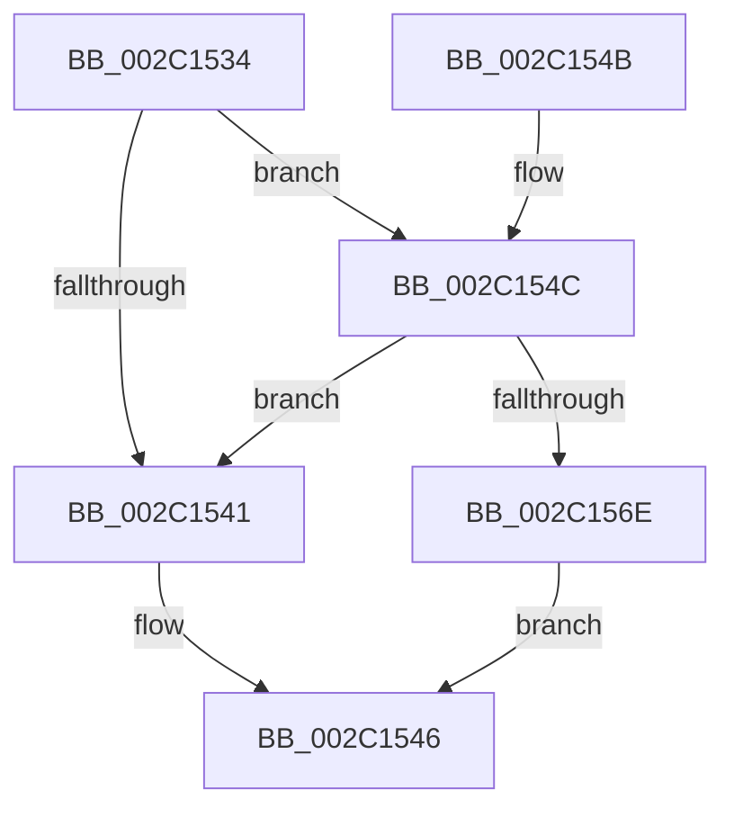

# RtlpHpEnvFreeVA

- RVA: `0x002C1534`–`0x002C1572` (길이 `62` bytes)
- VA: `0x00000001402C1534`
- 실행 섹션: `.text`
- PDB 이름 있음: `예`; PDB Function 태그: `아니요`
- unwind 정보 RVA: `0x0006E5EC`
- 디코드: `18`개 명령, `62/62` bytes 표시
- 미해석 바이트: `0` (있으면 어셈블리에 `.byte`로 보존)

> 이 문서는 커널 이미지의 기계어와 PDB 기호를 분석해 생성했습니다. 4번과 5번은 함수 원형과 자료형을 바이너리 사용 방식에서 추정한 C 해석이며 원본 소스 복구 결과는 아닙니다.

## 1. Dependencies

- 직접 호출 지점: **1**; 고유 호출 대상: **1**
- 직접 호출자로 확인된 함수: **4**
- RIP 상대 이미지 참조: **0**

### Outgoing calls
- `0x002C1541` → [MmFreePoolMemory](MmFreePoolMemory_function_002C1578.md) (function, `0x002C1578`)

### Direct callers
- [RtlpHpFreeVA](RtlpHpFreeVA_function_002C0FD4.md) at `0x002C0FF5`
- [RtlpHpVaMgrCtxFree](../2E/RtlpHpVaMgrCtxFree_function_002ED734.md) at `0x002ED9BD`
- [RtlpHpVaMgrRegionAllocate](../2E/RtlpHpVaMgrRegionAllocate_function_002EF1B0.md) at `0x002EF219`
- [sub_00328FA3](../32/Unknown_function_00328FA3.md) at `0x0032941C`

### Static image references
- 디코드된 RIP-relative 메모리 참조가 없습니다.

## 2. Other-region calls and transfers

- 다른 실행 섹션으로 향하는 call: **0**
- 별도 외부 분기/꼬리 이동을 확인하지 못했습니다.

## 3. Assembly (complete function range)

```asm
002C1534  48 83 EC 28                     sub rsp, 0x28
002C1538  41 81 F8 00 80 00 00            cmp r8d, 0x8000
002C153F  74 0B                           je 0x1402c154c
002C1541  E8 32 00 00 00                  call 0x1402c1578
002C1546  48 83 C4 28                     add rsp, 0x28
002C154A  C3                              ret
002C154B  CC                              int3
002C154C  4C 8B 09                        mov r9, qword ptr [rcx]
002C154F  4C 8B 12                        mov r10, qword ptr [rdx]
002C1552  4D 03 D1                        add r10, r9
002C1555  49 81 C1 FF FF 1F 00            add r9, 0x1fffff
002C155C  49 81 E1 00 00 E0 FF            and r9, 0xffffffffffe00000
002C1563  4D 2B D1                        sub r10, r9
002C1566  4C 89 09                        mov qword ptr [rcx], r9
002C1569  4C 89 12                        mov qword ptr [rdx], r10
002C156C  75 D3                           jne 0x1402c1541
002C156E  33 C0                           xor eax, eax
002C1570  EB D4                           jmp 0x1402c1546
```

## 4. C-style interpretation (structured pseudocode)

```c
__int64 __fastcall RtlpHpEnvFreeVA(__int64 a1, __int64 a2, int a3)
{
    __int64 result;
    __int64 v_r10;
    __int64 v_rsp;

    v_rsp = (v_rsp) - (40);
    if (a3 == 0x8000ULL) goto loc_002C154C;
loc_002C1541:
    result = MmFreePoolMemory(a1, a2, a3, a4);
loc_002C1546:
    v_rsp = (v_rsp) + (40);
    return result;
loc_002C154C:
    v_r10 = (*(unsigned __int64 *)(a2)) + (*(unsigned __int64 *)(a1));
    a4 = (*(unsigned __int64 *)(a1)) + (0x1FFFFFULL);
    a4 = (a4) & (0xFFFFFFFFFFE00000ULL);
    v_r10 = (v_r10) - (a4);
    *(unsigned __int64 *)(a1) = a4;
    *(unsigned __int64 *)(a2) = v_r10;
    if (condition_is_not_equal) goto loc_002C1541;
    result = 0;
    goto loc_002C1546;
}
```

## 5. (Beta) C Style

```c
int64_t RtlpHpEnvFreeVA(void *Arg1, void *Arg2, int32_t Arg3)
{
    uint8_t *arg1 = (uint8_t *)Arg1;
    uint8_t *arg2 = (uint8_t *)Arg2;

    int64_t result;
    int64_t local_r10;
    int64_t local_rsp;

    local_rsp = (local_rsp) - (40);
    if (Arg3 == 0x8000ULL) goto loc_002C154C;
loc_002C1541:
    result = MmFreePoolMemory(Arg1, Arg2, Arg3, a4);
loc_002C1546:
    local_rsp = (local_rsp) + (40);
    return result;
loc_002C154C:
    local_r10 = (*(uint64_t *)(arg2)) + (*(uint64_t *)(arg1));
    a4 = (*(uint64_t *)(arg1)) + (0x1FFFFFULL);
    a4 = (a4) & (0xFFFFFFFFFFE00000ULL);
    local_r10 = (local_r10) - (a4);
    *(uint64_t *)(arg1) = a4;
    *(uint64_t *)(arg2) = local_r10;
    if (condition_is_not_equal) goto loc_002C1541;
    result = 0;
    goto loc_002C1546;
}
```

### 관측된 메모리 오프셋

구조체 형식이 확인되지 않은 접근은 인자 기준의 오프셋으로만 기록했습니다.

| 기준 인자 | 오프셋 표현 | 폭 (bit) | 접근 |
|---|---:|---:|---|
| `Arg1` | `+ 0x0` | `64` | `R` |
| `Arg1` | `+ 0x0` | `64` | `W` |
| `Arg2` | `+ 0x0` | `64` | `R` |
| `Arg2` | `+ 0x0` | `64` | `W` |

## 6. Execution-region graph

[열기: 2D/3D 그래프와 함수 탐색 컨트롤 패널](../../../control-panel.html?section=text&rva=0x002C1534&view=graph)

- 2D 그래프는 위에서 아래로 흐르고, 3D 그래프는 빈 공간을 드래그해 회전합니다. Shift+드래그는 이동, 휠은 확대·축소, 함수 노드 선택은 대상 보고서 이동입니다.

### Static fallback


