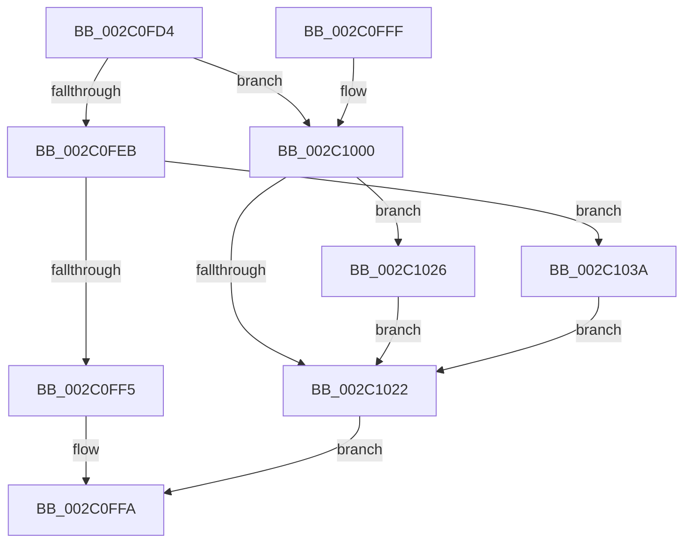

# RtlpHpFreeVA

- RVA: `0x002C0FD4`–`0x002C104E` (길이 `122` bytes)
- VA: `0x00000001402C0FD4`
- 실행 섹션: `.text`
- PDB 이름 있음: `예`; PDB Function 태그: `아니요`
- unwind 정보 RVA: `0x0006E68C`
- 디코드: `34`개 명령, `122/122` bytes 표시
- 미해석 바이트: `0` (있으면 어셈블리에 `.byte`로 보존)

> 이 문서는 커널 이미지의 기계어와 PDB 기호를 분석해 생성했습니다. 4번과 5번은 함수 원형과 자료형을 바이너리 사용 방식에서 추정한 C 해석이며 원본 소스 복구 결과는 아닙니다.

## 1. Dependencies

- 직접 호출 지점: **3**; 고유 호출 대상: **3**
- 직접 호출자로 확인된 함수: **5**
- RIP 상대 이미지 참조: **1**

### Outgoing calls
- `0x002C0FF5` → [RtlpHpEnvFreeVA](RtlpHpEnvFreeVA_function_002C1534.md) (function, `0x002C1534`)
- `0x002C1033` → [RtlpHpVaMgrCtxFree](../2E/RtlpHpVaMgrCtxFree_function_002ED734.md) (function, `0x002ED734`)
- `0x002C1047` → [RtlpHpVaMgrCtxDecommit](../60/RtlpHpVaMgrCtxDecommit_function_00603DC0.md) (function, `0x00603DC0`)

### Direct callers
- [RtlpHpLargeAlloc](../2E/RtlpHpLargeAlloc_function_002EBD5C.md) at `0x002EBFD9`
- [RtlpHpLargeAlloc](../2E/RtlpHpLargeAlloc_function_002EBD5C.md) at `0x002EC02C`
- [RtlpHpSegMgrReserve](../2E/RtlpHpSegMgrReserve_function_002ED1F0.md) at `0x002ED375`
- [RtlpHpHeapAllocate](../60/RtlpHpHeapAllocate_function_00602D98.md) at `0x00602FB3`
- [RtlpHpHeapDestroy](../60/RtlpHpHeapDestroy_function_006033AC.md) at `0x00603518`
- [RtlpHpLargeAllocationDestroy](../60/RtlpHpLargeAllocationDestroy_function_006054D8.md) at `0x00605559`

### Static image references
- `0x002C102C` → RVA `0x00E68658` (`.data`; read)

## 2. Other-region calls and transfers

- 다른 실행 섹션으로 향하는 call: **0**
- 별도 외부 분기/꼬리 이동을 확인하지 못했습니다.

## 3. Assembly (complete function range)

```asm
002C0FD4  48 83 EC 48                     sub rsp, 0x48
002C0FD8  41 0F 28 01                     movaps xmm0, xmmword ptr [r9]
002C0FDC  F3 0F 7F 44 24 30               movdqu xmmword ptr [rsp + 0x30], xmm0
002C0FE2  41 81 F8 00 80 00 00            cmp r8d, 0x8000
002C0FE9  74 15                           je 0x1402c1000
002C0FEB  8A 44 24 31                     mov al, byte ptr [rsp + 0x31]
002C0FEF  2C 02                           sub al, 2
002C0FF1  3C 02                           cmp al, 2
002C0FF3  76 45                           jbe 0x1402c103a
002C0FF5  E8 3A 05 00 00                  call 0x1402c1534
002C0FFA  48 83 C4 48                     add rsp, 0x48
002C0FFE  C3                              ret
002C0FFF  CC                              int3
002C1000  4C 8B 01                        mov r8, qword ptr [rcx]
002C1003  4C 8B 0A                        mov r9, qword ptr [rdx]
002C1006  4D 03 C8                        add r9, r8
002C1009  49 81 C0 FF FF 0F 00            add r8, 0xfffff
002C1010  49 81 E0 00 00 F0 FF            and r8, 0xfffffffffff00000
002C1017  4D 2B C8                        sub r9, r8
002C101A  4C 89 01                        mov qword ptr [rcx], r8
002C101D  4C 89 0A                        mov qword ptr [rdx], r9
002C1020  75 04                           jne 0x1402c1026
002C1022  33 C0                           xor eax, eax
002C1024  EB D4                           jmp 0x1402c0ffa
002C1026  4C 8B C2                        mov r8, rdx
002C1029  48 8B D1                        mov rdx, rcx
002C102C  48 8D 0D 25 76 BA 00            lea rcx, [rip + 0xba7625]
002C1033  E8 FC C6 02 00                  call 0x1402ed734
002C1038  EB E8                           jmp 0x1402c1022
002C103A  4C 8B 02                        mov r8, qword ptr [rdx]
002C103D  48 8B 11                        mov rdx, qword ptr [rcx]
002C1040  48 8D 0D 11 76 BA 00            lea rcx, [rip + 0xba7611]
002C1047  E8 74 2D 34 00                  call 0x140603dc0
002C104C  EB D4                           jmp 0x1402c1022
```

## 4. C-style interpretation (structured pseudocode)

```c
__int64 __fastcall RtlpHpFreeVA(__int64 a1, __int64 a2, int a3, __int64 a4)
{
    __int64 result;
    __int64 v_rsp;
    unsigned __int8 v_stack_m17;
    unsigned __int64 v_stack_m18;

    v_rsp = (v_rsp) - (72);
    v_stack_m18 = v_xmm0;
    if (a3 == 0x8000ULL) goto loc_002C1000;
    result = (unsigned __int8)((v_stack_m17) - (2));
    if (((unsigned __int8)(result)) <= 2) goto loc_002C103A;
    result = RtlpHpEnvFreeVA(a1, a2, a3, a4);
loc_002C0FFA:
    v_rsp = (v_rsp) + (72);
    return result;
loc_002C1000:
    a4 = (*(unsigned __int64 *)(a2)) + (*(unsigned __int64 *)(a1));
    a3 = (*(unsigned __int64 *)(a1)) + (0xFFFFFULL);
    a3 = (a3) & (0xFFFFFFFFFFF00000ULL);
    a4 = (a4) - (a3);
    *(unsigned __int64 *)(a1) = a3;
    *(unsigned __int64 *)(a2) = a4;
    if (condition_is_not_equal) goto loc_002C1026;
loc_002C1022:
    result = 0;
    goto loc_002C0FFA;
loc_002C1026:
    result = RtlpHpVaMgrCtxFree(v_rip + 12219941, a1, a2, a4);
    goto loc_002C1022;
loc_002C103A:
    result = RtlpHpVaMgrCtxDecommit(v_rip + 12219921, *(unsigned __int64 *)(v_rip + 12219941), *(unsigned __int64 *)(a1), a4);
    goto loc_002C1022;
}
```

## 5. (Beta) C Style

```c
int64_t RtlpHpFreeVA(void *Arg1, void *Arg2, int32_t Arg3, void *Arg4)
{
    uint8_t *arg1 = (uint8_t *)Arg1;
    uint8_t *arg2 = (uint8_t *)Arg2;
    uint8_t *arg4 = (uint8_t *)Arg4;

    int64_t result;
    int64_t local_rsp;
    uint8_t v_stack_m17;
    uint64_t v_stack_m18;

    local_rsp = (local_rsp) - (72);
    v_stack_m18 = v_xmm0;
    if (Arg3 == 0x8000ULL) goto loc_002C1000;
    result = (uint8_t)((v_stack_m17) - (2));
    if (((uint8_t)(result)) <= 2) goto loc_002C103A;
    result = RtlpHpEnvFreeVA(Arg1, Arg2, Arg3, Arg4);
loc_002C0FFA:
    local_rsp = (local_rsp) + (72);
    return result;
loc_002C1000:
    Arg4 = (*(uint64_t *)(arg2)) + (*(uint64_t *)(arg1));
    Arg3 = (*(uint64_t *)(arg1)) + (0xFFFFFULL);
    Arg3 = (Arg3) & (0xFFFFFFFFFFF00000ULL);
    Arg4 = (Arg4) - (Arg3);
    *(uint64_t *)(arg1) = Arg3;
    *(void **)(arg2) = Arg4;
    if (condition_is_not_equal) goto loc_002C1026;
loc_002C1022:
    result = 0;
    goto loc_002C0FFA;
loc_002C1026:
    result = RtlpHpVaMgrCtxFree(v_rip + 12219941, Arg1, Arg2, Arg4);
    goto loc_002C1022;
loc_002C103A:
    result = RtlpHpVaMgrCtxDecommit(v_rip + 12219921, *(uint64_t *)(v_rip + 0xBA7625), *(uint64_t *)(arg1), Arg4);
    goto loc_002C1022;
}
```

### 관측된 메모리 오프셋

구조체 형식이 확인되지 않은 접근은 인자 기준의 오프셋으로만 기록했습니다.

| 기준 인자 | 오프셋 표현 | 폭 (bit) | 접근 |
|---|---:|---:|---|
| `Arg1` | `+ 0x0` | `64` | `R` |
| `Arg1` | `+ 0x0` | `64` | `W` |
| `Arg2` | `+ 0x0` | `64` | `R` |
| `Arg2` | `+ 0x0` | `64` | `W` |
| `Arg4` | `+ 0x0` | `128` | `R` |

## 6. Execution-region graph

[열기: 2D/3D 그래프와 함수 탐색 컨트롤 패널](../../../control-panel.html?section=text&rva=0x002C0FD4&view=graph)

- 2D 그래프는 위에서 아래로 흐르고, 3D 그래프는 빈 공간을 드래그해 회전합니다. Shift+드래그는 이동, 휠은 확대·축소, 함수 노드 선택은 대상 보고서 이동입니다.

### Static fallback


