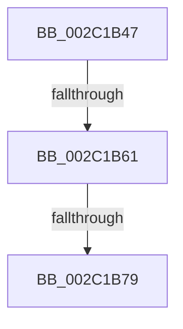

# sub_002C1B47

- RVA: `0x002C1B47`–`0x002C1B88` (길이 `65` bytes)
- VA: `0x00000001402C1B47`
- 실행 섹션: `.text`
- PDB 이름 있음: `아니요`; PDB Function 태그: `아니요`
- unwind 정보 RVA: `0x0006E780`
- 디코드: `14`개 명령, `65/65` bytes 표시
- 미해석 바이트: `0` (있으면 어셈블리에 `.byte`로 보존)

> 이 문서는 커널 이미지의 기계어와 PDB 기호를 분석해 생성했습니다. 4번과 5번은 함수 원형과 자료형을 바이너리 사용 방식에서 추정한 C 해석이며 원본 소스 복구 결과는 아닙니다.

## 1. Dependencies

- 직접 호출 지점: **0**; 고유 호출 대상: **0**
- 직접 호출자로 확인된 함수: **0**
- RIP 상대 이미지 참조: **0**

### Outgoing calls
- 직접 디코드된 call 명령이 없습니다.

### Direct callers
- 이 함수 시작 RVA로 연결되는 직접 call은 확인되지 않았습니다. 간접 호출은 완전히 역산할 수 없습니다.

### Static image references
- 디코드된 RIP-relative 메모리 참조가 없습니다.

## 2. Other-region calls and transfers

- 다른 실행 섹션으로 향하는 call: **0**
- call이 아닌 외부 분기/꼬리 이동: **3**
  - `0x002C1B5B` → [sub_002C1DD3](Unknown_function_002C1DD3.md) (`tail-transfer`)
  - `0x002C1B73` → [sub_002C1CF0](Unknown_function_002C1CF0.md) (`tail-transfer`)
  - `0x002C1B86` → [sub_002C1B88 + 0x2F](Unknown_function_002C1B88.md) (`tail-transfer`)

## 3. Assembly (complete function range)

```asm
002C1B47  4C 89 A4 24 80 00 00 00         mov qword ptr [rsp + 0x80], r12
002C1B4F  49 B8 00 00 00 00 80 F6 FF FF   movabs r8, 0xfffff68000000000
002C1B59  85 D2                           test edx, edx
002C1B5B  0F 84 72 02 00 00               je 0x1402c1dd3
002C1B61  8D 42 01                        lea eax, [rdx + 1]
002C1B64  33 DB                           xor ebx, ebx
002C1B66  89 47 40                        mov dword ptr [rdi + 0x40], eax
002C1B69  44 8B E3                        mov r12d, ebx
002C1B6C  F0 48 0F BA 6E 18 3F            lock bts qword ptr [rsi + 0x18], 0x3f
002C1B73  0F 82 77 01 00 00               jb 0x1402c1cf0
002C1B79  41 8B 07                        mov eax, dword ptr [r15]
002C1B7C  4C 8B A4 24 80 00 00 00         mov r12, qword ptr [rsp + 0x80]
002C1B84  A8 02                           test al, 2
002C1B86  75 2F                           jne 0x1402c1bb7
```

## 4. C-style interpretation (structured pseudocode)

```c
__int64 __fastcall sub_002C1B47(__int64 a1, __int64 a2, __int64 a3, __int64 a4, __int64 a5, __int64 a6, __int64 a7, __int64 a8, __int64 a9, __int64 a10, __int64 a11, __int64 a12, __int64 a13, __int64 a14, __int64 a15, __int64 a16)
{
    __int64 v_rbx;
    unsigned __int64 v_stack_p80;

    v_stack_p80 = v_r12;
    v_rbx = 0;
    *(unsigned int *)(v_rdi + 64) = (unsigned int)(a2 + 1);
}
```

## 5. (Beta) C Style

```c
int64_t sub_002C1B47(int64_t Arg1, int64_t Arg2, int64_t Arg3, int64_t Arg4, uint64_t Arg5, uint64_t Arg6, uint64_t Arg7, uint64_t Arg8, uint64_t Arg9, uint64_t Arg10, uint64_t Arg11, uint64_t Arg12, uint64_t Arg13, uint64_t Arg14, uint64_t Arg15, int64_t Arg16)
{
    int64_t local_rbx;
    uint64_t v_stack_p80;

    v_stack_p80 = local_r12;
    local_rbx = 0;
    *(uint32_t *)(local_rdi + 0x40) = (uint32_t)(Arg2 + 1);
}
```

## 6. Execution-region graph

[열기: 2D/3D 그래프와 함수 탐색 컨트롤 패널](../../../control-panel.html?section=text&rva=0x002C1B47&view=graph)

- 2D 그래프는 위에서 아래로 흐르고, 3D 그래프는 빈 공간을 드래그해 회전합니다. Shift+드래그는 이동, 휠은 확대·축소, 함수 노드 선택은 대상 보고서 이동입니다.

### Static fallback


