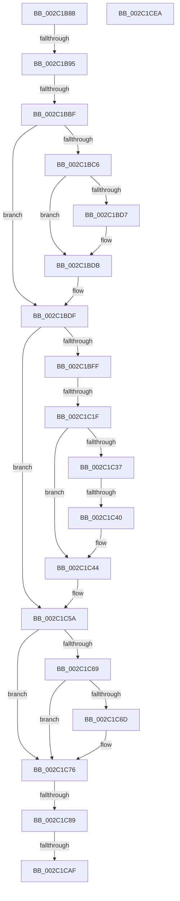

# sub_002C1B88

- RVA: `0x002C1B88`–`0x002C1CF0` (길이 `360` bytes)
- VA: `0x00000001402C1B88`
- 실행 섹션: `.text`
- PDB 이름 있음: `아니요`; PDB Function 태그: `아니요`
- unwind 정보 RVA: `0x0006E794`
- 디코드: `84`개 명령, `360/360` bytes 표시
- 미해석 바이트: `0` (있으면 어셈블리에 `.byte`로 보존)

> 이 문서는 커널 이미지의 기계어와 PDB 기호를 분석해 생성했습니다. 4번과 5번은 함수 원형과 자료형을 바이너리 사용 방식에서 추정한 C 해석이며 원본 소스 복구 결과는 아닙니다.

## 1. Dependencies

- 직접 호출 지점: **4**; 고유 호출 대상: **4**
- 직접 호출자로 확인된 함수: **0**
- RIP 상대 이미지 참조: **2**

### Outgoing calls
- `0x002C1C07` → [MI_READ_PTE_LOCK_FREE](../28/MI_READ_PTE_LOCK_FREE_function_002828A0.md) (function, `0x002828A0`)
- `0x002C1CAF` → [MiGetProcessorFlushList](../24/MiGetProcessorFlushList_function_00242C90.md) (function, `0x00242C90`)
- `0x002C1CCF` → [MiInitializeTbFlushList](../29/MiInitializeTbFlushList_function_00294F00.md) (function, `0x00294F00`)
- `0x002C1CE0` → [MiInsertTbFlushEntry](../29/MiInsertTbFlushEntry_function_00293670.md) (function, `0x00293670`)

### Direct callers
- 이 함수 시작 RVA로 연결되는 직접 call은 확인되지 않았습니다. 간접 호출은 완전히 역산할 수 없습니다.

### Static image references
- `0x002C1C10` → RVA `0x00FCF080` (`CACHEALI`; read)
- `0x002C1C2B` → RVA `0x00E2DC80` (`.data`; read)

## 2. Other-region calls and transfers

- 다른 실행 섹션으로 향하는 call: **0**
- call이 아닌 외부 분기/꼬리 이동: **7**
  - `0x002C1B8F` → [sub_002C1E57 + 0x9C](Unknown_function_002C1E57.md) (`tail-transfer`)
  - `0x002C1BB9` → [sub_002C1D11](Unknown_function_002C1D11.md) (`tail-transfer`)
  - `0x002C1C19` → [sub_002C1E57 + 0xA5](Unknown_function_002C1E57.md) (`tail-transfer`)
  - `0x002C1C3A` → [sub_002C1D11 + 0xBA](Unknown_function_002C1D11.md) (`tail-transfer`)
  - `0x002C1C83` → [MiDeleteNonPagedPoolPte + 0x27](MiDeleteNonPagedPoolPte_function_002C1A90.md) (`tail-transfer`)
  - `0x002C1CA9` → [sub_002C1E57 + 0xCE](Unknown_function_002C1E57.md) (`tail-transfer`)
  - `0x002C1CE5` → [MiDeleteNonPagedPoolPte + 0x27](MiDeleteNonPagedPoolPte_function_002C1A90.md) (`tail-transfer`)

## 3. Assembly (complete function range)

```asm
002C1B88  8B 46 20                        mov eax, dword ptr [rsi + 0x20]
002C1B8B  66 83 F8 01                     cmp ax, 1
002C1B8F  0F 85 5E 03 00 00               jne 0x1402c1ef3
002C1B95  8B 46 20                        mov eax, dword ptr [rsi + 0x20]
002C1B98  89 84 24 88 00 00 00            mov dword ptr [rsp + 0x88], eax
002C1B9F  C1 E8 10                        shr eax, 0x10
002C1BA2  24 FD                           and al, 0xfd
002C1BA4  0C 05                           or al, 5
002C1BA6  88 84 24 8A 00 00 00            mov byte ptr [rsp + 0x8a], al
002C1BAD  8B 84 24 88 00 00 00            mov eax, dword ptr [rsp + 0x88]
002C1BB4  89 46 20                        mov dword ptr [rsi + 0x20], eax
002C1BB7  85 ED                           test ebp, ebp
002C1BB9  0F 85 52 01 00 00               jne 0x1402c1d11
002C1BBF  41 8B 07                        mov eax, dword ptr [r15]
002C1BC2  A8 02                           test al, 2
002C1BC4  75 19                           jne 0x1402c1bdf
002C1BC6  48 8B 47 08                     mov rax, qword ptr [rdi + 8]
002C1BCA  48 89 06                        mov qword ptr [rsi], rax
002C1BCD  48 89 77 08                     mov qword ptr [rdi + 8], rsi
002C1BD1  48 39 5F 10                     cmp qword ptr [rdi + 0x10], rbx
002C1BD5  75 04                           jne 0x1402c1bdb
002C1BD7  48 89 77 10                     mov qword ptr [rdi + 0x10], rsi
002C1BDB  48 FF 47 18                     inc qword ptr [rdi + 0x18]
002C1BDF  48 B8 FF FF FF FF FF FF FF 7F   movabs rax, 0x7fffffffffffffff
002C1BE9  F0 48 21 46 18                  lock and qword ptr [rsi + 0x18], rax
002C1BEE  48 89 9C 24 98 00 00 00         mov qword ptr [rsp + 0x98], rbx
002C1BF6  F7 47 38 00 00 00 40            test dword ptr [rdi + 0x38], 0x40000000
002C1BFD  75 5B                           jne 0x1402c1c5a
002C1BFF  48 8D 8C 24 98 00 00 00         lea rcx, [rsp + 0x98]
002C1C07  E8 94 0C FC FF                  call 0x1402828a0
002C1C0C  F0 09 1C 24                     lock or dword ptr [rsp], ebx
002C1C10  8B 0D 6A D4 D0 00               mov ecx, dword ptr [rip + 0xd0d46a]
002C1C16  48 85 C0                        test rax, rax
002C1C19  0F 85 DD 02 00 00               jne 0x1402c1efc
002C1C1F  48 8B C1                        mov rax, rcx
002C1C22  8B CB                           mov ecx, ebx
002C1C24  48 C1 E0 20                     shl rax, 0x20
002C1C28  48 0B C1                        or rax, rcx
002C1C2B  48 8B 0D 4E C0 B6 00            mov rcx, qword ptr [rip + 0xb6c04e]
002C1C32  48 85 C9                        test rcx, rcx
002C1C35  74 0D                           je 0x1402c1c44
002C1C37  48 85 C8                        test rax, rcx
002C1C3A  0F 84 8B 01 00 00               je 0x1402c1dcb
002C1C40  48 83 C8 10                     or rax, 0x10
002C1C44  48 8D 8C 24 98 00 00 00         lea rcx, [rsp + 0x98]
002C1C4C  48 89 01                        mov qword ptr [rcx], rax
002C1C4F  48 8B 9C 24 98 00 00 00         mov rbx, qword ptr [rsp + 0x98]
002C1C57  49 89 1E                        mov qword ptr [r14], rbx
002C1C5A  48 8B 0D 1F C0 B6 00            mov rcx, qword ptr [rip + 0xb6c01f]
002C1C61  48 8B C3                        mov rax, rbx
002C1C64  48 85 C9                        test rcx, rcx
002C1C67  74 0D                           je 0x1402c1c76
002C1C69  A8 10                           test al, 0x10
002C1C6B  75 09                           jne 0x1402c1c76
002C1C6D  48 8B D9                        mov rbx, rcx
002C1C70  48 F7 D3                        not rbx
002C1C73  48 23 D8                        and rbx, rax
002C1C76  48 B8 00 00 00 00 FF FF FF FF   movabs rax, 0xffffffff00000000
002C1C80  48 85 D8                        test rax, rbx
002C1C83  0F 85 2E FE FF FF               jne 0x1402c1ab7
002C1C89  49 C1 E6 19                     shl r14, 0x19
002C1C8D  48 B8 00 00 00 00 80 F6 FF FF   movabs rax, 0xfffff68000000000
002C1C97  48 8B C0                        mov rax, rax
002C1C9A  48 C1 E0 19                     shl rax, 0x19
002C1C9E  4C 2B F0                        sub r14, rax
002C1CA1  49 C1 FE 10                     sar r14, 0x10
002C1CA5  48 83 3F 00                     cmp qword ptr [rdi], 0
002C1CA9  0F 85 76 02 00 00               jne 0x1402c1f25
002C1CAF  E8 DC 0F F8 FF                  call 0x140242c90
002C1CB4  48 89 07                        mov qword ptr [rdi], rax
002C1CB7  41 BB 01 00 00 00               mov r11d, 1
002C1CBD  45 33 C9                        xor r9d, r9d
002C1CC0  44 89 5C 24 20                  mov dword ptr [rsp + 0x20], r11d
002C1CC5  49 8B D5                        mov rdx, r13
002C1CC8  48 8B C8                        mov rcx, rax
002C1CCB  44 8B 40 0C                     mov r8d, dword ptr [rax + 0xc]
002C1CCF  E8 2C 32 FD FF                  call 0x140294f00
002C1CD4  48 8B 0F                        mov rcx, qword ptr [rdi]
002C1CD7  45 33 C9                        xor r9d, r9d
002C1CDA  4D 8B C3                        mov r8, r11
002C1CDD  49 8B D6                        mov rdx, r14
002C1CE0  E8 8B 19 FD FF                  call 0x140293670
002C1CE5  E9 CD FD FF FF                  jmp 0x1402c1ab7
002C1CEA  66 0F 1F 44 00 00               nop word ptr [rax + rax]
```

## 4. C-style interpretation (structured pseudocode)

```c
__int64 __fastcall sub_002C1B88(__int64 a1, __int64 a2, __int64 a3, int a4, __int64 a5, __int64 a6, __int64 a7, __int64 a8, __int64 a9, __int64 a10, __int64 a11, __int64 a12, __int64 a13, __int64 a14, __int64 a15, __int64 a16, unsigned int a17, __int64 a18, __int64 a19)
{
    __int64 result;
    __int64 v_r14;
    __int64 v_rbx;
    unsigned int v_stack_p0;
    unsigned int v_stack_p20;
    unsigned int v_stack_p88;
    unsigned __int8 v_stack_p8A;
    unsigned __int64 v_stack_p98;

    v_stack_p88 = (unsigned int)((unsigned int)(*(unsigned int *)(v_rsi + 32)));
    result = (unsigned int)(((unsigned int)(*(unsigned int *)(v_rsi + 32))) >> (16));
    result = (unsigned __int8)((result) & (253));
    result = (unsigned __int8)((result) | (5));
    v_stack_p8A = (unsigned __int8)(result);
    *(unsigned int *)(v_rsi + 32) = (unsigned int)((unsigned int)(a17));
    if ((((unsigned __int8)((unsigned int)(*(unsigned int *)(v_r15)))) & (2)) != 0) goto loc_002C1BDF;
    *(unsigned __int64 *)(v_rsi) = *(unsigned __int64 *)(v_rdi + 8);
    *(unsigned __int64 *)(v_rdi + 8) = v_rsi;
    if ((*(unsigned __int64 *)(v_rdi + 16)) == v_rbx) {
        *(unsigned __int64 *)(v_rdi + 16) = v_rsi;
    }
loc_002C1BDF:
    v_stack_p98 = v_rbx;
    if (((*(unsigned int *)(v_rdi + 56)) & (0x40000000ULL)) != 0) goto loc_002C1C5A;
    result = MI_READ_PTE_LOCK_FREE(a19, a2, a3, a4);
    result = ((unsigned int)(*(unsigned int *)(v_rip + 13685866))) << (32);
    result = (result) | ((unsigned int)((unsigned int)(v_rbx)));
    if (*(unsigned __int64 *)(v_rip + 11976782) == 0) goto loc_002C1C44;
    result = (result) | (16);
loc_002C1C44:
    *(unsigned __int64 *)(a19) = result;
    *(unsigned __int64 *)(v_r14) = a19;
loc_002C1C5A:
    if (*(unsigned __int64 *)(v_rip + 11976735) == 0) goto loc_002C1C76;
    v_rbx = a19;
    if ((((unsigned __int8)(a19)) & (16)) == 0) {
        v_rbx = *(unsigned __int64 *)(v_rip + 11976735);
        v_rbx = ~(v_rbx);
        v_rbx = (v_rbx) & (a19);
    }
    v_r14 = (v_r14) << (25);
    result = (a19) << (25);
    v_r14 = (v_r14) - (result);
    v_r14 = (v_r14) >> (16);
    result = MiGetProcessorFlushList(*(unsigned __int64 *)(v_rip + 11976735), a2, a3, a4);
    *(unsigned __int64 *)(v_rdi) = result;
    a4 = 0;
    v_stack_p20 = 1;
    result = MiInitializeTbFlushList(result, v_r13, (unsigned int)(*(unsigned int *)(result + 12)), a4);
    a4 = 0;
    result = MiInsertTbFlushEntry(*(unsigned __int64 *)(v_rdi), v_r14, 1, a4);
}
```

## 5. (Beta) C Style

```c
int64_t sub_002C1B88(int64_t Arg1, int64_t Arg2, int64_t Arg3, int32_t Arg4, uint64_t Arg5, uint64_t Arg6, uint64_t Arg7, uint64_t Arg8, uint64_t Arg9, uint64_t Arg10, uint64_t Arg11, uint64_t Arg12, uint64_t Arg13, uint64_t Arg14, uint64_t Arg15, uint64_t Arg16, uint32_t Arg17, uint64_t Arg18, int64_t Arg19)
{
    int64_t result;
    int64_t local_r14;
    int64_t local_rbx;
    uint32_t v_stack_p0;
    uint32_t v_stack_p20;
    uint32_t v_stack_p88;
    uint8_t v_stack_p8A;
    uint64_t v_stack_p98;

    v_stack_p88 = (uint32_t)((uint32_t)(*(uint32_t *)(local_rsi + 0x20)));
    result = (uint32_t)(((uint32_t)(*(uint32_t *)(local_rsi + 0x20))) >> (16));
    result = (uint8_t)((result) & (253));
    result = (uint8_t)((result) | (5));
    v_stack_p8A = (uint8_t)(result);
    *(uint32_t *)(local_rsi + 0x20) = (uint32_t)((uint32_t)(Arg17));
    if ((((uint8_t)((uint32_t)(*(uint32_t *)(local_r15)))) & (2)) != 0) goto loc_002C1BDF;
    *(uint64_t *)(local_rsi) = *(uint64_t *)(local_rdi + 0x8);
    *(uint64_t *)(local_rdi + 0x8) = local_rsi;
    if ((*(uint64_t *)(local_rdi + 0x10)) == local_rbx) {
        *(uint64_t *)(local_rdi + 0x10) = local_rsi;
    }
loc_002C1BDF:
    v_stack_p98 = local_rbx;
    if (((*(uint32_t *)(local_rdi + 0x38)) & (0x40000000ULL)) != 0) goto loc_002C1C5A;
    result = MI_READ_PTE_LOCK_FREE(Arg19, Arg2, Arg3, Arg4);
    result = ((uint32_t)(*(uint32_t *)(v_rip + 0xD0D46A))) << (32);
    result = (result) | ((uint32_t)((uint32_t)(local_rbx)));
    if (*(uint64_t *)(v_rip + 0xB6C04E) == 0) goto loc_002C1C44;
    result = (result) | (16);
loc_002C1C44:
    *(uint64_t *)(Arg19) = result;
    *(uint64_t *)(local_r14) = Arg19;
loc_002C1C5A:
    if (*(uint64_t *)(v_rip + 0xB6C01F) == 0) goto loc_002C1C76;
    local_rbx = Arg19;
    if ((((uint8_t)(Arg19)) & (16)) == 0) {
        local_rbx = *(uint64_t *)(v_rip + 0xB6C01F);
        local_rbx = ~(local_rbx);
        local_rbx = (local_rbx) & (Arg19);
    }
    local_r14 = (local_r14) << (25);
    result = (Arg19) << (25);
    local_r14 = (local_r14) - (result);
    local_r14 = (local_r14) >> (16);
    result = MiGetProcessorFlushList(*(uint64_t *)(v_rip + 0xB6C01F), Arg2, Arg3, Arg4);
    *(uint64_t *)(local_rdi) = result;
    Arg4 = 0;
    v_stack_p20 = 1;
    result = MiInitializeTbFlushList(result, local_r13, (uint32_t)(*(uint32_t *)(result + 0xC)), Arg4);
    Arg4 = 0;
    result = MiInsertTbFlushEntry(*(uint64_t *)(local_rdi), local_r14, 1, Arg4);
}
```

## 6. Execution-region graph

[열기: 2D/3D 그래프와 함수 탐색 컨트롤 패널](../../../control-panel.html?section=text&rva=0x002C1B88&view=graph)

- 2D 그래프는 위에서 아래로 흐르고, 3D 그래프는 빈 공간을 드래그해 회전합니다. Shift+드래그는 이동, 휠은 확대·축소, 함수 노드 선택은 대상 보고서 이동입니다.

### Static fallback


