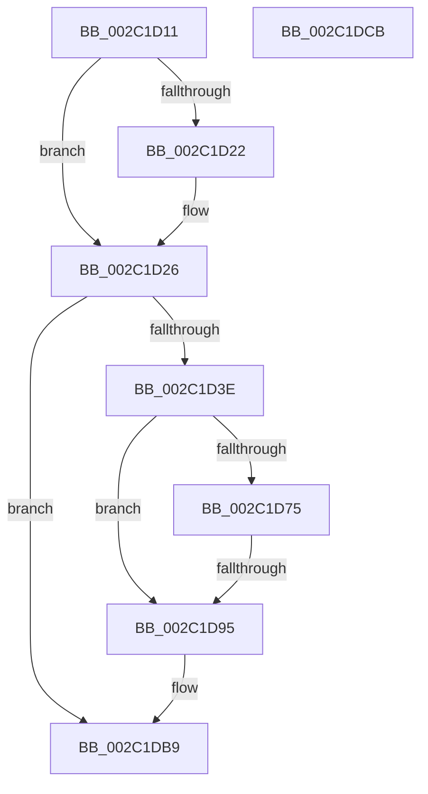

# sub_002C1D11

- RVA: `0x002C1D11`–`0x002C1DD3` (길이 `194` bytes)
- VA: `0x00000001402C1D11`
- 실행 섹션: `.text`
- PDB 이름 있음: `아니요`; PDB Function 태그: `아니요`
- unwind 정보 RVA: `0x0006E7B8`
- 디코드: `48`개 명령, `194/194` bytes 표시
- 미해석 바이트: `0` (있으면 어셈블리에 `.byte`로 보존)

> 이 문서는 커널 이미지의 기계어와 PDB 기호를 분석해 생성했습니다. 4번과 5번은 함수 원형과 자료형을 바이너리 사용 방식에서 추정한 C 해석이며 원본 소스 복구 결과는 아닙니다.

## 1. Dependencies

- 직접 호출 지점: **2**; 고유 호출 대상: **2**
- 직접 호출자로 확인된 함수: **0**
- RIP 상대 이미지 참조: **1**

### Outgoing calls
- `0x002C1D3E` → [MiGetProcessorFlushList](../24/MiGetProcessorFlushList_function_00242C90.md) (function, `0x00242C90`)
- `0x002C1DC1` → [MiInsertRecursiveTbFlushEntries](MiInsertRecursiveTbFlushEntries_function_002C1F38.md) (function, `0x002C1F38`)

### Direct callers
- 이 함수 시작 RVA로 연결되는 직접 call은 확인되지 않았습니다. 간접 호출은 완전히 역산할 수 없습니다.

### Static image references
- `0x002C1D59` → RVA `0x00E38538` (`.data`; read)

## 2. Other-region calls and transfers

- 다른 실행 섹션으로 향하는 call: **0**
- call이 아닌 외부 분기/꼬리 이동: **3**
  - `0x002C1D8F` → [sub_002C1E57 + 0x76](Unknown_function_002C1E57.md) (`tail-transfer`)
  - `0x002C1DC6` → [MiDeleteNonPagedPoolPte + 0x27](MiDeleteNonPagedPoolPte_function_002C1A90.md) (`tail-transfer`)
  - `0x002C1DCE` → [sub_002C1B88 + 0xBC](Unknown_function_002C1B88.md) (`tail-transfer`)

## 3. Assembly (complete function range)

```asm
002C1D11  48 8B 47 20                     mov rax, qword ptr [rdi + 0x20]
002C1D15  48 89 06                        mov qword ptr [rsi], rax
002C1D18  48 89 77 20                     mov qword ptr [rdi + 0x20], rsi
002C1D1C  48 39 5F 28                     cmp qword ptr [rdi + 0x28], rbx
002C1D20  75 04                           jne 0x1402c1d26
002C1D22  48 89 77 28                     mov qword ptr [rdi + 0x28], rsi
002C1D26  48 FF 47 30                     inc qword ptr [rdi + 0x30]
002C1D2A  48 B8 FF FF FF FF FF FF FF 7F   movabs rax, 0x7fffffffffffffff
002C1D34  F0 48 21 46 18                  lock and qword ptr [rsi + 0x18], rax
002C1D39  48 39 1F                        cmp qword ptr [rdi], rbx
002C1D3C  75 7B                           jne 0x1402c1db9
002C1D3E  E8 4D 0F F8 FF                  call 0x140242c90
002C1D43  48 89 07                        mov qword ptr [rdi], rax
002C1D46  41 BB 01 00 00 00               mov r11d, 1
002C1D4C  48 8B D0                        mov rdx, rax
002C1D4F  89 58 10                        mov dword ptr [rax + 0x10], ebx
002C1D52  44 89 58 14                     mov dword ptr [rax + 0x14], r11d
002C1D56  4C 89 28                        mov qword ptr [rax], r13
002C1D59  8B 0D D9 67 B7 00               mov ecx, dword ptr [rip + 0xb767d9]
002C1D5F  C1 E9 08                        shr ecx, 8
002C1D62  C0 E9 03                        shr cl, 3
002C1D65  41 22 CB                        and cl, r11b
002C1D68  88 48 18                        mov byte ptr [rax + 0x18], cl
002C1D6B  8B 05 C7 67 B7 00               mov eax, dword ptr [rip + 0xb767c7]
002C1D71  A8 0F                           test al, 0xf
002C1D73  75 20                           jne 0x1402c1d95
002C1D75  65 48 8B 04 25 88 01 00 00      mov rax, qword ptr gs:[0x188]
002C1D7E  48 8B 88 B8 00 00 00            mov rcx, qword ptr [rax + 0xb8]
002C1D85  48 81 C1 00 04 00 00            add rcx, 0x400
002C1D8C  4C 3B E9                        cmp r13, rcx
002C1D8F  0F 85 38 01 00 00               jne 0x1402c1ecd
002C1D95  8B 05 9D 67 B7 00               mov eax, dword ptr [rip + 0xb7679d]
002C1D9B  8B CB                           mov ecx, ebx
002C1D9D  A8 0F                           test al, 0xf
002C1D9F  41 0F 44 CB                     cmove ecx, r11d
002C1DA3  83 62 10 DB                     and dword ptr [rdx + 0x10], 0xffffffdb
002C1DA7  89 4A 08                        mov dword ptr [rdx + 8], ecx
002C1DAA  66 89 5A 19                     mov word ptr [rdx + 0x19], bx
002C1DAE  89 5A 1C                        mov dword ptr [rdx + 0x1c], ebx
002C1DB1  48 89 5A 20                     mov qword ptr [rdx + 0x20], rbx
002C1DB5  48 89 5A 28                     mov qword ptr [rdx + 0x28], rbx
002C1DB9  48 8B 0F                        mov rcx, qword ptr [rdi]
002C1DBC  4D 8B C6                        mov r8, r14
002C1DBF  8B D5                           mov edx, ebp
002C1DC1  E8 72 01 00 00                  call 0x1402c1f38
002C1DC6  E9 EC FC FF FF                  jmp 0x1402c1ab7
002C1DCB  48 0B C1                        or rax, rcx
002C1DCE  E9 71 FE FF FF                  jmp 0x1402c1c44
```

## 4. C-style interpretation (structured pseudocode)

```c
__int64 __fastcall sub_002C1D11(void)
{
    __int64 result;

    *(unsigned __int64 *)(v_rsi) = *(unsigned __int64 *)(v_rdi + 32);
    *(unsigned __int64 *)(v_rdi + 32) = v_rsi;
    if ((*(unsigned __int64 *)(v_rdi + 40)) == v_rbx) {
        *(unsigned __int64 *)(v_rdi + 40) = v_rsi;
    }
    if ((*(unsigned __int64 *)(v_rdi)) != v_rbx) goto loc_002C1DB9;
    result = MiGetProcessorFlushList(a1, a2, a3, a4);
    *(unsigned __int64 *)(v_rdi) = result;
    *(unsigned int *)(result + 16) = (unsigned int)(v_rbx);
    *(unsigned int *)(result + 20) = 1;
    *(unsigned __int64 *)(result) = v_r13;
    a1 = (unsigned int)(((unsigned int)(*(unsigned int *)(v_rip + 12019673))) >> (8));
    a1 = (unsigned __int8)((a1) >> (3));
    a1 = (unsigned __int8)((a1) & (1));
    *(unsigned __int8 *)(result + 24) = (unsigned __int8)(a1);
    if ((((unsigned __int8)((unsigned int)(*(unsigned int *)(v_rip + 12019655)))) & (15)) != 0) goto loc_002C1D95;
    a1 = (*(unsigned __int64 *)(*(unsigned __int64 *)(gs_base + (0 + 392)) + 184)) + (0x400ULL);
loc_002C1D95:
    a1 = (unsigned int)((unsigned int)(v_rbx));
    if ((((unsigned __int8)((unsigned int)(*(unsigned int *)(v_rip + 12019613)))) & (15)) == 0) { a1 = 1; }
    *(unsigned int *)(result + 8) = (unsigned int)(a1);
    *(unsigned __int16 *)(result + 25) = (unsigned __int16)(v_rbx);
    *(unsigned int *)(result + 28) = (unsigned int)(v_rbx);
    *(unsigned __int64 *)(result + 32) = v_rbx;
    *(unsigned __int64 *)(result + 40) = v_rbx;
loc_002C1DB9:
    result = MiInsertRecursiveTbFlushEntries(*(unsigned __int64 *)(v_rdi), (unsigned int)((unsigned int)(v_rbp)), v_r14, a4);
}
```

## 5. (Beta) C Style

```c
void sub_002C1D11(void)
{
    int64_t result;

    *(uint64_t *)(local_rsi) = *(uint64_t *)(local_rdi + 0x20);
    *(uint64_t *)(local_rdi + 0x20) = local_rsi;
    if ((*(uint64_t *)(local_rdi + 0x28)) == local_rbx) {
        *(uint64_t *)(local_rdi + 0x28) = local_rsi;
    }
    if ((*(uint64_t *)(local_rdi)) != local_rbx) goto loc_002C1DB9;
    result = MiGetProcessorFlushList(a1, a2, a3, a4);
    *(uint64_t *)(local_rdi) = result;
    *(uint32_t *)(result + 0x10) = (uint32_t)(local_rbx);
    *(uint32_t *)(result + 0x14) = 1;
    *(uint64_t *)(result) = local_r13;
    a1 = (uint32_t)(((uint32_t)(*(uint32_t *)(v_rip + 0xB767D9))) >> (8));
    a1 = (uint8_t)((a1) >> (3));
    a1 = (uint8_t)((a1) & (1));
    *(uint8_t *)(result + 0x18) = (uint8_t)(a1);
    if ((((uint8_t)((uint32_t)(*(uint32_t *)(v_rip + 0xB767C7)))) & (15)) != 0) goto loc_002C1D95;
    a1 = (*(uint64_t *)(*(uint64_t *)(gs_base + (0 + 0x188)) + 0xB8)) + (0x400ULL);
loc_002C1D95:
    a1 = (uint32_t)((uint32_t)(local_rbx));
    if ((((uint8_t)((uint32_t)(*(uint32_t *)(v_rip + 0xB7679D)))) & (15)) == 0) { a1 = 1; }
    *(uint32_t *)(result + 0x8) = (uint32_t)(a1);
    *(uint16_t *)(result + 0x19) = (uint16_t)(local_rbx);
    *(uint32_t *)(result + 0x1C) = (uint32_t)(local_rbx);
    *(uint64_t *)(result + 0x20) = local_rbx;
    *(uint64_t *)(result + 0x28) = local_rbx;
loc_002C1DB9:
    result = MiInsertRecursiveTbFlushEntries(*(uint64_t *)(local_rdi), (uint32_t)((uint32_t)(local_rbp)), local_r14, a4);
}
```

## 6. Execution-region graph

[열기: 2D/3D 그래프와 함수 탐색 컨트롤 패널](../../../control-panel.html?section=text&rva=0x002C1D11&view=graph)

- 2D 그래프는 위에서 아래로 흐르고, 3D 그래프는 빈 공간을 드래그해 회전합니다. Shift+드래그는 이동, 휠은 확대·축소, 함수 노드 선택은 대상 보고서 이동입니다.

### Static fallback


