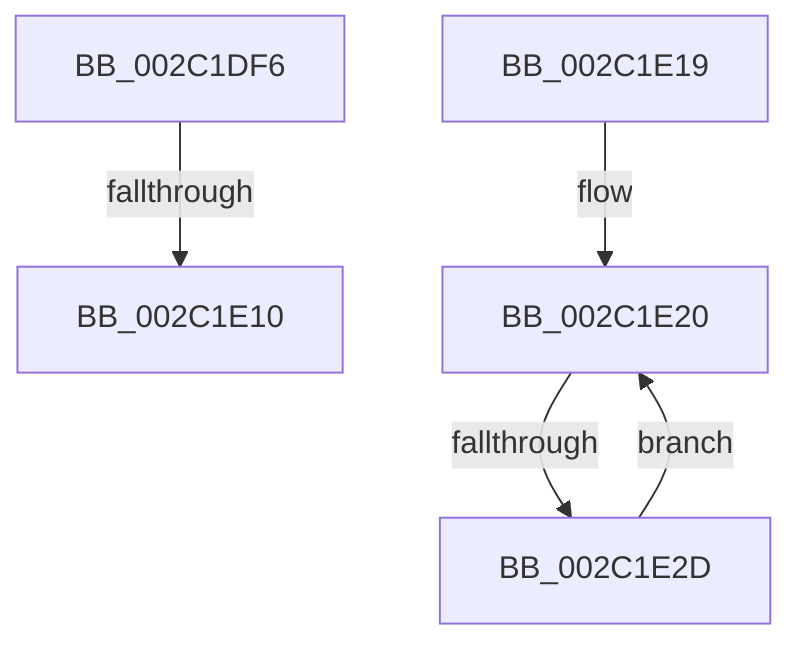

# sub_002C1DF6

- RVA: `0x002C1DF6`–`0x002C1E2F` (길이 `57` bytes)
- VA: `0x00000001402C1DF6`
- 실행 섹션: `.text`
- PDB 이름 있음: `아니요`; PDB Function 태그: `아니요`
- unwind 정보 RVA: `0x0006E7DC`
- 디코드: `13`개 명령, `57/57` bytes 표시
- 미해석 바이트: `0` (있으면 어셈블리에 `.byte`로 보존)

> 이 문서는 커널 이미지의 기계어와 PDB 기호를 분석해 생성했습니다. 4번과 5번은 함수 원형과 자료형을 바이너리 사용 방식에서 추정한 C 해석이며 원본 소스 복구 결과는 아닙니다.

## 1. Dependencies

- 직접 호출 지점: **1**; 고유 호출 대상: **1**
- 직접 호출자로 확인된 함수: **0**
- RIP 상대 이미지 참조: **1**

### Outgoing calls
- `0x002C1E03` → [MiEvictPageTableLock](MiEvictPageTableLock_function_002C1FBC.md) (function, `0x002C1FBC`)

### Direct callers
- 이 함수 시작 RVA로 연결되는 직접 call은 확인되지 않았습니다. 간접 호출은 완전히 역산할 수 없습니다.

### Static image references
- `0x002C1DF6` → RVA `0x00010880` (`.rdata`; read)

## 2. Other-region calls and transfers

- 다른 실행 섹션으로 향하는 call: **0**
- call이 아닌 외부 분기/꼬리 이동: **3**
  - `0x002C1E0A` → [MiDeleteNonPagedPoolPte + 0x27](MiDeleteNonPagedPoolPte_function_002C1A90.md) (`tail-transfer`)
  - `0x002C1E14` → [MiDeleteNonPagedPoolPte + 0xB4](MiDeleteNonPagedPoolPte_function_002C1A90.md) (`tail-transfer`)
  - `0x002C1E27` → [MiDeleteNonPagedPoolPte + 0x51](MiDeleteNonPagedPoolPte_function_002C1A90.md) (`tail-transfer`)

## 3. Assembly (complete function range)

```asm
002C1DF6  4C 8B 0D 83 EA D4 FF            mov r9, qword ptr [rip - 0x2b157d]
002C1DFD  45 8B C7                        mov r8d, r15d
002C1E00  49 8B CD                        mov rcx, r13
002C1E03  E8 B4 01 00 00                  call 0x1402c1fbc
002C1E08  85 C0                           test eax, eax
002C1E0A  0F 84 A7 FC FF FF               je 0x1402c1ab7
002C1E10  4C 8D 7F 3C                     lea r15, [rdi + 0x3c]
002C1E14  E9 2B FD FF FF                  jmp 0x1402c1b44
002C1E19  0F 1F 80 00 00 00 00            nop dword ptr [rax]
002C1E20  48 C1 E3 09                     shl rbx, 9
002C1E24  41 2B CF                        sub ecx, r15d
002C1E27  0F 84 B4 FC FF FF               je 0x1402c1ae1
002C1E2D  EB F1                           jmp 0x1402c1e20
```

## 4. C-style interpretation (structured pseudocode)

```c
__int64 __fastcall sub_002C1DF6(void)
{
    __int64 result;

    result = MiEvictPageTableLock(v_r13, a2, (unsigned int)((unsigned int)(v_r15)), *(unsigned __int64 *)(v_rip - 2823549));
}
```

## 5. (Beta) C Style

```c
void sub_002C1DF6(void)
{
    int64_t result;

    result = MiEvictPageTableLock(local_r13, a2, (uint32_t)((uint32_t)(local_r15)), *(uint64_t *)(v_rip - 0x2B157D));
}
```

## 6. Execution-region graph

[열기: 2D/3D 그래프와 함수 탐색 컨트롤 패널](../../../control-panel.html?section=text&rva=0x002C1DF6&view=graph)

- 2D 그래프는 위에서 아래로 흐르고, 3D 그래프는 빈 공간을 드래그해 회전합니다. Shift+드래그는 이동, 휠은 확대·축소, 함수 노드 선택은 대상 보고서 이동입니다.

### Static fallback


