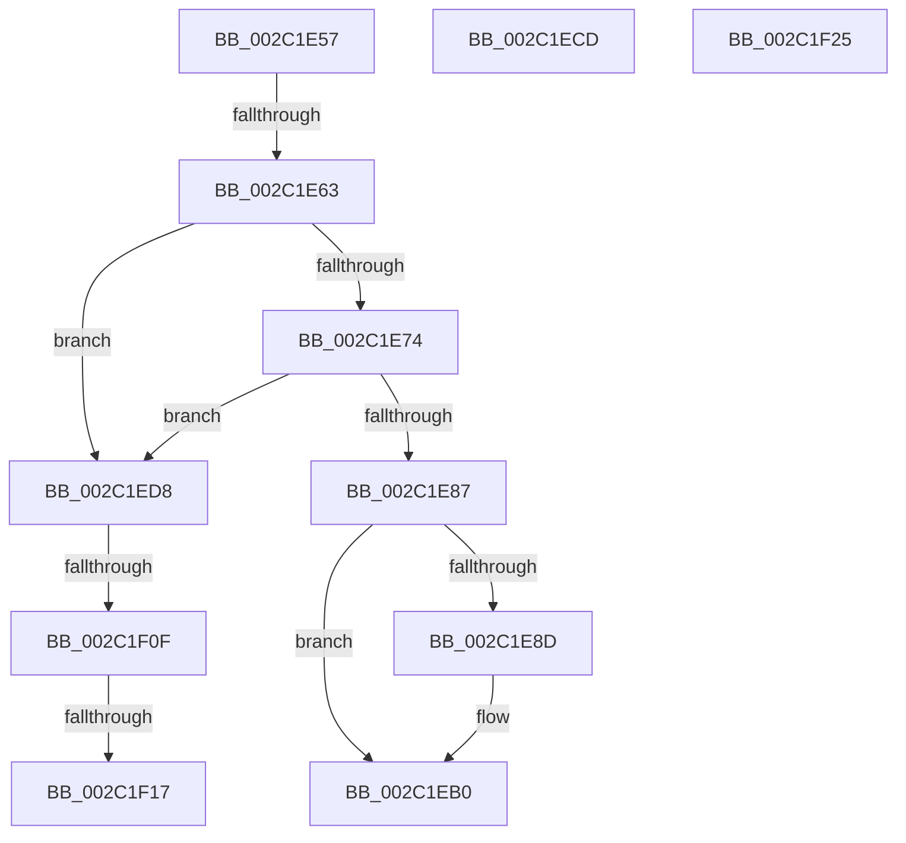

# sub_002C1E57

- RVA: `0x002C1E57`–`0x002C1F30` (길이 `217` bytes)
- VA: `0x00000001402C1E57`
- 실행 섹션: `.text`
- PDB 이름 있음: `아니요`; PDB Function 태그: `아니요`
- unwind 정보 RVA: `0x0006E800`
- 디코드: `56`개 명령, `217/217` bytes 표시
- 미해석 바이트: `0` (있으면 어셈블리에 `.byte`로 보존)

> 이 문서는 커널 이미지의 기계어와 PDB 기호를 분석해 생성했습니다. 4번과 5번은 함수 원형과 자료형을 바이너리 사용 방식에서 추정한 C 해석이며 원본 소스 복구 결과는 아닙니다.

## 1. Dependencies

- 직접 호출 지점: **6**; 고유 호출 대상: **6**
- 직접 호출자로 확인된 함수: **0**
- RIP 상대 이미지 참조: **2**

### Outgoing calls
- `0x002C1E66` → [MiGetLeafVa](../27/MiGetLeafVa_function_0027C0A0.md) (function, `0x0027C0A0`)
- `0x002C1E8D` → [MiGetProcessorFlushList](../24/MiGetProcessorFlushList_function_00242C90.md) (function, `0x00242C90`)
- `0x002C1EAB` → [MiInitializeTbFlushList](../29/MiInitializeTbFlushList_function_00294F00.md) (function, `0x00294F00`)
- `0x002C1EBC` → [MiDecommitLargePoolVa](../37/MiDecommitLargePoolVa_function_00377DD4.md) (function, `0x00377DD4`)
- `0x002C1EED` → [KeBugCheckEx](../4F/KeBugCheckEx_function_004FD660.md) (function, `0x004FD660`)
- `0x002C1EF6` → [MiBadRefCount](../24/MiBadRefCount_function_00246E08.md) (function, `0x00246E08`)

### Direct callers
- 이 함수 시작 RVA로 연결되는 직접 call은 확인되지 않았습니다. 간접 호출은 완전히 역산할 수 없습니다.

### Static image references
- `0x002C1E95` → RVA `0x00E38480` (`.data`; read)
- `0x002C1EFC` → RVA `0x00E2DC80` (`.data`; read)

## 2. Other-region calls and transfers

- 다른 실행 섹션으로 향하는 call: **0**
- call이 아닌 외부 분기/꼬리 이동: **7**
  - `0x002C1E5D` → [MiDeleteNonPagedPoolPte + 0x27](MiDeleteNonPagedPoolPte_function_002C1A90.md) (`tail-transfer`)
  - `0x002C1EC8` → [MiDeleteNonPagedPoolPte + 0x27](MiDeleteNonPagedPoolPte_function_002C1A90.md) (`tail-transfer`)
  - `0x002C1ED3` → [sub_002C1D11 + 0x92](Unknown_function_002C1D11.md) (`tail-transfer`)
  - `0x002C1F09` → [sub_002C1B88 + 0x97](Unknown_function_002C1B88.md) (`tail-transfer`)
  - `0x002C1F11` → [sub_006DC218](../6D/Unknown_function_006DC218.md) (`tail-transfer`)
  - `0x002C1F20` → [sub_002C1B88 + 0x97](Unknown_function_002C1B88.md) (`tail-transfer`)
  - `0x002C1F2B` → [sub_002C1B88 + 0x14C](Unknown_function_002C1B88.md) (`tail-transfer`)

## 3. Assembly (complete function range)

```asm
002C1E57  8B 47 3C                        mov eax, dword ptr [rdi + 0x3c]
002C1E5A  41 84 C7                        test r15b, al
002C1E5D  0F 84 54 FC FF FF               je 0x1402c1ab7
002C1E63  49 8B CE                        mov rcx, r14
002C1E66  E8 35 A2 FB FF                  call 0x14027c0a0
002C1E6B  48 8B F0                        mov rsi, rax
002C1E6E  49 3B 42 28                     cmp rax, qword ptr [r10 + 0x28]
002C1E72  72 64                           jb 0x1402c1ed8
002C1E74  48 8B CB                        mov rcx, rbx
002C1E77  48 C1 E1 0C                     shl rcx, 0xc
002C1E7B  48 FF C9                        dec rcx
002C1E7E  48 03 C8                        add rcx, rax
002C1E81  49 3B 4A 30                     cmp rcx, qword ptr [r10 + 0x30]
002C1E85  77 51                           ja 0x1402c1ed8
002C1E87  48 83 3F 00                     cmp qword ptr [rdi], 0
002C1E8B  75 23                           jne 0x1402c1eb0
002C1E8D  E8 FE 0D F8 FF                  call 0x140242c90
002C1E92  48 89 07                        mov qword ptr [rdi], rax
002C1E95  48 8D 15 E4 65 B7 00            lea rdx, [rip + 0xb765e4]
002C1E9C  45 33 C9                        xor r9d, r9d
002C1E9F  44 89 7C 24 20                  mov dword ptr [rsp + 0x20], r15d
002C1EA4  48 8B C8                        mov rcx, rax
002C1EA7  44 8B 40 0C                     mov r8d, dword ptr [rax + 0xc]
002C1EAB  E8 50 30 FD FF                  call 0x140294f00
002C1EB0  4C 8B 0F                        mov r9, qword ptr [rdi]
002C1EB3  4C 8B C3                        mov r8, rbx
002C1EB6  49 8B D6                        mov rdx, r14
002C1EB9  48 8B CE                        mov rcx, rsi
002C1EBC  E8 13 5F 0B 00                  call 0x140377dd4
002C1EC1  81 47 44 00 02 00 00            add dword ptr [rdi + 0x44], 0x200
002C1EC8  E9 EA FB FF FF                  jmp 0x1402c1ab7
002C1ECD  83 4A 10 09                     or dword ptr [rdx + 0x10], 9
002C1ED1  8B CB                           mov ecx, ebx
002C1ED3  E9 CB FE FF FF                  jmp 0x1402c1da3
002C1ED8  4C 8B CE                        mov r9, rsi
002C1EDB  48 89 5C 24 20                  mov qword ptr [rsp + 0x20], rbx
002C1EE0  4D 8B C2                        mov r8, r10
002C1EE3  BA 06 53 00 00                  mov edx, 0x5306
002C1EE8  B9 1A 00 00 00                  mov ecx, 0x1a
002C1EED  E8 6E B7 23 00                  call 0x1404fd660
002C1EF2  CC                              int3
002C1EF3  48 8B CE                        mov rcx, rsi
002C1EF6  E8 0D 4F F8 FF                  call 0x140246e08
002C1EFB  CC                              int3
002C1EFC  48 8B 15 7D BD B6 00            mov rdx, qword ptr [rip + 0xb6bd7d]
002C1F03  48 8B D8                        mov rbx, rax
002C1F06  48 85 D2                        test rdx, rdx
002C1F09  0F 84 10 FD FF FF               je 0x1402c1c1f
002C1F0F  A8 10                           test al, 0x10
002C1F11  0F 85 01 A3 41 00               jne 0x1406dc218
002C1F17  48 8B DA                        mov rbx, rdx
002C1F1A  48 F7 D3                        not rbx
002C1F1D  48 23 D8                        and rbx, rax
002C1F20  E9 FA FC FF FF                  jmp 0x1402c1c1f
002C1F25  41 BB 01 00 00 00               mov r11d, 1
002C1F2B  E9 A4 FD FF FF                  jmp 0x1402c1cd4
```

## 4. C-style interpretation (structured pseudocode)

```c
__int64 __fastcall sub_002C1E57(__int64 a1, __int64 a2, __int64 a3, int a4)
{
    __int64 result;
    __int64 v_rbx;
    unsigned int v_stack_p20;

    result = MiGetLeafVa(v_r14, a2, a3, a4);
    if (result < (*(unsigned __int64 *)(v_r10 + 40))) goto loc_002C1ED8;
    a1 = (v_rbx) << (12);
    a1 = (a1) - 1;
    a1 = (a1) + (result);
    if (a1 > (*(unsigned __int64 *)(v_r10 + 48))) goto loc_002C1ED8;
    if ((*(unsigned __int64 *)(v_rdi)) == 0) {
        result = MiGetProcessorFlushList(a1, a2, a3, a4);
        *(unsigned __int64 *)(v_rdi) = result;
        a2 = v_rip + 12019172;
        a4 = 0;
        v_stack_p20 = (unsigned int)(v_r15);
        a1 = result;
        a3 = *(unsigned int *)(result + 12);
        result = MiInitializeTbFlushList(a1, a2, a3, a4);
    }
    result = MiDecommitLargePoolVa(result, v_r14, v_rbx, *(unsigned __int64 *)(v_rdi));
loc_002C1ED8:
    v_stack_p20 = v_rbx;
    result = KeBugCheckEx(26, (unsigned int)(0x5306ULL), v_r10, result);
    result = MiBadRefCount(result, (unsigned int)(0x5306ULL), v_r10, result);
    v_rbx = ~(*(unsigned __int64 *)(v_rip + 11976061));
    v_rbx = (v_rbx) & (result);
}
```

## 5. (Beta) C Style

```c
int64_t sub_002C1E57(int64_t Arg1, int64_t Arg2, int64_t Arg3, int32_t Arg4)
{
    int64_t result;
    int64_t local_rbx;
    uint32_t v_stack_p20;

    result = MiGetLeafVa(local_r14, Arg2, Arg3, Arg4);
    if (result < (*(uint64_t *)(local_r10 + 0x28))) goto loc_002C1ED8;
    Arg1 = (local_rbx) << (12);
    Arg1 = (Arg1) - 1;
    Arg1 = (Arg1) + (result);
    if (Arg1 > (*(uint64_t *)(local_r10 + 0x30))) goto loc_002C1ED8;
    if ((*(uint64_t *)(local_rdi)) == 0) {
        result = MiGetProcessorFlushList(Arg1, Arg2, Arg3, Arg4);
        *(uint64_t *)(local_rdi) = result;
        Arg2 = v_rip + 12019172;
        Arg4 = 0;
        v_stack_p20 = (uint32_t)(local_r15);
        Arg1 = result;
        Arg3 = *(uint32_t *)(result + 0xC);
        result = MiInitializeTbFlushList(Arg1, Arg2, Arg3, Arg4);
    }
    result = MiDecommitLargePoolVa(result, local_r14, local_rbx, *(uint64_t *)(local_rdi));
loc_002C1ED8:
    v_stack_p20 = local_rbx;
    result = KeBugCheckEx(26, (uint32_t)(0x5306ULL), local_r10, result);
    result = MiBadRefCount(result, (uint32_t)(0x5306ULL), local_r10, result);
    local_rbx = ~(*(uint64_t *)(v_rip + 0xB6BD7D));
    local_rbx = (local_rbx) & (result);
}
```

## 6. Execution-region graph

[열기: 2D/3D 그래프와 함수 탐색 컨트롤 패널](../../../control-panel.html?section=text&rva=0x002C1E57&view=graph)

- 2D 그래프는 위에서 아래로 흐르고, 3D 그래프는 빈 공간을 드래그해 회전합니다. Shift+드래그는 이동, 휠은 확대·축소, 함수 노드 선택은 대상 보고서 이동입니다.

### Static fallback


