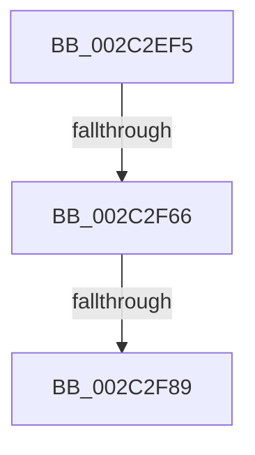

# sub_002C2EF5

- RVA: `0x002C2EF5`–`0x002C2FAE` (길이 `185` bytes)
- VA: `0x00000001402C2EF5`
- 실행 섹션: `.text`
- PDB 이름 있음: `아니요`; PDB Function 태그: `아니요`
- unwind 정보 RVA: `0x0006E940`
- 디코드: `38`개 명령, `185/185` bytes 표시
- 미해석 바이트: `0` (있으면 어셈블리에 `.byte`로 보존)

> 이 문서는 커널 이미지의 기계어와 PDB 기호를 분석해 생성했습니다. 4번과 5번은 함수 원형과 자료형을 바이너리 사용 방식에서 추정한 C 해석이며 원본 소스 복구 결과는 아닙니다.

## 1. Dependencies

- 직접 호출 지점: **2**; 고유 호출 대상: **2**
- 직접 호출자로 확인된 함수: **0**
- RIP 상대 이미지 참조: **0**

### Outgoing calls
- `0x002C2F1B` → [memset](../6C/memset_function_006C6C40.md) (function, `0x006C6C40`)
- `0x002C2F71` → [MiGetLeafVa](../27/MiGetLeafVa_function_0027C0A0.md) (function, `0x0027C0A0`)

### Direct callers
- 이 함수 시작 RVA로 연결되는 직접 call은 확인되지 않았습니다. 간접 호출은 완전히 역산할 수 없습니다.

### Static image references
- 디코드된 RIP-relative 메모리 참조가 없습니다.

## 2. Other-region calls and transfers

- 다른 실행 섹션으로 향하는 call: **0**
- call이 아닌 외부 분기/꼬리 이동: **3**
  - `0x002C2F60` → [sub_002C3091](Unknown_function_002C3091.md) (`tail-transfer`)
  - `0x002C2F83` → [sub_002C3069](Unknown_function_002C3069.md) (`tail-transfer`)
  - `0x002C2FAC` → [sub_002C2FAE + 0x59](Unknown_function_002C2FAE.md) (`tail-transfer`)

## 3. Assembly (complete function range)

```asm
002C2EF5  48 89 B4 24 18 01 00 00         mov qword ptr [rsp + 0x118], rsi
002C2EFD  48 8B EA                        mov rbp, rdx
002C2F00  48 8B F9                        mov rdi, rcx
002C2F03  0F 57 C0                        xorps xmm0, xmm0
002C2F06  48 8D 4C 24 30                  lea rcx, [rsp + 0x30]
002C2F0B  33 D2                           xor edx, edx
002C2F0D  41 B8 C0 00 00 00               mov r8d, 0xc0
002C2F13  0F 11 44 24 20                  movups xmmword ptr [rsp + 0x20], xmm0
002C2F18  41 8B F1                        mov esi, r9d
002C2F1B  E8 20 3D 40 00                  call 0x1406c6c40
002C2F20  49 BF 00 00 00 00 80 F6 FF FF   movabs r15, 0xfffff68000000000
002C2F2A  49 8B C7                        mov rax, r15
002C2F2D  48 C1 E0 19                     shl rax, 0x19
002C2F31  B9 E1 20 00 00                  mov ecx, 0x20e1
002C2F36  48 C1 E7 19                     shl rdi, 0x19
002C2F3A  48 2B F8                        sub rdi, rax
002C2F3D  48 C1 E5 19                     shl rbp, 0x19
002C2F41  48 2B E8                        sub rbp, rax
002C2F44  48 C1 FF 10                     sar rdi, 0x10
002C2F48  48 C1 FD 10                     sar rbp, 0x10
002C2F4C  B8 61 20 00 00                  mov eax, 0x2061
002C2F51  40 F6 C6 01                     test sil, 1
002C2F55  0F 45 C1                        cmovne eax, ecx
002C2F58  89 44 24 30                     mov dword ptr [rsp + 0x30], eax
002C2F5C  40 F6 C6 02                     test sil, 2
002C2F60  0F 85 2B 01 00 00               jne 0x1402c3091
002C2F66  48 8B CF                        mov rcx, rdi
002C2F69  48 89 9C 24 10 01 00 00         mov qword ptr [rsp + 0x110], rbx
002C2F71  E8 2A 91 FB FF                  call 0x14027c0a0
002C2F76  48 B9 00 00 00 00 00 80 FF FF   movabs rcx, 0xffff800000000000
002C2F80  48 3B C1                        cmp rax, rcx
002C2F83  0F 83 E0 00 00 00               jae 0x1402c3069
002C2F89  65 48 8B 1C 25 88 01 00 00      mov rbx, qword ptr gs:[0x188]
002C2F92  48 8B 9B B8 00 00 00            mov rbx, qword ptr [rbx + 0xb8]
002C2F99  48 81 C3 00 04 00 00            add rbx, 0x400
002C2FA0  40 F6 C6 04                     test sil, 4
002C2FA4  48 8B B4 24 18 01 00 00         mov rsi, qword ptr [rsp + 0x118]
002C2FAC  75 59                           jne 0x1402c3007
```

## 4. C-style interpretation (structured pseudocode)

```c
__int64 __fastcall sub_002C2EF5(__int64 a1, __int64 a2, __int64 a3, int a4, __int64 a5, __int64 a6, __int64 a7, __int64 a8, __int64 a9, __int64 a10, __int64 a11, __int64 a12, __int64 a13, __int64 a14, __int64 a15, __int64 a16, __int64 a17, __int64 a18, __int64 a19, __int64 a20, __int64 a21, __int64 a22, __int64 a23, __int64 a24, __int64 a25, __int64 a26, __int64 a27, __int64 a28, __int64 a29, __int64 a30, __int64 a31, __int64 a32, __int64 a33, __int64 a34, __int64 a35)
{
    __int64 result;
    __int64 v_rbp;
    __int64 v_rbx;
    __int64 v_rdi;
    unsigned __int64 v_stack_p110;
    unsigned __int64 v_stack_p118;
    unsigned __int64 v_stack_p20;
    unsigned int v_stack_p30;

    v_stack_p118 = v_rsi;
    a2 = 0;
    v_stack_p20 = v_xmm0;
    result = memset(a6, a2, 192, a4);
    result = (v_r15) << (25);
    v_rdi = (a1) << (25);
    v_rdi = (v_rdi) - (result);
    v_rbp = (a2) << (25);
    v_rbp = (v_rbp) - (result);
    v_rdi = (v_rdi) >> (16);
    v_rbp = (v_rbp) >> (16);
    result = (unsigned int)(0x2061ULL);
    if ((((unsigned __int8)((unsigned int)(a4))) & (1)) != 0) { result = (unsigned int)((unsigned int)(0x20E1ULL)); }
    v_stack_p30 = (unsigned int)(result);
    v_stack_p110 = v_rbx;
    result = MiGetLeafVa(v_rdi, a2, 192, a4);
    v_rbx = (*(unsigned __int64 *)(*(unsigned __int64 *)(gs_base + (0 + 392)) + 184)) + (0x400ULL);
}
```

## 5. (Beta) C Style

```c
int64_t sub_002C2EF5(int64_t Arg1, int64_t Arg2, int64_t Arg3, int32_t Arg4, uint64_t Arg5, int64_t Arg6, uint64_t Arg7, uint64_t Arg8, uint64_t Arg9, uint64_t Arg10, uint64_t Arg11, uint64_t Arg12, uint64_t Arg13, uint64_t Arg14, uint64_t Arg15, uint64_t Arg16, uint64_t Arg17, uint64_t Arg18, uint64_t Arg19, uint64_t Arg20, uint64_t Arg21, uint64_t Arg22, uint64_t Arg23, uint64_t Arg24, uint64_t Arg25, uint64_t Arg26, uint64_t Arg27, uint64_t Arg28, uint64_t Arg29, uint64_t Arg30, uint64_t Arg31, uint64_t Arg32, uint64_t Arg33, uint64_t Arg34, int64_t Arg35)
{
    int64_t result;
    int64_t local_rbp;
    int64_t local_rbx;
    int64_t local_rdi;
    uint64_t v_stack_p110;
    uint64_t v_stack_p118;
    uint64_t v_stack_p20;
    uint32_t v_stack_p30;

    v_stack_p118 = local_rsi;
    Arg2 = 0;
    v_stack_p20 = v_xmm0;
    result = memset(Arg6, Arg2, 192, Arg4);
    result = (local_r15) << (25);
    local_rdi = (Arg1) << (25);
    local_rdi = (local_rdi) - (result);
    local_rbp = (Arg2) << (25);
    local_rbp = (local_rbp) - (result);
    local_rdi = (local_rdi) >> (16);
    local_rbp = (local_rbp) >> (16);
    result = (uint32_t)(0x2061ULL);
    if ((((uint8_t)((uint32_t)(Arg4))) & (1)) != 0) { result = (uint32_t)((uint32_t)(0x20E1ULL)); }
    v_stack_p30 = (uint32_t)(result);
    v_stack_p110 = local_rbx;
    result = MiGetLeafVa(local_rdi, Arg2, 192, Arg4);
    local_rbx = (*(uint64_t *)(*(uint64_t *)(gs_base + (0 + 0x188)) + 0xB8)) + (0x400ULL);
}
```

## 6. Execution-region graph

[열기: 2D/3D 그래프와 함수 탐색 컨트롤 패널](../../../control-panel.html?section=text&rva=0x002C2EF5&view=graph)

- 2D 그래프는 위에서 아래로 흐르고, 3D 그래프는 빈 공간을 드래그해 회전합니다. Shift+드래그는 이동, 휠은 확대·축소, 함수 노드 선택은 대상 보고서 이동입니다.

### Static fallback


