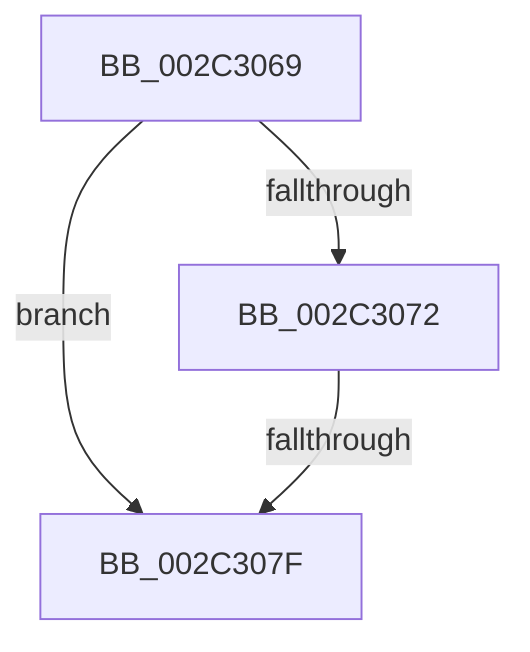

# sub_002C3069

- RVA: `0x002C3069`–`0x002C3091` (길이 `40` bytes)
- VA: `0x00000001402C3069`
- 실행 섹션: `.text`
- PDB 이름 있음: `아니요`; PDB Function 태그: `아니요`
- unwind 정보 RVA: `0x0006E970`
- 디코드: `8`개 명령, `40/40` bytes 표시
- 미해석 바이트: `0` (있으면 어셈블리에 `.byte`로 보존)

> 이 문서는 커널 이미지의 기계어와 PDB 기호를 분석해 생성했습니다. 4번과 5번은 함수 원형과 자료형을 바이너리 사용 방식에서 추정한 C 해석이며 원본 소스 복구 결과는 아닙니다.

## 1. Dependencies

- 직접 호출 지점: **1**; 고유 호출 대상: **1**
- 직접 호출자로 확인된 함수: **0**
- RIP 상대 이미지 참조: **2**

### Outgoing calls
- `0x002C3084` → [MiGetAnyMultiplexedVm](../44/MiGetAnyMultiplexedVm_function_00448BD0.md) (function, `0x00448BD0`)

### Direct callers
- 이 함수 시작 RVA로 연결되는 직접 call은 확인되지 않았습니다. 간접 호출은 완전히 역산할 수 없습니다.

### Static image references
- `0x002C3069` → RVA `0x00E2F380` (`.data`; read)
- `0x002C3072` → RVA `0x00E2F390` (`.data`; read)

## 2. Other-region calls and transfers

- 다른 실행 섹션으로 향하는 call: **0**
- call이 아닌 외부 분기/꼬리 이동: **2**
  - `0x002C3079` → [sub_002C2EF5 + 0x94](Unknown_function_002C2EF5.md) (`tail-transfer`)
  - `0x002C308C` → [sub_002C2EF5 + 0xAB](Unknown_function_002C2EF5.md) (`tail-transfer`)

## 3. Assembly (complete function range)

```asm
002C3069  48 3B 05 10 C3 B6 00            cmp rax, qword ptr [rip + 0xb6c310]
002C3070  72 0D                           jb 0x1402c307f
002C3072  48 3B 05 17 C3 B6 00            cmp rax, qword ptr [rip + 0xb6c317]
002C3079  0F 86 0A FF FF FF               jbe 0x1402c2f89
002C307F  B9 02 00 00 00                  mov ecx, 2
002C3084  E8 47 5B 18 00                  call 0x140448bd0
002C3089  48 8B D8                        mov rbx, rax
002C308C  E9 0F FF FF FF                  jmp 0x1402c2fa0
```

## 4. C-style interpretation (structured pseudocode)

```c
__int64 __fastcall sub_002C3069(void)
{
    __int64 result;

    if (result < (*(unsigned __int64 *)(v_rip + 11977488))) goto loc_002C307F;
loc_002C307F:
    result = MiGetAnyMultiplexedVm(2, a2, a3, a4);
}
```

## 5. (Beta) C Style

```c
void sub_002C3069(void)
{
    int64_t result;

    if (result < (*(uint64_t *)(v_rip + 0xB6C310))) goto loc_002C307F;
loc_002C307F:
    result = MiGetAnyMultiplexedVm(2, a2, a3, a4);
}
```

## 6. Execution-region graph

[열기: 2D/3D 그래프와 함수 탐색 컨트롤 패널](../../../control-panel.html?section=text&rva=0x002C3069&view=graph)

- 2D 그래프는 위에서 아래로 흐르고, 3D 그래프는 빈 공간을 드래그해 회전합니다. Shift+드래그는 이동, 휠은 확대·축소, 함수 노드 선택은 대상 보고서 이동입니다.

### Static fallback


