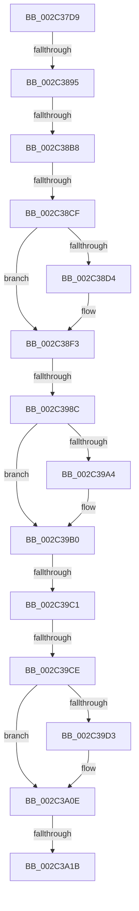

# sub_002C37D9

- RVA: `0x002C37D9`–`0x002C3A4B` (길이 `626` bytes)
- VA: `0x00000001402C37D9`
- 실행 섹션: `.text`
- PDB 이름 있음: `아니요`; PDB Function 태그: `아니요`
- unwind 정보 RVA: `0x0006EA0C`
- 디코드: `146`개 명령, `626/626` bytes 표시
- 미해석 바이트: `0` (있으면 어셈블리에 `.byte`로 보존)

> 이 문서는 커널 이미지의 기계어와 PDB 기호를 분석해 생성했습니다. 4번과 5번은 함수 원형과 자료형을 바이너리 사용 방식에서 추정한 C 해석이며 원본 소스 복구 결과는 아닙니다.

## 1. Dependencies

- 직접 호출 지점: **7**; 고유 호출 대상: **7**
- 직접 호출자로 확인된 함수: **0**
- RIP 상대 이미지 참조: **2**

### Outgoing calls
- `0x002C38C2` → [MiVadPureReserve](MiVadPureReserve_function_002C34C0.md) (function, `0x002C34C0`)
- `0x002C3914` → [MiLockWorkingSetShared](../27/MiLockWorkingSetShared_function_0027CBF0.md) (function, `0x0027CBF0`)
- `0x002C3959` → [MiQueryAddressState](../32/MiQueryAddressState_function_0032C380.md) (function, `0x0032C380`)
- `0x002C3992` → [MiUnlockWorkingSetShared](../27/MiUnlockWorkingSetShared_function_0027D690.md) (function, `0x0027D690`)
- `0x002C39AB` → [UNLOCK_PAGE_TABLE_COMMITMENT](../2E/UNLOCK_PAGE_TABLE_COMMITMENT_function_002E27D0.md) (function, `0x002E27D0`)
- `0x002C39FE` → [MiReturnCommit](../24/MiReturnCommit_function_00248410.md) (function, `0x00248410`)
- `0x002C3A09` → [MiReturnFullProcessCharges](MiReturnFullProcessCharges_function_002C2E70.md) (function, `0x002C2E70`)

### Direct callers
- 이 함수 시작 RVA로 연결되는 직접 call은 확인되지 않았습니다. 간접 호출은 완전히 역산할 수 없습니다.

### Static image references
- `0x002C38A3` → RVA `0x00E30088` (`.data`; read)
- `0x002C3962` → RVA `0x00014630` (`.rdata`; read)

## 2. Other-region calls and transfers

- 다른 실행 섹션으로 향하는 call: **0**
- call이 아닌 외부 분기/꼬리 이동: **7**
  - `0x002C388F` → [sub_002C3A7C + 0x7DF](Unknown_function_002C3A7C.md) (`tail-transfer`)
  - `0x002C38B2` → [sub_002C3A7C](Unknown_function_002C3A7C.md) (`tail-transfer`)
  - `0x002C38C9` → [sub_002C3A7C + 0x5B](Unknown_function_002C3A7C.md) (`tail-transfer`)
  - `0x002C3986` → [sub_002C3A7C + 0xAF](Unknown_function_002C3A7C.md) (`tail-transfer`)
  - `0x002C39BB` → [sub_002C3A7C + 0xAF7](Unknown_function_002C3A7C.md) (`tail-transfer`)
  - `0x002C39C8` → [sub_002C3A7C + 0x5D0](Unknown_function_002C3A7C.md) (`tail-transfer`)
  - `0x002C3A15` → [sub_002C3A7C + 0x649](Unknown_function_002C3A7C.md) (`tail-transfer`)

## 3. Assembly (complete function range)

```asm
002C37D9  48 89 9C 24 90 01 00 00         mov qword ptr [rsp + 0x190], rbx
002C37E1  8B D0                           mov edx, eax
002C37E3  83 E2 FE                        and edx, 0xfffffffe
002C37E6  48 89 BC 24 50 01 00 00         mov qword ptr [rsp + 0x150], rdi
002C37EE  8B C8                           mov ecx, eax
002C37F0  4C 89 A4 24 48 01 00 00         mov qword ptr [rsp + 0x148], r12
002C37F8  4C 89 B4 24 40 01 00 00         mov qword ptr [rsp + 0x140], r14
002C3800  83 E1 05                        and ecx, 5
002C3803  83 F9 05                        cmp ecx, 5
002C3806  4C 89 4D B0                     mov qword ptr [rbp - 0x50], r9
002C380A  4C 8B F6                        mov r14, rsi
002C380D  4C 89 4D E8                     mov qword ptr [rbp - 0x18], r9
002C3811  0F 45 D0                        cmovne edx, eax
002C3814  4C 89 4C 24 60                  mov qword ptr [rsp + 0x60], r9
002C3819  49 C1 EE 09                     shr r14, 9
002C381D  49 BA F8 FF FF FF 7F 00 00 00   movabs r10, 0x7ffffffff8
002C3827  89 54 24 74                     mov dword ptr [rsp + 0x74], edx
002C382B  4D 23 F2                        and r14, r10
002C382E  48 BA 00 00 00 00 80 F6 FF FF   movabs rdx, 0xfffff68000000000
002C3838  49 8B F9                        mov rdi, r9
002C383B  4C 89 4D 90                     mov qword ptr [rbp - 0x70], r9
002C383F  89 4C 24 58                     mov dword ptr [rsp + 0x58], ecx
002C3843  48 8B C2                        mov rax, rdx
002C3846  49 8B DF                        mov rbx, r15
002C3849  4C 03 F0                        add r14, rax
002C384C  48 C1 EB 09                     shr rbx, 9
002C3850  49 23 DA                        and rbx, r10
002C3853  4C 89 75 D8                     mov qword ptr [rbp - 0x28], r14
002C3857  48 8B C2                        mov rax, rdx
002C385A  48 03 D8                        add rbx, rax
002C385D  44 89 4D A4                     mov dword ptr [rbp - 0x5c], r9d
002C3861  65 48 8B 04 25 88 01 00 00      mov rax, qword ptr gs:[0x188]
002C386A  4D 8D A0 00 04 00 00            lea r12, [r8 + 0x400]
002C3871  48 89 45 E0                     mov qword ptr [rbp - 0x20], rax
002C3875  49 8B 80 10 04 00 00            mov rax, qword ptr [r8 + 0x410]
002C387C  48 89 5D A8                     mov qword ptr [rbp - 0x58], rbx
002C3880  4C 89 4D 80                     mov qword ptr [rbp - 0x80], r9
002C3884  4C 89 65 98                     mov qword ptr [rbp - 0x68], r12
002C3888  4C 39 88 28 04 00 00            cmp qword ptr [rax + 0x428], r9
002C388F  0F 85 C6 09 00 00               jne 0x1402c425b
002C3895  83 7C 24 58 05                  cmp dword ptr [rsp + 0x58], 5
002C389A  41 0F B7 8C 24 AE 00 00 00      movzx ecx, word ptr [r12 + 0xae]
002C38A3  48 8B 05 DE C7 B6 00            mov rax, qword ptr [rip + 0xb6c7de]
002C38AA  4C 8B 24 C8                     mov r12, qword ptr [rax + rcx*8]
002C38AE  4C 89 65 C0                     mov qword ptr [rbp - 0x40], r12
002C38B2  0F 84 C4 01 00 00               je 0x1402c3a7c
002C38B8  4C 8B A5 80 00 00 00            mov r12, qword ptr [rbp + 0x80]
002C38BF  49 8B CD                        mov rcx, r13
002C38C2  E8 F9 FB FF FF                  call 0x1402c34c0
002C38C7  85 C0                           test eax, eax
002C38C9  0F 85 08 02 00 00               jne 0x1402c3ad7
002C38CF  48 85 FF                        test rdi, rdi
002C38D2  74 1F                           je 0x1402c38f3
002C38D4  41 8B 55 34                     mov edx, dword ptr [r13 + 0x34]
002C38D8  41 0F B6 45 22                  movzx eax, byte ptr [r13 + 0x22]
002C38DD  48 C1 E0 20                     shl rax, 0x20
002C38E1  48 0B C2                        or rax, rdx
002C38E4  48 03 C7                        add rax, rdi
002C38E7  41 89 45 34                     mov dword ptr [r13 + 0x34], eax
002C38EB  48 C1 E8 20                     shr rax, 0x20
002C38EF  41 88 45 22                     mov byte ptr [r13 + 0x22], al
002C38F3  48 8B 7D 98                     mov rdi, qword ptr [rbp - 0x68]
002C38F7  33 C0                           xor eax, eax
002C38F9  48 8B CF                        mov rcx, rdi
002C38FC  C7 44 24 70 01 00 00 00         mov dword ptr [rsp + 0x70], 1
002C3904  44 8B F8                        mov r15d, eax
002C3907  48 89 44 24 78                  mov qword ptr [rsp + 0x78], rax
002C390C  44 8B E0                        mov r12d, eax
002C390F  48 89 44 24 68                  mov qword ptr [rsp + 0x68], rax
002C3914  E8 D7 92 FB FF                  call 0x14027cbf0
002C3919  0F B6 D8                        movzx ebx, al
002C391C  88 44 24 50                     mov byte ptr [rsp + 0x50], al
002C3920  48 8D 45 08                     lea rax, [rbp + 8]
002C3924  4D 8B CD                        mov r9, r13
002C3927  48 89 44 24 40                  mov qword ptr [rsp + 0x40], rax
002C392C  44 0F B6 C3                     movzx r8d, bl
002C3930  48 8D 45 88                     lea rax, [rbp - 0x78]
002C3934  48 8B D6                        mov rdx, rsi
002C3937  48 89 44 24 38                  mov qword ptr [rsp + 0x38], rax
002C393C  48 8B CE                        mov rcx, rsi
002C393F  48 8D 45 C8                     lea rax, [rbp - 0x38]
002C3943  48 89 44 24 30                  mov qword ptr [rsp + 0x30], rax
002C3948  48 8D 44 24 54                  lea rax, [rsp + 0x54]
002C394D  48 89 44 24 28                  mov qword ptr [rsp + 0x28], rax
002C3952  33 C0                           xor eax, eax
002C3954  48 89 44 24 20                  mov qword ptr [rsp + 0x20], rax
002C3959  E8 22 8A 06 00                  call 0x14032c380
002C395E  8B 44 24 54                     mov eax, dword ptr [rsp + 0x54]
002C3962  48 8D 0D C7 0C D5 FF            lea rcx, [rip - 0x2af339]
002C3969  8B 0C 81                        mov ecx, dword ptr [rcx + rax*4]
002C396C  48 8B 85 B0 00 00 00            mov rax, qword ptr [rbp + 0xb0]
002C3973  89 08                           mov dword ptr [rax], ecx
002C3975  41 8B 75 30                     mov esi, dword ptr [r13 + 0x30]
002C3979  C1 EE 0C                        shr esi, 0xc
002C397C  83 E6 7F                        and esi, 0x7f
002C397F  89 75 D0                        mov dword ptr [rbp - 0x30], esi
002C3982  4C 3B 75 A8                     cmp r14, qword ptr [rbp - 0x58]
002C3986  0F 86 9F 01 00 00               jbe 0x1402c3b2b
002C398C  0F B6 D3                        movzx edx, bl
002C398F  48 8B CF                        mov rcx, rdi
002C3992  E8 F9 9C FB FF                  call 0x14027d690
002C3997  83 7D A4 00                     cmp dword ptr [rbp - 0x5c], 0
002C399B  48 8B 9D 80 00 00 00            mov rbx, qword ptr [rbp + 0x80]
002C39A2  74 0C                           je 0x1402c39b0
002C39A4  48 8B 4D E0                     mov rcx, qword ptr [rbp - 0x20]
002C39A8  48 8B D3                        mov rdx, rbx
002C39AB  E8 20 EE 01 00                  call 0x1402e27d0
002C39B0  48 8B 7D E8                     mov rdi, qword ptr [rbp - 0x18]
002C39B4  48 8B 55 B0                     mov rdx, qword ptr [rbp - 0x50]
002C39B8  48 85 FF                        test rdi, rdi
002C39BB  0F 85 B2 0B 00 00               jne 0x1402c4573
002C39C1  48 8B 75 C0                     mov rsi, qword ptr [rbp - 0x40]
002C39C5  48 85 D2                        test rdx, rdx
002C39C8  0F 85 7E 06 00 00               jne 0x1402c404c
002C39CE  4D 85 FF                        test r15, r15
002C39D1  74 3B                           je 0x1402c3a0e
002C39D3  41 8B 4D 34                     mov ecx, dword ptr [r13 + 0x34]
002C39D7  49 8B D7                        mov rdx, r15
002C39DA  45 0F B6 45 22                  movzx r8d, byte ptr [r13 + 0x22]
002C39DF  48 2B D7                        sub rdx, rdi
002C39E2  49 C1 E0 20                     shl r8, 0x20
002C39E6  4C 0B C1                        or r8, rcx
002C39E9  48 8B CE                        mov rcx, rsi
002C39EC  4D 2B C7                        sub r8, r15
002C39EF  45 89 45 34                     mov dword ptr [r13 + 0x34], r8d
002C39F3  49 C1 E8 20                     shr r8, 0x20
002C39F7  45 88 45 22                     mov byte ptr [r13 + 0x22], r8b
002C39FB  45 33 C0                        xor r8d, r8d
002C39FE  E8 0D 4A F8 FF                  call 0x140248410
002C3A03  49 8B D7                        mov rdx, r15
002C3A06  48 8B CB                        mov rcx, rbx
002C3A09  E8 62 F4 FF FF                  call 0x1402c2e70
002C3A0E  48 8B 55 80                     mov rdx, qword ptr [rbp - 0x80]
002C3A12  48 85 D2                        test rdx, rdx
002C3A15  0F 85 AA 06 00 00               jne 0x1402c40c5
002C3A1B  33 C0                           xor eax, eax
002C3A1D  4C 8B A4 24 48 01 00 00         mov r12, qword ptr [rsp + 0x148]
002C3A25  48 8B BC 24 50 01 00 00         mov rdi, qword ptr [rsp + 0x150]
002C3A2D  48 8B 9C 24 90 01 00 00         mov rbx, qword ptr [rsp + 0x190]
002C3A35  4C 8B B4 24 40 01 00 00         mov r14, qword ptr [rsp + 0x140]
002C3A3D  48 81 C4 58 01 00 00            add rsp, 0x158
002C3A44  41 5F                           pop r15
002C3A46  41 5D                           pop r13
002C3A48  5E                              pop rsi
002C3A49  5D                              pop rbp
002C3A4A  C3                              ret
```

## 4. C-style interpretation (structured pseudocode)

```c
__int64 __fastcall sub_002C37D9(__int64 a1, __int64 a2, __int64 a3, __int64 a4, __int64 a5, __int64 a6, __int64 a7, __int64 a8, __int64 a9, __int64 a10, unsigned int a11, __int64 a12, __int64 a13, __int64 a14, __int64 a15, __int64 a16, __int64 a17, __int64 a18, __int64 a19, __int64 a20, __int64 a21, __int64 a22, __int64 a23, __int64 a24, __int64 a25, __int64 a26, __int64 a27, __int64 a28, __int64 a29, __int64 a30, __int64 a31, __int64 a32, __int64 a33, __int64 a34, __int64 a35, __int64 a36, __int64 a37, __int64 a38, __int64 a39, __int64 a40, __int64 a41, __int64 a42, __int64 a43, __int64 a44, __int64 a45, __int64 a46, __int64 a47, __int64 a48, __int64 a49, __int64 a50)
{
    __int64 result;
    __int64 v_r14;
    __int64 v_rbx;
    __int64 v_rsi;
    __int64 v_rsp;
    unsigned __int64 v_stack_p140;
    unsigned __int64 v_stack_p148;
    unsigned __int64 v_stack_p150;
    unsigned __int64 v_stack_p190;
    unsigned __int64 v_stack_p20;
    unsigned __int64 v_stack_p28;
    unsigned __int64 v_stack_p30;
    unsigned __int64 v_stack_p38;
    unsigned __int64 v_stack_p40;
    unsigned __int8 v_stack_p50;
    unsigned __int64 v_stack_p54;
    unsigned int v_stack_p58;
    unsigned __int64 v_stack_p60;
    unsigned __int64 v_stack_p68;
    unsigned int v_stack_p70;
    unsigned int v_stack_p74;
    unsigned __int64 v_stack_p78;

    v_stack_p190 = v_rbx;
    a2 = (unsigned int)(((unsigned int)((unsigned int)(result))) & (0xFFFFFFFEULL));
    v_stack_p150 = v_rdi;
    v_stack_p148 = v_r12;
    v_stack_p140 = v_r14;
    a1 = (unsigned int)(((unsigned int)((unsigned int)(result))) & (5));
    *(unsigned __int64 *)(v_rbp - 80) = a4;
    *(unsigned __int64 *)(v_rbp - 24) = a4;
    if (((unsigned int)(a1)) != 5) { a2 = (unsigned int)(result); }
    v_stack_p60 = a4;
    v_r14 = (v_rsi) >> (9);
    v_stack_p74 = (unsigned int)(a2);
    v_r14 = (v_r14) & (v_r10);
    *(unsigned __int64 *)(v_rbp - 112) = a4;
    v_stack_p58 = (unsigned int)(a1);
    v_r14 = (v_r14) + (a2);
    v_rbx = (v_r15) >> (9);
    v_rbx = (v_rbx) & (v_r10);
    *(unsigned __int64 *)(v_rbp - 40) = v_r14;
    v_rbx = (v_rbx) + (a2);
    *(unsigned int *)(v_rbp - 92) = (unsigned int)(a4);
    *(unsigned __int64 *)(v_rbp - 32) = *(unsigned __int64 *)(gs_base + (0 + 392));
    *(unsigned __int64 *)(v_rbp - 88) = v_rbx;
    *(unsigned __int64 *)(v_rbp - 128) = a4;
    *(unsigned __int64 *)(v_rbp - 104) = a3 + 1024;
    *(unsigned __int64 *)(v_rbp - 64) = *(unsigned __int64 *)(*(unsigned __int64 *)(v_rip + 11978718) + *(unsigned __int16 *)(a3 + 1024 + 174) * 8);
    result = MiVadPureReserve(v_r13, a2, a3, a4);
    if (a4 != 0) {
        a2 = *(unsigned int *)(v_r13 + 52);
        result = *(unsigned __int8 *)(v_r13 + 34);
        result = (result) << (32);
        result = (result) | (a2);
        result = (result) + (a4);
        *(unsigned int *)(v_r13 + 52) = (unsigned int)(result);
        result = (result) >> (32);
        *(unsigned __int8 *)(v_r13 + 34) = (unsigned __int8)(result);
    }
    result = 0;
    v_stack_p70 = 1;
    v_stack_p78 = 0;
    v_stack_p68 = 0;
    result = MiLockWorkingSetShared(*(unsigned __int64 *)(v_rbp - 104), a2, a3, a4);
    v_stack_p50 = (unsigned __int8)(result);
    v_stack_p40 = v_rbp + 8;
    v_stack_p38 = v_rbp - 120;
    v_stack_p30 = v_rbp - 56;
    v_stack_p28 = v_stack_p54;
    result = 0;
    v_stack_p20 = 0;
    result = MiQueryAddressState(v_rsi, v_rsi, (unsigned __int8)((unsigned __int8)(result)), v_r13);
    *(unsigned int *)(*(unsigned __int64 *)(v_rbp + 176)) = (unsigned int)((unsigned int)(*(unsigned int *)(v_rip - 2814777 + (unsigned int)(v_stack_p54) * 4)));
    v_rsi = (unsigned int)(((unsigned int)(*(unsigned int *)(v_r13 + 48))) >> (12));
    v_rsi = (unsigned int)((v_rsi) & (127));
    *(unsigned int *)(v_rbp - 48) = (unsigned int)(v_rsi);
    result = MiUnlockWorkingSetShared(*(unsigned __int64 *)(v_rbp - 104), (unsigned __int8)((unsigned __int8)(result)), (unsigned __int8)((unsigned __int8)(result)), v_r13);
    if ((*(unsigned int *)(v_rbp - 92)) != 0) {
        a1 = *(unsigned __int64 *)(v_rbp - 32);
        a2 = *(unsigned __int64 *)(v_rbp + 128);
        result = UNLOCK_PAGE_TABLE_COMMITMENT(a1, a2, (unsigned __int8)((unsigned __int8)(result)), v_r13);
    }
    if (0 != 0) {
        a1 = *(unsigned int *)(v_r13 + 52);
        a2 = 0;
        a3 = *(unsigned __int8 *)(v_r13 + 34);
        a2 = (a2) - (*(unsigned __int64 *)(v_rbp - 24));
        a3 = (a3) << (32);
        a3 = (a3) | (a1);
        a1 = *(unsigned __int64 *)(v_rbp - 64);
        a3 = (a3) - (0);
        *(unsigned int *)(v_r13 + 52) = (unsigned int)(a3);
        a3 = (a3) >> (32);
        *(unsigned __int8 *)(v_r13 + 34) = (unsigned __int8)(a3);
        a3 = 0;
        result = MiReturnCommit(a1, a2, a3, v_r13);
        a2 = 0;
        a1 = *(unsigned __int64 *)(v_rbp + 128);
        result = MiReturnFullProcessCharges(a1, a2, a3, v_r13);
    }
    result = 0;
    v_rsp = (v_rsp) + (344);
    return result;
}
```

## 5. (Beta) C Style

```c
int64_t sub_002C37D9(int64_t Arg1, int64_t Arg2, void *Arg3, int64_t Arg4, uint64_t Arg5, uint64_t Arg6, uint64_t Arg7, uint64_t Arg8, uint64_t Arg9, uint64_t Arg10, uint32_t Arg11, uint64_t Arg12, uint64_t Arg13, uint64_t Arg14, uint64_t Arg15, uint64_t Arg16, uint64_t Arg17, uint64_t Arg18, uint64_t Arg19, uint64_t Arg20, uint64_t Arg21, uint64_t Arg22, uint64_t Arg23, uint64_t Arg24, uint64_t Arg25, uint64_t Arg26, uint64_t Arg27, uint64_t Arg28, uint64_t Arg29, uint64_t Arg30, uint64_t Arg31, uint64_t Arg32, uint64_t Arg33, uint64_t Arg34, uint64_t Arg35, uint64_t Arg36, uint64_t Arg37, uint64_t Arg38, uint64_t Arg39, int64_t Arg40, int64_t Arg41, int64_t Arg42, uint64_t Arg43, uint64_t Arg44, uint64_t Arg45, uint64_t Arg46, uint64_t Arg47, uint64_t Arg48, uint64_t Arg49, int64_t Arg50)
{
    uint8_t *arg3 = (uint8_t *)Arg3;

    int64_t result;
    int64_t local_r14;
    int64_t local_rbx;
    int64_t local_rsi;
    int64_t local_rsp;
    uint64_t v_stack_p140;
    uint64_t v_stack_p148;
    uint64_t v_stack_p150;
    uint64_t v_stack_p190;
    uint64_t v_stack_p20;
    uint64_t v_stack_p28;
    uint64_t v_stack_p30;
    uint64_t v_stack_p38;
    uint64_t v_stack_p40;
    uint8_t v_stack_p50;
    uint64_t v_stack_p54;
    uint32_t v_stack_p58;
    uint64_t v_stack_p60;
    uint64_t v_stack_p68;
    uint32_t v_stack_p70;
    uint32_t v_stack_p74;
    uint64_t v_stack_p78;

    v_stack_p190 = local_rbx;
    Arg2 = (uint32_t)(((uint32_t)((uint32_t)(result))) & (0xFFFFFFFEULL));
    v_stack_p150 = local_rdi;
    v_stack_p148 = local_r12;
    v_stack_p140 = local_r14;
    Arg1 = (uint32_t)(((uint32_t)((uint32_t)(result))) & (5));
    *(uint64_t *)(local_rbp - 0x50) = Arg4;
    *(uint64_t *)(local_rbp - 0x18) = Arg4;
    if (((uint32_t)(Arg1)) != 5) { Arg2 = (uint32_t)(result); }
    v_stack_p60 = Arg4;
    local_r14 = (local_rsi) >> (9);
    v_stack_p74 = (uint32_t)(Arg2);
    local_r14 = (local_r14) & (local_r10);
    *(uint64_t *)(local_rbp - 0x70) = Arg4;
    v_stack_p58 = (uint32_t)(Arg1);
    local_r14 = (local_r14) + (Arg2);
    local_rbx = (local_r15) >> (9);
    local_rbx = (local_rbx) & (local_r10);
    *(uint64_t *)(local_rbp - 0x28) = local_r14;
    local_rbx = (local_rbx) + (Arg2);
    *(uint32_t *)(local_rbp - 0x5C) = (uint32_t)(Arg4);
    *(uint64_t *)(local_rbp - 0x20) = *(uint64_t *)(gs_base + (0 + 0x188));
    *(uint64_t *)(local_rbp - 0x58) = local_rbx;
    *(uint64_t *)(local_rbp - 0x80) = Arg4;
    *(void **)(local_rbp - 0x68) = Arg3 + 1024;
    *(uint64_t *)(local_rbp - 0x40) = *(uint64_t *)(*(uint64_t *)(v_rip + 0xB6C7DE) + *(uint16_t *)(arg3 + 0x400 + 0xAE) * 8);
    result = MiVadPureReserve(local_r13, Arg2, Arg3, Arg4);
    if (Arg4 != 0) {
        Arg2 = *(uint32_t *)(local_r13 + 0x34);
        result = *(uint8_t *)(local_r13 + 0x22);
        result = (result) << (32);
        result = (result) | (Arg2);
        result = (result) + (Arg4);
        *(uint32_t *)(local_r13 + 0x34) = (uint32_t)(result);
        result = (result) >> (32);
        *(uint8_t *)(local_r13 + 0x22) = (uint8_t)(result);
    }
    result = 0;
    v_stack_p70 = 1;
    v_stack_p78 = 0;
    v_stack_p68 = 0;
    result = MiLockWorkingSetShared(*(uint64_t *)(local_rbp - 0x68), Arg2, Arg3, Arg4);
    v_stack_p50 = (uint8_t)(result);
    v_stack_p40 = local_rbp + 8;
    v_stack_p38 = local_rbp - 120;
    v_stack_p30 = local_rbp - 56;
    v_stack_p28 = v_stack_p54;
    result = 0;
    v_stack_p20 = 0;
    result = MiQueryAddressState(local_rsi, local_rsi, (uint8_t)((uint8_t)(result)), local_r13);
    *(uint32_t *)(*(uint64_t *)(local_rbp + 0xB0)) = (uint32_t)((uint32_t)(*(uint32_t *)(v_rip - 0x2AF339 + (uint32_t)(v_stack_p54) * 4)));
    local_rsi = (uint32_t)(((uint32_t)(*(uint32_t *)(local_r13 + 0x30))) >> (12));
    local_rsi = (uint32_t)((local_rsi) & (127));
    *(uint32_t *)(local_rbp - 0x30) = (uint32_t)(local_rsi);
    result = MiUnlockWorkingSetShared(*(uint64_t *)(local_rbp - 0x68), (uint8_t)((uint8_t)(result)), (uint8_t)((uint8_t)(result)), local_r13);
    if ((*(uint32_t *)(local_rbp - 0x5C)) != 0) {
        Arg1 = *(uint64_t *)(local_rbp - 0x20);
        Arg2 = *(uint64_t *)(local_rbp + 0x80);
        result = UNLOCK_PAGE_TABLE_COMMITMENT(Arg1, Arg2, (uint8_t)((uint8_t)(result)), local_r13);
    }
    if (0 != 0) {
        Arg1 = *(uint32_t *)(local_r13 + 0x34);
        Arg2 = 0;
        Arg3 = *(uint8_t *)(local_r13 + 0x22);
        Arg2 = (Arg2) - (*(uint64_t *)(local_rbp - 0x18));
        Arg3 = (Arg3) << (32);
        Arg3 = (Arg3) | (Arg1);
        Arg1 = *(uint64_t *)(local_rbp - 0x40);
        Arg3 = (Arg3) - (0);
        *(uint32_t *)(local_r13 + 0x34) = (uint32_t)(Arg3);
        Arg3 = (Arg3) >> (32);
        *(uint8_t *)(local_r13 + 0x22) = (uint8_t)(Arg3);
        Arg3 = 0;
        result = MiReturnCommit(Arg1, Arg2, Arg3, local_r13);
        Arg2 = 0;
        Arg1 = *(uint64_t *)(local_rbp + 0x80);
        result = MiReturnFullProcessCharges(Arg1, Arg2, Arg3, local_r13);
    }
    result = 0;
    local_rsp = (local_rsp) + (344);
    return result;
}
```

### 관측된 메모리 오프셋

구조체 형식이 확인되지 않은 접근은 인자 기준의 오프셋으로만 기록했습니다.

| 기준 인자 | 오프셋 표현 | 폭 (bit) | 접근 |
|---|---:|---:|---|
| `Arg3` | `+ 0xAE` | `16` | `R` |
| `Arg3` | `+ 0x400` | `64` | `R` |
| `Arg3` | `+ 0x410` | `64` | `R` |

## 6. Execution-region graph

[열기: 2D/3D 그래프와 함수 탐색 컨트롤 패널](../../../control-panel.html?section=text&rva=0x002C37D9&view=graph)

- 2D 그래프는 위에서 아래로 흐르고, 3D 그래프는 빈 공간을 드래그해 회전합니다. Shift+드래그는 이동, 휠은 확대·축소, 함수 노드 선택은 대상 보고서 이동입니다.

### Static fallback


