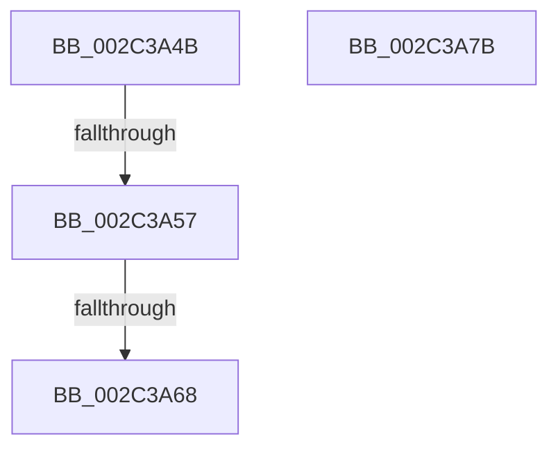

# sub_002C3A4B

- RVA: `0x002C3A4B`–`0x002C3A7C` (길이 `49` bytes)
- VA: `0x00000001402C3A4B`
- 실행 섹션: `.text`
- PDB 이름 있음: `아니요`; PDB Function 태그: `아니요`
- unwind 정보 RVA: `0x0006EA30`
- 디코드: `16`개 명령, `49/49` bytes 표시
- 미해석 바이트: `0` (있으면 어셈블리에 `.byte`로 보존)

> 이 문서는 커널 이미지의 기계어와 PDB 기호를 분석해 생성했습니다. 4번과 5번은 함수 원형과 자료형을 바이너리 사용 방식에서 추정한 C 해석이며 원본 소스 복구 결과는 아닙니다.

## 1. Dependencies

- 직접 호출 지점: **1**; 고유 호출 대상: **1**
- 직접 호출자로 확인된 함수: **0**
- RIP 상대 이미지 참조: **0**

### Outgoing calls
- `0x002C3A5A` → [MiGetImageExtensionBaseAddress](../../page/A3/MiGetImageExtensionBaseAddress_function_00A3559C.md) (function, `0x00A3559C`)

### Direct callers
- 이 함수 시작 RVA로 연결되는 직접 call은 확인되지 않았습니다. 간접 호출은 완전히 역산할 수 없습니다.

### Static image references
- 디코드된 RIP-relative 메모리 참조가 없습니다.

## 2. Other-region calls and transfers

- 다른 실행 섹션으로 향하는 call: **1**
  - `0x002C3A5A` → [MiGetImageExtensionBaseAddress](../../page/A3/MiGetImageExtensionBaseAddress_function_00A3559C.md) (`.text` → `PAGE`)
- call이 아닌 외부 분기/꼬리 이동: **2**
  - `0x002C3A51` → [MiSetProtectionOnSection + 0x52](MiSetProtectionOnSection_function_002C3770.md) (`tail-transfer`)
  - `0x002C3A62` → [MiSetProtectionOnSection + 0x52](MiSetProtectionOnSection_function_002C3770.md) (`tail-transfer`)

## 3. Assembly (complete function range)

```asm
002C3A4B  CC                              int3
002C3A4C  8B 42 40                        mov eax, dword ptr [rdx + 0x40]
002C3A4F  A8 20                           test al, 0x20
002C3A51  0F 84 6B FD FF FF               je 0x1402c37c2
002C3A57  49 8B CD                        mov rcx, r13
002C3A5A  E8 3D 1B 77 00                  call 0x140a3559c
002C3A5F  49 3B C7                        cmp rax, r15
002C3A62  0F 87 5A FD FF FF               ja 0x1402c37c2
002C3A68  B8 45 00 00 C0                  mov eax, 0xc0000045
002C3A6D  48 81 C4 58 01 00 00            add rsp, 0x158
002C3A74  41 5F                           pop r15
002C3A76  41 5D                           pop r13
002C3A78  5E                              pop rsi
002C3A79  5D                              pop rbp
002C3A7A  C3                              ret
002C3A7B  CC                              int3
```

## 4. C-style interpretation (structured pseudocode)

```c
__int64 __fastcall sub_002C3A4B(__int64 a1, __int64 a2)
{
    __int64 result;
    __int64 v_rsp;

    result = MiGetImageExtensionBaseAddress(v_r13, a2, a3, a4);
    v_rsp = (v_rsp) + (344);
    return (unsigned int)(0xC0000045ULL);
}
```

## 5. (Beta) C Style

```c
int64_t sub_002C3A4B(int64_t Arg1, void *Arg2)
{
    uint8_t *arg2 = (uint8_t *)Arg2;

    int64_t result;
    int64_t local_rsp;

    result = MiGetImageExtensionBaseAddress(local_r13, Arg2, a3, a4);
    local_rsp = (local_rsp) + (344);
    return (uint32_t)(0xC0000045ULL);
}
```

### 관측된 메모리 오프셋

구조체 형식이 확인되지 않은 접근은 인자 기준의 오프셋으로만 기록했습니다.

| 기준 인자 | 오프셋 표현 | 폭 (bit) | 접근 |
|---|---:|---:|---|
| `Arg2` | `+ 0x40` | `32` | `R` |

## 6. Execution-region graph

[열기: 2D/3D 그래프와 함수 탐색 컨트롤 패널](../../../control-panel.html?section=text&rva=0x002C3A4B&view=graph)

- 2D 그래프는 위에서 아래로 흐르고, 3D 그래프는 빈 공간을 드래그해 회전합니다. Shift+드래그는 이동, 휠은 확대·축소, 함수 노드 선택은 대상 보고서 이동입니다.

### Static fallback


