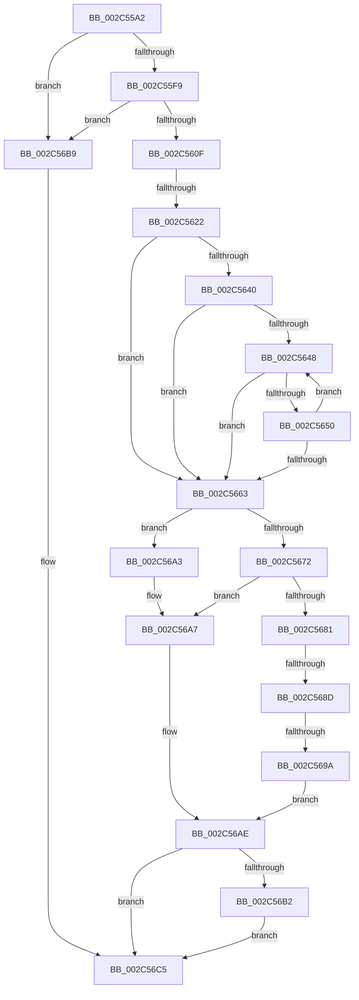

# sub_002C55A2

- RVA: `0x002C55A2`–`0x002C56D7` (길이 `309` bytes)
- VA: `0x00000001402C55A2`
- 실행 섹션: `.text`
- PDB 이름 있음: `아니요`; PDB Function 태그: `아니요`
- unwind 정보 RVA: `0x0006EACC`
- 디코드: `70`개 명령, `309/309` bytes 표시
- 미해석 바이트: `0` (있으면 어셈블리에 `.byte`로 보존)

> 이 문서는 커널 이미지의 기계어와 PDB 기호를 분석해 생성했습니다. 4번과 5번은 함수 원형과 자료형을 바이너리 사용 방식에서 추정한 C 해석이며 원본 소스 복구 결과는 아닙니다.

## 1. Dependencies

- 직접 호출 지점: **0**; 고유 호출 대상: **0**
- 직접 호출자로 확인된 함수: **0**
- RIP 상대 이미지 참조: **3**

### Outgoing calls
- 직접 디코드된 call 명령이 없습니다.

### Direct callers
- 이 함수 시작 RVA로 연결되는 직접 call은 확인되지 않았습니다. 간접 호출은 완전히 역산할 수 없습니다.

### Static image references
- `0x002C568D` → RVA `0x00E2F380` (`.data`; read)
- `0x002C569A` → RVA `0x00E2EE84` (`.data`; read)
- `0x002C56A7` → RVA `0x00E2EE85` (`.data`; read)

## 2. Other-region calls and transfers

- 다른 실행 섹션으로 향하는 call: **0**
- call이 아닌 외부 분기/꼬리 이동: **4**
  - `0x002C561C` → [sub_002C574C + 0x19](Unknown_function_002C574C.md) (`tail-transfer`)
  - `0x002C5687` → [sub_002C574C + 0x64](Unknown_function_002C574C.md) (`tail-transfer`)
  - `0x002C5694` → [sub_002C574C](Unknown_function_002C574C.md) (`tail-transfer`)
  - `0x002C56D1` → [sub_002C57D0](Unknown_function_002C57D0.md) (`tail-transfer`)

## 3. Assembly (complete function range)

```asm
002C55A2  48 89 6C 24 38                  mov qword ptr [rsp + 0x38], rbp
002C55A7  41 8B F8                        mov edi, r8d
002C55AA  48 89 74 24 40                  mov qword ptr [rsp + 0x40], rsi
002C55AF  41 8B F0                        mov esi, r8d
002C55B2  83 E6 1F                        and esi, 0x1f
002C55B5  4C 89 74 24 48                  mov qword ptr [rsp + 0x48], r14
002C55BA  48 BD 00 00 00 00 80 F6 FF FF   movabs rbp, 0xfffff68000000000
002C55C4  48 8B 1C F0                     mov rbx, qword ptr [rax + rsi*8]
002C55C8  48 B8 7F 0E 00 00 00 00 F0 FF   movabs rax, 0xfff0000000000e7f
002C55D2  48 23 D8                        and rbx, rax
002C55D5  48 B8 FF FF FF FF FF 00 00 00   movabs rax, 0xffffffffff
002C55DF  48 23 D0                        and rdx, rax
002C55E2  48 C1 E2 0C                     shl rdx, 0xc
002C55E6  48 0B DA                        or rbx, rdx
002C55E9  48 83 CB 21                     or rbx, 0x21
002C55ED  48 8B C5                        mov rax, rbp
002C55F0  48 3B C8                        cmp rcx, rax
002C55F3  0F 82 C0 00 00 00               jb 0x1402c56b9
002C55F9  49 BE FF FF FF FF FF F6 FF FF   movabs r14, 0xfffff6ffffffffff
002C5603  49 8B C6                        mov rax, r14
002C5606  48 3B C8                        cmp rcx, rax
002C5609  0F 87 AA 00 00 00               ja 0x1402c56b9
002C560F  48 B8 00 00 00 40 FB F6 FF FF   movabs rax, 0xfffff6fb40000000
002C5619  48 3B C8                        cmp rcx, rax
002C561C  0F 83 43 01 00 00               jae 0x1402c5765
002C5622  48 8B D5                        mov rdx, rbp
002C5625  48 C1 E1 19                     shl rcx, 0x19
002C5629  44 8B C7                        mov r8d, edi
002C562C  48 C1 E2 19                     shl rdx, 0x19
002C5630  48 2B CA                        sub rcx, rdx
002C5633  48 C1 F9 10                     sar rcx, 0x10
002C5637  41 81 E0 00 00 00 04            and r8d, 0x4000000
002C563E  74 23                           je 0x1402c5663
002C5640  48 8B C5                        mov rax, rbp
002C5643  48 3B C8                        cmp rcx, rax
002C5646  72 1B                           jb 0x1402c5663
002C5648  49 8B C6                        mov rax, r14
002C564B  48 3B C8                        cmp rcx, rax
002C564E  77 13                           ja 0x1402c5663
002C5650  48 C1 E1 19                     shl rcx, 0x19
002C5654  48 2B CA                        sub rcx, rdx
002C5657  48 C1 F9 10                     sar rcx, 0x10
002C565B  48 8B C5                        mov rax, rbp
002C565E  48 3B C8                        cmp rcx, rax
002C5661  73 E5                           jae 0x1402c5648
002C5663  48 B8 FF FF FE FF FF 7F 00 00   movabs rax, 0x7ffffffeffff
002C566D  48 3B C8                        cmp rcx, rax
002C5670  76 31                           jbe 0x1402c56a3
002C5672  48 B8 00 00 00 00 00 80 FF FF   movabs rax, 0xffff800000000000
002C567C  48 3B C8                        cmp rcx, rax
002C567F  72 26                           jb 0x1402c56a7
002C5681  48 8B C5                        mov rax, rbp
002C5684  48 3B C8                        cmp rcx, rax
002C5687  0F 83 23 01 00 00               jae 0x1402c57b0
002C568D  48 3B 0D EC 9C B6 00            cmp rcx, qword ptr [rip + 0xb69cec]
002C5694  0F 83 B2 00 00 00               jae 0x1402c574c
002C569A  0F B6 05 E3 97 B6 00            movzx eax, byte ptr [rip + 0xb697e3]
002C56A1  EB 0B                           jmp 0x1402c56ae
002C56A3  48 83 CB 04                     or rbx, 4
002C56A7  0F B6 05 D7 97 B6 00            movzx eax, byte ptr [rip + 0xb697d7]
002C56AE  85 C0                           test eax, eax
002C56B0  74 13                           je 0x1402c56c5
002C56B2  48 0F BA EB 08                  bts rbx, 8
002C56B7  EB 0C                           jmp 0x1402c56c5
002C56B9  48 0F BA EB 08                  bts rbx, 8
002C56BE  41 81 E0 00 00 00 04            and r8d, 0x4000000
002C56C5  4C 8B 74 24 48                  mov r14, qword ptr [rsp + 0x48]
002C56CA  48 8B 6C 24 38                  mov rbp, qword ptr [rsp + 0x38]
002C56CF  85 FF                           test edi, edi
002C56D1  0F 88 F9 00 00 00               js 0x1402c57d0
```

## 4. C-style interpretation (structured pseudocode)

```c
__int64 __fastcall sub_002C55A2(__int64 a1, __int64 a2, int a3, __int64 a4, __int64 a5, __int64 a6, __int64 a7, __int64 a8, __int64 a9)
{
    __int64 v_rbx;
    __int64 v_rsi;
    unsigned __int64 v_stack_p38;
    unsigned __int64 v_stack_p40;
    unsigned __int64 v_stack_p48;

    v_stack_p38 = v_rbp;
    v_stack_p40 = v_rsi;
    v_rsi = (unsigned int)(((unsigned int)(a3)) & (31));
    v_stack_p48 = v_r14;
    v_rbx = (*(unsigned __int64 *)(result + v_rsi * 8)) & (result);
    a2 = (a2) & (result);
    a2 = (a2) << (12);
    v_rbx = (v_rbx) | (a2);
    v_rbx = (v_rbx) | (33);
    if (a1 < v_rbp) goto loc_002C56B9;
    if (a1 > v_r14) goto loc_002C56B9;
    a1 = (a1) << (25);
    a2 = (v_rbp) << (25);
    a1 = (a1) - (a2);
    a1 = (a1) >> (16);
    a3 = (unsigned int)(((unsigned int)((unsigned int)((unsigned int)(a3)))) & (0x4000000ULL));
    if (condition_is_equal) goto loc_002C5663;
    if (a1 < v_rbp) goto loc_002C5663;
loc_002C5648:
    if (a1 > v_r14) goto loc_002C5663;
    a1 = (a1) << (25);
    a1 = (a1) - (a2);
    a1 = (a1) >> (16);
    if (a1 >= v_rbp) goto loc_002C5648;
loc_002C5663:
    if (a1 <= v_rbp) goto loc_002C56A3;
    if (a1 < v_rbp) goto loc_002C56A7;
    goto loc_002C56AE;
loc_002C56A3:
    v_rbx = (v_rbx) | (4);
loc_002C56A7:
loc_002C56AE:
    if ((unsigned int)(*(unsigned __int8 *)(v_rip + 11966423)) == 0) goto loc_002C56C5;
    goto loc_002C56C5;
loc_002C56B9:
    a3 = (unsigned int)((a3) & (0x4000000ULL));
loc_002C56C5:
}
```

## 5. (Beta) C Style

```c
int64_t sub_002C55A2(int64_t Arg1, int64_t Arg2, int32_t Arg3, int64_t Arg4, uint64_t Arg5, uint64_t Arg6, int64_t Arg7, uint64_t Arg8, int64_t Arg9)
{
    int64_t local_rbx;
    int64_t local_rsi;
    uint64_t v_stack_p38;
    uint64_t v_stack_p40;
    uint64_t v_stack_p48;

    v_stack_p38 = local_rbp;
    v_stack_p40 = local_rsi;
    local_rsi = (uint32_t)(((uint32_t)(Arg3)) & (31));
    v_stack_p48 = local_r14;
    local_rbx = (*(uint64_t *)(result + local_rsi * 8)) & (result);
    Arg2 = (Arg2) & (result);
    Arg2 = (Arg2) << (12);
    local_rbx = (local_rbx) | (Arg2);
    local_rbx = (local_rbx) | (33);
    if (Arg1 < local_rbp) goto loc_002C56B9;
    if (Arg1 > local_r14) goto loc_002C56B9;
    Arg1 = (Arg1) << (25);
    Arg2 = (local_rbp) << (25);
    Arg1 = (Arg1) - (Arg2);
    Arg1 = (Arg1) >> (16);
    Arg3 = (uint32_t)(((uint32_t)((uint32_t)((uint32_t)(Arg3)))) & (0x4000000ULL));
    if (condition_is_equal) goto loc_002C5663;
    if (Arg1 < local_rbp) goto loc_002C5663;
loc_002C5648:
    if (Arg1 > local_r14) goto loc_002C5663;
    Arg1 = (Arg1) << (25);
    Arg1 = (Arg1) - (Arg2);
    Arg1 = (Arg1) >> (16);
    if (Arg1 >= local_rbp) goto loc_002C5648;
loc_002C5663:
    if (Arg1 <= local_rbp) goto loc_002C56A3;
    if (Arg1 < local_rbp) goto loc_002C56A7;
    goto loc_002C56AE;
loc_002C56A3:
    local_rbx = (local_rbx) | (4);
loc_002C56A7:
loc_002C56AE:
    if ((uint32_t)(*(uint8_t *)(v_rip + 0xB697D7)) == 0) goto loc_002C56C5;
    goto loc_002C56C5;
loc_002C56B9:
    Arg3 = (uint32_t)((Arg3) & (0x4000000ULL));
loc_002C56C5:
}
```

## 6. Execution-region graph

[열기: 2D/3D 그래프와 함수 탐색 컨트롤 패널](../../../control-panel.html?section=text&rva=0x002C55A2&view=graph)

- 2D 그래프는 위에서 아래로 흐르고, 3D 그래프는 빈 공간을 드래그해 회전합니다. Shift+드래그는 이동, 휠은 확대·축소, 함수 노드 선택은 대상 보고서 이동입니다.

### Static fallback


