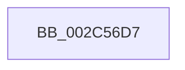

# sub_002C56D7

- RVA: `0x002C56D7`–`0x002C56F6` (길이 `31` bytes)
- VA: `0x00000001402C56D7`
- 실행 섹션: `.text`
- PDB 이름 있음: `아니요`; PDB Function 태그: `아니요`
- unwind 정보 RVA: `0x0006EAE8`
- 디코드: `8`개 명령, `31/31` bytes 표시
- 미해석 바이트: `0` (있으면 어셈블리에 `.byte`로 보존)

> 이 문서는 커널 이미지의 기계어와 PDB 기호를 분석해 생성했습니다. 4번과 5번은 함수 원형과 자료형을 바이너리 사용 방식에서 추정한 C 해석이며 원본 소스 복구 결과는 아닙니다.

## 1. Dependencies

- 직접 호출 지점: **0**; 고유 호출 대상: **0**
- 직접 호출자로 확인된 함수: **0**
- RIP 상대 이미지 참조: **0**

### Outgoing calls
- 직접 디코드된 call 명령이 없습니다.

### Direct callers
- 이 함수 시작 RVA로 연결되는 직접 call은 확인되지 않았습니다. 간접 호출은 완전히 역산할 수 없습니다.

### Static image references
- 디코드된 RIP-relative 메모리 참조가 없습니다.

## 2. Other-region calls and transfers

- 다른 실행 섹션으로 향하는 call: **0**
- call이 아닌 외부 분기/꼬리 이동: **1**
  - `0x002C56F4` → [sub_002C56F6 + 0x16](Unknown_function_002C56F6.md) (`tail-transfer`)

## 3. Assembly (complete function range)

```asm
002C56D7  48 8B 74 24 40                  mov rsi, qword ptr [rsp + 0x40]
002C56DC  48 8B C3                        mov rax, rbx
002C56DF  48 83 E0 FB                     and rax, 0xfffffffffffffffb
002C56E3  0F BA E7 1E                     bt edi, 0x1e
002C56E7  48 0F 43 C3                     cmovae rax, rbx
002C56EB  48 8B 5C 24 30                  mov rbx, qword ptr [rsp + 0x30]
002C56F0  0F BA E7 1D                     bt edi, 0x1d
002C56F4  73 16                           jae 0x1402c570c
```

## 4. C-style interpretation (structured pseudocode)

```c
__int64 __fastcall sub_002C56D7(__int64 a1, __int64 a2, __int64 a3, __int64 a4, __int64 a5, __int64 a6, __int64 a7, __int64 a8)
{
    __int64 result;

    result = (v_rbx) & (-5);
    if (condition_is_above_or_equal) { result = v_rbx; }
}
```

## 5. (Beta) C Style

```c
int64_t sub_002C56D7(int64_t Arg1, int64_t Arg2, int64_t Arg3, int64_t Arg4, uint64_t Arg5, int64_t Arg6, uint64_t Arg7, int64_t Arg8)
{
    int64_t result;

    result = (local_rbx) & (-5);
    if (condition_is_above_or_equal) { result = local_rbx; }
}
```

## 6. Execution-region graph

[열기: 2D/3D 그래프와 함수 탐색 컨트롤 패널](../../../control-panel.html?section=text&rva=0x002C56D7&view=graph)

- 2D 그래프는 위에서 아래로 흐르고, 3D 그래프는 빈 공간을 드래그해 회전합니다. Shift+드래그는 이동, 휠은 확대·축소, 함수 노드 선택은 대상 보고서 이동입니다.

### Static fallback


