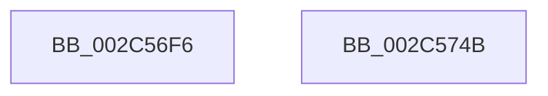

# sub_002C56F6

- RVA: `0x002C56F6`–`0x002C574C` (길이 `86` bytes)
- VA: `0x00000001402C56F6`
- 실행 섹션: `.text`
- PDB 이름 있음: `아니요`; PDB Function 태그: `아니요`
- unwind 정보 RVA: `0x0006EAFC`
- 디코드: `21`개 명령, `86/86` bytes 표시
- 미해석 바이트: `0` (있으면 어셈블리에 `.byte`로 보존)

> 이 문서는 커널 이미지의 기계어와 PDB 기호를 분석해 생성했습니다. 4번과 5번은 함수 원형과 자료형을 바이너리 사용 방식에서 추정한 C 해석이며 원본 소스 복구 결과는 아닙니다.

## 1. Dependencies

- 직접 호출 지점: **0**; 고유 호출 대상: **0**
- 직접 호출자로 확인된 함수: **0**
- RIP 상대 이미지 참조: **1**

### Outgoing calls
- 직접 디코드된 call 명령이 없습니다.

### Direct callers
- 이 함수 시작 RVA로 연결되는 직접 call은 확인되지 않았습니다. 간접 호출은 완전히 역산할 수 없습니다.

### Static image references
- `0x002C56F6` → RVA `0x00E2EE84` (`.data`; read)

## 2. Other-region calls and transfers

- 다른 실행 섹션으로 향하는 call: **0**
- 별도 외부 분기/꼬리 이동을 확인하지 못했습니다.

## 3. Assembly (complete function range)

```asm
002C56F6  0F B6 15 87 97 B6 00            movzx edx, byte ptr [rip + 0xb69787]
002C56FD  48 C1 E2 08                     shl rdx, 8
002C5701  48 33 C2                        xor rax, rdx
002C5704  48 0F BA F0 08                  btr rax, 8
002C5709  48 33 C2                        xor rax, rdx
002C570C  48 8B C8                        mov rcx, rax
002C570F  48 0F BA F1 08                  btr rcx, 8
002C5714  0F BA E7 1B                     bt edi, 0x1b
002C5718  48 0F 43 C8                     cmovae rcx, rax
002C571C  48 8B C1                        mov rax, rcx
002C571F  48 0F BA E8 07                  bts rax, 7
002C5724  45 85 C0                        test r8d, r8d
002C5727  48 0F 44 C1                     cmove rax, rcx
002C572B  48 B9 FF FF FF FF FF FF FF FA   movabs rcx, 0xfaffffffffffffff
002C5735  48 23 C1                        and rax, rcx
002C5738  48 B9 00 00 00 00 00 00 00 0A   movabs rcx, 0xa00000000000000
002C5742  48 0B C1                        or rax, rcx
002C5745  48 83 C4 20                     add rsp, 0x20
002C5749  5F                              pop rdi
002C574A  C3                              ret
002C574B  CC                              int3
```

## 4. C-style interpretation (structured pseudocode)

```c
__int64 __fastcall sub_002C56F6(__int64 a1, __int64 a2, int a3)
{
    __int64 result;
    __int64 v_rsp;

    a2 = (*(unsigned __int8 *)(v_rip + 11966343)) << (8);
    result = (result) ^ (a2);
    result = (result) ^ (a2);
    a1 = result;
    if (condition_is_above_or_equal) { a1 = result; }
    if (a3 == 0) { a1 = a1; }
    result = (a1) & (a1);
    result = (result) | (a1);
    v_rsp = (v_rsp) + (32);
    return result;
}
```

## 5. (Beta) C Style

```c
int64_t sub_002C56F6(int64_t Arg1, int64_t Arg2, int32_t Arg3)
{
    int64_t result;
    int64_t local_rsp;

    Arg2 = (*(uint8_t *)(v_rip + 0xB69787)) << (8);
    result = (result) ^ (Arg2);
    result = (result) ^ (Arg2);
    Arg1 = result;
    if (condition_is_above_or_equal) { Arg1 = result; }
    if (Arg3 == 0) { Arg1 = Arg1; }
    result = (Arg1) & (Arg1);
    result = (result) | (Arg1);
    local_rsp = (local_rsp) + (32);
    return result;
}
```

## 6. Execution-region graph

[열기: 2D/3D 그래프와 함수 탐색 컨트롤 패널](../../../control-panel.html?section=text&rva=0x002C56F6&view=graph)

- 2D 그래프는 위에서 아래로 흐르고, 3D 그래프는 빈 공간을 드래그해 회전합니다. Shift+드래그는 이동, 휠은 확대·축소, 함수 노드 선택은 대상 보고서 이동입니다.

### Static fallback


