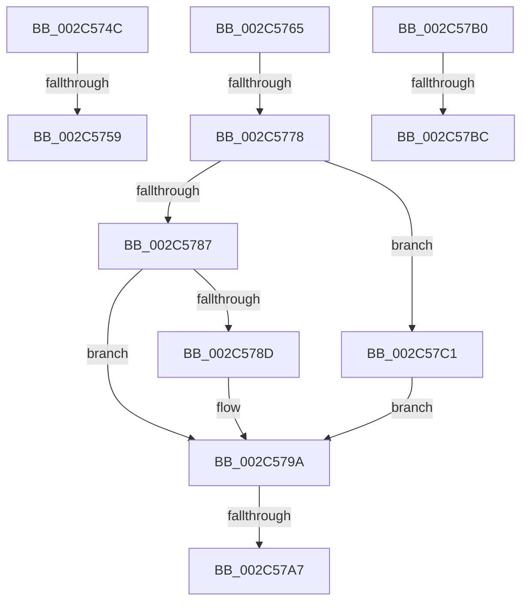

# sub_002C574C

- RVA: `0x002C574C`–`0x002C57D0` (길이 `132` bytes)
- VA: `0x00000001402C574C`
- 실행 섹션: `.text`
- PDB 이름 있음: `아니요`; PDB Function 태그: `아니요`
- unwind 정보 RVA: `0x0006EB10`
- 디코드: `26`개 명령, `132/132` bytes 표시
- 미해석 바이트: `0` (있으면 어셈블리에 `.byte`로 보존)

> 이 문서는 커널 이미지의 기계어와 PDB 기호를 분석해 생성했습니다. 4번과 5번은 함수 원형과 자료형을 바이너리 사용 방식에서 추정한 C 해석이며 원본 소스 복구 결과는 아닙니다.

## 1. Dependencies

- 직접 호출 지점: **1**; 고유 호출 대상: **1**
- 직접 호출자로 확인된 함수: **0**
- RIP 상대 이미지 참조: **2**

### Outgoing calls
- `0x002C579A` → [MiUserPdeOrAbove](MiUserPdeOrAbove_function_002C57F0.md) (function, `0x002C57F0`)

### Direct callers
- 이 함수 시작 RVA로 연결되는 직접 call은 확인되지 않았습니다. 간접 호출은 완전히 역산할 수 없습니다.

### Static image references
- `0x002C574C` → RVA `0x00E2F390` (`.data`; read)
- `0x002C5759` → RVA `0x00E2EE85` (`.data`; read)

## 2. Other-region calls and transfers

- 다른 실행 섹션으로 향하는 call: **0**
- call이 아닌 외부 분기/꼬리 이동: **7**
  - `0x002C5753` → [sub_002C55A2 + 0xF8](Unknown_function_002C55A2.md) (`tail-transfer`)
  - `0x002C5760` → [sub_002C55A2 + 0x10C](Unknown_function_002C55A2.md) (`tail-transfer`)
  - `0x002C5772` → [sub_002C55A2 + 0x80](Unknown_function_002C55A2.md) (`tail-transfer`)
  - `0x002C57A1` → [sub_002C55A2 + 0x80](Unknown_function_002C55A2.md) (`tail-transfer`)
  - `0x002C57AB` → [sub_002C55A2 + 0x80](Unknown_function_002C55A2.md) (`tail-transfer`)
  - `0x002C57B6` → [sub_002C55A2 + 0xEB](Unknown_function_002C55A2.md) (`tail-transfer`)
  - `0x002C57BC` → [sub_002C55A2 + 0x123](Unknown_function_002C55A2.md) (`tail-transfer`)

## 3. Assembly (complete function range)

```asm
002C574C  48 3B 0D 3D 9C B6 00            cmp rcx, qword ptr [rip + 0xb69c3d]
002C5753  0F 87 41 FF FF FF               ja 0x1402c569a
002C5759  0F B6 05 25 97 B6 00            movzx eax, byte ptr [rip + 0xb69725]
002C5760  E9 49 FF FF FF                  jmp 0x1402c56ae
002C5765  48 B8 FF FF FF 7F FB F6 FF FF   movabs rax, 0xfffff6fb7fffffff
002C576F  48 3B C8                        cmp rcx, rax
002C5772  0F 87 AA FE FF FF               ja 0x1402c5622
002C5778  48 B8 68 DF BE 7D FB F6 FF FF   movabs rax, 0xfffff6fb7dbedf68
002C5782  48 3B C8                        cmp rcx, rax
002C5785  74 3A                           je 0x1402c57c1
002C5787  0F BA E7 1A                     bt edi, 0x1a
002C578B  72 0D                           jb 0x1402c579a
002C578D  48 B8 FF FF FF FF FF FF FF 7F   movabs rax, 0x7fffffffffffffff
002C5797  48 23 D8                        and rbx, rax
002C579A  E8 51 00 00 00                  call 0x1402c57f0
002C579F  85 C0                           test eax, eax
002C57A1  0F 84 7B FE FF FF               je 0x1402c5622
002C57A7  48 83 CB 04                     or rbx, 4
002C57AB  E9 72 FE FF FF                  jmp 0x1402c5622
002C57B0  49 8B C6                        mov rax, r14
002C57B3  48 3B C8                        cmp rcx, rax
002C57B6  0F 87 D1 FE FF FF               ja 0x1402c568d
002C57BC  E9 04 FF FF FF                  jmp 0x1402c56c5
002C57C1  48 B8 00 00 00 00 00 00 00 80   movabs rax, 0x8000000000000000
002C57CB  48 0B D8                        or rbx, rax
002C57CE  EB CA                           jmp 0x1402c579a
```

## 4. C-style interpretation (structured pseudocode)

```c
__int64 __fastcall sub_002C574C(__int64 a1)
{
}
```

## 5. (Beta) C Style

```c
int64_t sub_002C574C(int64_t Arg1)
{
}
```

## 6. Execution-region graph

[열기: 2D/3D 그래프와 함수 탐색 컨트롤 패널](../../../control-panel.html?section=text&rva=0x002C574C&view=graph)

- 2D 그래프는 위에서 아래로 흐르고, 3D 그래프는 빈 공간을 드래그해 회전합니다. Shift+드래그는 이동, 휠은 확대·축소, 함수 노드 선택은 대상 보고서 이동입니다.

### Static fallback


