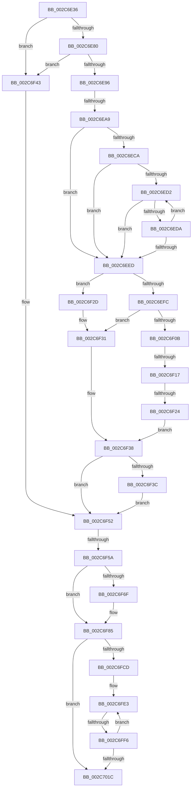

# sub_002C6E36

- RVA: `0x002C6E36`–`0x002C7029` (길이 `499` bytes)
- VA: `0x00000001402C6E36`
- 실행 섹션: `.text`
- PDB 이름 있음: `아니요`; PDB Function 태그: `아니요`
- unwind 정보 RVA: `0x0006ECDC`
- 디코드: `113`개 명령, `499/499` bytes 표시
- 미해석 바이트: `0` (있으면 어셈블리에 `.byte`로 보존)

> 이 문서는 커널 이미지의 기계어와 PDB 기호를 분석해 생성했습니다. 4번과 5번은 함수 원형과 자료형을 바이너리 사용 방식에서 추정한 C 해석이며 원본 소스 복구 결과는 아닙니다.

## 1. Dependencies

- 직접 호출 지점: **0**; 고유 호출 대상: **0**
- 직접 호출자로 확인된 함수: **0**
- RIP 상대 이미지 참조: **4**

### Outgoing calls
- 직접 디코드된 call 명령이 없습니다.

### Direct callers
- 이 함수 시작 RVA로 연결되는 직접 call은 확인되지 않았습니다. 간접 호출은 완전히 역산할 수 없습니다.

### Static image references
- `0x002C6F17` → RVA `0x00E2F380` (`.data`; read)
- `0x002C6F24` → RVA `0x00E2EE84` (`.data`; read)
- `0x002C6F31` → RVA `0x00E2EE85` (`.data`; read)
- `0x002C6FE3` → RVA `0x00FC6A88` (`ALMOSTRO`; read)

## 2. Other-region calls and transfers

- 다른 실행 섹션으로 향하는 call: **0**
- call이 아닌 외부 분기/꼬리 이동: **5**
  - `0x002C6EA3` → [sub_002C7096](Unknown_function_002C7096.md) (`tail-transfer`)
  - `0x002C6F11` → [sub_002C7096 + 0x52](Unknown_function_002C7096.md) (`tail-transfer`)
  - `0x002C6F1E` → [sub_002C703E](Unknown_function_002C703E.md) (`tail-transfer`)
  - `0x002C6F54` → [sub_002C715F + 0x12](Unknown_function_002C715F.md) (`tail-transfer`)
  - `0x002C6FF0` → [sub_002C7096 + 0x63](Unknown_function_002C7096.md) (`tail-transfer`)

## 3. Assembly (complete function range)

```asm
002C6E36  4C 89 7C 24 20                  mov qword ptr [rsp + 0x20], r15
002C6E3B  48 B8 7F 0E 00 00 00 00 F0 FF   movabs rax, 0xfff0000000000e7f
002C6E45  44 8B FE                        mov r15d, esi
002C6E48  4C 89 6C 24 60                  mov qword ptr [rsp + 0x60], r13
002C6E4D  41 83 E7 1F                     and r15d, 0x1f
002C6E51  4B 8B 9C FE 90 09 01 00         mov rbx, qword ptr [r14 + r15*8 + 0x10990]
002C6E59  48 23 D8                        and rbx, rax
002C6E5C  48 B8 FF FF FF FF FF 00 00 00   movabs rax, 0xffffffffff
002C6E66  48 23 D0                        and rdx, rax
002C6E69  48 C1 E2 0C                     shl rdx, 0xc
002C6E6D  48 0B DA                        or rbx, rdx
002C6E70  48 83 CB 21                     or rbx, 0x21
002C6E74  49 8B C4                        mov rax, r12
002C6E77  48 3B F8                        cmp rdi, rax
002C6E7A  0F 82 C3 00 00 00               jb 0x1402c6f43
002C6E80  49 BD FF FF FF FF FF F6 FF FF   movabs r13, 0xfffff6ffffffffff
002C6E8A  49 8B C5                        mov rax, r13
002C6E8D  48 3B F8                        cmp rdi, rax
002C6E90  0F 87 AD 00 00 00               ja 0x1402c6f43
002C6E96  48 B8 00 00 00 40 FB F6 FF FF   movabs rax, 0xfffff6fb40000000
002C6EA0  48 3B F8                        cmp rdi, rax
002C6EA3  0F 83 ED 01 00 00               jae 0x1402c7096
002C6EA9  49 8B D4                        mov rdx, r12
002C6EAC  48 C1 E2 19                     shl rdx, 0x19
002C6EB0  48 8B C7                        mov rax, rdi
002C6EB3  48 C1 E0 19                     shl rax, 0x19
002C6EB7  44 8B C6                        mov r8d, esi
002C6EBA  48 2B C2                        sub rax, rdx
002C6EBD  48 C1 F8 10                     sar rax, 0x10
002C6EC1  41 81 E0 00 00 00 04            and r8d, 0x4000000
002C6EC8  74 23                           je 0x1402c6eed
002C6ECA  49 8B CC                        mov rcx, r12
002C6ECD  48 3B C1                        cmp rax, rcx
002C6ED0  72 1B                           jb 0x1402c6eed
002C6ED2  49 8B CD                        mov rcx, r13
002C6ED5  48 3B C1                        cmp rax, rcx
002C6ED8  77 13                           ja 0x1402c6eed
002C6EDA  48 C1 E0 19                     shl rax, 0x19
002C6EDE  48 2B C2                        sub rax, rdx
002C6EE1  48 C1 F8 10                     sar rax, 0x10
002C6EE5  49 8B CC                        mov rcx, r12
002C6EE8  48 3B C1                        cmp rax, rcx
002C6EEB  73 E5                           jae 0x1402c6ed2
002C6EED  48 B9 FF FF FE FF FF 7F 00 00   movabs rcx, 0x7ffffffeffff
002C6EF7  48 3B C1                        cmp rax, rcx
002C6EFA  76 31                           jbe 0x1402c6f2d
002C6EFC  48 B9 00 00 00 00 00 80 FF FF   movabs rcx, 0xffff800000000000
002C6F06  48 3B C1                        cmp rax, rcx
002C6F09  72 26                           jb 0x1402c6f31
002C6F0B  49 8B CC                        mov rcx, r12
002C6F0E  48 3B C1                        cmp rax, rcx
002C6F11  0F 83 D1 01 00 00               jae 0x1402c70e8
002C6F17  48 3B 05 62 84 B6 00            cmp rax, qword ptr [rip + 0xb68462]
002C6F1E  0F 83 1A 01 00 00               jae 0x1402c703e
002C6F24  0F B6 05 59 7F B6 00            movzx eax, byte ptr [rip + 0xb67f59]
002C6F2B  EB 0B                           jmp 0x1402c6f38
002C6F2D  48 83 CB 04                     or rbx, 4
002C6F31  0F B6 05 4D 7F B6 00            movzx eax, byte ptr [rip + 0xb67f4d]
002C6F38  85 C0                           test eax, eax
002C6F3A  74 16                           je 0x1402c6f52
002C6F3C  48 0F BA EB 08                  bts rbx, 8
002C6F41  EB 0F                           jmp 0x1402c6f52
002C6F43  48 0F BA EB 08                  bts rbx, 8
002C6F48  44 8B C6                        mov r8d, esi
002C6F4B  41 81 E0 00 00 00 04            and r8d, 0x4000000
002C6F52  85 F6                           test esi, esi
002C6F54  0F 88 17 02 00 00               js 0x1402c7171
002C6F5A  48 8B C3                        mov rax, rbx
002C6F5D  48 83 E0 FB                     and rax, 0xfffffffffffffffb
002C6F61  0F BA E6 1E                     bt esi, 0x1e
002C6F65  48 0F 43 C3                     cmovae rax, rbx
002C6F69  0F BA E6 1D                     bt esi, 0x1d
002C6F6D  73 16                           jae 0x1402c6f85
002C6F6F  0F B6 15 0E 7F B6 00            movzx edx, byte ptr [rip + 0xb67f0e]
002C6F76  48 C1 E2 08                     shl rdx, 8
002C6F7A  48 33 C2                        xor rax, rdx
002C6F7D  48 0F BA F0 08                  btr rax, 8
002C6F82  48 33 C2                        xor rax, rdx
002C6F85  49 8B AC EE A8 45 01 00         mov rbp, qword ptr [r14 + rbp*8 + 0x145a8]
002C6F8D  48 8B C8                        mov rcx, rax
002C6F90  48 0F BA F1 08                  btr rcx, 8
002C6F95  0F BA E6 1B                     bt esi, 0x1b
002C6F99  48 0F 43 C8                     cmovae rcx, rax
002C6F9D  48 B8 FF FF FF FF FF FF FF FA   movabs rax, 0xfaffffffffffffff
002C6FA7  48 8B D9                        mov rbx, rcx
002C6FAA  48 0F BA EB 07                  bts rbx, 7
002C6FAF  45 85 C0                        test r8d, r8d
002C6FB2  48 0F 44 D9                     cmove rbx, rcx
002C6FB6  33 F6                           xor esi, esi
002C6FB8  48 23 D8                        and rbx, rax
002C6FBB  48 B8 00 00 00 00 00 00 00 0A   movabs rax, 0xa00000000000000
002C6FC5  48 0B D8                        or rbx, rax
002C6FC8  48 85 ED                        test rbp, rbp
002C6FCB  74 4F                           je 0x1402c701c
002C6FCD  8B C6                           mov eax, esi
002C6FCF  48 B9 00 00 00 00 40 00 00 00   movabs rcx, 0x4000000000
002C6FD9  49 BF FF 0F 00 00 00 00 F0 FF   movabs r15, 0xfff0000000000fff
002C6FE3  48 0F BA 25 9C FA CF 00 24      bt qword ptr [rip + 0xcffa9c], 0x24
002C6FEC  4C 8D 34 C7                     lea r14, [rdi + rax*8]
002C6FF0  0F 82 03 01 00 00               jb 0x1402c70f9
002C6FF6  48 8D 93 00 10 00 00            lea rdx, [rbx + 0x1000]
002C6FFD  49 89 1E                        mov qword ptr [r14], rbx
002C7000  48 33 DA                        xor rbx, rdx
002C7003  FF C6                           inc esi
002C7005  49 23 DF                        and rbx, r15
002C7008  8B C6                           mov eax, esi
002C700A  48 33 DA                        xor rbx, rdx
002C700D  48 B9 00 00 00 00 40 00 00 00   movabs rcx, 0x4000000000
002C7017  48 3B C5                        cmp rax, rbp
002C701A  72 C7                           jb 0x1402c6fe3
002C701C  4C 8B 6C 24 60                  mov r13, qword ptr [rsp + 0x60]
002C7021  48 8B C7                        mov rax, rdi
002C7024  4C 8B 7C 24 20                  mov r15, qword ptr [rsp + 0x20]
```

## 4. C-style interpretation (structured pseudocode)

```c
__int64 __fastcall sub_002C6E36(__int64 a1, __int64 a2, __int64 a3, __int64 a4, __int64 a5, __int64 a6, __int64 a7, __int64 a8, __int64 a9, __int64 a10, __int64 a11, __int64 a12)
{
    __int64 result;
    __int64 v_r15;
    __int64 v_rbx;
    __int64 v_rsi;
    unsigned __int64 v_stack_p20;
    unsigned __int64 v_stack_p60;

    v_stack_p20 = v_r15;
    v_stack_p60 = v_r13;
    v_r15 = (unsigned int)(((unsigned int)((unsigned int)(v_rsi))) & (31));
    v_rbx = (*(unsigned __int64 *)(v_r14 + v_r15 * 8 + 67984)) & (result);
    a2 = (a2) & (result);
    a2 = (a2) << (12);
    v_rbx = (v_rbx) | (a2);
    v_rbx = (v_rbx) | (33);
    if (v_rdi < v_r12) goto loc_002C6F43;
    if (v_rdi > v_r13) goto loc_002C6F43;
    a2 = (v_r12) << (25);
    result = (v_rdi) << (25);
    result = (result) - (a2);
    result = (result) >> (16);
    a3 = (unsigned int)(((unsigned int)((unsigned int)(v_rsi))) & (0x4000000ULL));
    if (condition_is_equal) goto loc_002C6EED;
    if (result < v_r12) goto loc_002C6EED;
loc_002C6ED2:
    if (result > v_r13) goto loc_002C6EED;
    result = (result) << (25);
    result = (result) - (a2);
    result = (result) >> (16);
    if (result >= v_r12) goto loc_002C6ED2;
loc_002C6EED:
    if (result <= v_r12) goto loc_002C6F2D;
    if (result < v_r12) goto loc_002C6F31;
    goto loc_002C6F38;
loc_002C6F2D:
    v_rbx = (v_rbx) | (4);
loc_002C6F31:
loc_002C6F38:
    if ((unsigned int)(*(unsigned __int8 *)(v_rip + 11960141)) == 0) goto loc_002C6F52;
    goto loc_002C6F52;
loc_002C6F43:
    a3 = (unsigned int)(((unsigned int)((unsigned int)(v_rsi))) & (0x4000000ULL));
loc_002C6F52:
    result = (v_rbx) & (-5);
    if (condition_is_above_or_equal) { result = v_rbx; }
    if (!(condition_is_above_or_equal)) {
        a2 = *(unsigned __int8 *)(v_rip + 11960078);
        a2 = (a2) << (8);
        result = (result) ^ (a2);
        result = (result) ^ (a2);
    }
    a1 = result;
    if (condition_is_above_or_equal) { a1 = result; }
    if ((unsigned int)(a3) == 0) { a1 = a1; }
    v_rsi = 0;
    v_rbx = (a1) & (result);
    v_rbx = (v_rbx) | (result);
    if (*(unsigned __int64 *)(v_r14 + v_rbp * 8 + 83368) == 0) goto loc_002C701C;
loc_002C6FE3:
    *(unsigned __int64 *)(v_rdi + 0 * 8) = v_rbx;
    v_rbx = (v_rbx) ^ (v_rbx + 4096);
    v_rsi = (unsigned int)((v_rsi) + 1);
    v_rbx = (v_rbx) & (v_r15);
    v_rbx = (v_rbx) ^ (v_rbx + 4096);
    if (((unsigned int)((unsigned int)(v_rsi))) < (*(unsigned __int64 *)(v_r14 + v_rbp * 8 + 83368))) goto loc_002C6FE3;
loc_002C701C:
    return v_rdi;
}
```

## 5. (Beta) C Style

```c
int64_t sub_002C6E36(int64_t Arg1, int64_t Arg2, int64_t Arg3, int64_t Arg4, uint64_t Arg5, uint64_t Arg6, uint64_t Arg7, uint64_t Arg8, uint64_t Arg9, uint64_t Arg10, uint64_t Arg11, int64_t Arg12)
{
    int64_t result;
    int64_t local_r15;
    int64_t local_rbx;
    int64_t local_rsi;
    uint64_t v_stack_p20;
    uint64_t v_stack_p60;

    v_stack_p20 = local_r15;
    v_stack_p60 = local_r13;
    local_r15 = (uint32_t)(((uint32_t)((uint32_t)(local_rsi))) & (31));
    local_rbx = (*(uint64_t *)(local_r14 + local_r15 * 8 + 0x10990)) & (result);
    Arg2 = (Arg2) & (result);
    Arg2 = (Arg2) << (12);
    local_rbx = (local_rbx) | (Arg2);
    local_rbx = (local_rbx) | (33);
    if (local_rdi < local_r12) goto loc_002C6F43;
    if (local_rdi > local_r13) goto loc_002C6F43;
    Arg2 = (local_r12) << (25);
    result = (local_rdi) << (25);
    result = (result) - (Arg2);
    result = (result) >> (16);
    Arg3 = (uint32_t)(((uint32_t)((uint32_t)(local_rsi))) & (0x4000000ULL));
    if (condition_is_equal) goto loc_002C6EED;
    if (result < local_r12) goto loc_002C6EED;
loc_002C6ED2:
    if (result > local_r13) goto loc_002C6EED;
    result = (result) << (25);
    result = (result) - (Arg2);
    result = (result) >> (16);
    if (result >= local_r12) goto loc_002C6ED2;
loc_002C6EED:
    if (result <= local_r12) goto loc_002C6F2D;
    if (result < local_r12) goto loc_002C6F31;
    goto loc_002C6F38;
loc_002C6F2D:
    local_rbx = (local_rbx) | (4);
loc_002C6F31:
loc_002C6F38:
    if ((uint32_t)(*(uint8_t *)(v_rip + 0xB67F4D)) == 0) goto loc_002C6F52;
    goto loc_002C6F52;
loc_002C6F43:
    Arg3 = (uint32_t)(((uint32_t)((uint32_t)(local_rsi))) & (0x4000000ULL));
loc_002C6F52:
    result = (local_rbx) & (-5);
    if (condition_is_above_or_equal) { result = local_rbx; }
    if (!(condition_is_above_or_equal)) {
        Arg2 = *(uint8_t *)(v_rip + 0xB67F0E);
        Arg2 = (Arg2) << (8);
        result = (result) ^ (Arg2);
        result = (result) ^ (Arg2);
    }
    Arg1 = result;
    if (condition_is_above_or_equal) { Arg1 = result; }
    if ((uint32_t)(Arg3) == 0) { Arg1 = Arg1; }
    local_rsi = 0;
    local_rbx = (Arg1) & (result);
    local_rbx = (local_rbx) | (result);
    if (*(uint64_t *)(local_r14 + local_rbp * 8 + 0x145A8) == 0) goto loc_002C701C;
loc_002C6FE3:
    *(uint64_t *)(local_rdi + 0x0 * 8) = local_rbx;
    local_rbx = (local_rbx) ^ (local_rbx + 4096);
    local_rsi = (uint32_t)((local_rsi) + 1);
    local_rbx = (local_rbx) & (local_r15);
    local_rbx = (local_rbx) ^ (local_rbx + 4096);
    if (((uint32_t)((uint32_t)(local_rsi))) < (*(uint64_t *)(local_r14 + local_rbp * 8 + 0x145A8))) goto loc_002C6FE3;
loc_002C701C:
    return local_rdi;
}
```

## 6. Execution-region graph

[열기: 2D/3D 그래프와 함수 탐색 컨트롤 패널](../../../control-panel.html?section=text&rva=0x002C6E36&view=graph)

- 2D 그래프는 위에서 아래로 흐르고, 3D 그래프는 빈 공간을 드래그해 회전합니다. Shift+드래그는 이동, 휠은 확대·축소, 함수 노드 선택은 대상 보고서 이동입니다.

### Static fallback


