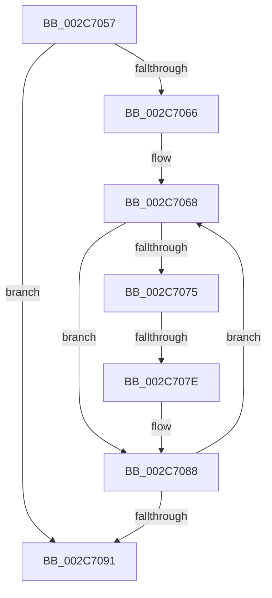

# sub_002C7057

- RVA: `0x002C7057`–`0x002C7096` (길이 `63` bytes)
- VA: `0x00000001402C7057`
- 실행 섹션: `.text`
- PDB 이름 있음: `아니요`; PDB Function 태그: `아니요`
- unwind 정보 RVA: `0x0006ED20`
- 디코드: `19`개 명령, `63/63` bytes 표시
- 미해석 바이트: `0` (있으면 어셈블리에 `.byte`로 보존)

> 이 문서는 커널 이미지의 기계어와 PDB 기호를 분석해 생성했습니다. 4번과 5번은 함수 원형과 자료형을 바이너리 사용 방식에서 추정한 C 해석이며 원본 소스 복구 결과는 아닙니다.

## 1. Dependencies

- 직접 호출 지점: **0**; 고유 호출 대상: **0**
- 직접 호출자로 확인된 함수: **0**
- RIP 상대 이미지 참조: **1**

### Outgoing calls
- 직접 디코드된 call 명령이 없습니다.

### Direct callers
- 이 함수 시작 RVA로 연결되는 직접 call은 확인되지 않았습니다. 간접 호출은 완전히 역산할 수 없습니다.

### Static image references
- `0x002C707E` → RVA `0x00010880` (`.rdata`; read)

## 2. Other-region calls and transfers

- 다른 실행 섹션으로 향하는 call: **0**
- call이 아닌 외부 분기/꼬리 이동: **2**
  - `0x002C7078` → [sub_002C7147](Unknown_function_002C7147.md) (`tail-transfer`)
  - `0x002C7094` → [sub_002C7029](Unknown_function_002C7029.md) (`tail-transfer`)

## 3. Assembly (complete function range)

```asm
002C7057  49 8B 9C EE A8 45 01 00         mov rbx, qword ptr [r14 + rbp*8 + 0x145a8]
002C705F  33 F6                           xor esi, esi
002C7061  48 85 DB                        test rbx, rbx
002C7064  74 2B                           je 0x1402c7091
002C7066  8B C6                           mov eax, esi
002C7068  48 8D 0C C7                     lea rcx, [rdi + rax*8]
002C706C  48 8B 04 C7                     mov rax, qword ptr [rdi + rax*8]
002C7070  48 85 C0                        test rax, rax
002C7073  74 13                           je 0x1402c7088
002C7075  83 FD 01                        cmp ebp, 1
002C7078  0F 86 C9 00 00 00               jbe 0x1402c7147
002C707E  48 8B 05 FB 97 D4 FF            mov rax, qword ptr [rip - 0x2b6805]
002C7085  48 89 01                        mov qword ptr [rcx], rax
002C7088  FF C6                           inc esi
002C708A  8B C6                           mov eax, esi
002C708C  48 3B C3                        cmp rax, rbx
002C708F  72 D7                           jb 0x1402c7068
002C7091  48 8B C7                        mov rax, rdi
002C7094  EB 93                           jmp 0x1402c7029
```

## 4. C-style interpretation (structured pseudocode)

```c
__int64 __fastcall sub_002C7057(void)
{
    __int64 v_rsi;

    v_rsi = 0;
    if (*(unsigned __int64 *)(v_r14 + v_rbp * 8 + 83368) == 0) goto loc_002C7091;
loc_002C7068:
    if (*(unsigned __int64 *)(v_rdi + 0 * 8) == 0) goto loc_002C7088;
    *(unsigned __int64 *)(v_rdi + 0 * 8) = *(unsigned __int64 *)(v_rip - 2844677);
loc_002C7088:
    v_rsi = (unsigned int)((v_rsi) + 1);
    if (((unsigned int)((unsigned int)(v_rsi))) < (*(unsigned __int64 *)(v_r14 + v_rbp * 8 + 83368))) goto loc_002C7068;
loc_002C7091:
}
```

## 5. (Beta) C Style

```c
void sub_002C7057(void)
{
    int64_t local_rsi;

    local_rsi = 0;
    if (*(uint64_t *)(local_r14 + local_rbp * 8 + 0x145A8) == 0) goto loc_002C7091;
loc_002C7068:
    if (*(uint64_t *)(local_rdi + 0x0 * 8) == 0) goto loc_002C7088;
    *(uint64_t *)(local_rdi + 0x0 * 8) = *(uint64_t *)(v_rip - 0x2B6805);
loc_002C7088:
    local_rsi = (uint32_t)((local_rsi) + 1);
    if (((uint32_t)((uint32_t)(local_rsi))) < (*(uint64_t *)(local_r14 + local_rbp * 8 + 0x145A8))) goto loc_002C7068;
loc_002C7091:
}
```

## 6. Execution-region graph

[열기: 2D/3D 그래프와 함수 탐색 컨트롤 패널](../../../control-panel.html?section=text&rva=0x002C7057&view=graph)

- 2D 그래프는 위에서 아래로 흐르고, 3D 그래프는 빈 공간을 드래그해 회전합니다. Shift+드래그는 이동, 휠은 확대·축소, 함수 노드 선택은 대상 보고서 이동입니다.

### Static fallback


