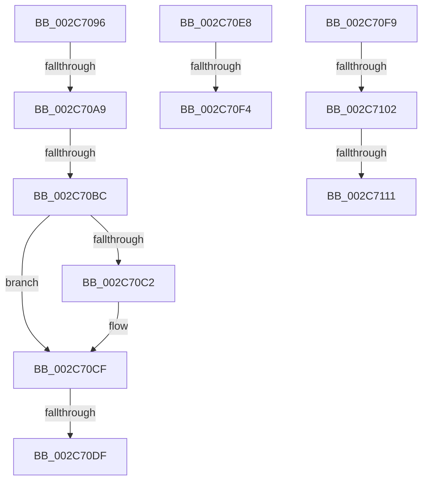

# sub_002C7096

- RVA: `0x002C7096`–`0x002C7127` (길이 `145` bytes)
- VA: `0x00000001402C7096`
- 실행 섹션: `.text`
- PDB 이름 있음: `아니요`; PDB Function 태그: `아니요`
- unwind 정보 RVA: `0x0006ED30`
- 디코드: `31`개 명령, `145/145` bytes 표시
- 미해석 바이트: `0` (있으면 어셈블리에 `.byte`로 보존)

> 이 문서는 커널 이미지의 기계어와 PDB 기호를 분석해 생성했습니다. 4번과 5번은 함수 원형과 자료형을 바이너리 사용 방식에서 추정한 C 해석이며 원본 소스 복구 결과는 아닙니다.

## 1. Dependencies

- 직접 호출 지점: **2**; 고유 호출 대상: **2**
- 직접 호출자로 확인된 함수: **0**
- RIP 상대 이미지 참조: **0**

### Outgoing calls
- `0x002C70D2` → [MiUserPdeOrAbove](MiUserPdeOrAbove_function_002C57F0.md) (function, `0x002C57F0`)
- `0x002C711D` → [MiCheckLinearProtectedPteAccessedBit](../29/MiCheckLinearProtectedPteAccessedBit_function_00292D80.md) (function, `0x00292D80`)

### Direct callers
- 이 함수 시작 RVA로 연결되는 직접 call은 확인되지 않았습니다. 간접 호출은 완전히 역산할 수 없습니다.

### Static image references
- 디코드된 RIP-relative 메모리 참조가 없습니다.

## 2. Other-region calls and transfers

- 다른 실행 섹션으로 향하는 call: **0**
- call이 아닌 외부 분기/꼬리 이동: **9**
  - `0x002C70A3` → [sub_002C6E36 + 0x73](Unknown_function_002C6E36.md) (`tail-transfer`)
  - `0x002C70B6` → [sub_002C715F](Unknown_function_002C715F.md) (`tail-transfer`)
  - `0x002C70D9` → [sub_002C6E36 + 0x73](Unknown_function_002C6E36.md) (`tail-transfer`)
  - `0x002C70E3` → [sub_002C6E36 + 0x73](Unknown_function_002C6E36.md) (`tail-transfer`)
  - `0x002C70EE` → [sub_002C6E36 + 0xE1](Unknown_function_002C6E36.md) (`tail-transfer`)
  - `0x002C70F4` → [sub_002C6E36 + 0x11C](Unknown_function_002C6E36.md) (`tail-transfer`)
  - `0x002C70FC` → [sub_002C6E36 + 0x1C0](Unknown_function_002C6E36.md) (`tail-transfer`)
  - `0x002C710B` → [sub_002C6E36 + 0x1C0](Unknown_function_002C6E36.md) (`tail-transfer`)
  - `0x002C7122` → [sub_002C6E36 + 0x1C0](Unknown_function_002C6E36.md) (`tail-transfer`)

## 3. Assembly (complete function range)

```asm
002C7096  48 B8 FF FF FF 7F FB F6 FF FF   movabs rax, 0xfffff6fb7fffffff
002C70A0  48 3B F8                        cmp rdi, rax
002C70A3  0F 87 00 FE FF FF               ja 0x1402c6ea9
002C70A9  48 B8 68 DF BE 7D FB F6 FF FF   movabs rax, 0xfffff6fb7dbedf68
002C70B3  48 3B F8                        cmp rdi, rax
002C70B6  0F 84 A3 00 00 00               je 0x1402c715f
002C70BC  0F BA E6 1A                     bt esi, 0x1a
002C70C0  72 0D                           jb 0x1402c70cf
002C70C2  48 B8 FF FF FF FF FF FF FF 7F   movabs rax, 0x7fffffffffffffff
002C70CC  48 23 D8                        and rbx, rax
002C70CF  48 8B CF                        mov rcx, rdi
002C70D2  E8 19 E7 FF FF                  call 0x1402c57f0
002C70D7  85 C0                           test eax, eax
002C70D9  0F 84 CA FD FF FF               je 0x1402c6ea9
002C70DF  48 83 CB 04                     or rbx, 4
002C70E3  E9 C1 FD FF FF                  jmp 0x1402c6ea9
002C70E8  49 8B CD                        mov rcx, r13
002C70EB  48 3B C1                        cmp rax, rcx
002C70EE  0F 87 23 FE FF FF               ja 0x1402c6f17
002C70F4  E9 59 FE FF FF                  jmp 0x1402c6f52
002C70F9  F6 C3 20                        test bl, 0x20
002C70FC  0F 85 F4 FE FF FF               jne 0x1402c6ff6
002C7102  49 8B C4                        mov rax, r12
002C7105  48 03 C1                        add rax, rcx
002C7108  4C 3B F0                        cmp r14, rax
002C710B  0F 82 E5 FE FF FF               jb 0x1402c6ff6
002C7111  41 B8 80 00 00 00               mov r8d, 0x80
002C7117  48 8B D3                        mov rdx, rbx
002C711A  49 8B CE                        mov rcx, r14
002C711D  E8 5E BC FC FF                  call 0x140292d80
002C7122  E9 CF FE FF FF                  jmp 0x1402c6ff6
```

## 4. C-style interpretation (structured pseudocode)

```c
__int64 __fastcall sub_002C7096(void)
{
    __int64 result;
    __int64 v_rbx;

    if (v_rdi >= result) {
        v_rbx = (v_rbx) & (result);
    }
    result = MiUserPdeOrAbove(v_rdi, a2, a3, a4);
    v_rbx = (v_rbx) | (4);
}
```

## 5. (Beta) C Style

```c
void sub_002C7096(void)
{
    int64_t result;
    int64_t local_rbx;

    if (local_rdi >= result) {
        local_rbx = (local_rbx) & (result);
    }
    result = MiUserPdeOrAbove(local_rdi, a2, a3, a4);
    local_rbx = (local_rbx) | (4);
}
```

## 6. Execution-region graph

[열기: 2D/3D 그래프와 함수 탐색 컨트롤 패널](../../../control-panel.html?section=text&rva=0x002C7096&view=graph)

- 2D 그래프는 위에서 아래로 흐르고, 3D 그래프는 빈 공간을 드래그해 회전합니다. Shift+드래그는 이동, 휠은 확대·축소, 함수 노드 선택은 대상 보고서 이동입니다.

### Static fallback


