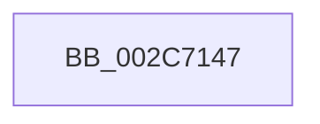

# sub_002C7147

- RVA: `0x002C7147`–`0x002C715F` (길이 `24` bytes)
- VA: `0x00000001402C7147`
- 실행 섹션: `.text`
- PDB 이름 있음: `아니요`; PDB Function 태그: `아니요`
- unwind 정보 RVA: `0x0006ED58`
- 디코드: `6`개 명령, `24/24` bytes 표시
- 미해석 바이트: `0` (있으면 어셈블리에 `.byte`로 보존)

> 이 문서는 커널 이미지의 기계어와 PDB 기호를 분석해 생성했습니다. 4번과 5번은 함수 원형과 자료형을 바이너리 사용 방식에서 추정한 C 해석이며 원본 소스 복구 결과는 아닙니다.

## 1. Dependencies

- 직접 호출 지점: **1**; 고유 호출 대상: **1**
- 직접 호출자로 확인된 함수: **0**
- RIP 상대 이미지 참조: **1**

### Outgoing calls
- `0x002C7155` → [MiRewritePteWithLockBit](../32/MiRewritePteWithLockBit_function_00322FEC.md) (function, `0x00322FEC`)

### Direct callers
- 이 함수 시작 RVA로 연결되는 직접 call은 확인되지 않았습니다. 간접 호출은 완전히 역산할 수 없습니다.

### Static image references
- `0x002C7147` → RVA `0x00010880` (`.rdata`; read)

## 2. Other-region calls and transfers

- 다른 실행 섹션으로 향하는 call: **0**
- call이 아닌 외부 분기/꼬리 이동: **1**
  - `0x002C715A` → [sub_002C7057 + 0x31](Unknown_function_002C7057.md) (`tail-transfer`)

## 3. Assembly (complete function range)

```asm
002C7147  4C 8B 0D 32 97 D4 FF            mov r9, qword ptr [rip - 0x2b68ce]
002C714E  4C 8B C1                        mov r8, rcx
002C7151  33 C9                           xor ecx, ecx
002C7153  33 D2                           xor edx, edx
002C7155  E8 92 BE 05 00                  call 0x140322fec
002C715A  E9 29 FF FF FF                  jmp 0x1402c7088
```

## 4. C-style interpretation (structured pseudocode)

```c
__int64 __fastcall sub_002C7147(__int64 a1, int a2)
{
    __int64 result;

    a1 = 0;
    a2 = 0;
    result = MiRewritePteWithLockBit(a1, a2, a1, *(unsigned __int64 *)(v_rip - 2844878));
}
```

## 5. (Beta) C Style

```c
int64_t sub_002C7147(int64_t Arg1, int32_t Arg2)
{
    int64_t result;

    Arg1 = 0;
    Arg2 = 0;
    result = MiRewritePteWithLockBit(Arg1, Arg2, Arg1, *(uint64_t *)(v_rip - 0x2B68CE));
}
```

## 6. Execution-region graph

[열기: 2D/3D 그래프와 함수 탐색 컨트롤 패널](../../../control-panel.html?section=text&rva=0x002C7147&view=graph)

- 2D 그래프는 위에서 아래로 흐르고, 3D 그래프는 빈 공간을 드래그해 회전합니다. Shift+드래그는 이동, 휠은 확대·축소, 함수 노드 선택은 대상 보고서 이동입니다.

### Static fallback


