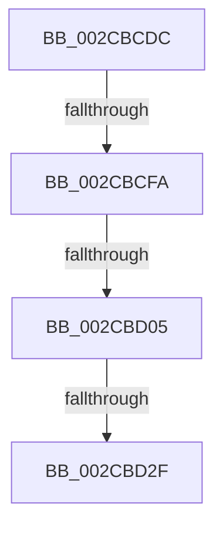

# sub_002CBCDC

- RVA: `0x002CBCDC`–`0x002CBD32` (길이 `86` bytes)
- VA: `0x00000001402CBCDC`
- 실행 섹션: `.text`
- PDB 이름 있음: `아니요`; PDB Function 태그: `아니요`
- unwind 정보 RVA: `0x0006F358`
- 디코드: `21`개 명령, `86/86` bytes 표시
- 미해석 바이트: `0` (있으면 어셈블리에 `.byte`로 보존)

> 이 문서는 커널 이미지의 기계어와 PDB 기호를 분석해 생성했습니다. 4번과 5번은 함수 원형과 자료형을 바이너리 사용 방식에서 추정한 C 해석이며 원본 소스 복구 결과는 아닙니다.

## 1. Dependencies

- 직접 호출 지점: **0**; 고유 호출 대상: **0**
- 직접 호출자로 확인된 함수: **0**
- RIP 상대 이미지 참조: **0**

### Outgoing calls
- 직접 디코드된 call 명령이 없습니다.

### Direct callers
- 이 함수 시작 RVA로 연결되는 직접 call은 확인되지 않았습니다. 간접 호출은 완전히 역산할 수 없습니다.

### Static image references
- 디코드된 RIP-relative 메모리 참조가 없습니다.

## 2. Other-region calls and transfers

- 다른 실행 섹션으로 향하는 call: **0**
- call이 아닌 외부 분기/꼬리 이동: **3**
  - `0x002CBCF4` → [sub_002CBE9E](Unknown_function_002CBE9E.md) (`tail-transfer`)
  - `0x002CBCFF` → [sub_002CBDDE](Unknown_function_002CBDDE.md) (`tail-transfer`)
  - `0x002CBD29` → [sub_002CBDDE](Unknown_function_002CBDDE.md) (`tail-transfer`)

## 3. Assembly (complete function range)

```asm
002CBCDC  48 89 5C 24 50                  mov qword ptr [rsp + 0x50], rbx
002CBCE1  33 DB                           xor ebx, ebx
002CBCE3  4C 89 64 24 30                  mov qword ptr [rsp + 0x30], r12
002CBCE8  44 8D 60 40                     lea r12d, [rax + 0x40]
002CBCEC  48 89 7C 24 60                  mov qword ptr [rsp + 0x60], rdi
002CBCF1  48 85 D2                        test rdx, rdx
002CBCF4  0F 84 A4 01 00 00               je 0x1402cbe9e
002CBCFA  8B 41 04                        mov eax, dword ptr [rcx + 4]
002CBCFD  A8 20                           test al, 0x20
002CBCFF  0F 85 D9 00 00 00               jne 0x1402cbdde
002CBD05  41 8B D8                        mov ebx, r8d
002CBD08  48 8D BA 80 DF 00 00            lea rdi, [rdx + 0xdf80]
002CBD0F  83 E3 01                        and ebx, 1
002CBD12  B8 00 04 00 00                  mov eax, 0x400
002CBD17  41 0F 45 C4                     cmovne eax, r12d
002CBD1B  48 83 F3 01                     xor rbx, 1
002CBD1F  48 C1 E3 14                     shl rbx, 0x14
002CBD23  44 8B E0                        mov r12d, eax
002CBD26  48 3B D7                        cmp rdx, rdi
002CBD29  0F 83 AF 00 00 00               jae 0x1402cbdde
002CBD2F  48 2B FA                        sub rdi, rdx
```

## 4. C-style interpretation (structured pseudocode)

```c
__int64 __fastcall sub_002CBCDC(__int64 a1, __int64 a2, int a3)
{
    __int64 result;
    __int64 v_rbx;
    __int64 v_rdi;
    unsigned __int64 v_stack_p30;
    unsigned __int64 v_stack_p50;
    unsigned __int64 v_stack_p60;

    v_stack_p50 = v_rbx;
    v_rbx = 0;
    v_stack_p30 = v_r12;
    v_stack_p60 = v_rdi;
    v_rbx = (unsigned int)(((unsigned int)(a3)) & (1));
    result = (unsigned int)(0x400ULL);
    if (condition_is_not_equal) { result = (unsigned int)(result + 64); }
    v_rbx = (v_rbx) ^ (1);
    v_rbx = (v_rbx) << (20);
    v_rdi = (a2 + 57216) - (a2);
    return result;
}
```

## 5. (Beta) C Style

```c
int64_t sub_002CBCDC(void *Arg1, int64_t Arg2, int32_t Arg3)
{
    uint8_t *arg1 = (uint8_t *)Arg1;

    int64_t result;
    int64_t local_rbx;
    int64_t local_rdi;
    uint64_t v_stack_p30;
    uint64_t v_stack_p50;
    uint64_t v_stack_p60;

    v_stack_p50 = local_rbx;
    local_rbx = 0;
    v_stack_p30 = local_r12;
    v_stack_p60 = local_rdi;
    local_rbx = (uint32_t)(((uint32_t)(Arg3)) & (1));
    result = (uint32_t)(0x400ULL);
    if (condition_is_not_equal) { result = (uint32_t)(result + 64); }
    local_rbx = (local_rbx) ^ (1);
    local_rbx = (local_rbx) << (20);
    local_rdi = (Arg2 + 57216) - (Arg2);
    return result;
}
```

### 관측된 메모리 오프셋

구조체 형식이 확인되지 않은 접근은 인자 기준의 오프셋으로만 기록했습니다.

| 기준 인자 | 오프셋 표현 | 폭 (bit) | 접근 |
|---|---:|---:|---|
| `Arg1` | `+ 0x4` | `32` | `R` |

## 6. Execution-region graph

[열기: 2D/3D 그래프와 함수 탐색 컨트롤 패널](../../../control-panel.html?section=text&rva=0x002CBCDC&view=graph)

- 2D 그래프는 위에서 아래로 흐르고, 3D 그래프는 빈 공간을 드래그해 회전합니다. Shift+드래그는 이동, 휠은 확대·축소, 함수 노드 선택은 대상 보고서 이동입니다.

### Static fallback


