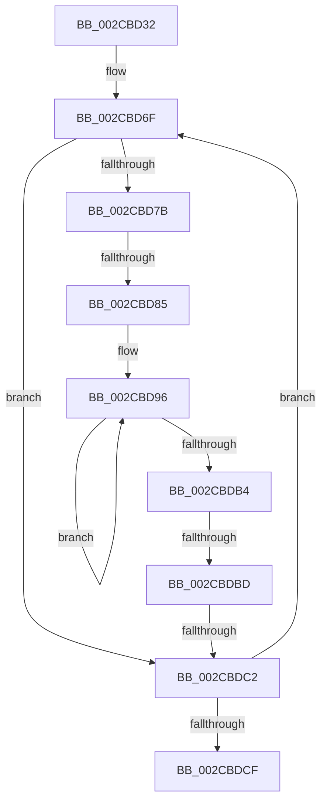

# sub_002CBD32

- RVA: `0x002CBD32`–`0x002CBDDE` (길이 `172` bytes)
- VA: `0x00000001402CBD32`
- 실행 섹션: `.text`
- PDB 이름 있음: `아니요`; PDB Function 태그: `아니요`
- unwind 정보 RVA: `0x0006F374`
- 디코드: `40`개 명령, `172/172` bytes 표시
- 미해석 바이트: `0` (있으면 어셈블리에 `.byte`로 보존)

> 이 문서는 커널 이미지의 기계어와 PDB 기호를 분석해 생성했습니다. 4번과 5번은 함수 원형과 자료형을 바이너리 사용 방식에서 추정한 C 해석이며 원본 소스 복구 결과는 아닙니다.

## 1. Dependencies

- 직접 호출 지점: **0**; 고유 호출 대상: **0**
- 직접 호출자로 확인된 함수: **0**
- RIP 상대 이미지 참조: **1**

### Outgoing calls
- 직접 디코드된 call 명령이 없습니다.

### Direct callers
- 이 함수 시작 RVA로 연결되는 직접 call은 확인되지 않았습니다. 간접 호출은 완전히 역산할 수 없습니다.

### Static image references
- `0x002CBD58` → RVA `0x00011C60` (`.rdata`; read)

## 2. Other-region calls and transfers

- 다른 실행 섹션으로 향하는 call: **0**
- call이 아닌 외부 분기/꼬리 이동: **3**
  - `0x002CBD7F` → [sub_002CBDF6 + 0x3D](Unknown_function_002CBDF6.md) (`tail-transfer`)
  - `0x002CBDB7` → [sub_002CBDF6 + 0x92](Unknown_function_002CBDF6.md) (`tail-transfer`)
  - `0x002CBDC0` → [sub_002CBDF6](Unknown_function_002CBDF6.md) (`tail-transfer`)

## 3. Assembly (complete function range)

```asm
002CBD32  4C 89 74 24 28                  mov qword ptr [rsp + 0x28], r14
002CBD37  48 FF CF                        dec rdi
002CBD3A  48 89 6C 24 58                  mov qword ptr [rsp + 0x58], rbp
002CBD3F  48 B8 CB 21 7B 17 E9 D7 39 25   movabs rax, 0x2539d7e9177b21cb
002CBD49  4C 89 7C 24 20                  mov qword ptr [rsp + 0x20], r15
002CBD4E  4C 8D B2 10 0F 00 00            lea r14, [rdx + 0xf10]
002CBD55  48 F7 E7                        mul rdi
002CBD58  4C 8D 1D 01 5F D4 FF            lea r11, [rip - 0x2ba0ff]
002CBD5F  48 2B FA                        sub rdi, rdx
002CBD62  48 D1 EF                        shr rdi, 1
002CBD65  48 03 FA                        add rdi, rdx
002CBD68  48 C1 EF 0F                     shr rdi, 0xf
002CBD6C  48 FF C7                        inc rdi
002CBD6F  41 0F B6 86 B0 2C 00 00         movzx eax, byte ptr [r14 + 0x2cb0]
002CBD77  84 C0                           test al, al
002CBD79  75 47                           jne 0x1402cbdc2
002CBD7B  41 F6 C5 02                     test r13b, 2
002CBD7F  0F 85 AE 00 00 00               jne 0x1402cbe33
002CBD85  45 33 C9                        xor r9d, r9d
002CBD88  49 8D 86 00 F1 FF FF            lea rax, [r14 - 0xf00]
002CBD8F  4D 8B C3                        mov r8, r11
002CBD92  45 8D 51 03                     lea r10d, [r9 + 3]
002CBD96  49 8B 08                        mov rcx, qword ptr [r8]
002CBD99  4D 8D 40 08                     lea r8, [r8 + 8]
002CBD9D  48 8B 10                        mov rdx, qword ptr [rax]
002CBDA0  48 8D 80 00 05 00 00            lea rax, [rax + 0x500]
002CBDA7  48 0F AF D1                     imul rdx, rcx
002CBDAB  4C 03 CA                        add r9, rdx
002CBDAE  49 83 EA 01                     sub r10, 1
002CBDB2  75 E2                           jne 0x1402cbd96
002CBDB4  48 85 F6                        test rsi, rsi
002CBDB7  0F 84 CB 00 00 00               je 0x1402cbe88
002CBDBD  4D 3B CC                        cmp r9, r12
002CBDC0  73 34                           jae 0x1402cbdf6
002CBDC2  49 81 C6 80 DF 00 00            add r14, 0xdf80
002CBDC9  48 83 EF 01                     sub rdi, 1
002CBDCD  75 A0                           jne 0x1402cbd6f
002CBDCF  4C 8B 7C 24 20                  mov r15, qword ptr [rsp + 0x20]
002CBDD4  4C 8B 74 24 28                  mov r14, qword ptr [rsp + 0x28]
002CBDD9  48 8B 6C 24 58                  mov rbp, qword ptr [rsp + 0x58]
```

## 4. C-style interpretation (structured pseudocode)

```c
__int64 __fastcall sub_002CBD32(__int64 a1, __int64 a2, __int64 a3, int a4, __int64 a5, __int64 a6, __int64 a7, __int64 a8, __int64 a9, __int64 a10, __int64 a11)
{
    __int64 v_r10;
    __int64 v_r14;
    __int64 v_rdi;
    unsigned __int64 v_stack_p20;
    unsigned __int64 v_stack_p28;
    unsigned __int64 v_stack_p58;

    v_stack_p28 = v_r14;
    v_rdi = (v_rdi) - 1;
    v_stack_p58 = v_rbp;
    v_stack_p20 = v_r15;
    v_rdi = (v_rdi) - (a2);
    v_rdi = (v_rdi) >> (1);
    v_rdi = (v_rdi) + (a2);
    v_rdi = (v_rdi) >> (15);
    v_rdi = (v_rdi) + 1;
loc_002CBD6F:
    if ((unsigned __int8)(*(unsigned __int8 *)(a2 + 3856 + 11440)) != 0) goto loc_002CBDC2;
    a4 = 0;
loc_002CBD96:
    a2 = (*(unsigned __int64 *)(a2 + 3856 - 3840)) * (*(unsigned __int64 *)(v_rip - 2859263));
    a4 = (a4) + (a2);
    v_r10 = (a4 + 3) - (1);
    if (condition_is_not_equal) goto loc_002CBD96;
loc_002CBDC2:
    v_r14 = (a2 + 3856) + (0xDF80ULL);
    v_rdi = (v_rdi) - (1);
    if (condition_is_not_equal) goto loc_002CBD6F;
    return a2 + 3856 - 3840 + 1280;
}
```

## 5. (Beta) C Style

```c
int64_t sub_002CBD32(int64_t Arg1, void *Arg2, int64_t Arg3, int32_t Arg4, int64_t Arg5, uint64_t Arg6, uint64_t Arg7, uint64_t Arg8, uint64_t Arg9, uint64_t Arg10, int64_t Arg11)
{
    uint8_t *arg2 = (uint8_t *)Arg2;

    int64_t local_r10;
    int64_t local_r14;
    int64_t local_rdi;
    uint64_t v_stack_p20;
    uint64_t v_stack_p28;
    uint64_t v_stack_p58;

    v_stack_p28 = local_r14;
    local_rdi = (local_rdi) - 1;
    v_stack_p58 = local_rbp;
    v_stack_p20 = local_r15;
    local_rdi = (local_rdi) - (Arg2);
    local_rdi = (local_rdi) >> (1);
    local_rdi = (local_rdi) + (Arg2);
    local_rdi = (local_rdi) >> (15);
    local_rdi = (local_rdi) + 1;
loc_002CBD6F:
    if ((uint8_t)(*(uint8_t *)(arg2 + 0xF10 + 0x2CB0)) != 0) goto loc_002CBDC2;
    Arg4 = 0;
loc_002CBD96:
    Arg2 = (*(uint64_t *)(arg2 + 0xF10 - 0xF00)) * (*(uint64_t *)(v_rip - 0x2BA0FF));
    Arg4 = (Arg4) + (Arg2);
    local_r10 = (Arg4 + 3) - (1);
    if (condition_is_not_equal) goto loc_002CBD96;
loc_002CBDC2:
    local_r14 = (Arg2 + 3856) + (0xDF80ULL);
    local_rdi = (local_rdi) - (1);
    if (condition_is_not_equal) goto loc_002CBD6F;
    return Arg2 + 3856 - 3840 + 1280;
}
```

### 관측된 메모리 오프셋

구조체 형식이 확인되지 않은 접근은 인자 기준의 오프셋으로만 기록했습니다.

| 기준 인자 | 오프셋 표현 | 폭 (bit) | 접근 |
|---|---:|---:|---|
| `Arg2` | `- 0xF00` | `64` | `R` |
| `Arg2` | `+ 0x0` | `64` | `R` |
| `Arg2` | `+ 0x500` | `64` | `R` |
| `Arg2` | `+ 0xF10` | `64` | `R` |
| `Arg2` | `+ 0x2CB0` | `8` | `R` |

## 6. Execution-region graph

[열기: 2D/3D 그래프와 함수 탐색 컨트롤 패널](../../../control-panel.html?section=text&rva=0x002CBD32&view=graph)

- 2D 그래프는 위에서 아래로 흐르고, 3D 그래프는 빈 공간을 드래그해 회전합니다. Shift+드래그는 이동, 휠은 확대·축소, 함수 노드 선택은 대상 보고서 이동입니다.

### Static fallback


