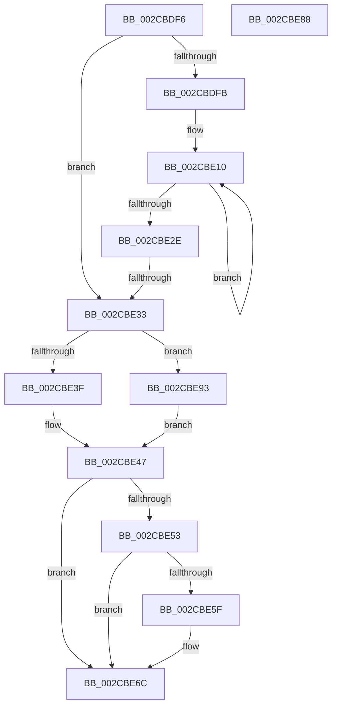

# sub_002CBDF6

- RVA: `0x002CBDF6`–`0x002CBE9E` (길이 `168` bytes)
- VA: `0x00000001402CBDF6`
- 실행 섹션: `.text`
- PDB 이름 있음: `아니요`; PDB Function 태그: `아니요`
- unwind 정보 RVA: `0x0006F3B4`
- 디코드: `41`개 명령, `168/168` bytes 표시
- 미해석 바이트: `0` (있으면 어셈블리에 `.byte`로 보존)

> 이 문서는 커널 이미지의 기계어와 PDB 기호를 분석해 생성했습니다. 4번과 5번은 함수 원형과 자료형을 바이너리 사용 방식에서 추정한 C 해석이며 원본 소스 복구 결과는 아닙니다.

## 1. Dependencies

- 직접 호출 지점: **4**; 고유 호출 대상: **4**
- 직접 호출자로 확인된 함수: **0**
- RIP 상대 이미지 참조: **1**

### Outgoing calls
- `0x002CBE42` → [ExAcquireSpinLockExclusiveAtDpcLevel](../24/ExAcquireSpinLockExclusiveAtDpcLevel_function_00248E80.md) (function, `0x00248E80`)
- `0x002CBE67` → [MiWakeZeroingThreads](MiWakeZeroingThreads_function_002CBEC0.md) (function, `0x002CBEC0`)
- `0x002CBE77` → [MiReleaseSpinLockExclusive](../24/MiReleaseSpinLockExclusive_function_002482C0.md) (function, `0x002482C0`)
- `0x002CBE93` → [ExAcquireSpinLockExclusive](../24/ExAcquireSpinLockExclusive_function_00248690.md) (function, `0x00248690`)

### Direct callers
- 이 함수 시작 RVA로 연결되는 직접 call은 확인되지 않았습니다. 간접 호출은 완전히 역산할 수 없습니다.

### Static image references
- `0x002CBE7C` → RVA `0x00011C60` (`.rdata`; read)

## 2. Other-region calls and transfers

- 다른 실행 섹션으로 향하는 call: **0**
- call이 아닌 외부 분기/꼬리 이동: **3**
  - `0x002CBE31` → [sub_002CBD32 + 0x90](Unknown_function_002CBD32.md) (`tail-transfer`)
  - `0x002CBE83` → [sub_002CBD32 + 0x90](Unknown_function_002CBD32.md) (`tail-transfer`)
  - `0x002CBE8E` → [sub_002CBD32 + 0x8B](Unknown_function_002CBD32.md) (`tail-transfer`)

## 3. Assembly (complete function range)

```asm
002CBDF6  48 85 DB                        test rbx, rbx
002CBDF9  74 38                           je 0x1402cbe33
002CBDFB  45 33 C9                        xor r9d, r9d
002CBDFE  4D 8D 86 F8 F0 FF FF            lea r8, [r14 - 0xf08]
002CBE05  49 8B D3                        mov rdx, r11
002CBE08  45 8D 51 03                     lea r10d, [r9 + 3]
002CBE0C  0F 1F 40 00                     nop dword ptr [rax]
002CBE10  48 8B 02                        mov rax, qword ptr [rdx]
002CBE13  48 8D 52 08                     lea rdx, [rdx + 8]
002CBE17  49 8B 08                        mov rcx, qword ptr [r8]
002CBE1A  4D 8D 80 00 05 00 00            lea r8, [r8 + 0x500]
002CBE21  48 0F AF C8                     imul rcx, rax
002CBE25  4C 03 C9                        add r9, rcx
002CBE28  49 83 EA 01                     sub r10, 1
002CBE2C  75 E2                           jne 0x1402cbe10
002CBE2E  4C 3B CB                        cmp r9, rbx
002CBE31  73 8F                           jae 0x1402cbdc2
002CBE33  49 8D 8E A0 2C 00 00            lea rcx, [r14 + 0x2ca0]
002CBE3A  48 85 F6                        test rsi, rsi
002CBE3D  74 54                           je 0x1402cbe93
002CBE3F  41 B7 11                        mov r15b, 0x11
002CBE42  E8 39 D0 F7 FF                  call 0x140248e80
002CBE47  49 8B 8E 98 2C 00 00            mov rcx, qword ptr [r14 + 0x2c98]
002CBE4E  48 85 C9                        test rcx, rcx
002CBE51  74 19                           je 0x1402cbe6c
002CBE53  41 0F B6 96 B0 2C 00 00         movzx edx, byte ptr [r14 + 0x2cb0]
002CBE5B  84 D2                           test dl, dl
002CBE5D  75 0D                           jne 0x1402cbe6c
002CBE5F  41 C6 86 B0 2C 00 00 01         mov byte ptr [r14 + 0x2cb0], 1
002CBE67  E8 54 00 00 00                  call 0x1402cbec0
002CBE6C  41 0F B6 D7                     movzx edx, r15b
002CBE70  49 8D 8E A0 2C 00 00            lea rcx, [r14 + 0x2ca0]
002CBE77  E8 44 C4 F7 FF                  call 0x1402482c0
002CBE7C  4C 8D 1D DD 5D D4 FF            lea r11, [rip - 0x2ba223]
002CBE83  E9 3A FF FF FF                  jmp 0x1402cbdc2
002CBE88  49 8B 06                        mov rax, qword ptr [r14]
002CBE8B  4C 03 C8                        add r9, rax
002CBE8E  E9 2A FF FF FF                  jmp 0x1402cbdbd
002CBE93  E8 F8 C7 F7 FF                  call 0x140248690
002CBE98  44 0F B6 F8                     movzx r15d, al
002CBE9C  EB A9                           jmp 0x1402cbe47
```

## 4. C-style interpretation (structured pseudocode)

```c
__int64 __fastcall sub_002CBDF6(__int64 a1, __int64 a2, __int64 a3, int a4)
{
    __int64 result;
    __int64 v_r10;

    if (v_rbx == 0) goto loc_002CBE33;
    a4 = 0;
loc_002CBE10:
    a1 = (*(unsigned __int64 *)(v_r14 - 3848)) * (*(unsigned __int64 *)(v_r11));
    a4 = (a4) + (a1);
    v_r10 = (a4 + 3) - (1);
    if (condition_is_not_equal) goto loc_002CBE10;
loc_002CBE33:
    if (v_rsi == 0) goto loc_002CBE93;
    result = ExAcquireSpinLockExclusiveAtDpcLevel(v_r14 + 11424, v_r11 + 8, v_r14 - 3848 + 1280, a4);
loc_002CBE47:
    if (*(unsigned __int64 *)(v_r14 + 11416) == 0) goto loc_002CBE6C;
    if ((unsigned __int8)(*(unsigned __int8 *)(v_r14 + 11440)) == 0) {
        *(unsigned __int8 *)(v_r14 + 11440) = 1;
        result = MiWakeZeroingThreads(*(unsigned __int64 *)(v_r14 + 11416), *(unsigned __int8 *)(v_r14 + 11440), v_r14 - 3848 + 1280, a4);
    }
    result = MiReleaseSpinLockExclusive(v_r14 + 11424, 17, v_r14 - 3848 + 1280, a4);
loc_002CBE93:
    result = ExAcquireSpinLockExclusive(v_r14 + 11424, 17, v_r14 - 3848 + 1280, a4);
    goto loc_002CBE47;
}
```

## 5. (Beta) C Style

```c
int64_t sub_002CBDF6(int64_t Arg1, int64_t Arg2, int64_t Arg3, int32_t Arg4)
{
    int64_t result;
    int64_t local_r10;

    if (local_rbx == 0) goto loc_002CBE33;
    Arg4 = 0;
loc_002CBE10:
    Arg1 = (*(uint64_t *)(local_r14 - 0xF08)) * (*(uint64_t *)(local_r11));
    Arg4 = (Arg4) + (Arg1);
    local_r10 = (Arg4 + 3) - (1);
    if (condition_is_not_equal) goto loc_002CBE10;
loc_002CBE33:
    if (local_rsi == 0) goto loc_002CBE93;
    result = ExAcquireSpinLockExclusiveAtDpcLevel(local_r14 + 11424, local_r11 + 8, local_r14 - 3848 + 1280, Arg4);
loc_002CBE47:
    if (*(uint64_t *)(local_r14 + 0x2C98) == 0) goto loc_002CBE6C;
    if ((uint8_t)(*(uint8_t *)(local_r14 + 0x2CB0)) == 0) {
        *(uint8_t *)(local_r14 + 0x2CB0) = 1;
        result = MiWakeZeroingThreads(*(uint64_t *)(local_r14 + 0x2C98), *(uint8_t *)(local_r14 + 0x2CB0), local_r14 - 3848 + 1280, Arg4);
    }
    result = MiReleaseSpinLockExclusive(local_r14 + 11424, 17, local_r14 - 3848 + 1280, Arg4);
loc_002CBE93:
    result = ExAcquireSpinLockExclusive(local_r14 + 11424, 17, local_r14 - 3848 + 1280, Arg4);
    goto loc_002CBE47;
}
```

## 6. Execution-region graph

[열기: 2D/3D 그래프와 함수 탐색 컨트롤 패널](../../../control-panel.html?section=text&rva=0x002CBDF6&view=graph)

- 2D 그래프는 위에서 아래로 흐르고, 3D 그래프는 빈 공간을 드래그해 회전합니다. Shift+드래그는 이동, 휠은 확대·축소, 함수 노드 선택은 대상 보고서 이동입니다.

### Static fallback


