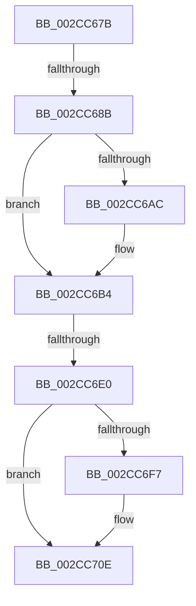

# sub_002CC67B

- RVA: `0x002CC67B`–`0x002CC724` (길이 `169` bytes)
- VA: `0x00000001402CC67B`
- 실행 섹션: `.text`
- PDB 이름 있음: `아니요`; PDB Function 태그: `아니요`
- unwind 정보 RVA: `0x0006F464`
- 디코드: `36`개 명령, `169/169` bytes 표시
- 미해석 바이트: `0` (있으면 어셈블리에 `.byte`로 보존)

> 이 문서는 커널 이미지의 기계어와 PDB 기호를 분석해 생성했습니다. 4번과 5번은 함수 원형과 자료형을 바이너리 사용 방식에서 추정한 C 해석이며 원본 소스 복구 결과는 아닙니다.

## 1. Dependencies

- 직접 호출 지점: **5**; 고유 호출 대상: **5**
- 직접 호출자로 확인된 함수: **0**
- RIP 상대 이미지 참조: **0**

### Outgoing calls
- `0x002CC699` → [ExAcquireSpinLockExclusive](../24/ExAcquireSpinLockExclusive_function_00248690.md) (function, `0x00248690`)
- `0x002CC6AF` → [MiUnlinkZeroThreadFromActiveDomain](MiUnlinkZeroThreadFromActiveDomain_function_002CCB9C.md) (function, `0x002CCB9C`)
- `0x002CC6C5` → [MiFindBestZeroingProcessor](MiFindBestZeroingProcessor_function_002CC73C.md) (function, `0x002CC73C`)
- `0x002CC6EE` → [MiAssignBackgroundZeroThreadToProcessor](MiAssignBackgroundZeroThreadToProcessor_function_002CCAAC.md) (function, `0x002CCAAC`)
- `0x002CC709` → [MiReleaseSpinLockExclusive](../24/MiReleaseSpinLockExclusive_function_002482C0.md) (function, `0x002482C0`)

### Direct callers
- 이 함수 시작 RVA로 연결되는 직접 call은 확인되지 않았습니다. 간접 호출은 완전히 역산할 수 없습니다.

### Static image references
- 디코드된 RIP-relative 메모리 참조가 없습니다.

## 2. Other-region calls and transfers

- 다른 실행 섹션으로 향하는 call: **0**
- call이 아닌 외부 분기/꼬리 이동: **3**
  - `0x002CC685` → [sub_002CC724 + 0x7](Unknown_function_002CC724.md) (`tail-transfer`)
  - `0x002CC6DE` → [sub_002CC724](Unknown_function_002CC724.md) (`tail-transfer`)
  - `0x002CC71F` → [MiSelectBestZeroingProcessor + 0x78](MiSelectBestZeroingProcessor_function_002CC5E0.md) (`tail-transfer`)

## 3. Assembly (complete function range)

```asm
002CC67B  4C 89 BC 24 80 00 00 00         mov qword ptr [rsp + 0x80], r15
002CC683  85 ED                           test ebp, ebp
002CC685  0F 85 A0 00 00 00               jne 0x1402cc72b
002CC68B  48 8B 89 D0 00 00 00            mov rcx, qword ptr [rcx + 0xd0]
002CC692  48 81 C1 B0 3B 00 00            add rcx, 0x3bb0
002CC699  E8 F2 BF F7 FF                  call 0x140248690
002CC69E  44 0F B6 F8                     movzx r15d, al
002CC6A2  48 83 BB 60 01 00 00 00         cmp qword ptr [rbx + 0x160], 0
002CC6AA  74 08                           je 0x1402cc6b4
002CC6AC  48 8B CB                        mov rcx, rbx
002CC6AF  E8 E8 04 00 00                  call 0x1402ccb9c
002CC6B4  41 B9 01 00 00 00               mov r9d, 1
002CC6BA  48 8D 4C 24 20                  lea rcx, [rsp + 0x20]
002CC6BF  45 8B C6                        mov r8d, r14d
002CC6C2  48 8B D6                        mov rdx, rsi
002CC6C5  E8 72 00 00 00                  call 0x1402cc73c
002CC6CA  4C 63 74 24 48                  movsxd r14, dword ptr [rsp + 0x48]
002CC6CF  48 8B CB                        mov rcx, rbx
002CC6D2  42 FF 84 B7 68 50 EF 00         inc dword ptr [rdi + r14*4 + 0xef5068]
002CC6DA  41 83 FE 05                     cmp r14d, 5
002CC6DE  74 44                           je 0x1402cc724
002CC6E0  FF 86 14 01 00 00               inc dword ptr [rsi + 0x114]
002CC6E6  4C 8D 44 24 20                  lea r8, [rsp + 0x20]
002CC6EB  48 8B D6                        mov rdx, rsi
002CC6EE  E8 B9 03 00 00                  call 0x1402ccaac
002CC6F3  85 ED                           test ebp, ebp
002CC6F5  75 17                           jne 0x1402cc70e
002CC6F7  48 8B 8E D0 00 00 00            mov rcx, qword ptr [rsi + 0xd0]
002CC6FE  41 0F B6 D7                     movzx edx, r15b
002CC702  48 81 C1 B0 3B 00 00            add rcx, 0x3bb0
002CC709  E8 B2 BB F7 FF                  call 0x1402482c0
002CC70E  4C 8B BC 24 80 00 00 00         mov r15, qword ptr [rsp + 0x80]
002CC716  33 C0                           xor eax, eax
002CC718  41 83 FE 05                     cmp r14d, 5
002CC71C  0F 95 C0                        setne al
002CC71F  E9 34 FF FF FF                  jmp 0x1402cc658
```

## 4. C-style interpretation (structured pseudocode)

```c
__int64 __fastcall sub_002CC67B(__int64 a1, __int64 a2, __int64 a3, __int64 a4, __int64 a5, __int64 a6, __int64 a7, __int64 a8, unsigned int a9, __int64 a10, __int64 a11, __int64 a12, __int64 a13, __int64 a14, __int64 a15, __int64 a16)
{
    __int64 result;
    unsigned __int64 v_stack_p20;
    unsigned __int64 v_stack_p80;

    v_stack_p80 = v_r15;
    a1 = (*(unsigned __int64 *)(a1 + 208)) + (0x3BB0ULL);
    result = ExAcquireSpinLockExclusive(a1, a2, a3, a4);
    if ((*(unsigned __int64 *)(v_rbx + 352)) != 0) {
        a1 = v_rbx;
        result = MiUnlinkZeroThreadFromActiveDomain(a1, a2, a3, a4);
    }
    result = MiFindBestZeroingProcessor(v_stack_p20, v_rsi, (unsigned int)((unsigned int)(v_r14)), 1);
    result = MiAssignBackgroundZeroThreadToProcessor(v_rbx, v_rsi, v_stack_p20, 1);
    if ((unsigned int)(v_rbp) == 0) {
        a1 = *(unsigned __int64 *)(v_rsi + 208);
        a2 = (unsigned __int8)((unsigned __int8)(result));
        a1 = (a1) + (0x3BB0ULL);
        result = MiReleaseSpinLockExclusive(a1, a2, v_stack_p20, 1);
    }
    result = 0;
    result = (((unsigned int)((int)(a9))) != 5) ? 1 : 0;
}
```

## 5. (Beta) C Style

```c
int64_t sub_002CC67B(void *Arg1, int64_t Arg2, int64_t Arg3, int64_t Arg4, uint64_t Arg5, uint64_t Arg6, uint64_t Arg7, uint64_t Arg8, uint32_t Arg9, uint64_t Arg10, uint64_t Arg11, uint64_t Arg12, uint64_t Arg13, uint64_t Arg14, uint64_t Arg15, int64_t Arg16)
{
    uint8_t *arg1 = (uint8_t *)Arg1;

    int64_t result;
    uint64_t v_stack_p20;
    uint64_t v_stack_p80;

    v_stack_p80 = local_r15;
    Arg1 = (*(uint64_t *)(arg1 + 0xD0)) + (0x3BB0ULL);
    result = ExAcquireSpinLockExclusive(Arg1, Arg2, Arg3, Arg4);
    if ((*(uint64_t *)(local_rbx + 0x160)) != 0) {
        Arg1 = local_rbx;
        result = MiUnlinkZeroThreadFromActiveDomain(Arg1, Arg2, Arg3, Arg4);
    }
    result = MiFindBestZeroingProcessor(v_stack_p20, local_rsi, (uint32_t)((uint32_t)(local_r14)), 1);
    result = MiAssignBackgroundZeroThreadToProcessor(local_rbx, local_rsi, v_stack_p20, 1);
    if ((uint32_t)(local_rbp) == 0) {
        Arg1 = *(uint64_t *)(local_rsi + 0xD0);
        Arg2 = (uint8_t)((uint8_t)(result));
        Arg1 = (Arg1) + (0x3BB0ULL);
        result = MiReleaseSpinLockExclusive(Arg1, Arg2, v_stack_p20, 1);
    }
    result = 0;
    result = (((uint32_t)((int32_t)(Arg9))) != 5) ? 1 : 0;
}
```

### 관측된 메모리 오프셋

구조체 형식이 확인되지 않은 접근은 인자 기준의 오프셋으로만 기록했습니다.

| 기준 인자 | 오프셋 표현 | 폭 (bit) | 접근 |
|---|---:|---:|---|
| `Arg1` | `+ 0xD0` | `64` | `R` |

## 6. Execution-region graph

[열기: 2D/3D 그래프와 함수 탐색 컨트롤 패널](../../../control-panel.html?section=text&rva=0x002CC67B&view=graph)

- 2D 그래프는 위에서 아래로 흐르고, 3D 그래프는 빈 공간을 드래그해 회전합니다. Shift+드래그는 이동, 휠은 확대·축소, 함수 노드 선택은 대상 보고서 이동입니다.

### Static fallback


