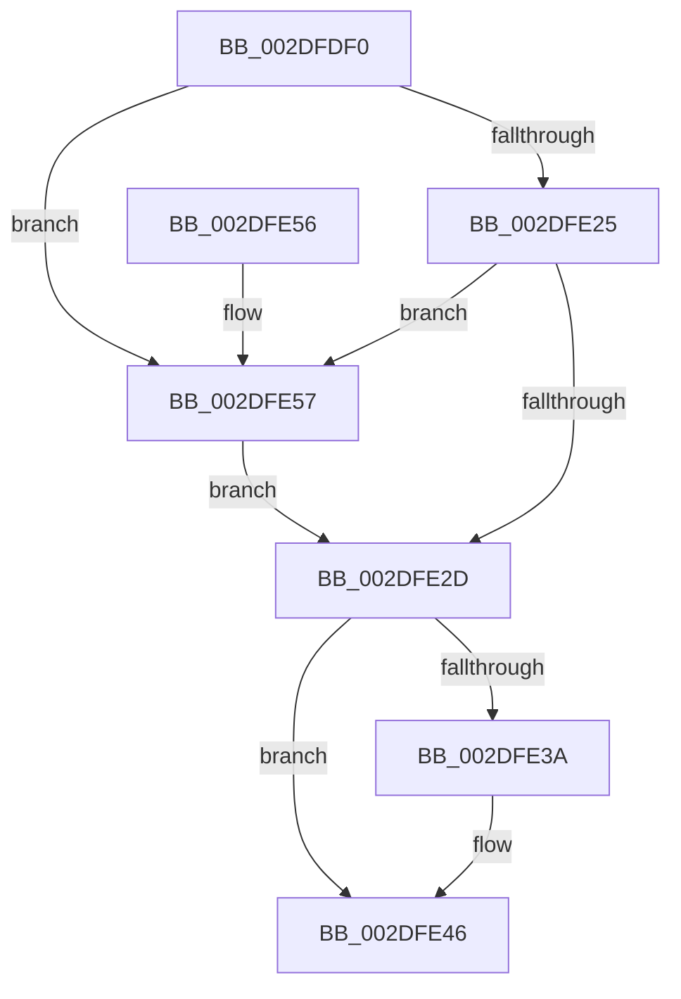

# CcReleaseBcbLockAndVacbLock

- RVA: `0x002DFDF0`–`0x002DFE62` (길이 `114` bytes)
- VA: `0x00000001402DFDF0`
- 실행 섹션: `.text`
- PDB 이름 있음: `예`; PDB Function 태그: `아니요`
- unwind 정보 RVA: `0x00070B38`
- 디코드: `33`개 명령, `114/114` bytes 표시
- 미해석 바이트: `0` (있으면 어셈블리에 `.byte`로 보존)

> 이 문서는 커널 이미지의 기계어와 PDB 기호를 분석해 생성했습니다. 4번과 5번은 함수 원형과 자료형을 바이너리 사용 방식에서 추정한 C 해석이며 원본 소스 복구 결과는 아닙니다.

## 1. Dependencies

- 직접 호출 지점: **3**; 고유 호출 대상: **3**
- 직접 호출자로 확인된 함수: **8**
- RIP 상대 이미지 참조: **0**

### Outgoing calls
- `0x002DFE31` → [KeAbPostRelease](../2E/KeAbPostRelease_function_002E1600.md) (function, `0x002E1600`)
- `0x002DFE41` → [ExReleaseFastMutex](../25/ExReleaseFastMutex_function_002519C0.md) (function, `0x002519C0`)
- `0x002DFE5B` → [ExfReleasePushLock](../26/ExfReleasePushLock_function_002638D0.md) (function, `0x002638D0`)

### Direct callers
- [CcExtendVacbArray](../26/CcExtendVacbArray_function_0026DCD0.md) at `0x0026DE47`
- [CcExtendVacbArray](../26/CcExtendVacbArray_function_0026DCD0.md) at `0x0026E035`
- [CcUnmapInactiveViewsInternal](../27/CcUnmapInactiveViewsInternal_function_0027174C.md) at `0x00271A74`
- [CcUnmapInactiveViewsInternal](../27/CcUnmapInactiveViewsInternal_function_0027174C.md) at `0x00271CD3`
- [CcUnmapInactiveViewsInternal](../27/CcUnmapInactiveViewsInternal_function_0027174C.md) at `0x00271D08`
- [CcGetVacbMiss](../27/CcGetVacbMiss_function_00272900.md) at `0x00272C80`
- [CcPinFileData](../33/CcPinFileData_function_0033FB40.md) at `0x00340C8C`
- [CcUnmapVacbArray](../38/CcUnmapVacbArray_function_0038AEAC.md) at `0x0038B08C`
- [CcDereferenceFileOffset](../4E/CcDereferenceFileOffset_function_004E004C.md) at `0x004E008D`
- [sub_006E2024](../6E/Unknown_function_006E2024.md) at `0x006E2052`
- [sub_006E532A](../6E/Unknown_function_006E532A.md) at `0x006E534E`

### Static image references
- 디코드된 RIP-relative 메모리 참조가 없습니다.

## 2. Other-region calls and transfers

- 다른 실행 섹션으로 향하는 call: **0**
- 별도 외부 분기/꼬리 이동을 확인하지 못했습니다.

## 3. Assembly (complete function range)

```asm
002DFDF0  48 89 5C 24 08                  mov qword ptr [rsp + 8], rbx
002DFDF5  48 89 74 24 10                  mov qword ptr [rsp + 0x10], rsi
002DFDFA  57                              push rdi
002DFDFB  48 83 EC 20                     sub rsp, 0x20
002DFDFF  48 8B FA                        mov rdi, rdx
002DFE02  8B F1                           mov esi, ecx
002DFE04  0F 0D 4A 68                     prefetchw byte ptr [rdx + 0x68]
002DFE08  48 8B 42 68                     mov rax, qword ptr [rdx + 0x68]
002DFE0C  33 C9                           xor ecx, ecx
002DFE0E  4C 8B C0                        mov r8, rax
002DFE11  49 83 E0 F0                     and r8, 0xfffffffffffffff0
002DFE15  49 83 F8 10                     cmp r8, 0x10
002DFE19  48 8D 50 F0                     lea rdx, [rax - 0x10]
002DFE1D  48 0F 46 D1                     cmovbe rdx, rcx
002DFE21  A8 02                           test al, 2
002DFE23  75 32                           jne 0x1402dfe57
002DFE25  F0 48 0F B1 57 68               lock cmpxchg qword ptr [rdi + 0x68], rdx
002DFE2B  75 2A                           jne 0x1402dfe57
002DFE2D  48 8D 4F 68                     lea rcx, [rdi + 0x68]
002DFE31  E8 CA 17 00 00                  call 0x1402e1600
002DFE36  85 F6                           test esi, esi
002DFE38  74 0C                           je 0x1402dfe46
002DFE3A  48 8D 8F 20 01 00 00            lea rcx, [rdi + 0x120]
002DFE41  E8 7A 1B F7 FF                  call 0x1402519c0
002DFE46  48 8B 5C 24 30                  mov rbx, qword ptr [rsp + 0x30]
002DFE4B  48 8B 74 24 38                  mov rsi, qword ptr [rsp + 0x38]
002DFE50  48 83 C4 20                     add rsp, 0x20
002DFE54  5F                              pop rdi
002DFE55  C3                              ret
002DFE56  CC                              int3
002DFE57  48 8D 4F 68                     lea rcx, [rdi + 0x68]
002DFE5B  E8 70 3A F8 FF                  call 0x1402638d0
002DFE60  EB CB                           jmp 0x1402dfe2d
```

## 4. C-style interpretation (structured pseudocode)

```c
__int64 __fastcall CcReleaseBcbLockAndVacbLock(int a1, __int64 a2)
{
    __int64 result;
    __int64 v_rsp;
    unsigned __int64 v_stack_p10;
    unsigned __int64 v_stack_p8;

    v_stack_p8 = v_rbx;
    v_stack_p10 = v_rsi;
    v_rsp = (v_rsp) - (32);
    a1 = 0;
    a3 = (*(unsigned __int64 *)(a2 + 104)) & (-16);
    a2 = *(unsigned __int64 *)(a2 + 104) - 16;
    if (a3 <= 16) { a2 = 0; }
    if ((((unsigned __int8)(*(unsigned __int64 *)(a2 + 104))) & (2)) != 0) goto loc_002DFE57;
    if ((((unsigned __int8)(*(unsigned __int64 *)(a2 + 104))) & (2)) != 0) goto loc_002DFE57;
loc_002DFE2D:
    result = KeAbPostRelease(a2 + 104, a2, a3, a4);
    if ((unsigned int)((unsigned int)(a1)) != 0) {
        a1 = a2 + 288;
        result = ExReleaseFastMutex(a1, a2, a3, a4);
    }
    v_rsp = (v_rsp) + (32);
    return result;
loc_002DFE57:
    result = ExfReleasePushLock(a2 + 104, a2, a3, a4);
    goto loc_002DFE2D;
}
```

## 5. (Beta) C Style

```c
int64_t CcReleaseBcbLockAndVacbLock(int32_t Arg1, void *Arg2)
{
    uint8_t *arg2 = (uint8_t *)Arg2;

    int64_t result;
    int64_t local_rsp;
    uint64_t v_stack_p10;
    uint64_t v_stack_p8;

    v_stack_p8 = local_rbx;
    v_stack_p10 = local_rsi;
    local_rsp = (local_rsp) - (32);
    Arg1 = 0;
    a3 = (*(uint64_t *)(arg2 + 0x68)) & (-16);
    Arg2 = *(uint64_t *)(arg2 + 0x68) - 16;
    if (a3 <= 16) { Arg2 = 0; }
    if ((((uint8_t)(*(uint64_t *)(arg2 + 0x68))) & (2)) != 0) goto loc_002DFE57;
    if ((((uint8_t)(*(uint64_t *)(arg2 + 0x68))) & (2)) != 0) goto loc_002DFE57;
loc_002DFE2D:
    result = KeAbPostRelease(Arg2 + 104, Arg2, a3, a4);
    if ((uint32_t)((uint32_t)(Arg1)) != 0) {
        Arg1 = Arg2 + 288;
        result = ExReleaseFastMutex(Arg1, Arg2, a3, a4);
    }
    local_rsp = (local_rsp) + (32);
    return result;
loc_002DFE57:
    result = ExfReleasePushLock(Arg2 + 104, Arg2, a3, a4);
    goto loc_002DFE2D;
}
```

### 관측된 메모리 오프셋

구조체 형식이 확인되지 않은 접근은 인자 기준의 오프셋으로만 기록했습니다.

| 기준 인자 | 오프셋 표현 | 폭 (bit) | 접근 |
|---|---:|---:|---|
| `Arg2` | `+ 0x68` | `8` | `R` |
| `Arg2` | `+ 0x68` | `64` | `R` |
| `Arg2` | `+ 0x120` | `64` | `R` |

## 6. Execution-region graph

[열기: 2D/3D 그래프와 함수 탐색 컨트롤 패널](../../../control-panel.html?section=text&rva=0x002DFDF0&view=graph)

- 2D 그래프는 위에서 아래로 흐르고, 3D 그래프는 빈 공간을 드래그해 회전합니다. Shift+드래그는 이동, 휠은 확대·축소, 함수 노드 선택은 대상 보고서 이동입니다.

### Static fallback


