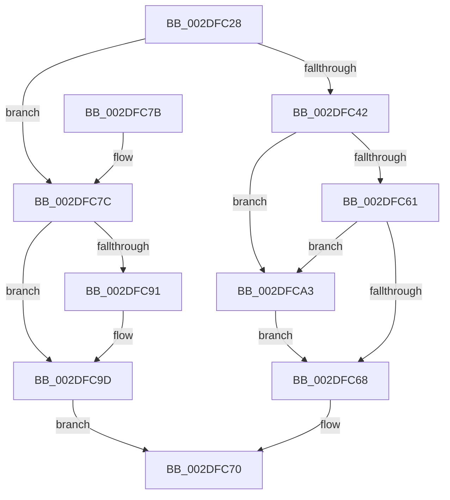

# EtwpUnlockBufferList

- RVA: `0x002DFC28`–`0x002DFCAD` (길이 `133` bytes)
- VA: `0x00000001402DFC28`
- 실행 섹션: `.text`
- PDB 이름 있음: `예`; PDB Function 태그: `아니요`
- unwind 정보 RVA: `0x00070B28`
- 디코드: `39`개 명령, `133/133` bytes 표시
- 미해석 바이트: `0` (있으면 어셈블리에 `.byte`로 보존)

> 이 문서는 커널 이미지의 기계어와 PDB 기호를 분석해 생성했습니다. 4번과 5번은 함수 원형과 자료형을 바이너리 사용 방식에서 추정한 C 해석이며 원본 소스 복구 결과는 아닙니다.

## 1. Dependencies

- 직접 호출 지점: **4**; 고유 호출 대상: **4**
- 직접 호출자로 확인된 함수: **7**
- RIP 상대 이미지 참조: **1**

### Outgoing calls
- `0x002DFC6B` → [KeAbPostRelease](../2E/KeAbPostRelease_function_002E1600.md) (function, `0x002E1600`)
- `0x002DFC82` → [KxReleaseSpinLock](../20/KxReleaseSpinLock_function_00206670.md) (function, `0x00206670`)
- `0x002DFC98` → [KiLowerIrqlProcessIrqlFlags](../4F/KiLowerIrqlProcessIrqlFlags_function_004F5698.md) (function, `0x004F5698`)
- `0x002DFCA6` → [ExfReleasePushLock](../26/ExfReleasePushLock_function_002638D0.md) (function, `0x002638D0`)

### Direct callers
- [EtwpReserveTraceBuffer](../2F/EtwpReserveTraceBuffer_function_002FC8C0.md) at `0x002FCD69`
- [EtwpEnqueueOverflowBuffer](../2F/EtwpEnqueueOverflowBuffer_function_002FE644.md) at `0x002FE68C`
- [EtwpAllocateFreeBuffers](../3E/EtwpAllocateFreeBuffers_function_003EAEA4.md) at `0x003EAFBA`
- [EtwpDequeueFreeBuffer](../3E/EtwpDequeueFreeBuffer_function_003EB1F0.md) at `0x003EB23C`
- [EtwpDequeueFreeBuffer](../3E/EtwpDequeueFreeBuffer_function_003EB1F0.md) at `0x003EB2B6`
- [EtwpDequeueFreeBuffer](../3E/EtwpDequeueFreeBuffer_function_003EB1F0.md) at `0x003EB322`
- [EtwpAdjustSiloTraceBuffers](../3E/EtwpAdjustSiloTraceBuffers_function_003EB720.md) at `0x003EB7C9`
- [EtwpDequeueBufferPendingCompression](../65/EtwpDequeueBufferPendingCompression_function_006533E8.md) at `0x0065345B`
- [EtwpReenableCompression](../65/EtwpReenableCompression_function_00653768.md) at `0x00653803`

### Static image references
- `0x002DFC89` → RVA `0x00FC6D20` (`ALMOSTRO`; read)

## 2. Other-region calls and transfers

- 다른 실행 섹션으로 향하는 call: **0**
- 별도 외부 분기/꼬리 이동을 확인하지 못했습니다.

## 3. Assembly (complete function range)

```asm
002DFC28  48 89 5C 24 08                  mov qword ptr [rsp + 8], rbx
002DFC2D  57                              push rdi
002DFC2E  48 83 EC 20                     sub rsp, 0x20
002DFC32  83 B9 2C 01 00 00 01            cmp dword ptr [rcx + 0x12c], 1
002DFC39  48 8D 99 B8 02 00 00            lea rbx, [rcx + 0x2b8]
002DFC40  75 3A                           jne 0x1402dfc7c
002DFC42  0F 0D 0B                        prefetchw byte ptr [rbx]
002DFC45  48 8B 03                        mov rax, qword ptr [rbx]
002DFC48  33 D2                           xor edx, edx
002DFC4A  48 8B C8                        mov rcx, rax
002DFC4D  48 83 E1 F0                     and rcx, 0xfffffffffffffff0
002DFC51  48 83 F9 10                     cmp rcx, 0x10
002DFC55  4C 8D 40 F0                     lea r8, [rax - 0x10]
002DFC59  4C 0F 46 C2                     cmovbe r8, rdx
002DFC5D  A8 02                           test al, 2
002DFC5F  75 42                           jne 0x1402dfca3
002DFC61  F0 4C 0F B1 03                  lock cmpxchg qword ptr [rbx], r8
002DFC66  75 3B                           jne 0x1402dfca3
002DFC68  48 8B CB                        mov rcx, rbx
002DFC6B  E8 90 19 00 00                  call 0x1402e1600
002DFC70  48 8B 5C 24 30                  mov rbx, qword ptr [rsp + 0x30]
002DFC75  48 83 C4 20                     add rsp, 0x20
002DFC79  5F                              pop rdi
002DFC7A  C3                              ret
002DFC7B  CC                              int3
002DFC7C  0F B6 3A                        movzx edi, byte ptr [rdx]
002DFC7F  48 8B CB                        mov rcx, rbx
002DFC82  E8 E9 69 F2 FF                  call 0x140206670
002DFC87  33 D2                           xor edx, edx
002DFC89  39 15 91 70 CE 00               cmp dword ptr [rip + 0xce7091], edx
002DFC8F  74 0C                           je 0x1402dfc9d
002DFC91  44 0F 20 C1                     mov rcx, cr8
002DFC95  40 8A D7                        mov dl, dil
002DFC98  E8 FB 59 21 00                  call 0x1404f5698
002DFC9D  44 0F 22 C7                     mov cr8, rdi
002DFCA1  EB CD                           jmp 0x1402dfc70
002DFCA3  48 8B CB                        mov rcx, rbx
002DFCA6  E8 25 3C F8 FF                  call 0x1402638d0
002DFCAB  EB BB                           jmp 0x1402dfc68
```

## 4. C-style interpretation (structured pseudocode)

```c
__int64 __fastcall EtwpUnlockBufferList(__int64 a1, int a2)
{
    __int64 result;
    __int64 v_rsp;
    unsigned __int64 v_stack_p8;

    v_stack_p8 = v_rbx;
    v_rsp = (v_rsp) - (32);
    if ((*(unsigned int *)(a1 + 300)) != 1) goto loc_002DFC7C;
    a2 = 0;
    a1 = (*(unsigned __int64 *)(a1 + 696)) & (-16);
    a3 = *(unsigned __int64 *)(a1 + 696) - 16;
    if (a1 <= 16) { a3 = 0; }
    if ((((unsigned __int8)(*(unsigned __int64 *)(a1 + 696))) & (2)) != 0) goto loc_002DFCA3;
    if ((((unsigned __int8)(*(unsigned __int64 *)(a1 + 696))) & (2)) != 0) goto loc_002DFCA3;
loc_002DFC68:
    result = KeAbPostRelease(a1 + 696, a2, a3, a4);
loc_002DFC70:
    v_rsp = (v_rsp) + (32);
    return result;
loc_002DFC7C:
    result = KxReleaseSpinLock(v_stack_p8, a2, a3, a4);
    a2 = 0;
    if ((*(unsigned int *)(v_rip + 13529233)) != 0) {
        a1 = v_cr8;
        a2 = (unsigned __int8)(*(unsigned __int8 *)(a2));
        result = KiLowerIrqlProcessIrqlFlags(a1, a2, a3, a4);
    }
    goto loc_002DFC70;
loc_002DFCA3:
    result = ExfReleasePushLock(v_stack_p8, a2, a3, a4);
    goto loc_002DFC68;
}
```

## 5. (Beta) C Style

```c
int64_t EtwpUnlockBufferList(void *Arg1, void *Arg2)
{
    uint8_t *arg1 = (uint8_t *)Arg1;
    uint8_t *arg2 = (uint8_t *)Arg2;

    int64_t result;
    int64_t local_rsp;
    uint64_t v_stack_p8;

    v_stack_p8 = local_rbx;
    local_rsp = (local_rsp) - (32);
    if ((*(uint32_t *)(arg1 + 0x12C)) != 1) goto loc_002DFC7C;
    Arg2 = 0;
    Arg1 = (*(uint64_t *)(arg1 + 0x2B8)) & (-16);
    a3 = *(uint64_t *)(arg1 + 0x2B8) - 16;
    if (Arg1 <= 16) { a3 = 0; }
    if ((((uint8_t)(*(uint64_t *)(arg1 + 0x2B8))) & (2)) != 0) goto loc_002DFCA3;
    if ((((uint8_t)(*(uint64_t *)(arg1 + 0x2B8))) & (2)) != 0) goto loc_002DFCA3;
loc_002DFC68:
    result = KeAbPostRelease(Arg1 + 696, Arg2, a3, a4);
loc_002DFC70:
    local_rsp = (local_rsp) + (32);
    return result;
loc_002DFC7C:
    result = KxReleaseSpinLock(v_stack_p8, Arg2, a3, a4);
    Arg2 = 0;
    if ((*(uint32_t *)(v_rip + 0xCE7091)) != 0) {
        Arg1 = v_cr8;
        Arg2 = (uint8_t)(*(uint8_t *)(arg2));
        result = KiLowerIrqlProcessIrqlFlags(Arg1, Arg2, a3, a4);
    }
    goto loc_002DFC70;
loc_002DFCA3:
    result = ExfReleasePushLock(v_stack_p8, Arg2, a3, a4);
    goto loc_002DFC68;
}
```

### 관측된 메모리 오프셋

구조체 형식이 확인되지 않은 접근은 인자 기준의 오프셋으로만 기록했습니다.

| 기준 인자 | 오프셋 표현 | 폭 (bit) | 접근 |
|---|---:|---:|---|
| `Arg1` | `+ 0x0` | `8` | `R` |
| `Arg1` | `+ 0x0` | `64` | `R` |
| `Arg1` | `+ 0x12C` | `32` | `R` |
| `Arg1` | `+ 0x2B8` | `64` | `R` |
| `Arg2` | `+ 0x0` | `8` | `R` |

## 6. Execution-region graph

[열기: 2D/3D 그래프와 함수 탐색 컨트롤 패널](../../../control-panel.html?section=text&rva=0x002DFC28&view=graph)

- 2D 그래프는 위에서 아래로 흐르고, 3D 그래프는 빈 공간을 드래그해 회전합니다. Shift+드래그는 이동, 휠은 확대·축소, 함수 노드 선택은 대상 보고서 이동입니다.

### Static fallback


