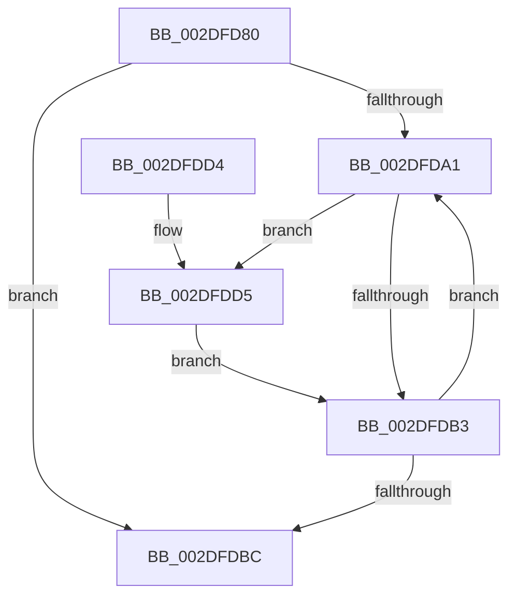

# ExReleaseCacheAwarePushLockExclusive

- RVA: `0x002DFD80`–`0x002DFDDC` (길이 `92` bytes)
- VA: `0x00000001402DFD80`
- 실행 섹션: `.text`
- PDB 이름 있음: `예`; PDB Function 태그: `아니요`
- unwind 정보 RVA: `0x0006383C`
- 디코드: `28`개 명령, `92/92` bytes 표시
- 미해석 바이트: `0` (있으면 어셈블리에 `.byte`로 보존)

> 이 문서는 커널 이미지의 기계어와 PDB 기호를 분석해 생성했습니다. 4번과 5번은 함수 원형과 자료형을 바이너리 사용 방식에서 추정한 C 해석이며 원본 소스 복구 결과는 아닙니다.

## 1. Dependencies

- 직접 호출 지점: **2**; 고유 호출 대상: **2**
- 직접 호출자로 확인된 함수: **0**
- RIP 상대 이미지 참조: **0**

### Outgoing calls
- `0x002DFDBF` → [KeAbPostRelease](../2E/KeAbPostRelease_function_002E1600.md) (function, `0x002E1600`)
- `0x002DFDD5` → [ExfTryToWakePushLock](../26/ExfTryToWakePushLock_function_00265DD0.md) (function, `0x00265DD0`)

### Direct callers
- 이 함수 시작 RVA로 연결되는 직접 call은 확인되지 않았습니다. 간접 호출은 완전히 역산할 수 없습니다.

### Static image references
- 디코드된 RIP-relative 메모리 참조가 없습니다.

## 2. Other-region calls and transfers

- 다른 실행 섹션으로 향하는 call: **0**
- 별도 외부 분기/꼬리 이동을 확인하지 못했습니다.

## 3. Assembly (complete function range)

```asm
002DFD80  48 89 5C 24 08                  mov qword ptr [rsp + 8], rbx
002DFD85  48 89 74 24 10                  mov qword ptr [rsp + 0x10], rsi
002DFD8A  57                              push rdi
002DFD8B  48 83 EC 20                     sub rsp, 0x20
002DFD8F  48 8D B1 00 01 00 00            lea rsi, [rcx + 0x100]
002DFD96  48 8B D9                        mov rbx, rcx
002DFD99  48 8B F9                        mov rdi, rcx
002DFD9C  48 3B CE                        cmp rcx, rsi
002DFD9F  73 1B                           jae 0x1402dfdbc
002DFDA1  48 8B 0F                        mov rcx, qword ptr [rdi]
002DFDA4  48 83 C8 FF                     or rax, 0xffffffffffffffff
002DFDA8  F0 48 0F C1 01                  lock xadd qword ptr [rcx], rax
002DFDAD  24 06                           and al, 6
002DFDAF  3C 02                           cmp al, 2
002DFDB1  74 22                           je 0x1402dfdd5
002DFDB3  48 83 C7 08                     add rdi, 8
002DFDB7  48 3B FE                        cmp rdi, rsi
002DFDBA  72 E5                           jb 0x1402dfda1
002DFDBC  48 8B CB                        mov rcx, rbx
002DFDBF  E8 3C 18 00 00                  call 0x1402e1600
002DFDC4  48 8B 5C 24 30                  mov rbx, qword ptr [rsp + 0x30]
002DFDC9  48 8B 74 24 38                  mov rsi, qword ptr [rsp + 0x38]
002DFDCE  48 83 C4 20                     add rsp, 0x20
002DFDD2  5F                              pop rdi
002DFDD3  C3                              ret
002DFDD4  CC                              int3
002DFDD5  E8 F6 5F F8 FF                  call 0x140265dd0
002DFDDA  EB D7                           jmp 0x1402dfdb3
```

## 4. C-style interpretation (structured pseudocode)

```c
__int64 __fastcall ExReleaseCacheAwarePushLockExclusive(__int64 a1)
{
    __int64 result;
    __int64 v_rdi;
    __int64 v_rsp;
    unsigned __int64 v_stack_p10;
    unsigned __int64 v_stack_p8;

    v_stack_p8 = v_rbx;
    v_stack_p10 = v_rsi;
    v_rsp = (v_rsp) - (32);
    if (a1 >= (a1 + 256)) goto loc_002DFDBC;
loc_002DFDA1:
    result = (result) | (-1);
    result = (unsigned __int8)((result) & (6));
    if (((unsigned __int8)(result)) == 2) goto loc_002DFDD5;
loc_002DFDB3:
    v_rdi = (a1) + (8);
    if (v_rdi < (a1 + 256)) goto loc_002DFDA1;
loc_002DFDBC:
    result = KeAbPostRelease(a1, a2, a3, a4);
    v_rsp = (v_rsp) + (32);
    return result;
loc_002DFDD5:
    result = ExfTryToWakePushLock(a1, a2, a3, a4);
    goto loc_002DFDB3;
}
```

## 5. (Beta) C Style

```c
int64_t ExReleaseCacheAwarePushLockExclusive(void *Arg1)
{
    uint8_t *arg1 = (uint8_t *)Arg1;

    int64_t result;
    int64_t local_rdi;
    int64_t local_rsp;
    uint64_t v_stack_p10;
    uint64_t v_stack_p8;

    v_stack_p8 = local_rbx;
    v_stack_p10 = local_rsi;
    local_rsp = (local_rsp) - (32);
    if (Arg1 >= (Arg1 + 256)) goto loc_002DFDBC;
loc_002DFDA1:
    result = (result) | (-1);
    result = (uint8_t)((result) & (6));
    if (((uint8_t)(result)) == 2) goto loc_002DFDD5;
loc_002DFDB3:
    local_rdi = (Arg1) + (8);
    if (local_rdi < (Arg1 + 256)) goto loc_002DFDA1;
loc_002DFDBC:
    result = KeAbPostRelease(Arg1, a2, a3, a4);
    local_rsp = (local_rsp) + (32);
    return result;
loc_002DFDD5:
    result = ExfTryToWakePushLock(Arg1, a2, a3, a4);
    goto loc_002DFDB3;
}
```

### 관측된 메모리 오프셋

구조체 형식이 확인되지 않은 접근은 인자 기준의 오프셋으로만 기록했습니다.

| 기준 인자 | 오프셋 표현 | 폭 (bit) | 접근 |
|---|---:|---:|---|
| `Arg1` | `+ 0x100` | `64` | `R` |

## 6. Execution-region graph

[열기: 2D/3D 그래프와 함수 탐색 컨트롤 패널](../../../control-panel.html?section=text&rva=0x002DFD80&view=graph)

- 2D 그래프는 위에서 아래로 흐르고, 3D 그래프는 빈 공간을 드래그해 회전합니다. Shift+드래그는 이동, 휠은 확대·축소, 함수 노드 선택은 대상 보고서 이동입니다.

### Static fallback


