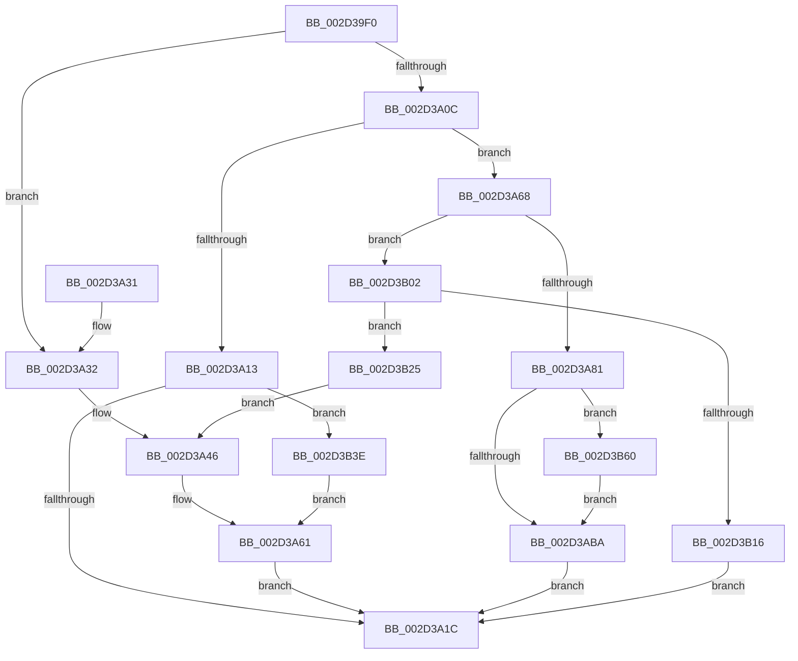

# HalDisableInterrupt

- RVA: `0x002D39F0`–`0x002D3B82` (길이 `402` bytes)
- VA: `0x00000001402D39F0`
- 실행 섹션: `.text`
- PDB 이름 있음: `예`; PDB Function 태그: `아니요`
- unwind 정보 RVA: `0x0006FA9C`
- 디코드: `98`개 명령, `402/402` bytes 표시
- 미해석 바이트: `0` (있으면 어셈블리에 `.byte`로 보존)

> 이 문서는 커널 이미지의 기계어와 PDB 기호를 분석해 생성했습니다. 4번과 5번은 함수 원형과 자료형을 바이너리 사용 방식에서 추정한 C 해석이며 원본 소스 복구 결과는 아닙니다.

## 1. Dependencies

- 직접 호출 지점: **10**; 고유 호출 대상: **9**
- 직접 호출자로 확인된 함수: **2**
- RIP 상대 이미지 참조: **8**

### Outgoing calls
- `0x002D3A70` → [HalpInterruptFindLinesForGsiRange](HalpInterruptFindLinesForGsiRange_function_002D204C.md) (function, `0x002D204C`)
- `0x002D3AA0` → [HalpInterruptApplyOverrides](HalpInterruptApplyOverrides_function_002D2CE0.md) (function, `0x002D2CE0`)
- `0x002D3AA9` → [HalpInterruptLookupController](HalpInterruptLookupController_function_002D20D4.md) (function, `0x002D20D4`)
- `0x002D3AC1` → [HalpAcquireHighLevelLock](HalpAcquireHighLevelLock_function_002D2390.md) (function, `0x002D2390`)
- `0x002D3AE8` → [HalpInterruptSetLineStateInternal](HalpInterruptSetLineStateInternal_function_002D2104.md) (function, `0x002D2104`)
- `0x002D3AF8` → [HalpReleaseHighLevelLock](HalpReleaseHighLevelLock_function_002D1C58.md) (function, `0x002D1C58`)
- `0x002D3B0D` → [guard_dispatch_icall](../6B/guard_dispatch_icall_function_006BAAD0.md) (function, `0x006BAAD0`)
- `0x002D3B19` → [HalpDisableSecondaryInterrupt](../48/HalpDisableSecondaryInterrupt_function_00488F34.md) (function, `0x00488F34`)
- `0x002D3B56` → [HalpInterruptSetProblemEx](../48/HalpInterruptSetProblemEx_function_0048AC8C.md) (function, `0x0048AC8C`)
- `0x002D3B78` → [HalpInterruptSetProblemEx](../48/HalpInterruptSetProblemEx_function_0048AC8C.md) (function, `0x0048AC8C`)

### Direct callers
- [KiDisconnectInterruptInternal](KiDisconnectInterruptInternal_function_002D38C0.md) at `0x002D390F`
- [KiDisconnectSecondaryInterrupt](KiDisconnectSecondaryInterrupt_function_002D3B88.md) at `0x002D3C38`

### Static image references
- `0x002D3A32` → RVA `0x00F90694` (`.data`; write)
- `0x002D3A3C` → RVA `0x00F906D0` (`.data`; write)
- `0x002D3A46` → RVA `0x00010AA8` (`.rdata`; read)
- `0x002D3A4D` → RVA `0x00F906A0` (`.data`; write)
- `0x002D3A53` → RVA `0x00F906C8` (`.data`; write)
- `0x002D3A5A` → RVA `0x00F906B8` (`.data`; write)
- `0x002D3ABA` → RVA `0x00FC19A8` (`.data`; read)
- `0x002D3B02` → RVA `0x00E009E0` (`.data`; read)

## 2. Other-region calls and transfers

- 다른 실행 섹션으로 향하는 call: **0**
- 별도 외부 분기/꼬리 이동을 확인하지 못했습니다.

## 3. Assembly (complete function range)

```asm
002D39F0  48 89 5C 24 10                  mov qword ptr [rsp + 0x10], rbx
002D39F5  48 89 6C 24 18                  mov qword ptr [rsp + 0x18], rbp
002D39FA  56                              push rsi
002D39FB  57                              push rdi
002D39FC  41 56                           push r14
002D39FE  48 83 EC 30                     sub rsp, 0x30
002D3A02  33 FF                           xor edi, edi
002D3A04  48 8B D9                        mov rbx, rcx
002D3A07  83 39 01                        cmp dword ptr [rcx], 1
002D3A0A  75 26                           jne 0x1402d3a32
002D3A0C  8B 71 08                        mov esi, dword ptr [rcx + 8]
002D3A0F  85 F6                           test esi, esi
002D3A11  74 55                           je 0x1402d3a68
002D3A13  83 FE 03                        cmp esi, 3
002D3A16  0F 85 22 01 00 00               jne 0x1402d3b3e
002D3A1C  48 8B 5C 24 58                  mov rbx, qword ptr [rsp + 0x58]
002D3A21  8B C7                           mov eax, edi
002D3A23  48 8B 6C 24 60                  mov rbp, qword ptr [rsp + 0x60]
002D3A28  48 83 C4 30                     add rsp, 0x30
002D3A2C  41 5E                           pop r14
002D3A2E  5F                              pop rdi
002D3A2F  5E                              pop rsi
002D3A30  C3                              ret
002D3A31  CC                              int3
002D3A32  C7 05 58 CC CB 00 13 00 00 00   mov dword ptr [rip + 0xcbcc58], 0x13
002D3A3C  C7 05 8A CC CB 00 73 01 00 00   mov dword ptr [rip + 0xcbcc8a], 0x173
002D3A46  4C 8D 0D 5B D0 D3 FF            lea r9, [rip - 0x2c2fa5]
002D3A4D  89 3D 4D CC CB 00               mov dword ptr [rip + 0xcbcc4d], edi
002D3A53  4C 89 0D 6E CC CB 00            mov qword ptr [rip + 0xcbcc6e], r9
002D3A5A  48 89 3D 57 CC CB 00            mov qword ptr [rip + 0xcbcc57], rdi
002D3A61  BF 0D 00 00 C0                  mov edi, 0xc000000d
002D3A66  EB B4                           jmp 0x1402d3a1c
002D3A68  8B 69 40                        mov ebp, dword ptr [rcx + 0x40]
002D3A6B  8B CD                           mov ecx, ebp
002D3A6D  8D 55 01                        lea edx, [rbp + 1]
002D3A70  E8 D7 E5 FF FF                  call 0x1402d204c
002D3A75  4C 8B F0                        mov r14, rax
002D3A78  48 85 C0                        test rax, rax
002D3A7B  0F 84 81 00 00 00               je 0x1402d3b02
002D3A81  8B 40 10                        mov eax, dword ptr [rax + 0x10]
002D3A84  45 33 C0                        xor r8d, r8d
002D3A87  89 44 24 50                     mov dword ptr [rsp + 0x50], eax
002D3A8B  33 D2                           xor edx, edx
002D3A8D  41 8B 4E 14                     mov ecx, dword ptr [r14 + 0x14]
002D3A91  41 2B 4E 1C                     sub ecx, dword ptr [r14 + 0x1c]
002D3A95  03 CD                           add ecx, ebp
002D3A97  89 4C 24 54                     mov dword ptr [rsp + 0x54], ecx
002D3A9B  48 8D 4C 24 50                  lea rcx, [rsp + 0x50]
002D3AA0  E8 3B F2 FF FF                  call 0x1402d2ce0
002D3AA5  8B 4C 24 50                     mov ecx, dword ptr [rsp + 0x50]
002D3AA9  E8 26 E6 FF FF                  call 0x1402d20d4
002D3AAE  48 8B F0                        mov rsi, rax
002D3AB1  48 85 C0                        test rax, rax
002D3AB4  0F 84 A6 00 00 00               je 0x1402d3b60
002D3ABA  48 8D 0D E7 DE CE 00            lea rcx, [rip + 0xcedee7]
002D3AC1  E8 CA E8 FF FF                  call 0x1402d2390
002D3AC6  8B 54 24 54                     mov edx, dword ptr [rsp + 0x54]
002D3ACA  48 8B CE                        mov rcx, rsi
002D3ACD  41 2B 56 14                     sub edx, dword ptr [r14 + 0x14]
002D3AD1  8A D8                           mov bl, al
002D3AD3  48 63 D2                        movsxd rdx, edx
002D3AD6  4C 6B C2 38                     imul r8, rdx, 0x38
002D3ADA  48 8D 54 24 50                  lea rdx, [rsp + 0x50]
002D3ADF  4D 03 46 28                     add r8, qword ptr [r14 + 0x28]
002D3AE3  41 83 60 0C EF                  and dword ptr [r8 + 0xc], 0xffffffef
002D3AE8  E8 17 E6 FF FF                  call 0x1402d2104
002D3AED  8A D3                           mov dl, bl
002D3AEF  48 8D 0D B2 DE CE 00            lea rcx, [rip + 0xcedeb2]
002D3AF6  8B F8                           mov edi, eax
002D3AF8  E8 5B E1 FF FF                  call 0x1402d1c58
002D3AFD  E9 1A FF FF FF                  jmp 0x1402d3a1c
002D3B02  48 8B 05 D7 CE B2 00            mov rax, qword ptr [rip + 0xb2ced7]
002D3B09  8B D5                           mov edx, ebp
002D3B0B  8B CE                           mov ecx, esi
002D3B0D  E8 BE 6F 3E 00                  call 0x1406baad0
002D3B12  84 C0                           test al, al
002D3B14  74 0F                           je 0x1402d3b25
002D3B16  48 8B CB                        mov rcx, rbx
002D3B19  E8 16 54 1B 00                  call 0x140488f34
002D3B1E  8B F8                           mov edi, eax
002D3B20  E9 F7 FE FF FF                  jmp 0x1402d3a1c
002D3B25  C7 05 65 CB CB 00 12 00 00 00   mov dword ptr [rip + 0xcbcb65], 0x12
002D3B2F  C7 05 97 CB CB 00 A1 01 00 00   mov dword ptr [rip + 0xcbcb97], 0x1a1
002D3B39  E9 08 FF FF FF                  jmp 0x1402d3a46
002D3B3E  45 33 C0                        xor r8d, r8d
002D3B41  C7 44 24 20 B0 01 00 00         mov dword ptr [rsp + 0x20], 0x1b0
002D3B49  4C 8D 0D 58 CF D3 FF            lea r9, [rip - 0x2c30a8]
002D3B50  33 C9                           xor ecx, ecx
002D3B52  41 8D 50 13                     lea edx, [r8 + 0x13]
002D3B56  E8 31 71 1B 00                  call 0x14048ac8c
002D3B5B  E9 01 FF FF FF                  jmp 0x1402d3a61
002D3B60  45 33 C0                        xor r8d, r8d
002D3B63  C7 44 24 20 C8 01 00 00         mov dword ptr [rsp + 0x20], 0x1c8
002D3B6B  4C 8D 0D 36 CF D3 FF            lea r9, [rip - 0x2c30ca]
002D3B72  33 C9                           xor ecx, ecx
002D3B74  41 8D 50 11                     lea edx, [r8 + 0x11]
002D3B78  E8 0F 71 1B 00                  call 0x14048ac8c
002D3B7D  E9 38 FF FF FF                  jmp 0x1402d3aba
```

## 4. C-style interpretation (structured pseudocode)

```c
__int64 __fastcall HalDisableInterrupt(__int64 a1, __int64 a2, int a3)
{
    __int64 result;
    __int64 v_rdi;
    __int64 v_rsp;
    unsigned __int64 v_stack_p10;
    unsigned __int64 v_stack_p18;
    unsigned int v_stack_p20;
    unsigned int v_stack_p50;
    unsigned int v_stack_p54;

    v_stack_p10 = v_rbx;
    v_stack_p18 = v_rbp;
    v_rsp = (v_rsp) - (48);
    v_rdi = 0;
    if ((*(unsigned int *)(a1)) != 1) goto loc_002D3A32;
    if ((unsigned int)((unsigned int)(*(unsigned int *)(a1 + 8))) == 0) goto loc_002D3A68;
    if (((unsigned int)((unsigned int)(*(unsigned int *)(a1 + 8)))) != 3) goto loc_002D3B3E;
loc_002D3A1C:
    v_rsp = (v_rsp) + (48);
    return 0;
loc_002D3A32:
    *(unsigned int *)(v_rip + 13356120) = 19;
    *(unsigned int *)(v_rip + 13356170) = 371;
loc_002D3A46:
    *(unsigned int *)(v_rip + 13356109) = 0;
    *(unsigned __int64 *)(v_rip + 13356142) = v_rip - 2895781;
    *(unsigned __int64 *)(v_rip + 13356119) = 0;
loc_002D3A61:
    goto loc_002D3A1C;
loc_002D3A68:
    result = HalpInterruptFindLinesForGsiRange((unsigned int)((unsigned int)((unsigned int)(*(unsigned int *)(a1 + 64)))), (unsigned int)(*(unsigned int *)(a1 + 64)) + 1, a3, v_rip - 2895781);
    if (result == 0) goto loc_002D3B02;
    a3 = 0;
    v_stack_p50 = (unsigned int)((unsigned int)(*(unsigned int *)(result + 16)));
    a2 = 0;
    a1 = (unsigned int)(((unsigned int)(*(unsigned int *)(result + 20))) - (*(unsigned int *)(result + 28)));
    a1 = (unsigned int)((a1) + ((unsigned int)((unsigned int)(*(unsigned int *)(a1 + 64)))));
    v_stack_p54 = (unsigned int)(a1);
    result = HalpInterruptApplyOverrides(v_stack_p50, a2, a3, v_rip - 2895781);
    result = HalpInterruptLookupController((unsigned int)(v_stack_p50), a2, a3, v_rip - 2895781);
    if (result == 0) goto loc_002D3B60;
loc_002D3ABA:
    result = HalpAcquireHighLevelLock(v_rip + 13557479, a2, a3, v_rip - 2895781);
    a2 = (unsigned int)(((unsigned int)(v_stack_p54)) - (*(unsigned int *)(result + 20)));
    a3 = (a3) * ((int)((unsigned int)(a2)));
    a3 = (a3) + (*(unsigned __int64 *)(result + 40));
    result = HalpInterruptSetLineStateInternal(result, v_stack_p50, a3, v_rip - 2895781);
    result = HalpReleaseHighLevelLock(v_rip + 13557426, (unsigned __int8)((unsigned __int8)(result)), a3, v_rip - 2895781);
    goto loc_002D3A1C;
loc_002D3B02:
    result = guard_dispatch_icall((unsigned int)((unsigned int)(result)), (unsigned int)((unsigned int)((unsigned int)(*(unsigned int *)(a1 + 64)))), a3, v_rip - 2895781);
    if ((unsigned __int8)(result) == 0) goto loc_002D3B25;
    result = HalpDisableSecondaryInterrupt((unsigned __int8)(result), (unsigned int)((unsigned int)((unsigned int)(*(unsigned int *)(a1 + 64)))), a3, v_rip - 2895781);
    goto loc_002D3A1C;
loc_002D3B25:
    *(unsigned int *)(v_rip + 13355877) = 18;
    *(unsigned int *)(v_rip + 13355927) = 417;
    goto loc_002D3A46;
loc_002D3B3E:
    a3 = 0;
    v_stack_p20 = 432;
    a1 = 0;
    result = HalpInterruptSetProblemEx(a1, a3 + 19, a3, v_rip - 2896040);
    goto loc_002D3A61;
loc_002D3B60:
    a3 = 0;
    v_stack_p20 = 456;
    a1 = 0;
    result = HalpInterruptSetProblemEx(a1, a3 + 17, a3, v_rip - 2896074);
    goto loc_002D3ABA;
}
```

## 5. (Beta) C Style

```c
int64_t HalDisableInterrupt(void *Arg1, int64_t Arg2, int32_t Arg3)
{
    uint8_t *arg1 = (uint8_t *)Arg1;

    int64_t result;
    int64_t local_rdi;
    int64_t local_rsp;
    uint64_t v_stack_p10;
    uint64_t v_stack_p18;
    uint32_t v_stack_p20;
    uint32_t v_stack_p50;
    uint32_t v_stack_p54;

    v_stack_p10 = local_rbx;
    v_stack_p18 = local_rbp;
    local_rsp = (local_rsp) - (48);
    local_rdi = 0;
    if ((*(uint32_t *)(arg1)) != 1) goto loc_002D3A32;
    if ((uint32_t)((uint32_t)(*(uint32_t *)(arg1 + 0x8))) == 0) goto loc_002D3A68;
    if (((uint32_t)((uint32_t)(*(uint32_t *)(arg1 + 0x8)))) != 3) goto loc_002D3B3E;
loc_002D3A1C:
    local_rsp = (local_rsp) + (48);
    return 0;
loc_002D3A32:
    *(uint32_t *)(v_rip + 0xCBCC58) = 19;
    *(uint32_t *)(v_rip + 0xCBCC8A) = 371;
loc_002D3A46:
    *(uint32_t *)(v_rip + 0xCBCC4D) = 0;
    *(uint64_t *)(v_rip + 0xCBCC6E) = v_rip - 2895781;
    *(uint64_t *)(v_rip + 0xCBCC57) = 0;
loc_002D3A61:
    goto loc_002D3A1C;
loc_002D3A68:
    result = HalpInterruptFindLinesForGsiRange((uint32_t)((uint32_t)((uint32_t)(*(uint32_t *)(arg1 + 0x40)))), (uint32_t)(*(uint32_t *)(arg1 + 0x40)) + 1, Arg3, v_rip - 2895781);
    if (result == 0) goto loc_002D3B02;
    Arg3 = 0;
    v_stack_p50 = (uint32_t)((uint32_t)(*(uint32_t *)(result + 0x10)));
    Arg2 = 0;
    Arg1 = (uint32_t)(((uint32_t)(*(uint32_t *)(result + 0x14))) - (*(uint32_t *)(result + 0x1C)));
    Arg1 = (uint32_t)((Arg1) + ((uint32_t)((uint32_t)(*(uint32_t *)(arg1 + 0x40)))));
    v_stack_p54 = (uint32_t)(Arg1);
    result = HalpInterruptApplyOverrides(v_stack_p50, Arg2, Arg3, v_rip - 2895781);
    result = HalpInterruptLookupController((uint32_t)(v_stack_p50), Arg2, Arg3, v_rip - 2895781);
    if (result == 0) goto loc_002D3B60;
loc_002D3ABA:
    result = HalpAcquireHighLevelLock(v_rip + 13557479, Arg2, Arg3, v_rip - 2895781);
    Arg2 = (uint32_t)(((uint32_t)(v_stack_p54)) - (*(uint32_t *)(result + 0x14)));
    Arg3 = (Arg3) * ((int32_t)((uint32_t)(Arg2)));
    Arg3 = (Arg3) + (*(uint64_t *)(result + 0x28));
    result = HalpInterruptSetLineStateInternal(result, v_stack_p50, Arg3, v_rip - 2895781);
    result = HalpReleaseHighLevelLock(v_rip + 13557426, (uint8_t)((uint8_t)(result)), Arg3, v_rip - 2895781);
    goto loc_002D3A1C;
loc_002D3B02:
    result = guard_dispatch_icall((uint32_t)((uint32_t)(result)), (uint32_t)((uint32_t)((uint32_t)(*(uint32_t *)(arg1 + 0x40)))), Arg3, v_rip - 2895781);
    if ((uint8_t)(result) == 0) goto loc_002D3B25;
    result = HalpDisableSecondaryInterrupt((uint8_t)(result), (uint32_t)((uint32_t)((uint32_t)(*(uint32_t *)(arg1 + 0x40)))), Arg3, v_rip - 2895781);
    goto loc_002D3A1C;
loc_002D3B25:
    *(uint32_t *)(v_rip + 0xCBCB65) = 18;
    *(uint32_t *)(v_rip + 0xCBCB97) = 417;
    goto loc_002D3A46;
loc_002D3B3E:
    Arg3 = 0;
    v_stack_p20 = 432;
    Arg1 = 0;
    result = HalpInterruptSetProblemEx(Arg1, Arg3 + 19, Arg3, v_rip - 2896040);
    goto loc_002D3A61;
loc_002D3B60:
    Arg3 = 0;
    v_stack_p20 = 456;
    Arg1 = 0;
    result = HalpInterruptSetProblemEx(Arg1, Arg3 + 17, Arg3, v_rip - 2896074);
    goto loc_002D3ABA;
}
```

### 관측된 메모리 오프셋

구조체 형식이 확인되지 않은 접근은 인자 기준의 오프셋으로만 기록했습니다.

| 기준 인자 | 오프셋 표현 | 폭 (bit) | 접근 |
|---|---:|---:|---|
| `Arg1` | `+ 0x0` | `32` | `R` |
| `Arg1` | `+ 0x8` | `32` | `R` |
| `Arg1` | `+ 0x40` | `32` | `R` |

## 6. Execution-region graph

[열기: 2D/3D 그래프와 함수 탐색 컨트롤 패널](../../../control-panel.html?section=text&rva=0x002D39F0&view=graph)

- 2D 그래프는 위에서 아래로 흐르고, 3D 그래프는 빈 공간을 드래그해 회전합니다. Shift+드래그는 이동, 휠은 확대·축소, 함수 노드 선택은 대상 보고서 이동입니다.

### Static fallback


