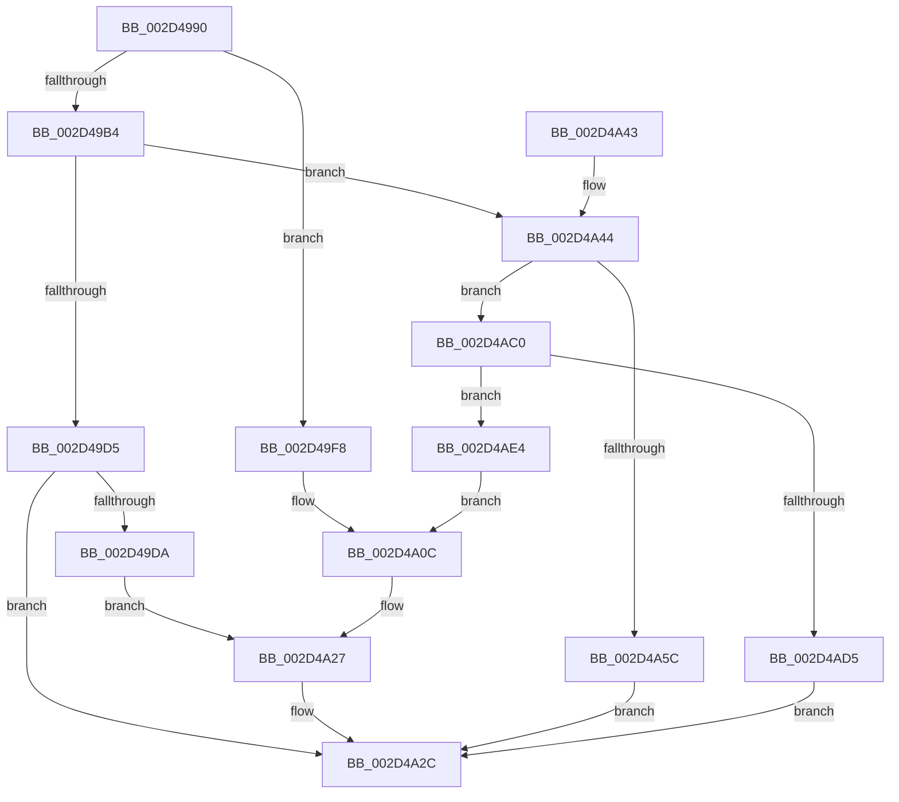

# HalEnableInterrupt

- RVA: `0x002D4990`–`0x002D4AFD` (길이 `365` bytes)
- VA: `0x00000001402D4990`
- 실행 섹션: `.text`
- PDB 이름 있음: `예`; PDB Function 태그: `아니요`
- unwind 정보 RVA: `0x0006FBA4`
- 디코드: `95`개 명령, `365/365` bytes 표시
- 미해석 바이트: `0` (있으면 어셈블리에 `.byte`로 보존)

> 이 문서는 커널 이미지의 기계어와 PDB 기호를 분석해 생성했습니다. 4번과 5번은 함수 원형과 자료형을 바이너리 사용 방식에서 추정한 C 해석이며 원본 소스 복구 결과는 아닙니다.

## 1. Dependencies

- 직접 호출 지점: **7**; 고유 호출 대상: **7**
- 직접 호출자로 확인된 함수: **1**
- RIP 상대 이미지 참조: **8**

### Outgoing calls
- `0x002D49F1` → [HalpInterruptSetProblemEx](../48/HalpInterruptSetProblemEx_function_0048AC8C.md) (function, `0x0048AC8C`)
- `0x002D4A4F` → [HalpInterruptFindLinesForGsiRange](HalpInterruptFindLinesForGsiRange_function_002D204C.md) (function, `0x002D204C`)
- `0x002D4A77` → [HalpAcquireHighLevelLock](HalpAcquireHighLevelLock_function_002D2390.md) (function, `0x002D2390`)
- `0x002D4AA6` → [HalpInterruptSetLineState](../48/HalpInterruptSetLineState_function_0048A0C8.md) (function, `0x0048A0C8`)
- `0x002D4AB6` → [HalpReleaseHighLevelLock](HalpReleaseHighLevelLock_function_002D1C58.md) (function, `0x002D1C58`)
- `0x002D4ACC` → [guard_dispatch_icall](../6B/guard_dispatch_icall_function_006BAAD0.md) (function, `0x006BAAD0`)
- `0x002D4AD8` → [HalpEnableSecondaryInterrupt](../../page/AC/HalpEnableSecondaryInterrupt_function_00AC4DC0.md) (function, `0x00AC4DC0`)

### Direct callers
- [KeConnectInterrupt](KeConnectInterrupt_function_002D3D5C.md) at `0x002D3E92`

### Static image references
- `0x002D49DA` → RVA `0x00010AA8` (`.rdata`; read)
- `0x002D49F8` → RVA `0x00F90694` (`.data`; write)
- `0x002D4A02` → RVA `0x00F906D0` (`.data`; write)
- `0x002D4A13` → RVA `0x00F906B8` (`.data`; write)
- `0x002D4A1A` → RVA `0x00F906C8` (`.data`; write)
- `0x002D4A21` → RVA `0x00F906A0` (`.data`; write)
- `0x002D4A70` → RVA `0x00FC19A8` (`.data`; read)
- `0x002D4AC0` → RVA `0x00E009E0` (`.data`; read)

## 2. Other-region calls and transfers

- 다른 실행 섹션으로 향하는 call: **1**
  - `0x002D4AD8` → [HalpEnableSecondaryInterrupt](../../page/AC/HalpEnableSecondaryInterrupt_function_00AC4DC0.md) (`.text` → `PAGE`)
- 별도 외부 분기/꼬리 이동을 확인하지 못했습니다.

## 3. Assembly (complete function range)

```asm
002D4990  48 89 5C 24 18                  mov qword ptr [rsp + 0x18], rbx
002D4995  48 89 74 24 20                  mov qword ptr [rsp + 0x20], rsi
002D499A  55                              push rbp
002D499B  57                              push rdi
002D499C  41 56                           push r14
002D499E  48 8B EC                        mov rbp, rsp
002D49A1  48 83 EC 60                     sub rsp, 0x60
002D49A5  33 FF                           xor edi, edi
002D49A7  48 8B F1                        mov rsi, rcx
002D49AA  89 7D E4                        mov dword ptr [rbp - 0x1c], edi
002D49AD  8D 4F 01                        lea ecx, [rdi + 1]
002D49B0  39 0E                           cmp dword ptr [rsi], ecx
002D49B2  75 44                           jne 0x1402d49f8
002D49B4  83 4D 20 FF                     or dword ptr [rbp + 0x20], 0xffffffff
002D49B8  48 8D 46 20                     lea rax, [rsi + 0x20]
002D49BC  8B 5E 08                        mov ebx, dword ptr [rsi + 8]
002D49BF  48 89 45 E8                     mov qword ptr [rbp - 0x18], rax
002D49C3  48 8D 46 30                     lea rax, [rsi + 0x30]
002D49C7  48 89 45 F0                     mov qword ptr [rbp - 0x10], rax
002D49CB  89 4D E0                        mov dword ptr [rbp - 0x20], ecx
002D49CE  89 4D 24                        mov dword ptr [rbp + 0x24], ecx
002D49D1  85 DB                           test ebx, ebx
002D49D3  74 6F                           je 0x1402d4a44
002D49D5  83 FB 03                        cmp ebx, 3
002D49D8  74 52                           je 0x1402d4a2c
002D49DA  4C 8D 0D C7 C0 D3 FF            lea r9, [rip - 0x2c3f39]
002D49E1  C7 44 24 20 39 01 00 00         mov dword ptr [rsp + 0x20], 0x139
002D49E9  45 33 C0                        xor r8d, r8d
002D49EC  8D 57 13                        lea edx, [rdi + 0x13]
002D49EF  33 C9                           xor ecx, ecx
002D49F1  E8 96 62 1B 00                  call 0x14048ac8c
002D49F6  EB 2F                           jmp 0x1402d4a27
002D49F8  C7 05 92 BC CB 00 13 00 00 00   mov dword ptr [rip + 0xcbbc92], 0x13
002D4A02  C7 05 C4 BC CB 00 CC 00 00 00   mov dword ptr [rip + 0xcbbcc4], 0xcc
002D4A0C  4C 8D 0D 95 C0 D3 FF            lea r9, [rip - 0x2c3f6b]
002D4A13  48 89 3D 9E BC CB 00            mov qword ptr [rip + 0xcbbc9e], rdi
002D4A1A  4C 89 0D A7 BC CB 00            mov qword ptr [rip + 0xcbbca7], r9
002D4A21  89 3D 79 BC CB 00               mov dword ptr [rip + 0xcbbc79], edi
002D4A27  BF 0D 00 00 C0                  mov edi, 0xc000000d
002D4A2C  4C 8D 5C 24 60                  lea r11, [rsp + 0x60]
002D4A31  8B C7                           mov eax, edi
002D4A33  49 8B 5B 30                     mov rbx, qword ptr [r11 + 0x30]
002D4A37  49 8B 73 38                     mov rsi, qword ptr [r11 + 0x38]
002D4A3B  49 8B E3                        mov rsp, r11
002D4A3E  41 5E                           pop r14
002D4A40  5F                              pop rdi
002D4A41  5D                              pop rbp
002D4A42  C3                              ret
002D4A43  CC                              int3
002D4A44  44 8B 76 40                     mov r14d, dword ptr [rsi + 0x40]
002D4A48  41 8B CE                        mov ecx, r14d
002D4A4B  41 8D 56 01                     lea edx, [r14 + 1]
002D4A4F  E8 F8 D5 FF FF                  call 0x1402d204c
002D4A54  48 8B C8                        mov rcx, rax
002D4A57  48 85 C0                        test rax, rax
002D4A5A  74 64                           je 0x1402d4ac0
002D4A5C  8B 40 10                        mov eax, dword ptr [rax + 0x10]
002D4A5F  89 45 28                        mov dword ptr [rbp + 0x28], eax
002D4A62  8B 41 1C                        mov eax, dword ptr [rcx + 0x1c]
002D4A65  8B 49 14                        mov ecx, dword ptr [rcx + 0x14]
002D4A68  2B C8                           sub ecx, eax
002D4A6A  41 03 CE                        add ecx, r14d
002D4A6D  89 4D 2C                        mov dword ptr [rbp + 0x2c], ecx
002D4A70  48 8D 0D 31 CF CE 00            lea rcx, [rip + 0xcecf31]
002D4A77  E8 14 D9 FF FF                  call 0x1402d2390
002D4A7C  44 8B 4E 18                     mov r9d, dword ptr [rsi + 0x18]
002D4A80  48 8D 4D 28                     lea rcx, [rbp + 0x28]
002D4A84  44 8A 46 10                     mov r8b, byte ptr [rsi + 0x10]
002D4A88  8A D8                           mov bl, al
002D4A8A  8B 56 0C                        mov edx, dword ptr [rsi + 0xc]
002D4A8D  48 8D 45 20                     lea rax, [rbp + 0x20]
002D4A91  48 89 44 24 30                  mov qword ptr [rsp + 0x30], rax
002D4A96  48 8D 45 E0                     lea rax, [rbp - 0x20]
002D4A9A  48 89 44 24 28                  mov qword ptr [rsp + 0x28], rax
002D4A9F  8B 46 14                        mov eax, dword ptr [rsi + 0x14]
002D4AA2  89 44 24 20                     mov dword ptr [rsp + 0x20], eax
002D4AA6  E8 1D 56 1B 00                  call 0x14048a0c8
002D4AAB  8A D3                           mov dl, bl
002D4AAD  48 8D 0D F4 CE CE 00            lea rcx, [rip + 0xcecef4]
002D4AB4  8B F8                           mov edi, eax
002D4AB6  E8 9D D1 FF FF                  call 0x1402d1c58
002D4ABB  E9 6C FF FF FF                  jmp 0x1402d4a2c
002D4AC0  48 8B 05 19 BF B2 00            mov rax, qword ptr [rip + 0xb2bf19]
002D4AC7  41 8B D6                        mov edx, r14d
002D4ACA  8B CB                           mov ecx, ebx
002D4ACC  E8 FF 5F 3E 00                  call 0x1406baad0
002D4AD1  84 C0                           test al, al
002D4AD3  74 0F                           je 0x1402d4ae4
002D4AD5  48 8B CE                        mov rcx, rsi
002D4AD8  E8 E3 02 7F 00                  call 0x140ac4dc0
002D4ADD  8B F8                           mov edi, eax
002D4ADF  E9 48 FF FF FF                  jmp 0x1402d4a2c
002D4AE4  C7 05 A6 BB CB 00 12 00 00 00   mov dword ptr [rip + 0xcbbba6], 0x12
002D4AEE  C7 05 D8 BB CB 00 10 01 00 00   mov dword ptr [rip + 0xcbbbd8], 0x110
002D4AF8  E9 0F FF FF FF                  jmp 0x1402d4a0c
```

## 4. C-style interpretation (structured pseudocode)

```c
__int64 __fastcall HalEnableInterrupt(__int64 a1, __int64 a2, int a3)
{
    __int64 result;
    __int64 v_rdi;
    __int64 v_rsp;
    unsigned __int64 v_stack_m18;
    unsigned __int64 v_stack_m28;
    unsigned __int64 v_stack_m30;
    unsigned int v_stack_m34;
    unsigned int v_stack_m38;
    unsigned int v_stack_m40;
    unsigned int v_stack_m58;
    unsigned int v_stack_p10;
    unsigned int v_stack_p14;
    unsigned __int64 v_stack_p18;
    unsigned __int64 v_stack_p20;
    unsigned int v_stack_p8;
    unsigned int v_stack_pC;

    v_stack_p18 = v_rbx;
    v_stack_p20 = v_rsi;
    v_rsp = (v_rsp) - (96);
    v_rdi = 0;
    v_stack_m34 = 0;
    if ((*(unsigned int *)(a1)) != ((unsigned int)(v_rdi + 1))) goto loc_002D49F8;
    v_stack_m30 = a1 + 32;
    v_stack_m28 = a1 + 48;
    v_stack_m38 = (unsigned int)(v_rdi + 1);
    v_stack_pC = (unsigned int)(v_rdi + 1);
    if ((unsigned int)((unsigned int)(*(unsigned int *)(a1 + 8))) == 0) goto loc_002D4A44;
    if (((unsigned int)((unsigned int)(*(unsigned int *)(a1 + 8)))) == 3) goto loc_002D4A2C;
    v_stack_m58 = 313;
    a3 = 0;
    a1 = 0;
    result = HalpInterruptSetProblemEx(a1, v_rdi + 19, a3, v_rip - 2899769);
    goto loc_002D4A27;
loc_002D49F8:
    *(unsigned int *)(v_rip + 13352082) = 19;
    *(unsigned int *)(v_rip + 13352132) = 204;
loc_002D4A0C:
    *(unsigned __int64 *)(v_rip + 13352094) = 0;
    *(unsigned __int64 *)(v_rip + 13352103) = v_rip - 2899819;
    *(unsigned int *)(v_rip + 13352057) = 0;
loc_002D4A27:
loc_002D4A2C:
    return (unsigned int)((unsigned int)((unsigned int)(0xC000000DULL)));
loc_002D4A44:
    result = HalpInterruptFindLinesForGsiRange((unsigned int)((unsigned int)((unsigned int)(*(unsigned int *)(*(unsigned __int64 *)(v_stack_m18 + 56) + 64)))), (unsigned int)(*(unsigned int *)(*(unsigned __int64 *)(v_stack_m18 + 56) + 64)) + 1, a3, v_rip - 2899819);
    if (result == 0) goto loc_002D4AC0;
    v_stack_p10 = (unsigned int)((unsigned int)(*(unsigned int *)(result + 16)));
    a1 = (unsigned int)(((unsigned int)(*(unsigned int *)(result + 20))) - ((unsigned int)((unsigned int)(*(unsigned int *)(result + 28)))));
    a1 = (unsigned int)((a1) + ((unsigned int)((unsigned int)(*(unsigned int *)(*(unsigned __int64 *)(v_stack_m18 + 56) + 64)))));
    v_stack_p14 = (unsigned int)(a1);
    result = HalpAcquireHighLevelLock(v_rip + 13553457, (unsigned int)(*(unsigned int *)(*(unsigned __int64 *)(v_stack_m18 + 56) + 64)) + 1, a3, v_rip - 2899819);
    v_stack_m30 = v_stack_p8;
    v_stack_m38 = v_stack_m38;
    v_stack_m40 = (unsigned int)((unsigned int)(*(unsigned int *)(*(unsigned __int64 *)(v_stack_m18 + 56) + 20)));
    result = HalpInterruptSetLineState(v_stack_p10, (unsigned int)(*(unsigned int *)(*(unsigned __int64 *)(v_stack_m18 + 56) + 12)), *(unsigned __int8 *)(*(unsigned __int64 *)(v_stack_m18 + 56) + 16), (unsigned int)(*(unsigned int *)(*(unsigned __int64 *)(v_stack_m18 + 56) + 24)));
    result = HalpReleaseHighLevelLock(v_rip + 13553396, (unsigned __int8)((unsigned __int8)(result)), *(unsigned __int8 *)(*(unsigned __int64 *)(v_stack_m18 + 56) + 16), (unsigned int)(*(unsigned int *)(*(unsigned __int64 *)(v_stack_m18 + 56) + 24)));
    goto loc_002D4A2C;
loc_002D4AC0:
    result = guard_dispatch_icall((unsigned int)((unsigned int)((unsigned __int8)(result))), (unsigned int)((unsigned int)((unsigned int)(*(unsigned int *)(*(unsigned __int64 *)(v_stack_m18 + 56) + 64)))), *(unsigned __int8 *)(*(unsigned __int64 *)(v_stack_m18 + 56) + 16), (unsigned int)(*(unsigned int *)(*(unsigned __int64 *)(v_stack_m18 + 56) + 24)));
    if ((unsigned __int8)(result) == 0) goto loc_002D4AE4;
    result = HalpEnableSecondaryInterrupt(*(unsigned __int64 *)(v_stack_m18 + 56), (unsigned int)((unsigned int)((unsigned int)(*(unsigned int *)(*(unsigned __int64 *)(v_stack_m18 + 56) + 64)))), *(unsigned __int8 *)(*(unsigned __int64 *)(v_stack_m18 + 56) + 16), (unsigned int)(*(unsigned int *)(*(unsigned __int64 *)(v_stack_m18 + 56) + 24)));
    goto loc_002D4A2C;
loc_002D4AE4:
    *(unsigned int *)(v_rip + 13351846) = 18;
    *(unsigned int *)(v_rip + 13351896) = 272;
    goto loc_002D4A0C;
}
```

## 5. (Beta) C Style

```c
int64_t HalEnableInterrupt(void *Arg1, int64_t Arg2, int32_t Arg3)
{
    uint8_t *arg1 = (uint8_t *)Arg1;

    int64_t result;
    int64_t local_rdi;
    int64_t local_rsp;
    uint64_t v_stack_m18;
    uint64_t v_stack_m28;
    uint64_t v_stack_m30;
    uint32_t v_stack_m34;
    uint32_t v_stack_m38;
    uint32_t v_stack_m40;
    uint32_t v_stack_m58;
    uint32_t v_stack_p10;
    uint32_t v_stack_p14;
    uint64_t v_stack_p18;
    uint64_t v_stack_p20;
    uint32_t v_stack_p8;
    uint32_t v_stack_pC;

    v_stack_p18 = local_rbx;
    v_stack_p20 = local_rsi;
    local_rsp = (local_rsp) - (96);
    local_rdi = 0;
    v_stack_m34 = 0;
    if ((*(uint32_t *)(arg1)) != ((uint32_t)(local_rdi + 1))) goto loc_002D49F8;
    v_stack_m30 = Arg1 + 32;
    v_stack_m28 = Arg1 + 48;
    v_stack_m38 = (uint32_t)(local_rdi + 1);
    v_stack_pC = (uint32_t)(local_rdi + 1);
    if ((uint32_t)((uint32_t)(*(uint32_t *)(arg1 + 0x8))) == 0) goto loc_002D4A44;
    if (((uint32_t)((uint32_t)(*(uint32_t *)(arg1 + 0x8)))) == 3) goto loc_002D4A2C;
    v_stack_m58 = 313;
    Arg3 = 0;
    Arg1 = 0;
    result = HalpInterruptSetProblemEx(Arg1, local_rdi + 19, Arg3, v_rip - 2899769);
    goto loc_002D4A27;
loc_002D49F8:
    *(uint32_t *)(v_rip + 0xCBBC92) = 19;
    *(uint32_t *)(v_rip + 0xCBBCC4) = 204;
loc_002D4A0C:
    *(uint64_t *)(v_rip + 0xCBBC9E) = 0;
    *(uint64_t *)(v_rip + 0xCBBCA7) = v_rip - 2899819;
    *(uint32_t *)(v_rip + 0xCBBC79) = 0;
loc_002D4A27:
loc_002D4A2C:
    return (uint32_t)((uint32_t)((uint32_t)(0xC000000DULL)));
loc_002D4A44:
    result = HalpInterruptFindLinesForGsiRange((uint32_t)((uint32_t)((uint32_t)(*(uint32_t *)(*(uint64_t *)(v_stack_m18 + 0x38) + 0x40)))), (uint32_t)(*(uint32_t *)(*(uint64_t *)(v_stack_m18 + 0x38) + 0x40)) + 1, Arg3, v_rip - 2899819);
    if (result == 0) goto loc_002D4AC0;
    v_stack_p10 = (uint32_t)((uint32_t)(*(uint32_t *)(result + 0x10)));
    Arg1 = (uint32_t)(((uint32_t)(*(uint32_t *)(result + 0x14))) - ((uint32_t)((uint32_t)(*(uint32_t *)(result + 0x1C)))));
    Arg1 = (uint32_t)((Arg1) + ((uint32_t)((uint32_t)(*(uint32_t *)(*(uint64_t *)(v_stack_m18 + 0x38) + 0x40)))));
    v_stack_p14 = (uint32_t)(Arg1);
    result = HalpAcquireHighLevelLock(v_rip + 13553457, (uint32_t)(*(uint32_t *)(*(uint64_t *)(v_stack_m18 + 0x38) + 0x40)) + 1, Arg3, v_rip - 2899819);
    v_stack_m30 = v_stack_p8;
    v_stack_m38 = v_stack_m38;
    v_stack_m40 = (uint32_t)((uint32_t)(*(uint32_t *)(*(uint64_t *)(v_stack_m18 + 0x38) + 0x14)));
    result = HalpInterruptSetLineState(v_stack_p10, (uint32_t)(*(uint32_t *)(*(uint64_t *)(v_stack_m18 + 0x38) + 0xC)), *(uint8_t *)(*(uint64_t *)(v_stack_m18 + 0x38) + 0x10), (uint32_t)(*(uint32_t *)(*(uint64_t *)(v_stack_m18 + 0x38) + 0x18)));
    result = HalpReleaseHighLevelLock(v_rip + 13553396, (uint8_t)((uint8_t)(result)), *(uint8_t *)(*(uint64_t *)(v_stack_m18 + 0x38) + 0x10), (uint32_t)(*(uint32_t *)(*(uint64_t *)(v_stack_m18 + 0x38) + 0x18)));
    goto loc_002D4A2C;
loc_002D4AC0:
    result = guard_dispatch_icall((uint32_t)((uint32_t)((uint8_t)(result))), (uint32_t)((uint32_t)((uint32_t)(*(uint32_t *)(*(uint64_t *)(v_stack_m18 + 0x38) + 0x40)))), *(uint8_t *)(*(uint64_t *)(v_stack_m18 + 0x38) + 0x10), (uint32_t)(*(uint32_t *)(*(uint64_t *)(v_stack_m18 + 0x38) + 0x18)));
    if ((uint8_t)(result) == 0) goto loc_002D4AE4;
    result = HalpEnableSecondaryInterrupt(*(uint64_t *)(v_stack_m18 + 0x38), (uint32_t)((uint32_t)((uint32_t)(*(uint32_t *)(*(uint64_t *)(v_stack_m18 + 0x38) + 0x40)))), *(uint8_t *)(*(uint64_t *)(v_stack_m18 + 0x38) + 0x10), (uint32_t)(*(uint32_t *)(*(uint64_t *)(v_stack_m18 + 0x38) + 0x18)));
    goto loc_002D4A2C;
loc_002D4AE4:
    *(uint32_t *)(v_rip + 0xCBBBA6) = 18;
    *(uint32_t *)(v_rip + 0xCBBBD8) = 272;
    goto loc_002D4A0C;
}
```

### 관측된 메모리 오프셋

구조체 형식이 확인되지 않은 접근은 인자 기준의 오프셋으로만 기록했습니다.

| 기준 인자 | 오프셋 표현 | 폭 (bit) | 접근 |
|---|---:|---:|---|
| `Arg1` | `+ 0x0` | `32` | `R` |
| `Arg1` | `+ 0x8` | `32` | `R` |
| `Arg1` | `+ 0xC` | `32` | `R` |
| `Arg1` | `+ 0x10` | `8` | `R` |
| `Arg1` | `+ 0x14` | `32` | `R` |
| `Arg1` | `+ 0x18` | `32` | `R` |
| `Arg1` | `+ 0x20` | `64` | `R` |
| `Arg1` | `+ 0x30` | `64` | `R` |
| `Arg1` | `+ 0x40` | `32` | `R` |

## 6. Execution-region graph

[열기: 2D/3D 그래프와 함수 탐색 컨트롤 패널](../../../control-panel.html?section=text&rva=0x002D4990&view=graph)

- 2D 그래프는 위에서 아래로 흐르고, 3D 그래프는 빈 공간을 드래그해 회전합니다. Shift+드래그는 이동, 휠은 확대·축소, 함수 노드 선택은 대상 보고서 이동입니다.

### Static fallback


