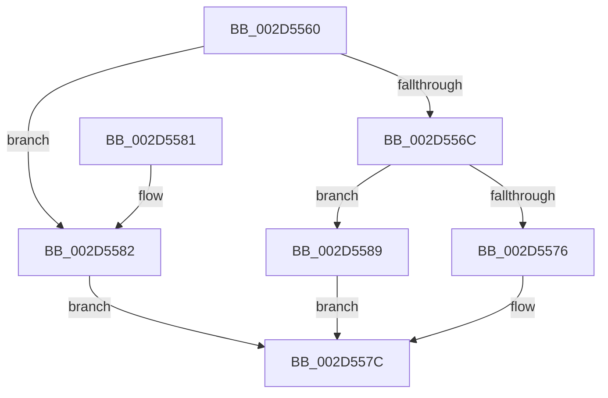

# HalGetProcessorIdByNtNumber

- RVA: `0x002D5560`–`0x002D5590` (길이 `48` bytes)
- VA: `0x00000001402D5560`
- 실행 섹션: `.text`
- PDB 이름 있음: `예`; PDB Function 태그: `아니요`
- unwind 정보 RVA: `0x00064C74`
- 디코드: `16`개 명령, `48/48` bytes 표시
- 미해석 바이트: `0` (있으면 어셈블리에 `.byte`로 보존)

> 이 문서는 커널 이미지의 기계어와 PDB 기호를 분석해 생성했습니다. 4번과 5번은 함수 원형과 자료형을 바이너리 사용 방식에서 추정한 C 해석이며 원본 소스 복구 결과는 아닙니다.

## 1. Dependencies

- 직접 호출 지점: **1**; 고유 호출 대상: **1**
- 직접 호출자로 확인된 함수: **6**
- RIP 상대 이미지 참조: **1**

### Outgoing calls
- `0x002D556C` → [HalpGetProcessorStateByNtIndex](HalpGetProcessorStateByNtIndex_function_002D5598.md) (function, `0x002D5598`)

### Direct callers
- [HalpInterruptGenerateMessage](../54/HalpInterruptGenerateMessage_function_005428F0.md) at `0x00542971`
- [PnprIsProcessorDevice](../../page/73/PnprIsProcessorDevice_function_00739EA8.md) at `0x00739F59`
- [KeRegisterProcessorChangeCallback](../../page/74/KeRegisterProcessorChangeCallback_function_00746520.md) at `0x0074663E`
- [KeRegisterProcessorChangeCallback](../../page/74/KeRegisterProcessorChangeCallback_function_00746520.md) at `0x007466C6`
- [HalpDpStartProcessor](../../pagelk/B6/HalpDpStartProcessor_function_00B60384.md) at `0x00B603BB`
- [PnprQuiesceProcessorDpc](../../pagelk/B6/PnprQuiesceProcessorDpc_function_00B64B50.md) at `0x00B64CC5`
- [HalpInterruptReinitialize](../../pagelk/B7/HalpInterruptReinitialize_function_00B79BEC.md) at `0x00B79D1D`

### Static image references
- `0x002D5564` → RVA `0x00E10200` (`.data`; read)

## 2. Other-region calls and transfers

- 다른 실행 섹션으로 향하는 call: **0**
- 별도 외부 분기/꼬리 이동을 확인하지 못했습니다.

## 3. Assembly (complete function range)

```asm
002D5560  48 83 EC 28                     sub rsp, 0x28
002D5564  3B 0D 96 AC B3 00               cmp ecx, dword ptr [rip + 0xb3ac96]
002D556A  73 16                           jae 0x1402d5582
002D556C  E8 27 00 00 00                  call 0x1402d5598
002D5571  48 85 C0                        test rax, rax
002D5574  74 13                           je 0x1402d5589
002D5576  8B 00                           mov eax, dword ptr [rax]
002D5578  89 02                           mov dword ptr [rdx], eax
002D557A  33 C0                           xor eax, eax
002D557C  48 83 C4 28                     add rsp, 0x28
002D5580  C3                              ret
002D5581  CC                              int3
002D5582  B8 0D 00 00 C0                  mov eax, 0xc000000d
002D5587  EB F3                           jmp 0x1402d557c
002D5589  B8 25 02 00 C0                  mov eax, 0xc0000225
002D558E  EB EC                           jmp 0x1402d557c
```

## 4. C-style interpretation (structured pseudocode)

```c
__int64 __fastcall HalGetProcessorIdByNtNumber(int a1, __int64 a2)
{
    __int64 result;
    __int64 v_rsp;

    v_rsp = (v_rsp) - (40);
    if (a1 >= (*(unsigned int *)(v_rip + 11775126))) goto loc_002D5582;
    result = HalpGetProcessorStateByNtIndex(a1, a2, a3, a4);
    if (result == 0) goto loc_002D5589;
    *(unsigned int *)(a2) = (unsigned int)((unsigned int)(*(unsigned int *)(result)));
    result = 0;
loc_002D557C:
    v_rsp = (v_rsp) + (40);
    return result;
loc_002D5582:
    goto loc_002D557C;
loc_002D5589:
    goto loc_002D557C;
}
```

## 5. (Beta) C Style

```c
int64_t HalGetProcessorIdByNtNumber(int32_t Arg1, int64_t Arg2)
{
    int64_t result;
    int64_t local_rsp;

    local_rsp = (local_rsp) - (40);
    if (Arg1 >= (*(uint32_t *)(v_rip + 0xB3AC96))) goto loc_002D5582;
    result = HalpGetProcessorStateByNtIndex(Arg1, Arg2, a3, a4);
    if (result == 0) goto loc_002D5589;
    *(uint32_t *)(Arg2) = (uint32_t)((uint32_t)(*(uint32_t *)(result)));
    result = 0;
loc_002D557C:
    local_rsp = (local_rsp) + (40);
    return result;
loc_002D5582:
    goto loc_002D557C;
loc_002D5589:
    goto loc_002D557C;
}
```

## 6. Execution-region graph

[열기: 2D/3D 그래프와 함수 탐색 컨트롤 패널](../../../control-panel.html?section=text&rva=0x002D5560&view=graph)

- 2D 그래프는 위에서 아래로 흐르고, 3D 그래프는 빈 공간을 드래그해 회전합니다. Shift+드래그는 이동, 휠은 확대·축소, 함수 노드 선택은 대상 보고서 이동입니다.

### Static fallback


