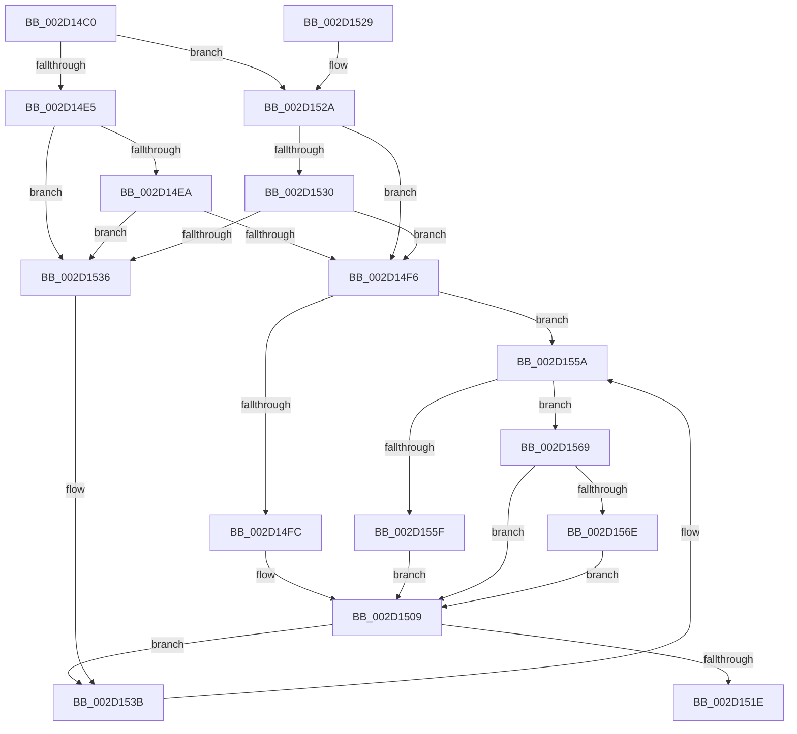

# HalRequestClockInterrupt

- RVA: `0x002D14C0`–`0x002D1578` (길이 `184` bytes)
- VA: `0x00000001402D14C0`
- 실행 섹션: `.text`
- PDB 이름 있음: `예`; PDB Function 태그: `아니요`
- unwind 정보 RVA: `0x0006F7B0`
- 디코드: `54`개 명령, `184/184` bytes 표시
- 미해석 바이트: `0` (있으면 어셈블리에 `.byte`로 보존)

> 이 문서는 커널 이미지의 기계어와 PDB 기호를 분석해 생성했습니다. 4번과 5번은 함수 원형과 자료형을 바이너리 사용 방식에서 추정한 C 해석이며 원본 소스 복구 결과는 아닙니다.

## 1. Dependencies

- 직접 호출 지점: **3**; 고유 호출 대상: **3**
- 직접 호출자로 확인된 함수: **2**
- RIP 상대 이미지 참조: **1**

### Outgoing calls
- `0x002D14ED` → [KeIsEmptyAffinityEx](KeIsEmptyAffinityEx_function_002D1580.md) (function, `0x002D1580`)
- `0x002D1513` → [HalpInterruptSendIpi](../25/HalpInterruptSendIpi_function_00252310.md) (function, `0x00252310`)
- `0x002D1554` → [KeBugCheckEx](../4F/KeBugCheckEx_function_004FD660.md) (function, `0x004FD660`)

### Direct callers
- [HalpTimerWatchdogTriggerSystemReset](../39/HalpTimerWatchdogTriggerSystemReset_function_0039B410.md) at `0x0039B4AD`
- [KiForwardTick](../39/KiForwardTick_function_0039D40C.md) at `0x0039D4DE`

### Static image references
- `0x002D153B` → RVA `0x00E101F0` (`.data`; read)

## 2. Other-region calls and transfers

- 다른 실행 섹션으로 향하는 call: **0**
- 별도 외부 분기/꼬리 이동을 확인하지 못했습니다.

## 3. Assembly (complete function range)

```asm
002D14C0  48 89 5C 24 08                  mov qword ptr [rsp + 8], rbx
002D14C5  57                              push rdi
002D14C6  48 83 EC 50                     sub rsp, 0x50
002D14CA  33 C0                           xor eax, eax
002D14CC  48 63 D9                        movsxd rbx, ecx
002D14CF  89 44 24 40                     mov dword ptr [rsp + 0x40], eax
002D14D3  0F 57 C0                        xorps xmm0, xmm0
002D14D6  48 8B FA                        mov rdi, rdx
002D14D9  44 8B C3                        mov r8d, ebx
002D14DC  0F 11 44 24 30                  movups xmmword ptr [rsp + 0x30], xmm0
002D14E1  85 C9                           test ecx, ecx
002D14E3  75 45                           jne 0x1402d152a
002D14E5  48 85 D2                        test rdx, rdx
002D14E8  74 4C                           je 0x1402d1536
002D14EA  48 8B CA                        mov rcx, rdx
002D14ED  E8 8E 00 00 00                  call 0x1402d1580
002D14F2  85 C0                           test eax, eax
002D14F4  75 40                           jne 0x1402d1536
002D14F6  8B CB                           mov ecx, ebx
002D14F8  85 DB                           test ebx, ebx
002D14FA  75 5E                           jne 0x1402d155a
002D14FC  C7 44 24 30 02 00 00 00         mov dword ptr [rsp + 0x30], 2
002D1504  48 89 7C 24 38                  mov qword ptr [rsp + 0x38], rdi
002D1509  BA D2 00 00 00                  mov edx, 0xd2
002D150E  48 8D 4C 24 30                  lea rcx, [rsp + 0x30]
002D1513  E8 F8 0D F8 FF                  call 0x140252310
002D1518  8B C8                           mov ecx, eax
002D151A  85 C0                           test eax, eax
002D151C  78 1D                           js 0x1402d153b
002D151E  48 8B 5C 24 60                  mov rbx, qword ptr [rsp + 0x60]
002D1523  48 83 C4 50                     add rsp, 0x50
002D1527  5F                              pop rdi
002D1528  C3                              ret
002D1529  CC                              int3
002D152A  41 83 E8 01                     sub r8d, 1
002D152E  74 C6                           je 0x1402d14f6
002D1530  41 83 F8 01                     cmp r8d, 1
002D1534  74 C0                           je 0x1402d14f6
002D1536  B9 0D 00 00 C0                  mov ecx, 0xc000000d
002D153B  4C 8B 05 AE EC B3 00            mov r8, qword ptr [rip + 0xb3ecae]
002D1542  BA 01 02 00 00                  mov edx, 0x201
002D1547  4C 63 C9                        movsxd r9, ecx
002D154A  B9 5C 00 00 00                  mov ecx, 0x5c
002D154F  48 89 5C 24 20                  mov qword ptr [rsp + 0x20], rbx
002D1554  E8 07 C1 22 00                  call 0x1404fd660
002D1559  CC                              int3
002D155A  83 E9 01                        sub ecx, 1
002D155D  75 0A                           jne 0x1402d1569
002D155F  C7 44 24 30 04 00 00 00         mov dword ptr [rsp + 0x30], 4
002D1567  EB A0                           jmp 0x1402d1509
002D1569  83 F9 01                        cmp ecx, 1
002D156C  75 9B                           jne 0x1402d1509
002D156E  C7 44 24 30 03 00 00 00         mov dword ptr [rsp + 0x30], 3
002D1576  EB 91                           jmp 0x1402d1509
```

## 4. C-style interpretation (structured pseudocode)

```c
__int64 __fastcall HalRequestClockInterrupt(int a1, __int64 a2)
{
    __int64 result;
    __int64 v_rsp;
    unsigned int v_stack_m18;
    unsigned __int64 v_stack_m20;
    unsigned __int64 v_stack_m28;
    unsigned __int64 v_stack_p20;
    unsigned int v_stack_p30;
    unsigned __int64 v_stack_p8;

    v_stack_p8 = v_rbx;
    v_rsp = (v_rsp) - (80);
    result = 0;
    v_stack_m18 = 0;
    v_stack_m28 = v_xmm0;
    if (a1 != 0) goto loc_002D152A;
    if (a2 == 0) goto loc_002D1536;
    result = KeIsEmptyAffinityEx(a2, a2, (unsigned int)((unsigned int)((int)(a1))), a4);
    if ((unsigned int)(result) != 0) goto loc_002D1536;
loc_002D14F6:
    if ((unsigned int)((int)(a1)) != 0) goto loc_002D155A;
    v_stack_m28 = 2;
    v_stack_m20 = a2;
loc_002D1509:
    result = HalpInterruptSendIpi(v_stack_m28, 210, (unsigned int)((unsigned int)((int)(a1))), a4);
    if (sign_flag) goto loc_002D153B;
    v_rsp = (v_rsp) + (80);
    return result;
loc_002D152A:
    a3 = (unsigned int)(((unsigned int)((unsigned int)((int)(a1)))) - (1));
    if (condition_is_equal) goto loc_002D14F6;
    if (((unsigned int)(a3)) == 1) goto loc_002D14F6;
loc_002D1536:
loc_002D153B:
    v_stack_p20 = v_stack_p8;
    result = KeBugCheckEx(92, 513, *(unsigned __int64 *)(v_rip + 11791534), (int)((unsigned int)((unsigned int)(0xC000000DULL))));
loc_002D155A:
    a1 = (unsigned int)((92) - (1));
    if (condition_is_not_equal) goto loc_002D1569;
    v_stack_p30 = 4;
    goto loc_002D1509;
loc_002D1569:
    if (a1 != 1) goto loc_002D1509;
    v_stack_p30 = 3;
    goto loc_002D1509;
}
```

## 5. (Beta) C Style

```c
int64_t HalRequestClockInterrupt(int32_t Arg1, int64_t Arg2)
{
    int64_t result;
    int64_t local_rsp;
    uint32_t v_stack_m18;
    uint64_t v_stack_m20;
    uint64_t v_stack_m28;
    uint64_t v_stack_p20;
    uint32_t v_stack_p30;
    uint64_t v_stack_p8;

    v_stack_p8 = local_rbx;
    local_rsp = (local_rsp) - (80);
    result = 0;
    v_stack_m18 = 0;
    v_stack_m28 = v_xmm0;
    if (Arg1 != 0) goto loc_002D152A;
    if (Arg2 == 0) goto loc_002D1536;
    result = KeIsEmptyAffinityEx(Arg2, Arg2, (uint32_t)((uint32_t)((int32_t)(Arg1))), a4);
    if ((uint32_t)(result) != 0) goto loc_002D1536;
loc_002D14F6:
    if ((uint32_t)((int32_t)(Arg1)) != 0) goto loc_002D155A;
    v_stack_m28 = 2;
    v_stack_m20 = Arg2;
loc_002D1509:
    result = HalpInterruptSendIpi(v_stack_m28, 210, (uint32_t)((uint32_t)((int32_t)(Arg1))), a4);
    if (sign_flag) goto loc_002D153B;
    local_rsp = (local_rsp) + (80);
    return result;
loc_002D152A:
    a3 = (uint32_t)(((uint32_t)((uint32_t)((int32_t)(Arg1)))) - (1));
    if (condition_is_equal) goto loc_002D14F6;
    if (((uint32_t)(a3)) == 1) goto loc_002D14F6;
loc_002D1536:
loc_002D153B:
    v_stack_p20 = v_stack_p8;
    result = KeBugCheckEx(92, 513, *(uint64_t *)(v_rip + 0xB3ECAE), (int32_t)((uint32_t)((uint32_t)(0xC000000DULL))));
loc_002D155A:
    Arg1 = (uint32_t)((92) - (1));
    if (condition_is_not_equal) goto loc_002D1569;
    v_stack_p30 = 4;
    goto loc_002D1509;
loc_002D1569:
    if (Arg1 != 1) goto loc_002D1509;
    v_stack_p30 = 3;
    goto loc_002D1509;
}
```

## 6. Execution-region graph

[열기: 2D/3D 그래프와 함수 탐색 컨트롤 패널](../../../control-panel.html?section=text&rva=0x002D14C0&view=graph)

- 2D 그래프는 위에서 아래로 흐르고, 3D 그래프는 빈 공간을 드래그해 회전합니다. Shift+드래그는 이동, 휠은 확대·축소, 함수 노드 선택은 대상 보고서 이동입니다.

### Static fallback


