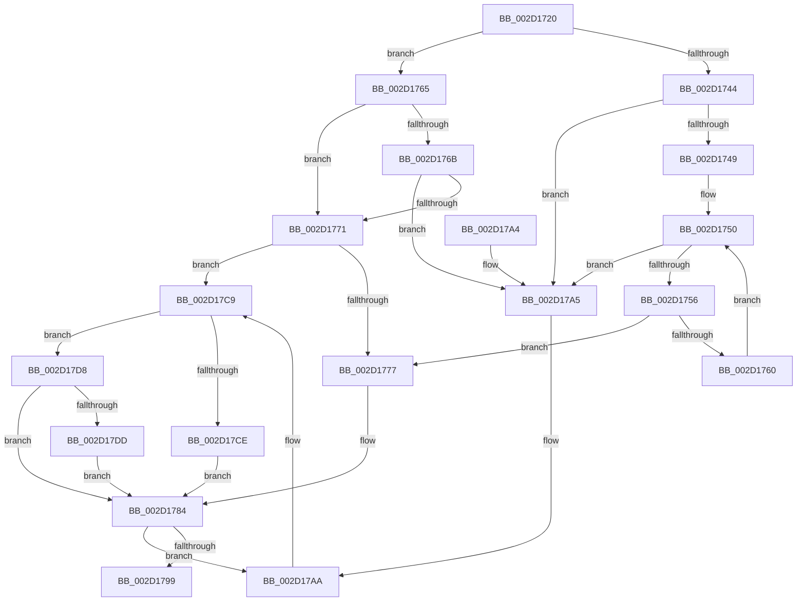

# HalRequestIpi

- RVA: `0x002D1720`–`0x002D17E7` (길이 `199` bytes)
- VA: `0x00000001402D1720`
- 실행 섹션: `.text`
- PDB 이름 있음: `예`; PDB Function 태그: `아니요`
- unwind 정보 RVA: `0x0006F7EC`
- 디코드: `59`개 명령, `199/199` bytes 표시
- 미해석 바이트: `0` (있으면 어셈블리에 `.byte`로 보존)

> 이 문서는 커널 이미지의 기계어와 PDB 기호를 분석해 생성했습니다. 4번과 5번은 함수 원형과 자료형을 바이너리 사용 방식에서 추정한 C 해석이며 원본 소스 복구 결과는 아닙니다.

## 1. Dependencies

- 직접 호출 지점: **2**; 고유 호출 대상: **2**
- 직접 호출자로 확인된 함수: **7**
- RIP 상대 이미지 참조: **1**

### Outgoing calls
- `0x002D178E` → [HalpInterruptSendIpi](../25/HalpInterruptSendIpi_function_00252310.md) (function, `0x00252310`)
- `0x002D17C3` → [KeBugCheckEx](../4F/KeBugCheckEx_function_004FD660.md) (function, `0x004FD660`)

### Direct callers
- [KiHaltOnAddressWakeEntireList](../21/KiHaltOnAddressWakeEntireList_function_00217AF4.md) at `0x00217BA4`
- [PpmWakeClockOwnerIfNeeded](PpmWakeClockOwnerIfNeeded_function_002D0924.md) at `0x002D09E4`
- [PpmUnlockProcessors](PpmUnlockProcessors_function_002D15B0.md) at `0x002D16D1`
- [PpmIdleUpdateSystemLatencyLimit](PpmIdleUpdateSystemLatencyLimit_function_002D9204.md) at `0x002D942B`
- [PoExecuteIdleCheck](../39/PoExecuteIdleCheck_function_0039CF20.md) at `0x0039D0BC`
- [PoInitiateProcessorWake](../5C/PoInitiateProcessorWake_function_005CF2D0.md) at `0x005CF3BB`
- [sub_006D6893](../6D/Unknown_function_006D6893.md) at `0x006D68AA`

### Static image references
- `0x002D17AA` → RVA `0x00E101F0` (`.data`; read)

## 2. Other-region calls and transfers

- 다른 실행 섹션으로 향하는 call: **0**
- 별도 외부 분기/꼬리 이동을 확인하지 못했습니다.

## 3. Assembly (complete function range)

```asm
002D1720  48 89 5C 24 08                  mov qword ptr [rsp + 8], rbx
002D1725  57                              push rdi
002D1726  48 83 EC 50                     sub rsp, 0x50
002D172A  33 C0                           xor eax, eax
002D172C  48 63 D9                        movsxd rbx, ecx
002D172F  33 FF                           xor edi, edi
002D1731  89 44 24 40                     mov dword ptr [rsp + 0x40], eax
002D1735  0F 57 C0                        xorps xmm0, xmm0
002D1738  44 8B C3                        mov r8d, ebx
002D173B  0F 11 44 24 30                  movups xmmword ptr [rsp + 0x30], xmm0
002D1740  85 C9                           test ecx, ecx
002D1742  75 21                           jne 0x1402d1765
002D1744  48 85 D2                        test rdx, rdx
002D1747  74 5C                           je 0x1402d17a5
002D1749  44 0F B7 02                     movzx r8d, word ptr [rdx]
002D174D  0F B7 CF                        movzx ecx, di
002D1750  66 41 3B C8                     cmp cx, r8w
002D1754  73 4F                           jae 0x1402d17a5
002D1756  0F B7 C1                        movzx eax, cx
002D1759  48 39 7C C2 08                  cmp qword ptr [rdx + rax*8 + 8], rdi
002D175E  75 17                           jne 0x1402d1777
002D1760  66 FF C1                        inc cx
002D1763  EB EB                           jmp 0x1402d1750
002D1765  41 83 E8 01                     sub r8d, 1
002D1769  74 06                           je 0x1402d1771
002D176B  41 83 F8 01                     cmp r8d, 1
002D176F  75 34                           jne 0x1402d17a5
002D1771  8B CB                           mov ecx, ebx
002D1773  85 DB                           test ebx, ebx
002D1775  75 52                           jne 0x1402d17c9
002D1777  C7 44 24 30 02 00 00 00         mov dword ptr [rsp + 0x30], 2
002D177F  48 89 54 24 38                  mov qword ptr [rsp + 0x38], rdx
002D1784  BA E1 00 00 00                  mov edx, 0xe1
002D1789  48 8D 4C 24 30                  lea rcx, [rsp + 0x30]
002D178E  E8 7D 0B F8 FF                  call 0x140252310
002D1793  8B C8                           mov ecx, eax
002D1795  85 C0                           test eax, eax
002D1797  78 11                           js 0x1402d17aa
002D1799  48 8B 5C 24 60                  mov rbx, qword ptr [rsp + 0x60]
002D179E  48 83 C4 50                     add rsp, 0x50
002D17A2  5F                              pop rdi
002D17A3  C3                              ret
002D17A4  CC                              int3
002D17A5  B9 0D 00 00 C0                  mov ecx, 0xc000000d
002D17AA  4C 8B 05 3F EA B3 00            mov r8, qword ptr [rip + 0xb3ea3f]
002D17B1  BA 01 02 00 00                  mov edx, 0x201
002D17B6  4C 63 C9                        movsxd r9, ecx
002D17B9  B9 5C 00 00 00                  mov ecx, 0x5c
002D17BE  48 89 5C 24 20                  mov qword ptr [rsp + 0x20], rbx
002D17C3  E8 98 BE 22 00                  call 0x1404fd660
002D17C8  CC                              int3
002D17C9  83 E9 01                        sub ecx, 1
002D17CC  75 0A                           jne 0x1402d17d8
002D17CE  C7 44 24 30 04 00 00 00         mov dword ptr [rsp + 0x30], 4
002D17D6  EB AC                           jmp 0x1402d1784
002D17D8  83 F9 01                        cmp ecx, 1
002D17DB  75 A7                           jne 0x1402d1784
002D17DD  C7 44 24 30 03 00 00 00         mov dword ptr [rsp + 0x30], 3
002D17E5  EB 9D                           jmp 0x1402d1784
```

## 4. C-style interpretation (structured pseudocode)

```c
__int64 __fastcall HalRequestIpi(int a1, __int64 a2)
{
    __int64 result;
    __int64 v_rdi;
    __int64 v_rsp;
    unsigned int v_stack_m18;
    unsigned __int64 v_stack_m20;
    unsigned __int64 v_stack_m28;
    unsigned __int64 v_stack_p20;
    unsigned int v_stack_p30;
    unsigned __int64 v_stack_p8;

    v_stack_p8 = v_rbx;
    v_rsp = (v_rsp) - (80);
    result = 0;
    v_rdi = 0;
    v_stack_m18 = 0;
    v_stack_m28 = v_xmm0;
    if (a1 != 0) goto loc_002D1765;
    if (a2 == 0) goto loc_002D17A5;
loc_002D1750:
    if (0 >= ((unsigned __int16)(*(unsigned __int16 *)(a2)))) goto loc_002D17A5;
    if ((*(unsigned __int64 *)(a2 + 0 * 8 + 8)) != 0) goto loc_002D1777;
    a1 = (unsigned __int16)((0) + 1);
    goto loc_002D1750;
loc_002D1765:
    a3 = (unsigned int)((*(unsigned __int16 *)(a2)) - (1));
    if (condition_is_equal) goto loc_002D1771;
    if (((unsigned int)(a3)) != 1) goto loc_002D17A5;
loc_002D1771:
    if ((unsigned int)((int)(a1)) != 0) goto loc_002D17C9;
loc_002D1777:
    v_stack_m28 = 2;
    v_stack_m20 = a2;
loc_002D1784:
    result = HalpInterruptSendIpi(v_stack_m28, 225, a3, a4);
    if (sign_flag) goto loc_002D17AA;
    v_rsp = (v_rsp) + (80);
    return result;
loc_002D17A5:
loc_002D17AA:
    v_stack_p20 = v_stack_p8;
    result = KeBugCheckEx(92, 513, *(unsigned __int64 *)(v_rip + 11790911), (int)((unsigned int)((unsigned int)(0xC000000DULL))));
loc_002D17C9:
    a1 = (unsigned int)((92) - (1));
    if (condition_is_not_equal) goto loc_002D17D8;
    v_stack_p30 = 4;
    goto loc_002D1784;
loc_002D17D8:
    if (a1 != 1) goto loc_002D1784;
    v_stack_p30 = 3;
    goto loc_002D1784;
}
```

## 5. (Beta) C Style

```c
int64_t HalRequestIpi(int32_t Arg1, int64_t Arg2)
{
    int64_t result;
    int64_t local_rdi;
    int64_t local_rsp;
    uint32_t v_stack_m18;
    uint64_t v_stack_m20;
    uint64_t v_stack_m28;
    uint64_t v_stack_p20;
    uint32_t v_stack_p30;
    uint64_t v_stack_p8;

    v_stack_p8 = local_rbx;
    local_rsp = (local_rsp) - (80);
    result = 0;
    local_rdi = 0;
    v_stack_m18 = 0;
    v_stack_m28 = v_xmm0;
    if (Arg1 != 0) goto loc_002D1765;
    if (Arg2 == 0) goto loc_002D17A5;
loc_002D1750:
    if (0 >= ((uint16_t)(*(uint16_t *)(Arg2)))) goto loc_002D17A5;
    if ((*(uint64_t *)(Arg2 + 0x0 * 8 + 0x8)) != 0) goto loc_002D1777;
    Arg1 = (uint16_t)((0) + 1);
    goto loc_002D1750;
loc_002D1765:
    a3 = (uint32_t)((*(uint16_t *)(Arg2)) - (1));
    if (condition_is_equal) goto loc_002D1771;
    if (((uint32_t)(a3)) != 1) goto loc_002D17A5;
loc_002D1771:
    if ((uint32_t)((int32_t)(Arg1)) != 0) goto loc_002D17C9;
loc_002D1777:
    v_stack_m28 = 2;
    v_stack_m20 = Arg2;
loc_002D1784:
    result = HalpInterruptSendIpi(v_stack_m28, 225, a3, a4);
    if (sign_flag) goto loc_002D17AA;
    local_rsp = (local_rsp) + (80);
    return result;
loc_002D17A5:
loc_002D17AA:
    v_stack_p20 = v_stack_p8;
    result = KeBugCheckEx(92, 513, *(uint64_t *)(v_rip + 0xB3EA3F), (int32_t)((uint32_t)((uint32_t)(0xC000000DULL))));
loc_002D17C9:
    Arg1 = (uint32_t)((92) - (1));
    if (condition_is_not_equal) goto loc_002D17D8;
    v_stack_p30 = 4;
    goto loc_002D1784;
loc_002D17D8:
    if (Arg1 != 1) goto loc_002D1784;
    v_stack_p30 = 3;
    goto loc_002D1784;
}
```

## 6. Execution-region graph

[열기: 2D/3D 그래프와 함수 탐색 컨트롤 패널](../../../control-panel.html?section=text&rva=0x002D1720&view=graph)

- 2D 그래프는 위에서 아래로 흐르고, 3D 그래프는 빈 공간을 드래그해 회전합니다. Shift+드래그는 이동, 휠은 확대·축소, 함수 노드 선택은 대상 보고서 이동입니다.

### Static fallback


